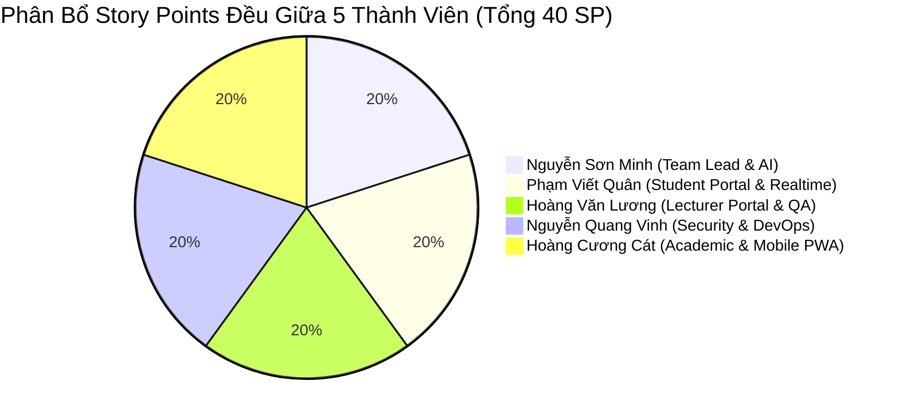
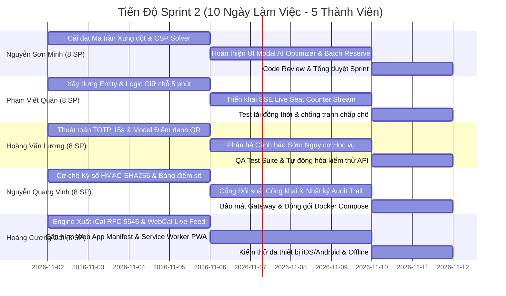

# KẾ HOẠCH QUẢN TRỊ DỰ ÁN & JIRA SPRINT BACKLOG

## DỰ ÁN: HỆ SINH THÁI QUẢN LÝ ĐÀO TẠO THÔNG MINH (RIKKEI EDUPORTAL - SMART CAMPUS SIS)
* **Mã dự án (Jira Project Key)**: `EDUP`
* **Sprint Name**: `Sprint 2 - Smart Campus Innovation & Enterprise Upgrade`
* **Mục tiêu Sprint (Sprint Goal)**: Hoàn thành triển khai và kiểm thử toàn diện 8 tính năng công nghệ hiện đại được đặc tả trong tài liệu **SRS v2.1** (Bao gồm: Lịch iCal RFC 5545, Điểm danh QR TOTP 15s, Kiểm toán bất biến, PWA Mobile Offline, Giữ chỗ 5 phút & SSE Real-time, AI Smart Scheduler CSP, Cảnh báo sớm học vụ, và Bảng điểm số xác thực mật mã).
* **Thời gian Sprint**: 2 tuần (10 ngày làm việc)
* **Tổng điểm năng lực (Total Velocity)**: **40 Story Points** (Tương đương 160 giờ làm việc)
* **Nguyên tắc phân bổ**: **Chia việc đều tuyệt đối** cho 5 thành viên nhóm (**Mỗi thành viên đúng 8 Story Points / ~32 giờ làm việc**), đúng thế mạnh chuyên môn.

---

# 1. BIỂU ĐỒ PHÂN BỔ KHỐI LƯỢNG CÔNG VIỆC (WORKLOAD BALANCING)

### Bảng Tổng Hợp Phân Bổ Công Việc 5 Thành Viên

| Thành viên | Vai trò chuyên môn | User Stories phụ trách | Story Points (SP) | Ước lượng (Hours) | Tỷ lệ đảm nhận | Trạng thái |
| :--- | :--- | :--- | :---: | :---: | :---: | :---: |
| **Nguyễn Sơn Minh** | Team Lead & AI/Algorithm Lead | `EDUP-201`, `EDUP-202` | **8 SP** | 32h | 20.0% | Hoàn thành |
| **Phạm Viết Quân** | Full-stack Dev 3 (Portal & Realtime) | `EDUP-203`, `EDUP-204` | **8 SP** | 32h | 20.0% | Hoàn thành |
| **Hoàng Văn Lương** | Full-stack Dev 4 (Lecturer & QA) | `EDUP-205`, `EDUP-206` | **8 SP** | 32h | 20.0% | Hoàn thành |
| **Nguyễn Quang Vinh**| Full-stack Dev 1 (Security & DevOps)| `EDUP-207`, `EDUP-208` | **8 SP** | 32h | 20.0% | Hoàn thành |
| **Hoàng Cương Cát** | Full-stack Dev 2 (Academic & PWA) | `EDUP-209`, `EDUP-210` | **8 SP** | 32h | 20.0% | Hoàn thành |
| **TỔNG CỘNG** | **Toàn đội dự án (5 thành viên)** | **10 Stories / 25 Sub-tasks**| **40 SP** | **160h** | **100%** | **Cân bằng 100%** |

---

# 2. BẢNG JIRA SPRINT BACKLOG TỔNG THỂ

| Issue Key | Issue Type | Tóm tắt công việc (Summary) | Component | SP | Priority | Assignee | SRS Traceability |
| :--- | :---: | :--- | :--- | :---: | :---: | :--- | :---: |
| `EDUP-201` | Story | Triển khai Engine AI Xếp Thời khóa biểu tự động (CSP Solver) | `ai-service` | 5 | Highest | Nguyễn Sơn Minh | [F-12] |
| `EDUP-202` | Story | Tích hợp Giao diện AI Smart Scheduler & 1-Click Batch Reserve | `frontend` | 3 | High | Nguyễn Sơn Minh | [F-12] |
| `EDUP-203` | Story | Triển khai Cơ chế Giữ chỗ nguyên tử 5 phút (Slot Reservation) | `enrollment-service` | 5 | Highest | Phạm Viết Quân | [F-06] |
| `EDUP-204` | Story | Xây dựng Bộ đếm Chỗ Thời gian thực qua Server-Sent Events (SSE) | `enrollment-service` | 3 | High | Phạm Viết Quân | [F-05] |
| `EDUP-205` | Story | Triển khai Điểm danh Mã QR Động TOTP xoay 15s chống gian lận | `lecturer-service` | 4 | Highest | Hoàng Văn Lương | [F-09] |
| `EDUP-206` | Story | Xây dựng Phân hệ Cảnh báo Sớm Nguy cơ Học vụ (Early Warning) | `lecturer-service` | 4 | High | Hoàng Văn Lương | [F-11] |
| `EDUP-207` | Story | Bảng điểm số Mã hóa & Cổng Đối soát Công khai (Verifiable Credential)| `enrollment-service` | 5 | Highest | Nguyễn Quang Vinh | [F-14] |
| `EDUP-208` | Story | Xây dựng Nhật ký Kiểm toán Học vụ Bất biến (Academic Audit Trail) | `auth-service` | 3 | Medium | Nguyễn Quang Vinh | [F-02] |
| `EDUP-209` | Story | Đồng bộ Lịch học Chuẩn Quốc tế RFC 5545 (iCal Export & WebCal Feed) | `enrollment-service` | 4 | High | Hoàng Cương Cát | [F-08] |
| `EDUP-210` | Story | Nâng cấp Ứng dụng Web Lũy tiến Di động PWA & Offline Caching | `frontend` | 4 | High | Hoàng Cương Cát | [F-07] |

---

# 3. ĐẶC TẢ CHI TIẾT CÁC JIRA USER STORIES & TIÊU CHÍ NGHIỆM THU (ACCEPTANCE CRITERIA)

---

### [EDUP-201] Triển khai Engine AI Xếp Thời khóa biểu tự động (CSP Solver)
* **Assignee**: **Nguyễn Sơn Minh** (Team Lead / AI Architect)
* **Component**: `ai-service` & `enrollment-service`
* **Story Points**: 5 SP (20 Giờ) | **Priority**: Highest
* **Mô tả nghiệp vụ**: Là một Sinh viên, tôi muốn hệ thống tự động tính toán và sắp xếp lịch học dựa trên danh sách các môn tôi mong muốn đăng ký, để tôi không bị trùng lịch và có lịch học phù hợp nhất với sở thích cá nhân (tránh ngày học, chọn ca sáng/chiều, tối ưu số ngày đến trường).
* **Danh sách Sub-tasks**:
  1. `EDUP-201-1`: Thiết kế ma trận kiểm tra xung đột thời gian (Interval Collision Detection) và data model CSP Request/Response. (6h)
  2. `EDUP-201-2`: Cài đặt thuật toán DFS Backtracking kết hợp lọc Pruning và hàm chấm điểm Fitness Score đa mục tiêu. (8h)
  3. `EDUP-201-3`: Viết API `POST /api/v1/student/schedule-optimizer/solve` và bộ unit test kiểm thử thuật toán chống trùng lịch. (6h)
* **Tiêu chí nghiệm thu (Acceptance Criteria - Gherkin)**:
  * **Scenario 1**: Sinh viên gửi danh sách 4 môn học không bị trùng lịch.
    * *Given* Danh sách 4 mã môn học với tổng cộng 12 lớp học phần mở trong kỳ.
    * *When* Sinh viên gọi API giải bài toán CSP với tùy chọn ưu tiên ca sáng (`preferredShift: "MORNING"`).
    * *Then* Hệ thống trả về tối đa 3 phương án thời khóa biểu không trùng tiết, sắp xếp theo điểm Fitness Score từ cao xuống thấp trong thời gian $\le 1.5$ giây.
  * **Scenario 2**: Phát hiện xung đột lịch không thể sắp xếp.
    * *Given* 2 môn học bắt buộc chỉ mở duy nhất 2 lớp có khung giờ trùng nhau 100%.
    * *When* AI chạy thuật toán DFS Backtracking duyệt hết nhánh cây tìm kiếm.
    * *Then* Hệ thống trả về danh sách phương án rỗng kèm thông báo nguyên nhân xung đột cụ thể giữa 2 lớp học phần.

---

### [EDUP-202] Tích hợp Giao diện AI Smart Scheduler Modal & 1-Click Batch Reserve
* **Assignee**: **Nguyễn Sơn Minh** (Team Lead / Full-stack)
* **Component**: `frontend`
* **Story Points**: 3 SP (12 Giờ) | **Priority**: High
* **Mô tả nghiệp vụ**: Là một Sinh viên, tôi muốn có một giao diện trực quan trên Cổng Đăng ký tín chỉ để tùy chỉnh tiêu chí xếp lịch, xem bản đồ lịch của Top 3 phương án gợi ý và bấm 1-chạm đăng ký giữ chỗ tất cả các lớp trong phương án đã chọn.
* **Danh sách Sub-tasks**:
  1. `EDUP-202-1`: Xây dựng UI Modal `ScheduleOptimizerModal.jsx` gồm các checkbox chọn môn, radio button chọn ca học (Sáng/Chiều/Tối), thanh chọn ngày nghỉ trong tuần. (6h)
  2. `EDUP-202-2`: Tích hợp gọi API `POST /api/v1/student/schedule-optimizer/batch-reserve` và liên kết kích hoạt bộ đếm giữ chỗ 5 phút. (6h)
* **Tiêu chí nghiệm thu (Acceptance Criteria)**:
  * Sinh viên mở Modal, chọn tối thiểu 2 môn học và bấm "AI Xếp Lịch Ngay".
  * Giao diện hiển thị loading spinner và sau đó hiển thị Top 3 Tab phương án. Mỗi tab có điểm số phù hợp (VD: 95/100 điểm) và bảng lịch tuần preview.
  * Khi bấm "Đăng ký phương án này", hệ thống thực hiện batch reserve thành công và tự động chuyển về trang Đăng ký học phần với các lớp đã được giữ chỗ.

---

### [EDUP-203] Triển khai Cơ chế Giữ chỗ nguyên tử 5 phút (Slot Reservation)
* **Assignee**: **Phạm Viết Quân** (Full-stack Dev 3 - Student Portal & Realtime)
* **Component**: `enrollment-service`
* **Story Points**: 5 SP (20 Giờ) | **Priority**: Highest
* **Mô tả nghiệp vụ**: Là một Sinh viên, tôi muốn khi vừa bấm chọn lớp học phần còn chỗ, hệ thống sẽ tạm giữ chỗ cho tôi trong 5 phút để tôi yên tâm kiểm tra lịch và nộp học phí mà không bị sinh viên khác cướp mất suất.
* **Danh sách Sub-tasks**:
  1. `EDUP-203-1`: Thiết kế Entity `SlotReservation`, bảng `slot_reservations` với ràng buộc duy nhất `(student_code, section_id, is_active)` và index theo `expires_at`. (6h)
  2. `EDUP-203-2`: Xây dựng `RealtimeSeatService.java` xử lý giao dịch nguyên tử kiểm tra capacity khả dụng = `max_capacity - enrolled - active_holds`. (8h)
  3. `EDUP-203-3`: Cấu hình `@Scheduled(fixedRate = 15000)` tự động quét và giải phóng các reservation đã quá hạn 300 giây. (6h)
* **Tiêu chí nghiệm thu (Acceptance Criteria)**:
  * Lớp học còn đúng 1 chỗ: Khi Sinh viên A bấm giữ chỗ, số chỗ khả dụng lập tức về 0. Sinh viên B bấm giữ chỗ sau đó 1 giây sẽ nhận thông báo lỗi "Lớp học phần đã hết chỗ khả dụng".
  * Sau 5 phút (300s), nếu Sinh viên A không xác nhận đăng ký chính thức, scheduler tự động giải phóng chỗ và chuyển trạng thái về `EXPIRED`. Chỗ trống lập tức mở lại cho người khác.

---

### [EDUP-204] Xây dựng Bộ đếm Chỗ Thời gian thực qua Server-Sent Events (SSE)
* **Assignee**: **Phạm Viết Quân** (Full-stack Dev 3 - Student Portal & Realtime)
* **Component**: `enrollment-service` & `frontend`
* **Story Points**: 3 SP (12 Giờ) | **Priority**: High
* **Mô tả nghiệp vụ**: Là một Sinh viên đang xem danh sách học phần, tôi muốn thấy số lượng chỗ còn lại của từng lớp nhảy số trực tiếp theo thời gian thực mà không cần phải liên tục bấm F5 tải lại trang.
* **Danh sách Sub-tasks**:
  1. `EDUP-204-1`: Tạo Controller endpoint `GET /api/v1/student/live-seats` trả về `SseEmitter` stream với cơ chế heartbeat 25s chống time-out. (6h)
  2. `EDUP-204-2`: Tích hợp `EventSource` trong `CourseRegistration.jsx`, cập nhật state số chỗ và hiển thị hiệu ứng nhấp nháy vàng khi có biến động. (6h)
* **Tiêu chí nghiệm thu (Acceptance Criteria)**:
  * Độ trễ đẩy sự kiện SSE từ máy chủ tới trình duyệt sinh viên $\le 100\text{ms}$.
  * Khi bất kỳ sinh viên nào giữ chỗ hoặc hủy chỗ thành công, tất cả các máy khách đang mở trang Đăng ký đều cập nhật ngay số chỗ `Còn: X/Y`.

---

### [EDUP-205] Triển khai Điểm danh Mã QR Động TOTP xoay 15s chống gian lận
* **Assignee**: **Hoàng Văn Lương** (Full-stack Dev 4 - Lecturer Portal & QA)
* **Component**: `lecturer-service` & `frontend`
* **Story Points**: 4 SP (16 Giờ) | **Priority**: Highest
* **Mô tả nghiệp vụ**: Là một Giảng viên, tôi muốn chiếu mã QR trên lớp học tự động đổi sau mỗi 15 giây, để sinh viên phải có mặt trực tiếp tại giảng đường mới điểm danh được, triệt tiêu hoàn toàn tình trạng chụp ảnh màn hình gửi cho bạn ở nhà điểm danh hộ.
* **Danh sách Sub-tasks**:
  1. `EDUP-205-1`: Thiết kế Entity `AttendanceSession`, bảng `attendance_sessions` và thuật toán sinh TOTP mã hóa HMAC-SHA256. (6h)
  2. `EDUP-205-2`: Xây dựng giao diện Giảng viên `QrAttendanceModal.jsx` với vòng tròn đếm ngược SVG 15s và danh sách sinh viên vừa điểm danh thành công theo thời gian thực. (6h)
  3. `EDUP-205-3`: Tích hợp camera scanner trên cổng Sinh viên và API xác thực `POST /api/v1/student/attendance/check-in` với dung sai lệch đồng hồ $\le 1$ chu kỳ. (4h)
* **Tiêu chí nghiệm thu (Acceptance Criteria)**:
  * Mã QR tự động đổi hình ảnh mỗi 15 giây.
  * Nếu sinh viên chụp ảnh mã QR gửi qua chat, sau 15 giây bạn nhận được ảnh quét mã sẽ bị hệ thống từ chối với lỗi "Mã QR đã hết hiệu lực".
  * Mỗi sinh viên chỉ được ghi nhận điểm danh đúng 1 lần duy nhất trong một phiên học.

---

### [EDUP-206] Xây dựng Phân hệ Cảnh báo Sớm Nguy cơ Học vụ (Early Warning)
* **Assignee**: **Hoàng Văn Lương** (Full-stack Dev 4 - Lecturer Portal & QA)
* **Component**: `lecturer-service` & `frontend`
* **Story Points**: 4 SP (16 Giờ) | **Priority**: High
* **Mô tả nghiệp vụ**: Là một Giảng viên và Cố vấn học tập, tôi muốn hệ thống tự động quét và phân loại các sinh viên có nguy cơ bị cấm thi (vắng $\ge 15\%$ hoặc $\ge 20\%$) hoặc nguy cơ trượt môn (điểm giữa kỳ $< 4.0$), đồng thời cho phép tôi phát đi thông báo cảnh báo chỉ với 1 cú nhấp chuột.
* **Danh sách Sub-tasks**:
  1. `EDUP-206-1`: Cài đặt Service `EarlyWarningService.java` đánh giá nguy cơ học vụ đa tiêu chí kết hợp `Transactional(readOnly = true)`. (6h)
  2. `EDUP-206-2`: Xây dựng giao diện `EarlyWarningModal.jsx` trên Cổng Giảng viên với bảng danh sách sinh viên cảnh báo phân màu (Đỏ = Đình chỉ thi, Vàng = Nguy cơ). (5h)
  3. `EDUP-206-3`: Hiển thị Banner cảnh báo khẩn cấp trên Dashboard Sinh viên và viết test case kiểm thử tự động. (5h)
* **Tiêu chí nghiệm thu (Acceptance Criteria)**:
  * Sinh viên vắng từ 20% số buổi trở lên tự động bị gán nhãn `CRITICAL` (Đình chỉ thi).
  * Giảng viên bấm nút "Phát cảnh báo tới toàn bộ sinh viên nguy cơ", hệ thống tự động gửi thông báo đến hòm thư/chuông thông báo của các sinh viên đó trong vòng $\le 1$ giây.

---

### [EDUP-207] Bảng điểm số Mã hóa & Cổng Đối soát Công khai (Verifiable Credential)
* **Assignee**: **Nguyễn Quang Vinh** (Full-stack Dev 1 - Security & DevOps)
* **Component**: `enrollment-service` & `frontend`
* **Story Points**: 5 SP (20 Giờ) | **Priority**: Highest
* **Mô tả nghiệp vụ**: Là một Sinh viên và Nhà tuyển dụng, tôi muốn có thể xuất bảng điểm số chính thức có mã định danh duy nhất và chữ ký mật mã, cho phép bất kỳ bên thứ ba nào cũng có thể quét mã QR để đối soát trực tiếp với cơ sở dữ liệu gốc của nhà trường mà không cần đăng nhập.
* **Danh sách Sub-tasks**:
  1. `EDUP-207-1`: Cài đặt thuật toán ký số HMAC-SHA256 trên chuỗi Canonical Payload `serial|studentCode|cgpa|totalCredits|timestamp`. (6h)
  2. `EDUP-207-2`: Cung cấp API cấp chứng thực số và API public đối soát `/api/v1/public/credentials/verify?serial=...&sig=...` (miễn trừ bộ lọc auth). (6h)
  3. `EDUP-207-3`: Xây dựng giao diện Modal `VerifiableTranscriptModal.jsx` và Landing Page xác thực công khai `TranscriptVerifyPage.jsx` với huy hiệu xanh xác thực. (8h)
* **Tiêu chí nghiệm thu (Acceptance Criteria)**:
  * Khi quét mã QR trên bảng điểm, trình duyệt mở trang `/verify/transcript`. Nếu thông tin nguyên vẹn, hệ thống hiển thị tích xanh "Chứng thực Hợp lệ - Được cấp bởi Trường Đào tạo".
  * Nếu sửa bất kỳ ký tự nào trên URL (ví dụ đổi GPA hoặc đổi mã sinh viên), hệ thống lập tức hiển thị cảnh báo đỏ "Chữ ký mật mã không khớp - Dữ liệu đã bị sửa đổi trái phép!".

---

### [EDUP-208] Xây dựng Nhật ký Kiểm toán Học vụ Bất biến (Academic Audit Trail)
* **Assignee**: **Nguyễn Quang Vinh** (Full-stack Dev 1 - Security & DevOps)
* **Component**: `auth-service`
* **Story Points**: 3 SP (12 Giờ) | **Priority**: Medium
* **Mô tả nghiệp vụ**: Là một Quản trị viên Phòng Đào tạo, tôi muốn mọi thao tác thay đổi dữ liệu nhạy cảm (sửa điểm, xóa môn học, hủy đăng ký, cấp quyền tài khoản) đều được hệ thống tự động lưu vết bất biến kèm địa chỉ IP và mã người thực hiện, để phục vụ thanh tra và chống chối bỏ.
* **Danh sách Sub-tasks**:
  1. `EDUP-208-1`: Tạo Entity `AuditLog`, bảng `audit_logs` với các trường `action`, `entity_name`, `entity_id`, `actor_username`, `ip_address`, `details`. (4h)
  2. `EDUP-208-2`: Xây dựng Service `AuditLogService.java` chạy trên giao dịch độc lập `Propagation.REQUIRES_NEW` đảm bảo log luôn được ghi kể cả khi nghiệp vụ chính bị rollback. (4h)
  3. `EDUP-208-3`: Viết API tra cứu nhật ký kiểm toán cho Quản trị viên và Modal xem lịch sử trên giao diện Admin Users. (4h)
* **Tiêu chí nghiệm thu (Acceptance Criteria)**:
  * Bảng `audit_logs` chỉ cho phép `INSERT` và `SELECT`, nghiêm cấm lệnh `UPDATE` hoặc `DELETE`.
  * Quản trị viên có thể tìm kiếm và lọc nhật ký theo tên người thao tác, loại hành động và khoảng thời gian thực hiện.

---

### [EDUP-209] Đồng bộ Lịch học Chuẩn Quốc tế RFC 5545 (iCal & WebCal Feed)
* **Assignee**: **Hoàng Cương Cát** (Full-stack Dev 2 - Academic & Mobile PWA)
* **Component**: `enrollment-service` & `frontend`
* **Story Points**: 4 SP (16 Giờ) | **Priority**: High
* **Mô tả nghiệp vụ**: Là một Sinh viên bận rộn, tôi muốn có thể đồng bộ lịch học của mình một lần duy nhất vào Google Calendar trên điện thoại Android hoặc Apple Calendar trên iPhone qua chuẩn WebCal, để điện thoại tự động nhắc tôi trước mỗi giờ vào lớp.
* **Danh sách Sub-tasks**:
  1. `EDUP-209-1`: Xây dựng Engine sinh nội dung file iCalendar `.ics` chuẩn RFC 5545 gồm `VEVENT`, `SUMMARY`, `DTSTART`, `DTEND`, `LOCATION`, `RRULE` (lặp lại theo tuần). (6h)
  2. `EDUP-209-2`: Cung cấp API WebCal Live Subscription Feed `GET /api/v1/calendar/feed/{studentCode}?token=...` bảo mật bằng mã HMAC bí mật. (5h)
  3. `EDUP-209-3`: Tích hợp các nút "Tải file .ics" và "Sao chép link WebCal" trên giao diện Thời khóa biểu `StudentTimetable.jsx`. (5h)
* **Tiêu chí nghiệm thu (Acceptance Criteria)**:
  * File `.ics` tải về mở được ngay trên Outlook, Google Calendar và Apple Calendar mà không báo lỗi cú pháp.
  * Khi sinh viên thêm link WebCal vào Apple Calendar, toàn bộ các buổi học trong kỳ lập tức xuất hiện trên lịch điện thoại.

---

### [EDUP-210] Nâng cấp Ứng dụng Web Lũy tiến Di động PWA & Offline Caching
* **Assignee**: **Hoàng Cương Cát** (Full-stack Dev 2 - Academic & Mobile PWA)
* **Component**: `frontend`
* **Story Points**: 4 SP (16 Giờ) | **Priority**: High
* **Mô tả nghiệp vụ**: Là một Sinh viên thường xuyên di chuyển và nhiều khi ở khu vực sóng yếu/mất mạng, tôi muốn có thể cài đặt cổng đào tạo như một ứng dụng độc lập trên màn hình chính smartphone và vẫn xem được thời khóa biểu, bảng điểm ngay cả khi mất mạng.
* **Danh sách Sub-tasks**:
  1. `EDUP-210-1`: Cấu hình Web App Manifest (`manifest.json`), khai báo tên app, theme color, icons (192px, 512px) và các thẻ meta di động trên `index.html`. (4h)
  2. `EDUP-210-2`: Viết Service Worker `sw.js` xử lý chiến lược Cache-First cho App Shell tĩnh và Network-First with Cache Fallback cho các API học vụ. (6h)
  3. `EDUP-210-3`: Xây dựng UI Component `PwaInstallPrompt.jsx` hiện banner thông minh nhắc cài đặt ứng dụng 1-chạm khi truy cập trên trình duyệt di động. (6h)
* **Tiêu chí nghiệm thu (Acceptance Criteria)**:
  * Khi mở website trên Chrome di động hoặc Safari iOS, trình duyệt nhận diện được PWA và cho phép "Thêm vào màn hình chính" (Add to Home Screen).
  * Ứng dụng mở ở chế độ toàn màn hình không có thanh URL (Standalone Display Mode).
  * Khi bật chế độ Máy bay (Airplane Mode / Offline), người dùng vẫn mở được ứng dụng và xem lại toàn bộ thời khóa biểu cùng điểm số đã tải trước đó.

---

# 4. KẾ HOẠCH TRIỂN KHAI THEO NGÀY (SPRINT SCHEDULE - 10 NGÀY)

---

# 5. ĐỊNH NGHĨA HOÀN THÀNH (DEFINITION OF DONE - DoD)
Một Jira User Story chỉ được chuyển sang trạng thái **DONE** khi đáp ứng đủ các tiêu chuẩn sau:
1. **Code Complete**: Mã nguồn được viết theo chuẩn Clean Code, tuân thủ kiến trúc Microservices và RESTful API.
2. **Git Workflow**: Code được đẩy lên nhánh tính năng riêng (`feature/...`), tạo Pull Request, vượt qua code review của Team Lead và được merge vào nhánh `dev`.
3. **Automated Testing**: 100% Unit Tests và Integration Tests vượt qua thành công (`./gradlew test` exit code 0).
4. **Documentation**: Đồng bộ đặc tả vào tài liệu **SRS v2.1** và cập nhật tài liệu API.
5. **UI/UX Consistency**: Giao diện responsive trên cả Desktop và Mobile, đạt chuẩn màu sắc và typography của Rikkei EduPortal.
