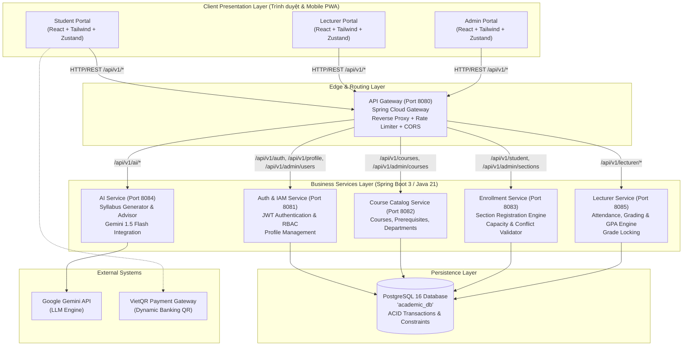
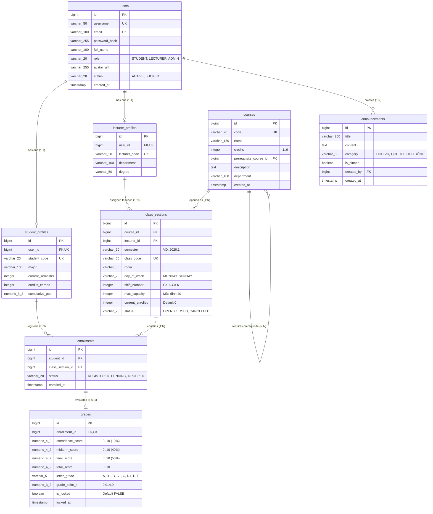
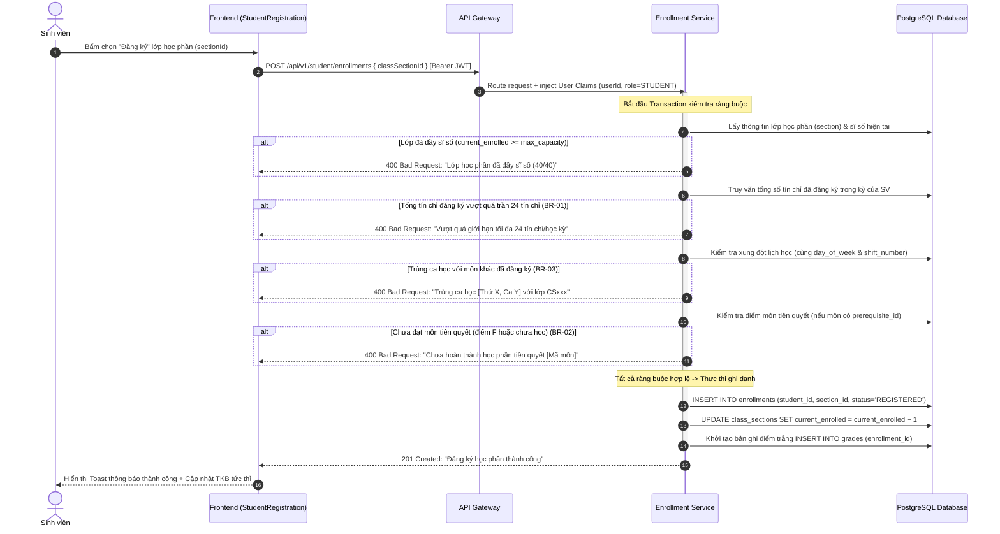
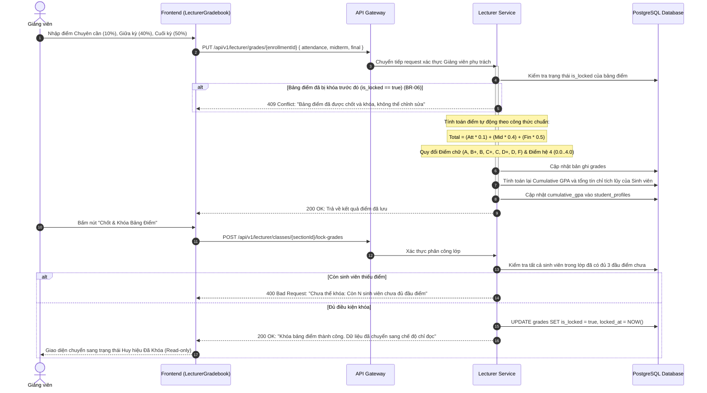

# BẢN ĐẶC TẢ YÊU CẦU PHẦN MỀM (SOFTWARE REQUIREMENTS SPECIFICATION - SRS)

## DỰ ÁN: HỆ THỐNG QUẢN LÝ ĐÀO TẠO & ĐĂNG KÝ HỌC PHẦN (RIKKEI EDUPORTAL - SIS)
* **Mã dự án**: `PRJ-QUICK-REVIEW-PRE-OJT-03`
* **Tiêu chuẩn tài liệu**: Chuẩn IEEE 830 / ISO/IEC/IEEE 29148
* **Vai trò biên soạn**: Senior Business Analyst & Lead Systems Architect
* **Phiên bản**: `2.0 - Enterprise Release`
* **Trạng thái**: Đã phê duyệt (Approved)

---

# MỤC LỤC
1. [TỔNG QUAN HỆ THỐNG & PHẠM VI (SYSTEM OVERVIEW & SCOPE)](#1-tổng-quan-hệ-thống--phạm-vi-system-overview--scope)
2. [HỆ THỐNG LƯỢC ĐỒ KIẾN TRÚC & NGHIỆP VỤ (SYSTEM DIAGRAMS)](#2-hệ-thống-lược-đồ-kiến-trúc--nghiệp-vụ-system-diagrams)
   - 2.1. [Lược đồ Kiến trúc Tổng thể Hệ thống (System Context & Architecture Diagram)](#21-lược-đồ-kiến-trúc-tổng-thể-hệ-thống-system-context--architecture-diagram)
   - 2.2. [Lược đồ Use Case Tổng quát (Overall Use Case Diagram)](#22-lược-đồ-use-case-tổng-quát-overall-use-case-diagram)
   - 2.3. [Lược đồ Quan hệ Thực thể Dữ liệu (Entity Relationship Diagram - ERD)](#23-lược-đồ-quan-hệ-thực-thể-dữ-liệu-entity-relationship-diagram---erd)
   - 2.4. [Lược đồ Tuần tự Nghiệp vụ Cốt lõi (Core Business Sequence Diagrams)](#24-lược-đồ-tuần-tự-nghiệp-vụ-cốt-lõi-core-business-sequence-diagrams)
3. [ĐẶC TẢ CHI TIẾT CÁC CÔNG VIỆC & CHỨC NĂNG CỦA DỰ ÁN (FUNCTIONAL SPECIFICATIONS)](#3-đặc-tả-chi-tiết-các-công-việc--chức-năng-của-dự-án-functional-specifications)
   - 3.1. [Phân hệ Xác thực & Quản lý Danh tính (Authentication & IAM Module)](#31-phân-hệ-xác-thực--quản-lý-danh-tính-authentication--iam-module)
   - 3.2. [Phân hệ Quản lý Khung Chương trình & Môn học (Academic Catalog Module)](#32-phân-hệ-quản-lý-khung-chương-trình--môn-học-academic-catalog-module)
   - 3.3. [Phân hệ Quản lý Lớp học phần & Xếp Thời khóa biểu (Class Sections & Scheduling Module)](#33-phân-hệ-quản-lý-lớp-học-phần--xếp-thời-khóa-biểu-class-sections--scheduling-module)
   - 3.4. [Phân hệ Cổng Sinh viên & Engine Đăng ký Tín chỉ (Student Portal & Registration Engine)](#34-phân-hệ-cổng-sinh-viên--engine-đăng-ký-tín-chỉ-student-portal--registration-engine)
   - 3.5. [Phân hệ Cổng Giảng viên & Quản lý Điểm số (Lecturer Portal & Gradebook Module)](#35-phân-hệ-cổng-giảng-viên--quản-lý-điểm-số-lecturer-portal--gradebook-module)
   - 3.6. [Phân hệ Tài chính Sinh viên & Quyết toán Học phí (Tuition & VietQR Module)](#36-phân-hệ-tài-chính-sinh-viên--quyết-toán-học-phí-tuition--vietqr-module)
   - 3.7. [Phân hệ Trí tuệ Nhân tạo Hỗ trợ Đào tạo (AI Academic Intelligence Module)](#37-phân-hệ-trí-tuệ-nhân-tạo-hỗ-trợ-đào-tạo-ai-academic-intelligence-module)
   - 3.8. [Phân hệ Quản trị Hệ thống & Kiểm toán Vết (System Administration & Audit Trail)](#38-phân-hệ-quản-trị-hệ-thống--kiểm-toán-vết-system-administration--audit-trail)
4. [QUY TẮC NGHIỆP VỤ BẮT BUỘC (BUSINESS RULES CATALOG - BRs)](#4-quy-tắc-nghiệp-vụ-bắt-buộc-business-rules-catalog---brs)
5. [TỪ ĐIỂN DỮ LIỆU & RÀNG BUỘC CƠ SỞ DỮ LIỆU (DATA DICTIONARY)](#5-từ-điển-dữ-liệu--ràng-buộc-cơ-sở-dữ-liệu-data-dictionary)
6. [YÊU CẦU PHI CHỨC NĂNG (NON-FUNCTIONAL REQUIREMENTS - NFRs)](#6-yêu-cầu-phi-chức-năng-non-functional-requirements---nfrs)
7. [CHUẨN GIAO DIỆN & TÍCH HỢP RESTFUL API (INTERFACE & INTEGRATION SPECIFICATIONS)](#7-chuẩn-giao-diện--tích-hợp-restful-api-interface--integration-specifications)

---

# 1. TỔNG QUAN HỆ THỐNG & PHẠM VI (SYSTEM OVERVIEW & SCOPE)

### 1.1. Mục đích tài liệu
Tài liệu Đặc tả Yêu cầu Phần mềm (SRS) này thiết lập cơ sở kỹ thuật và nghiệp vụ chính thức cho hệ thống **Rikkei EduPortal - Student Information System (SIS)**. Tài liệu đóng vai trò kim chỉ nam thống nhất giữa các bên liên quan (Product Owner, Business Analyst, Tech Lead, Developers, DevOps, QA) về phạm vi hệ thống, kiến trúc giải pháp, ràng buộc nghiệp vụ, giao thức API và tiêu chuẩn chất lượng.

### 1.2. Mục tiêu sản phẩm
Hệ thống giải quyết bài toán cốt lõi trong công tác quản lý đào tạo đại học theo học chế tín chỉ:
1. **Đối với Sinh viên (Student)**: Cung cấp cổng thông tin tự phục vụ (Self-service Portal) để theo dõi tiến độ học tập, đăng ký/hủy học phần trực tuyến với bộ kiểm tra xung đột thời gian thực, quản lý điểm số và thanh toán học phí qua mã VietQR tự động.
2. **Đối với Giảng viên (Lecturer)**: Cung cấp công cụ quản lý danh sách lớp giảng dạy, điểm danh chuyên cần, nhập điểm thành phần đa tiêu chí, tự động tính điểm chữ/GPA và chốt khóa bảng điểm an toàn.
3. **Đối với Phòng Đào tạo (Admin)**: Tự động hóa quy trình quản lý danh mục môn học, học phần tiên quyết, mở lớp học phần, xếp phòng/thời khóa biểu chống trùng lặp, quản lý tài khoản người dùng và giám sát báo cáo học vụ.
4. **Đối với Lãnh đạo Nhà trường**: Khai thác Trí tuệ Nhân tạo (Generative AI) để tự động sinh đề cương môn học chuẩn đầu ra và chatbot cố vấn học tập 24/7.

### 1.3. Các Tác nhân của Hệ thống (System Actors)
* **Sinh viên (STUDENT)**: Người học có tài khoản định danh trong hệ thống, được quyền tra cứu chương trình đào tạo, đăng ký môn, xem lịch học, xem điểm, thanh toán học phí và tương tác với AI Advisor.
* **Giảng viên (LECTURER)**: Cán bộ giảng dạy được phân công đứng lớp, thực hiện điểm danh, nhập điểm số và ký duyệt chốt bảng điểm.
* **Quản trị viên Đào tạo (ADMIN)**: Cán bộ phòng đào tạo/quản trị viên kỹ thuật có quyền quản lý hồ sơ người dùng, danh mục môn học, kế hoạch mở lớp, duyệt đăng ký ngoại lệ và quản trị hệ thống.
* **Hệ thống Bên ngoài (External Systems)**:
  * *Hệ thống AI (Google Gemini / Spring AI)*: Phục vụ sinh đề cương và cố vấn học vụ.
  * *Hệ thống Cổng thanh toán Ngân hàng (VietQR / Napas)*: Tạo mã QR thanh toán học phí động.

---

# 2. HỆ THỐNG LƯỢC ĐỒ KIẾN TRÚC & NGHIỆP VỤ (SYSTEM DIAGRAMS)

## 2.1. Lược đồ Kiến trúc Tổng thể Hệ thống (System Context & Architecture Diagram)

Hệ thống được thiết kế theo kiến trúc **Microservices phân tán hướng dịch vụ**, kiểm soát lưu lượng qua **API Gateway** trung tâm và bảo vệ bằng mô hình **Stateless JWT Security**.



---

## 2.2. Lược đồ Use Case Tổng quát (Overall Use Case Diagram)

```mermaid
graph LR
    actor_stu((Sinh viên\nSTUDENT))
    actor_lec((Giảng viên\nLECTURER))
    actor_adm((Quản trị viên\nADMIN))

    subgraph SystemBoundary ["HỆ THỐNG QUẢN LÝ ĐÀO TẠO (RIKKEI EDUPORTAL)"]
        UC_LOGIN["UC-01: Đăng nhập & Xác thực JWT"]
        UC_PROFILE["UC-02: Xem & Cập nhật Hồ sơ cá nhân"]
        
        %% Student Use Cases
        UC_DASHBOARD["UC-03: Xem Dashboard & Tiến độ học tập"]
        UC_VIEW_CLASSES["UC-04: Tra cứu Lớp học phần mở"]
        UC_ENROLL["UC-05: Đăng ký Học phần tín chỉ"]
        UC_DROP["UC-06: Hủy lớp học phần"]
        UC_VIEW_GRADE["UC-07: Xem Bảng điểm & Điểm rèn luyện"]
        UC_TUITION["UC-08: Xem Học phí & Quét mã VietQR"]
        UC_AI_CHAT["UC-09: Hỏi đáp Cố vấn học vụ AI"]

        %% Lecturer Use Cases
        UC_LEC_CLASSES["UC-10: Quản lý Lớp phân công giảng dạy"]
        UC_ATTENDANCE["UC-11: Điểm danh chuyên cần sinh viên"]
        UC_INPUT_GRADE["UC-12: Nhập điểm thành phần & Tính tổng kết"]
        UC_LOCK_GRADE["UC-13: Chốt khóa bảng điểm học phần"]

        %% Admin Use Cases
        UC_CRUD_USER["UC-14: Quản lý Tài khoản & Hồ sơ User"]
        UC_CRUD_COURSE["UC-15: Quản lý Danh mục Môn học"]
        UC_CRUD_SECTION["UC-16: Mở Lớp học phần & Xếp Lịch/Phòng"]
        UC_APPROVE_ENROLL["UC-17: Duyệt Đăng ký học phần chờ xử lý"]
        UC_GEN_SYLLABUS["UC-18: Sinh Đề cương môn học bằng AI"]
        UC_AUDIT["UC-19: Tra cứu Nhật ký Kiểm toán (Audit Log)"]
    end

    %% Student connections
    actor_stu --> UC_LOGIN
    actor_stu --> UC_PROFILE
    actor_stu --> UC_DASHBOARD
    actor_stu --> UC_VIEW_CLASSES
    actor_stu --> UC_ENROLL
    actor_stu --> UC_DROP
    actor_stu --> UC_VIEW_GRADE
    actor_stu --> UC_TUITION
    actor_stu --> UC_AI_CHAT

    %% Lecturer connections
    actor_lec --> UC_LOGIN
    actor_lec --> UC_PROFILE
    actor_lec --> UC_LEC_CLASSES
    actor_lec --> UC_ATTENDANCE
    actor_lec --> UC_INPUT_GRADE
    actor_lec --> UC_LOCK_GRADE
    actor_lec --> UC_GEN_SYLLABUS

    %% Admin connections
    actor_adm --> UC_LOGIN
    actor_adm --> UC_PROFILE
    actor_adm --> UC_CRUD_USER
    actor_adm --> UC_CRUD_COURSE
    actor_adm --> UC_CRUD_SECTION
    actor_adm --> UC_APPROVE_ENROLL
    actor_adm --> UC_GEN_SYLLABUS
    actor_adm --> UC_AUDIT
```



---

## 2.3. Lược đồ Quan hệ Thực thể Dữ liệu (Entity Relationship Diagram - ERD)



---

## 2.4. Lược đồ Tuần tự Nghiệp vụ Cốt lõi (Core Business Sequence Diagrams)

### Sequence 1: Đăng ký Học phần Sinh viên & Xử lý Ràng buộc Tín chỉ


### Sequence 2: Nhập điểm, Tính GPA & Chốt khóa Bảng điểm Giảng viên


---

# 3. ĐẶC TẢ CHI TIẾT CÁC CÔNG VIỆC & CHỨC NĂNG CỦA DỰ ÁN (FUNCTIONAL SPECIFICATIONS)

---

## 3.1. Phân hệ Xác thực & Quản lý Danh tính (Authentication & IAM Module)

### [F-01] Đăng nhập & Cấp phát Phiên làm việc (Authentication)
* **Mục tiêu**: Xác thực danh tính sinh viên, giảng viên và quản trị viên, cấp phát JWT token để truy cập các tài nguyên bảo vệ.
* **Tác nhân**: Tất cả người dùng (STUDENT, LECTURER, ADMIN).
* **Tiền điều kiện**: Tài khoản đã được cấp trong hệ thống và ở trạng thái `ACTIVE`.
* **Dữ liệu đầu vào**: `username` (hoặc `email`), `password`.
* **Luồng xử lý chuẩn**:
  1. Người dùng nhập tên đăng nhập và mật khẩu tại trang Login.
  2. Frontend gửi request mã hóa JSON tới `POST /api/v1/auth/login`.
  3. Backend truy vấn bảng `users`, so sánh hash mật khẩu thông qua `BCryptPasswordEncoder`.
  4. Nếu hợp lệ:
     - Kiểm tra trạng thái `status`: Nếu là `LOCKED`, từ chối đăng nhập với thông báo *"Tài khoản đã bị khóa, vui lòng liên hệ Ban Đào tạo"*.
     - Sinh `accessToken` chuẩn HMAC-SHA512 chứa claims: `userId`, `username`, `email`, `role`, `fullName`. Hạn dùng: 24 giờ.
     - Lấy hồ sơ đính kèm (`studentProfile` nếu là sinh viên, `lecturerProfile` nếu là giảng viên).
  5. Trả về mã HTTP `200 OK` kèm token và payload hồ sơ. Frontend lưu vào `localStorage` và chuyển hướng đến trang Dashboard tương ứng với vai trò.
* **Luồng ngoại lệ**:
  - Sai tài khoản hoặc mật khẩu: Trả về `401 Unauthorized` kèm thông báo *"Tên đăng nhập hoặc mật khẩu không chính xác"*.
  - Nhập trống trường bắt buộc: Báo lỗi validation phía client.

### [F-02] Quản lý & Cập nhật Hồ sơ cá nhân (Profile Management)
* **Tác nhân**: STUDENT, LECTURER, ADMIN.
* **Chức năng**:
  - `GET /api/v1/profile/me`: Lấy thông tin chi tiết của phiên hiện tại.
  - `PUT /api/v1/profile/me`: Cập nhật email, số điện thoại, ảnh đại diện `avatarUrl` và đổi mật khẩu mới.
* **Ràng buộc**: Không cho phép người dùng tự đổi mã SV, mã GV hoặc vai trò (`role`) của mình.

---

## 3.2. Phân hệ Quản lý Khung Chương trình & Môn học (Academic Catalog Module)

### [F-03] Quản lý Danh mục Môn học (Courses CRUD)
* **Tác nhân**: ADMIN.
* **Mô tả**: Thiết lập cơ sở dữ liệu học phần chuẩn làm điều kiện tiên quyết cho việc mở lớp.
* **Nghiệp vụ chi tiết**:
  - **Mã môn học (`code`)**: Định dạng duy nhất, viết hoa, không dấu (ví dụ: `CS101`, `MATH201`, `ENG102`).
  - **Số tín chỉ (`credits`)**: Số nguyên từ 1 đến 6 tín chỉ.
  - **Học phần tiên quyết (`prerequisite_course_id`)**: Chọn từ danh mục các môn học đã tồn tại. Hệ thống kiểm tra ràng buộc không được phép tham chiếu vòng tròn (A yêu cầu B, B lại yêu cầu A).
  - **Xóa môn học**: Chỉ cho phép xóa khi môn học đó chưa có bất kỳ Lớp học phần (`class_sections`) nào được mở trong lịch sử đào tạo.

---

## 3.3. Phân hệ Quản lý Lớp học phần & Xếp Thời khóa biểu (Class Sections & Scheduling Module)

### [F-04] Mở Lớp học phần & Kiểm soát Xung đột Phòng/Giảng viên (Scheduling Engine)
* **Tác nhân**: ADMIN.
* **Dữ liệu đầu vào**: Môn học (`courseId`), Học kỳ (`semester`, ví dụ `2026.1`), Giảng viên (`lecturerId`), Phòng học (`room`), Thứ trong tuần (`dayOfWeek`), Ca học (`shiftNumber` từ Ca 1 đến Ca 6), Sĩ số tối đa (`maxCapacity`, mặc định 40).
* **Thuật toán Kiểm soát Xung đột Lịch (Schedule Conflict Matrix)**:
  Khi Admin thêm mới hoặc sửa lớp học phần, hệ thống tự động quét toàn bộ bảng `class_sections` trong cùng học kỳ:
  1. **Kiểm tra trùng phòng học**:  
     `WHERE room = :room AND day_of_week = :day AND shift_number = :shift AND id != :currentId AND status != 'CANCELLED'`  
     -> Nếu tìm thấy bản ghi: Báo lỗi *"Phòng học [Tên phòng] đã được xếp cho lớp [Mã lớp] vào [Thứ, Ca]"*.
  2. **Kiểm tra trùng lịch giảng viên**:  
     `WHERE lecturer_id = :lecturerId AND day_of_week = :day AND shift_number = :shift AND id != :currentId AND status != 'CANCELLED'`  
     -> Nếu tìm thấy bản ghi: Báo lỗi *"Giảng viên [Tên GV] đã có lịch dạy lớp [Mã lớp] vào [Thứ, Ca]"*.

---

## 3.4. Phân hệ Cổng Sinh viên & Engine Đăng ký Tín chỉ (Student Portal & Registration Engine)

### [F-05] Màn hình Chỉ số Tổng quan Sinh viên (Student Dashboard)
* **Tác nhân**: STUDENT.
* **Dữ liệu cung cấp**:
  - `registeredCoursesCount`: Tổng số lớp học phần đang ghi nhận trạng thái `REGISTERED` trong kỳ hiện tại.
  - `weeklyClassesCount`: Tổng số buổi học trong một tuần theo thời khóa biểu.
  - `pendingRegistrationsCount`: Số lượng đăng ký lớp đang ở trạng thái duyệt `PENDING`.
  - `upcomingClasses`: Danh sách các ca học tiếp theo được sắp xếp theo thời gian thực tế trong tuần.
  - `creditsEarned`: Tổng tín chỉ tích lũy đạt điểm qua môn (A, B, C, D).
  - `cumulativeGpa`: Điểm trung bình tích lũy hệ 4.

### [F-06] Tra cứu & Tìm kiếm Lớp học phần Mở (Section Discovery)
* **Tác nhân**: STUDENT.
* **Bộ lọc tra cứu**: Theo học kỳ, theo từ khóa (Mã môn, Tên môn, Tên giảng viên), lọc theo khoa viện.
* **Thông tin hiển thị trên từng thẻ lớp**: Mã lớp, Tên môn, Số tín chỉ, Tên giảng viên, Phòng học, Thứ, Ca học, Trạng thái sĩ số (Đã đăng ký / Tối đa kèm thanh tiến trình màu sắc).

### [F-07] Engine Đăng ký Học phần Trực tuyến (Course Registration Engine)
* **Tác nhân**: STUDENT.
* **Quy trình xử lý giao dịch ACID**:
  1. Kiểm tra trạng thái cổng đào tạo: Nếu cổng đang đóng, từ chối toàn bộ request.
  2. Kiểm tra sĩ số: Số lượng sinh viên thực tế `current_enrolled < max_capacity`.
  3. Kiểm tra trần tín chỉ: Tổng tín chỉ sinh viên đã đăng ký cộng với số tín chỉ môn mới **không được vượt quá 24 tín chỉ** (BR-01).
  4. Kiểm tra môn tiên quyết: Sinh viên phải có bản ghi điểm của môn tiên quyết với trạng thái đạt (Điểm tổng kết >= 4.0 và Điểm chữ khác 'F') (BR-02).
  5. Kiểm tra trùng thời khóa biểu: Thứ trong tuần và Ca học của lớp mới không được trùng với bất kỳ lớp nào sinh viên đã đăng ký thành công (BR-03).
  6. Nếu tất cả điều kiện thỏa mãn: Lưu bản ghi `enrollments` với `status = 'REGISTERED'`, tăng `current_enrolled` lên 1, khởi tạo bản ghi điểm rỗng trong `grades`.

### [F-08] Hủy Đăng ký Lớp học phần (Drop Class Section)
* **Tác nhân**: STUDENT.
* **Nghiệp vụ**:
  - Sinh viên được quyền hủy lớp học phần trong thời gian mở cổng quy định.
  - Khi hủy thành công: Cập nhật `status = 'DROPPED'`, trừ `current_enrolled` của lớp học phần đi 1, xóa bản ghi điểm khởi tạo.

---

## 3.5. Phân hệ Cổng Giảng viên & Quản lý Điểm số (Lecturer Portal & Gradebook Module)

### [F-09] Quản lý Lớp Giảng dạy & Điểm danh Sinh viên (Attendance Tracking)
* **Tác nhân**: LECTURER.
* **Nghiệp vụ**:
  - Xem danh sách lớp học phần được phân công dạy trong học kỳ.
  - Xem danh sách sinh viên ghi danh trong từng lớp.
  - Cập nhật tỷ lệ điểm danh chuyên cần (0% đến 100%). Hệ thống tự động quy đổi tỷ lệ điểm danh ra thang điểm 10 chuyên cần.

### [F-10] Nhập Điểm & Tính toán GPA Tự động (Grading System)
* **Tác nhân**: LECTURER.
* **Công thức tính điểm**:
  $$\text{Total Score} = (\text{Attendance} \times 0.1) + (\text{Midterm} \times 0.4) + (\text{Final} \times 0.5)$$
* **Bảng quy đổi điểm chữ và thang điểm 4 chuẩn Bộ Giáo dục & Đào tạo**:
  * $8.5 \le \text{Total} \le 10.0 \rightarrow \text{Điểm chữ: } \mathbf{A} \rightarrow \text{Hệ 4: } \mathbf{4.0}$
  * $8.0 \le \text{Total} < 8.5 \rightarrow \text{Điểm chữ: } \mathbf{B+} \rightarrow \text{Hệ 4: } \mathbf{3.5}$
  * $7.0 \le \text{Total} < 8.0 \rightarrow \text{Điểm chữ: } \mathbf{B} \rightarrow \text{Hệ 4: } \mathbf{3.0}$
  * $6.5 \le \text{Total} < 7.0 \rightarrow \text{Điểm chữ: } \mathbf{C+} \rightarrow \text{Hệ 4: } \mathbf{2.5}$
  * $5.5 \le \text{Total} < 6.5 \rightarrow \text{Điểm chữ: } \mathbf{C} \rightarrow \text{Hệ 4: } \mathbf{2.0}$
  * $5.0 \le \text{Total} < 5.5 \rightarrow \text{Điểm chữ: } \mathbf{D+} \rightarrow \text{Hệ 4: } \mathbf{1.5}$
  * $4.0 \le \text{Total} < 5.0 \rightarrow \text{Điểm chữ: } \mathbf{D} \rightarrow \text{Hệ 4: } \mathbf{1.0}$
  * $\text{Total} < 4.0 \rightarrow \text{Điểm chữ: } \mathbf{F} \rightarrow \text{Hệ 4: } \mathbf{0.0}$ *(Học lại)*
* **Tự động cập nhật CGPA Sinh viên**: Khi có điểm mới, hệ thống tự động tính lại điểm trung bình chung tích lũy có trọng số tín chỉ của sinh viên:
  $$\text{CGPA} = \frac{\sum (\text{GradePoint}_i \times \text{Credits}_i)}{\sum \text{Credits}_i}$$

### [F-11] Chốt và Khóa Bảng Điểm (Grade Locking)
* **Tác nhân**: LECTURER.
* **Nghiệp vụ**:
  - Khi hoàn thành việc nhập điểm toàn bộ lớp, Giảng viên thực hiện thao tác **"Chốt & Khóa Bảng Điểm"**.
  - Hệ thống kiểm tra: Nếu còn bất kỳ sinh viên nào chưa có đủ điểm thành phần, chặn hành động và thông báo lỗi.
  - Khi đã khóa (`is_locked = TRUE`), bảng điểm chuyển sang trạng thái chỉ đọc (Read-only). Giảng viên không thể tự ý sửa điểm; mọi sửa đổi sau khi khóa bắt buộc phải có đơn xin mở khóa được Phòng Đào tạo (Admin) phê duyệt.

---

## 3.6. Phân hệ Tài chính Sinh viên & Quyết toán Học phí (Tuition & VietQR Module)

### [F-12] Tính toán Định mức Học phí & Thanh toán VietQR Động
* **Tác nhân**: STUDENT.
* **Nghiệp vụ**:
  - **Đơn giá tín chỉ**: Định mức chuẩn $450.000 \text{ VNĐ} / 1 \text{ tín chỉ}$ quy đổi.
  - **Tổng học phí kỳ**: $\text{Tổng tiền} = \text{Tổng số tín chỉ đăng ký hợp lệ} \times 450.000 \text{ VNĐ}$.
  - **Sinh mã VietQR động**:
    - Hệ thống tích hợp định dạng VietQR (chuẩn Napas247).
    - Cú pháp chuyển khoản tự động: `HP [Mã SV] [Học kỳ]` (ví dụ: `HP SV2024001 2026.1`).
    - Sinh viên dùng ứng dụng ngân hàng quét mã QR để chuyển khoản chính xác tuyệt đối số tiền và nội dung, loại bỏ sai sót đối soát kế toán.

---

## 3.7. Phân hệ Trí tuệ Nhân tạo Hỗ trợ Đào tạo (AI Academic Intelligence Module)

### [F-13] Tự động Sinh Đề cương Môn học (AI Syllabus Generator)
* **Tác nhân**: ADMIN, LECTURER.
* **Mô tả**: Tận dụng Google Gemini API để tạo cấu trúc đề cương học phần chuẩn mực.
* **Dữ liệu đầu vào**: Tên môn học, Số tín chỉ, Khoa quản lý môn.
* **Dữ liệu đầu ra cấu trúc JSON**:
  - Tóm tắt mục tiêu môn học (Course Objectives).
  - Chuẩn đầu ra (Learning Outcomes: Kiến thức, Kỹ năng, Thái độ).
  - Phân bổ 15 tuần học chi tiết (Weekly Schedule & Assignments).
  - Giáo trình và tài liệu tham khảo chính.

### [F-14] Trợ lý Cố vấn Học vụ AI (AI Academic Advisor Chatbot)
* **Tác nhân**: STUDENT.
* **Mô tả**: Widget tư vấn tương tác trực tiếp trên giao diện portal.
* **Khả năng giải đáp**:
  - Giải thích quy chế đào tạo tín chỉ, điều kiện tốt nghiệp, định mức học phí.
  - Gợi ý lộ trình môn học phù hợp với năng lực và điểm số hiện tại của sinh viên.
  - Phân tích và giải đáp thắc mắc về lịch thi, thủ tục hoãn thi, phúc khảo điểm.

---

## 3.8. Phân hệ Quản trị Hệ thống & Kiểm toán Vết (System Administration & Audit Trail)

### [F-15] Quản lý Tài khoản & Phân quyền Người dùng (User Management)
* **Tác nhân**: ADMIN.
* **Quy tắc bảo vệ tài khoản Quản trị viên (BR-04)**:
  - **Không được phép xóa tài khoản Admin**: Hệ thống chặn hoàn toàn thao tác xóa các user có `role = 'ADMIN'`. Cả backend và frontend đều vô hiệu hóa chức năng này.
  - **Không được phép khóa tài khoản Admin**: Không thể chuyển trạng thái tài khoản Admin sang `LOCKED`.
  - **Không được phép hạ cấp vai trò Admin**: Không thể đổi `role = 'ADMIN'` thành `STUDENT` hoặc `LECTURER`.
  - Admin có quyền đặt lại mật khẩu của người dùng về mật khẩu mặc định (`123456`) khi sinh viên hoặc giảng viên quên mật khẩu.

### [F-16] Quản lý Thông báo & Tin tức Học bổng / Lịch thi (Announcements)
* **Tác nhân**: ADMIN (Tạo/Sửa/Xóa/Ghim), ALL USERS (Xem tin).
* **Nghiệp vụ**:
  - Hỗ trợ ghim công văn khẩn lên đầu trang chủ portal.
  - Phân loại danh mục rõ ràng: `HỌC VỤ`, `LỊCH THI`, `HỌC BỔNG`, `HOẠT ĐỘNG`.
  - Hộp thoại xem chi tiết nội dung thông báo kèm định dạng bài viết chuyên nghiệp.

---

# 4. QUY TẮC NGHIỆP VỤ BẮT BUỘC (BUSINESS RULES CATALOG - BRs)

| Mã quy tắc | Tên quy tắc | Nội dung định nghĩa nghiệp vụ chi tiết | Hành vi hệ thống khi vi phạm |
| :--- | :--- | :--- | :--- |
| **BR-01** | **Giới hạn Trần/Sàn Tín chỉ** | Sinh viên được đăng ký tối thiểu 12 tín chỉ và **tối đa không quá 24 tín chỉ** trong một học kỳ chính. | Chặn giao dịch đăng ký, trả về HTTP 400 kèm thông báo *"Vượt quá hạn mức 24 tín chỉ/kỳ"*. |
| **BR-02** | **Học phần Tiên quyết** | Sinh viên chỉ được phép đăng ký môn học nối tiếp khi đã tích lũy đạt học phần tiên quyết ($\text{Total Score} \ge 4.0$ và Điểm chữ khác $\text{F}$). | Chặn đăng ký, trả về thông báo *"Chưa hoàn thành học phần tiên quyết [Mã môn - Tên môn]"*. |
| **BR-03** | **Chống Xung đột Lịch học** | Sinh viên không được phép đăng ký hai lớp học phần có cùng Thứ trong tuần (`day_of_week`) và cùng Ca học (`shift_number`). | Chặn đăng ký, trả về thông báo *"Trùng lịch học vào [Thứ, Ca] với lớp đã đăng ký"*. |
| **BR-04** | **Bảo vệ Tài khoản Admin** | Tài khoản Quản trị viên (`role = 'ADMIN'`) là đối tượng bảo vệ tối cao: **Cấm xóa**, **cấm khóa** (`status = 'LOCKED'`), **cấm hạ cấp vai trò**. | Backend ném ngoại lệ `BadRequestException`, UI làm mờ và vô hiệu hóa nút bấm. |
| **BR-05** | **Thang điểm & Trọng số** | Điểm học phần tính theo tỷ lệ chuẩn: Chuyên cần 10%, Giữa kỳ 40%, Cuối kỳ 50%. Thang điểm từ 0.00 đến 10.00. Quy đổi ra Thang chữ (A-F) và Thang 4. | Hệ thống tự tính toán tự động bằng GradeCalculator, giảng viên không được ghi đè điểm tổng kết. |
| **BR-06** | **Bất biến khi Khóa điểm** | Bảng điểm sau khi Giảng viên bấm Khóa (`is_locked = TRUE`) sẽ trở thành bất biến (Immutable). Toàn bộ API cập nhật điểm đều bị từ chối. | Trả về HTTP 409 Conflict *"Bảng điểm đã bị khóa, vui lòng liên hệ Ban Đào tạo"*. |
| **BR-07** | **Định mức Học phí** | Đơn giá học phí cố định $450.000 \text{ VNĐ} / 1 \text{ tín chỉ}$. Thời hạn hoàn thành là 30 ngày kể từ ngày chốt đăng ký tín chỉ. | Hệ thống tự động tính hóa đơn trên StudentTuition và sinh mã VietQR thanh toán. |

---

# 5. TỪ ĐIỂN DỮ LIỆU & RÀNG BUỘC CƠ SỞ DỮ LIỆU (DATA DICTIONARY)

### Bảng: `users` (Tài khoản người dùng hệ thống)
| Tên cột | Kiểu dữ liệu | Ràng buộc | Mô tả |
| :--- | :--- | :--- | :--- |
| `id` | `BIGSERIAL` | PRIMARY KEY | Khóa chính tự tăng |
| `username` | `VARCHAR(50)` | UNIQUE, NOT NULL | Tên đăng nhập (sv2024001, gv001, admin) |
| `email` | `VARCHAR(100)` | UNIQUE, NOT NULL | Thư điện tử chính thức của trường |
| `password_hash`| `VARCHAR(255)` | NOT NULL | Mật khẩu băm chuẩn BCrypt |
| `full_name` | `VARCHAR(100)` | NOT NULL | Họ và tên đầy đủ |
| `role` | `VARCHAR(20)` | NOT NULL | Phân quyền: `STUDENT`, `LECTURER`, `ADMIN` |
| `avatar_url` | `VARCHAR(255)` | NULL | Đường dẫn ảnh chân dung |
| `status` | `VARCHAR(20)` | DEFAULT 'ACTIVE'| Trạng thái: `ACTIVE`, `LOCKED` |
| `created_at` | `TIMESTAMP` | DEFAULT NOW() | Thời điểm tạo tài khoản |

### Bảng: `courses` (Danh mục môn học)
| Tên cột | Kiểu dữ liệu | Ràng buộc | Mô tả |
| :--- | :--- | :--- | :--- |
| `id` | `BIGSERIAL` | PRIMARY KEY | Khóa chính tự tăng |
| `code` | `VARCHAR(20)` | UNIQUE, NOT NULL | Mã môn học định danh (CS101, MATH101) |
| `name` | `VARCHAR(150)` | NOT NULL | Tên môn học đầy đủ |
| `credits` | `INT` | NOT NULL, CHECK (1..6)| Số lượng tín chỉ tích lũy |
| `prerequisite_course_id`| `BIGINT` | FK -> `courses.id`, NULL | Mã môn tiên quyết bắt buộc |
| `description` | `TEXT` | NULL | Đề cương mô tả tóm tắt môn học |
| `department` | `VARCHAR(100)`| NOT NULL | Khoa chuyên môn phụ trách |

### Bảng: `class_sections` (Lớp học phần mở trong kỳ)
| Tên cột | Kiểu dữ liệu | Ràng buộc | Mô tả |
| :--- | :--- | :--- | :--- |
| `id` | `BIGSERIAL` | PRIMARY KEY | Khóa chính tự tăng |
| `course_id` | `BIGINT` | FK -> `courses.id`, NOT NULL | Môn học tương ứng |
| `lecturer_id` | `BIGINT` | FK -> `lecturer_profiles.id` | Giảng viên đứng lớp |
| `semester` | `VARCHAR(20)` | NOT NULL | Học kỳ mở lớp (VD: `2026.1`) |
| `class_code` | `VARCHAR(50)` | UNIQUE, NOT NULL | Mã định danh lớp học phần (CS101-01) |
| `room` | `VARCHAR(50)` | NOT NULL | Phòng học (P301, Lab A, Online) |
| `day_of_week` | `VARCHAR(20)` | NOT NULL | Thứ trong tuần (`MONDAY` đến `SUNDAY`) |
| `shift_number`| `INT` | NOT NULL, CHECK (1..6)| Ca học (Ca 1: 07h-09h, Ca 2: 09h-11h...) |
| `max_capacity`| `INT` | DEFAULT 40 | Sĩ số tiếp nhận tối đa |
| `current_enrolled` | `INT`| DEFAULT 0 | Sĩ số đã đăng ký thực tế |
| `status` | `VARCHAR(20)` | DEFAULT 'OPEN' | Trạng thái: `OPEN`, `CLOSED`, `CANCELLED` |

### Bảng: `grades` (Bảng điểm thành phần & tổng kết)
| Tên cột | Kiểu dữ liệu | Ràng buộc | Mô tả |
| :--- | :--- | :--- | :--- |
| `id` | `BIGSERIAL` | PRIMARY KEY | Khóa chính |
| `enrollment_id`| `BIGINT` | FK -> `enrollments.id`, UNIQUE | Liên kết 1:1 với lượt ghi danh |
| `attendance_score`| `NUMERIC(4,2)`| CHECK (0..10) | Điểm chuyên cần (trọng số 10%) |
| `midterm_score` | `NUMERIC(4,2)`| CHECK (0..10) | Điểm giữa kỳ (trọng số 40%) |
| `final_score` | `NUMERIC(4,2)`| CHECK (0..10) | Điểm thi kết thúc môn (trọng số 50%) |
| `total_score` | `NUMERIC(4,2)`| CHECK (0..10) | Điểm tổng kết hệ 10 |
| `letter_grade`| `VARCHAR(5)` | CHECK (A, B+, B, C+, C, D+, D, F)| Điểm chữ tiêu chuẩn |
| `grade_point_4`| `NUMERIC(3,2)`| CHECK (0.0..4.0) | Điểm quy đổi thang 4 |
| `is_locked` | `BOOLEAN` | DEFAULT FALSE | Trạng thái khóa bảng điểm |
| `locked_at` | `TIMESTAMP` | NULL | Thời điểm khóa điểm |

---

# 6. YÊU CẦU PHI CHỨC NĂNG (NON-FUNCTIONAL REQUIREMENTS - NFRs)

### 6.1. Hiệu năng & Năng lực Xử lý (Performance & Scalability)
* **Thời gian phản hồi (Response Time)**:
  * 95% các yêu cầu đọc dữ liệu (Dashboard, Danh mục môn, Lịch học) có thời gian phản hồi dưới $300\text{ ms}$.
  * Giao dịch đăng ký học phần (Course Registration Transaction) hoàn tất dưới $500\text{ ms}$ tại điều kiện tải tiêu chuẩn.
* **Khả năng chịu tải đồng thời (Concurrency)**:
  * Cổng đăng ký tín chỉ chịu tải tối thiểu **500 yêu cầu/giây (RPS)** mà không xảy ra hiện tượng tranh chấp dữ liệu (Race Conditions) hay vượt quá sĩ số tối đa của lớp học phần.
* **Tối ưu hóa Cơ sở dữ liệu**:
  * Đánh chỉ mục (Index) trên các trường tra cứu tần suất cao: `username`, `email`, `student_code`, `class_code`, `semester`, cặp `(day_of_week, shift_number, room)`.
  * Cấu hình Connection Pool (HikariCP) tối ưu từ 20 đến 50 kết nối trên mỗi microservice.

### 6.2. Bảo mật & Toàn vẹn Dữ liệu (Security & Integrity)
* **Xác thực & Ủy quyền (Authentication & RBAC)**:
  * Áp dụng mã hóa mật khẩu một chiều bằng thuật toán `BCrypt` với Work Factor = 12.
  * JSON Web Token (JWT) sử dụng thuật toán mã hóa chữ ký `HMAC-SHA512` với khóa bí mật `JWT_SECRET` tối thiểu 256 bits.
  * Kiểm soát quyền truy cập chi tiết đến từng API Endpoint bằng `@PreAuthorize("hasRole('ADMIN')")`, `@PreAuthorize("hasRole('LECTURER')")`.
* **Phòng chống Lỗ hổng OWASP Top 10**:
  * Chống SQL Injection bằng việc sử dụng 100% Prepared Statements và Spring Data JPA Criteria/JPQL.
  * Chống Cross-Site Scripting (XSS) và bảo vệ giao thức bằng HTTP-Only, CORS Origin Filtering và CSP Header.
* **Toàn vẹn Dữ liệu Học bạ**:
  * Điểm số sau khi khóa (`is_locked = TRUE`) được bảo vệ bằng trigger/ràng buộc ứng dụng, không thể ghi đè dưới bất kỳ hình thức nào trừ khi có sự can thiệp phê duyệt của Hội đồng Đào tạo.

### 6.3. Tính Sẵn sàng & Độ Tin cậy (Availability & Reliability)
* **Mức độ sẵn sàng (Uptime)**: Đảm bảo thời gian hoạt động đạt tối thiểu $99.5\%$ trong thời gian diễn ra kỳ đăng ký tín chỉ và kỳ thi học kỳ.
* **Sao lưu & Phục hồi (Backup & Recovery)**:
  * Dữ liệu cơ sở dữ liệu PostgreSQL được lập lịch sao lưu tự động hàng ngày (Automated Daily Dumps).
  * Mục tiêu thời gian phục hồi (RTO): Dưới 30 phút.
  * Mục tiêu điểm phục hồi (RPO): Dưới 1 giờ mất mát dữ liệu tối đa khi có sự cố thảm họa.

---

# 7. CHUẨN GIAO DIỆN & TÍCH HỢP RESTFUL API (INTERFACE & INTEGRATION SPECIFICATIONS)

### Định dạng Chuẩn của Toàn bộ API Response
Mọi phản hồi từ hệ sinh thái Backend đều tuân thủ cấu trúc đồng nhất:
```json
{
  "status": 200,
  "message": "Thông điệp phản hồi nghiệp vụ",
  "data": { ... }
}
```

### Danh mục Các Endpoint Cốt lõi của Hệ thống

| Phương thức | Endpoint | Phân quyền | Mô tả chức năng |
| :--- | :--- | :--- | :--- |
| `POST` | `/api/v1/auth/login` | Public | Đăng nhập tài khoản, trả về JWT Token & Profile |
| `GET` | `/api/v1/profile/me` | Authenticated | Lấy thông tin cá nhân của người dùng hiện tại |
| `PUT` | `/api/v1/profile/me` | Authenticated | Cập nhật thông tin liên hệ và đổi mật khẩu |
| `GET` | `/api/v1/student/dashboard` | `STUDENT` | Lấy dữ liệu 4 thẻ chỉ số, TKB tuần và CGPA sinh viên |
| `GET` | `/api/v1/student/class-sections`| `STUDENT` | Tra cứu danh sách lớp học phần mở trong kỳ |
| `POST` | `/api/v1/student/enrollments` | `STUDENT` | Đăng ký học phần (Kiểm tra 24 tín, TKB, sĩ số) |
| `DELETE`| `/api/v1/student/enrollments/{id}`| `STUDENT` | Hủy đăng ký lớp học phần |
| `GET` | `/api/v1/student/grades` | `STUDENT` | Xem bảng điểm cá nhân qua các kỳ |
| `GET` | `/api/v1/lecturer/classes` | `LECTURER` | Xem danh sách các lớp được phân công giảng dạy |
| `GET` | `/api/v1/lecturer/classes/{id}/students`| `LECTURER` | Xem danh sách sinh viên và bảng điểm của 1 lớp |
| `PUT` | `/api/v1/lecturer/enrollments/{id}/attendance`| `LECTURER` | Điểm danh chuyên cần sinh viên |
| `PUT` | `/api/v1/lecturer/grades/{id}` | `LECTURER` | Nhập/Sửa điểm (CC, GK, CK) & tính GPA tự động |
| `POST` | `/api/v1/lecturer/classes/{id}/lock-grades` | `LECTURER` | Chốt và khóa vĩnh viễn bảng điểm lớp học phần |
| `GET/POST/PUT/DELETE`| `/api/v1/admin/users` | `ADMIN` | Quản lý người dùng (Cấm xóa/khóa tài khoản Admin) |
| `GET/POST/PUT/DELETE`| `/api/v1/admin/courses` | `ADMIN` | Quản lý danh mục môn học & tiên quyết |
| `GET/POST/PUT/DELETE`| `/api/v1/admin/class-sections` | `ADMIN` | Mở lớp học phần, xếp phòng và lịch học chống trùng |
| `POST` | `/api/v1/ai/generate-syllabus` | `ADMIN, LECTURER` | Tự động sinh đề cương môn học bằng Google Gemini |
| `POST` | `/api/v1/ai/academic-advisor` | `STUDENT` | Trợ lý ảo cố vấn quy chế học vụ và gợi ý môn học |

---
*Tài liệu này là tài sản kỹ thuật của Dự án Rikkei EduPortal. Mọi sửa đổi bổ sung phải được thông qua quy trình xét duyệt của Ban Kiến trúc Hệ thống.*
