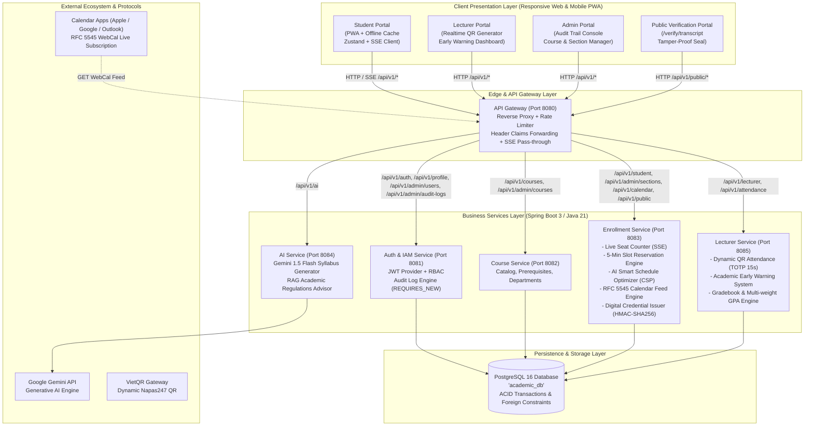
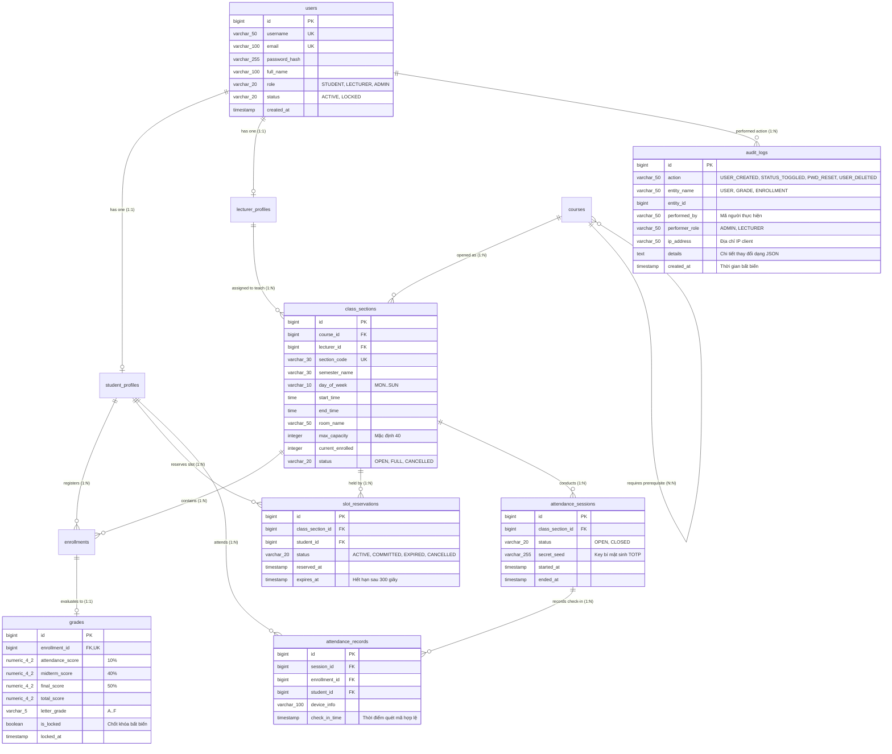
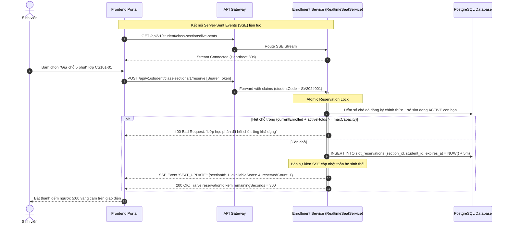
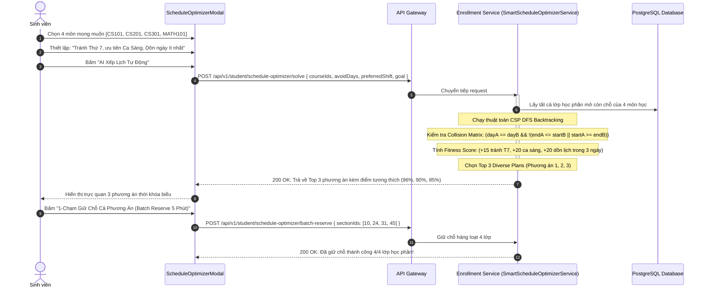
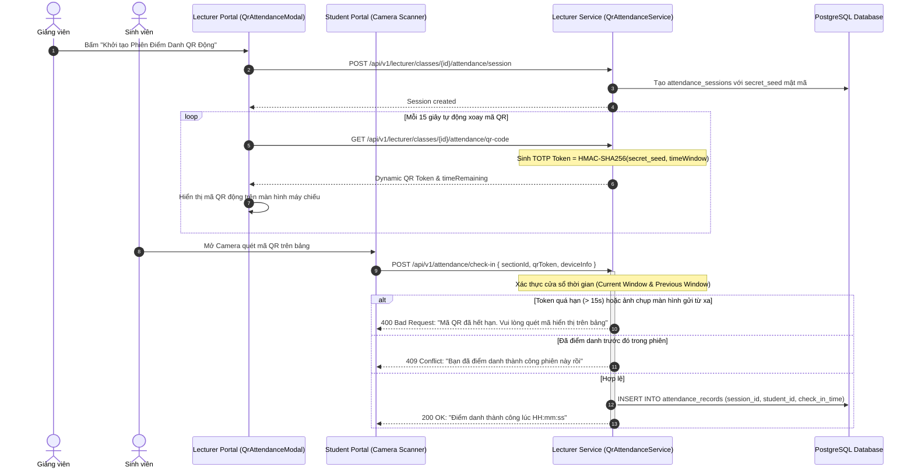
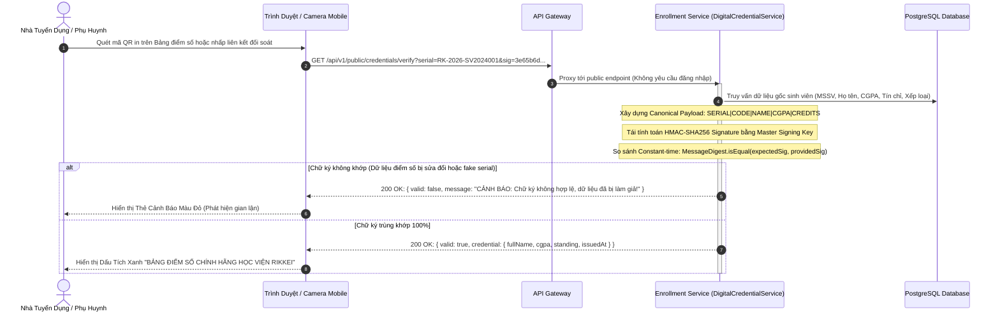

# BẢN ĐẶC TẢ YÊU CẦU PHẦN MỀM (SOFTWARE REQUIREMENTS SPECIFICATION - SRS)

## DỰ ÁN: HỆ SINH THÁI QUẢN LÝ ĐÀO TẠO THÔNG MINH (RIKKEI EDUPORTAL - SMART CAMPUS SIS)
* **Mã dự án**: `PRJ-QUICK-REVIEW-PRE-OJT-03`
* **Tiêu chuẩn tài liệu**: Chuẩn IEEE 830 / ISO/IEC/IEEE 29148
* **Vai trò biên soạn**: Senior Business Analyst & Lead Systems Architect
* **Phiên bản**: `2.1 - Smart Campus Enterprise Release`
* **Trạng thái**: Đã phê duyệt & Đã triển khai hoàn tất (Approved & Deployed)

---

# MỤC LỤC
1. [TỔNG QUAN HỆ THỐNG & PHẠM VI (SYSTEM OVERVIEW & SCOPE)](#1-tổng-quan-hệ-thống--phạm-vi-system-overview--scope)
2. [HỆ THỐNG LƯỢC ĐỒ KIẾN TRÚC & NGHIỆP VỤ (SYSTEM DIAGRAMS)](#2-hệ-thống-lược-đồ-kiến-trúc--nghiệp-vụ-system-diagrams)
   - 2.1. [Lược đồ Kiến trúc Tổng thể Hệ thống (System Architecture Diagram)](#21-lược-đồ-kiến-trúc-tổng-thể-hệ-thống-system-architecture-diagram)
   - 2.2. [Lược đồ Use Case Tổng quát (Overall Use Case Diagram)](#22-lược-đồ-use-case-tổng-quát-overall-use-case-diagram)
   - 2.3. [Lược đồ Quan hệ Thực thể Dữ liệu Mở rộng (Extended ERD)](#23-lược-đồ-quan-hệ-thực-thể-dữ-liệu-mở-rộng-extended-erd)
   - 2.4. [Lược đồ Tuần tự Nghiệp vụ Cốt lõi & Tiên tiến (Core & Advanced Sequence Diagrams)](#24-lược-đồ-tuần-tự-nghiệp-vụ-cốt-lõi--tiên-tiến-core--advanced-sequence-diagrams)
3. [ĐẶC TẢ CHI TIẾT CÁC PHÂN HỆ CHỨC NĂNG (FUNCTIONAL SPECIFICATIONS)](#3-đặc-tả-chi-tiết-các-phân-hệ-chức-năng-functional-specifications)
   - 3.1. [Phân hệ Xác thực, IAM & Kiểm toán Bất biến (Authentication, IAM & Audit Trail)](#31-phân-hệ-xác-thực-iam--kiểm-toán-bất-biến-authentication-iam--audit-trail)
   - 3.2. [Phân hệ Quản lý Khung Chương trình & Môn học (Academic Catalog Module)](#32-phân-hệ-quản-lý-khung-chương-trình--môn-học-academic-catalog-module)
   - 3.3. [Phân hệ Quản lý Lớp học phần & Lịch thi (Class Sections & Examination Module)](#33-phân-hệ-quản-lý-lớp-học-phần--lịch-thi-class-sections--examination-module)
   - 3.4. [Phân hệ Cổng Sinh viên & Engine Đăng ký Tín chỉ Real-time (Real-time Registration Engine)](#34-phân-hệ-cổng-sinh-viên--engine-đăng-ký-tín-chỉ-real-time-real-time-registration-engine)
   - 3.5. [Phân hệ Trải nghiệm Di động PWA & Đồng bộ Lịch iCal (Mobile PWA & Calendar Sync)](#35-phân-hệ-trải-nghiệm-di-động-pwa--đồng-bộ-lịch-ical-mobile-pwa--calendar-sync)
   - 3.6. [Phân hệ Điểm danh QR Động TOTP & Quản lý Điểm số (Dynamic QR Attendance & Gradebook)](#36-phân-hệ-điểm-danh-qr-động-totp--quản-lý-điểm-số-dynamic-qr-attendance--gradebook)
   - 3.7. [Phân hệ Cảnh báo Sớm Nguy cơ Học vụ (Academic Early Warning System)](#37-phân-hệ-cảnh-báo-sớm-nguy-cơ-học-vụ-academic-early-warning-system)
   - 3.8. [Phân hệ AI Tối ưu Hóa Lịch học & Cố vấn Đào tạo (AI Smart Scheduler & Advisor)](#38-phân-hệ-ai-tối-ưu-hóa-lịch-học--cố-vấn-đào-tạo-ai-smart-scheduler--advisor)
   - 3.9. [Phân hệ Bảng điểm Số có Chữ ký Mật mã Chống giả mạo (Verifiable Digital Credentials)](#39-phân-hệ-bảng-điểm-số-có-chữ-ký-mật-mã-chống-giả-mạo-verifiable-digital-credentials)
   - 3.10. [Phân hệ Tài chính Sinh viên & Quyết toán Học phí (Tuition & VietQR Module)](#310-phân-hệ-tài-chính-sinh-viên--quyết-toán-học-phí-tuition--vietqr-module)
4. [QUY TẮC NGHIỆP VỤ BẮT BUỘC (BUSINESS RULES CATALOG - BRs)](#4-quy-tắc-nghiệp-vụ-bắt-buộc-business-rules-catalog---brs)
5. [TỪ ĐIỂN DỮ LIỆU & RÀNG BUỘC CƠ SỞ DỮ LIỆU (DATA DICTIONARY)](#5-từ-điển-dữ-liệu--ràng-buộc-cơ-sở-dữ-liệu-data-dictionary)
6. [YÊU CẦU PHI CHỨC NĂNG (NON-FUNCTIONAL REQUIREMENTS - NFRs)](#6-yêu-cầu-phi-chức-năng-non-functional-requirements---nfrs)
7. [CHUẨN GIAO DIỆN & TÍCH HỢP RESTFUL API (INTERFACE & INTEGRATION SPECIFICATIONS)](#7-chuẩn-giao-diện--tích-hợp-restful-api-interface--integration-specifications)

---

# 1. TỔNG QUAN HỆ THỐNG & PHẠM VI (SYSTEM OVERVIEW & SCOPE)

### 1.1. Mục đích tài liệu
Tài liệu Đặc tả Yêu cầu Phần mềm (SRS) phiên bản **2.1 - Smart Campus Enterprise Release** thiết lập cơ sở kỹ thuật và nghiệp vụ hoàn chỉnh cho hệ thống **Rikkei EduPortal**. Tài liệu phản ánh 100% cấu trúc kiến trúc thực tế, logic xử lý giao dịch, thuật toán xếp lịch CSP, giao thức mật mã xác thực chứng chỉ số và các phân hệ thông minh vừa được hoàn thiện.

### 1.2. Mục tiêu sản phẩm
Chuyển đổi cổng đào tạo truyền thống thành **Hệ sinh thái Smart Campus & EdTech toàn diện**:
1. **Giải quyết triệt để bài toán mùa đăng ký tín chỉ**: Tích hợp luồng sự kiện Real-time (Server-Sent Events) hiển thị bộ đếm chỗ tức thì, cơ chế giữ chỗ phân tán 5 phút và thuật toán AI CSP xếp thời khóa biểu tối ưu tự động 1-chạm.
2. **Hiện đại hóa trải nghiệm người học**: Ứng dụng công nghệ Progressive Web App (PWA) cài đặt trực tiếp trên smartphone, đồng bộ lịch học tự động qua chuẩn quốc tế RFC 5545 `.ics` (Google Calendar, Apple Calendar).
3. **Triệt tiêu gian lận học vụ**: Áp dụng điểm danh bằng mã QR động xoay mỗi 15 giây (thuật toán TOTP mật mã), lưu vết kiểm toán bất biến (Audit Trail) cho mọi thao tác chỉnh sửa dữ liệu người dùng.
4. **Phòng ngừa rủi ro học tập chủ động**: Hệ thống Cảnh báo Sớm (Early Warning System) phát hiện sinh viên vắng $\ge 20\%$ số buổi (nguy cơ cấm thi) hoặc điểm giữa kỳ $< 4.0$ để giảng viên kịp thời hỗ trợ.
5. **Chứng thực số chuẩn quốc tế**: Bảng điểm điện tử gắn chữ ký số HMAC-SHA256 và mã QR đối soát công khai, cho phép nhà tuyển dụng xác minh tức thì tính hợp pháp của kết quả học tập.

### 1.3. Các Tác nhân Hệ thống (System Actors)
* **Sinh viên (STUDENT)**: Người học chính thức, tra cứu CTĐT, đăng ký tín chỉ thời gian thực, giữ chỗ môn học, tải lịch học về điện thoại, điểm danh camera QR, tra cứu điểm và xuất chứng chỉ số.
* **Giảng viên (LECTURER)**: Quản lý lớp, phát mã QR động điểm danh, theo dõi báo cáo cảnh báo sớm học vụ, nhập điểm thành phần và chốt khóa bảng điểm.
* **Quản trị viên Đào tạo (ADMIN)**: Phân quyền tài khoản, quản lý khung chương trình, mở lớp học phần, xếp phòng/lịch chống xung đột và tra cứu nhật ký kiểm toán hệ thống.
* **Bên thứ ba / Nhà tuyển dụng (PUBLIC VERIFIER)**: Truy cập cổng đối soát chứng chỉ số công khai `/verify/transcript` để xác thực bảng điểm thật/giả.

---

# 2. HỆ THỐNG LƯỢC ĐỒ KIẾN TRÚC & NGHIỆP VỤ (SYSTEM DIAGRAMS)

## 2.1. Lược đồ Kiến trúc Tổng thể Hệ thống (System Architecture Diagram)

---

## 2.2. Lược đồ Use Case Tổng quát (Overall Use Case Diagram)

```mermaid
graph LR
    actor_stu((Sinh viên\nSTUDENT))
    actor_lec((Giảng viên\nLECTURER))
    actor_adm((Quản trị viên\nADMIN))
    actor_pub((Bên thứ ba\nPUBLIC))

    subgraph SystemBoundary ["HỆ SINH THÁI RIKKEI EDUPORTAL (SMART CAMPUS)"]
        %% Common
        UC_LOGIN["UC-01: Đăng nhập & Xác thực JWT"]
        UC_PWA["UC-02: Cài đặt PWA & Tra cứu Offline"]
        
        %% Student Use Cases
        UC_DASHBOARD["UC-03: Xem Dashboard & Cảnh báo học vụ"]
        UC_CAL_SYNC["UC-04: Đồng bộ Lịch Google/Apple Calendar"]
        UC_LIVE_SEAT["UC-05: Xem số chỗ Real-time (SSE) & Giữ chỗ 5p"]
        UC_AI_SCHED["UC-06: AI Tối ưu Hóa TKB (CSP Optimizer)"]
        UC_ENROLL["UC-07: Đăng ký & Hủy học phần"]
        UC_QR_ATTEND["UC-08: Quét mã QR Động điểm danh"]
        UC_DIGITAL_TRANSCRIPT["UC-09: Xem Bảng điểm & Xuất Bằng số QR"]
        UC_TUITION["UC-10: Nộp học phí qua mã VietQR"]
        UC_AI_CHAT["UC-11: Trợ lý AI Cố vấn Quy chế Đào tạo"]

        %% Lecturer Use Cases
        UC_LEC_CLASSES["UC-12: Quản lý Lớp & Sinh viên"]
        UC_ROTATING_QR["UC-13: Khởi tạo Phiên Điểm danh QR Động (15s)"]
        UC_EARLY_WARNING["UC-14: Báo cáo Cảnh báo sớm & Bắn nhắc nhở"]
        UC_INPUT_GRADE["UC-15: Nhập điểm & Chốt khóa bảng điểm"]

        %% Admin Use Cases
        UC_ADMIN_USERS["UC-16: Quản lý Người dùng & Đặt lại mật khẩu"]
        UC_AUDIT_LOGS["UC-17: Tra cứu Nhật ký Kiểm toán (Audit Trail)"]
        UC_ADMIN_COURSES["UC-18: Quản lý Khung CTĐT & Tiên quyết"]
        UC_ADMIN_SECTIONS["UC-19: Mở lớp học phần & Kiểm soát trùng phòng"]
        UC_GEN_SYLLABUS["UC-20: AI Sinh Đề cương môn học"]

        %% Public Use Case
        UC_VERIFY_CREDENTIAL["UC-21: Đối soát Tính Hợp lệ Bảng điểm Số"]
    end

    %% Connections
    actor_stu --> UC_LOGIN
    actor_stu --> UC_PWA
    actor_stu --> UC_DASHBOARD
    actor_stu --> UC_CAL_SYNC
    actor_stu --> UC_LIVE_SEAT
    actor_stu --> UC_AI_SCHED
    actor_stu --> UC_ENROLL
    actor_stu --> UC_QR_ATTEND
    actor_stu --> UC_DIGITAL_TRANSCRIPT
    actor_stu --> UC_TUITION
    actor_stu --> UC_AI_CHAT

    actor_lec --> UC_LOGIN
    actor_lec --> UC_PWA
    actor_lec --> UC_LEC_CLASSES
    actor_lec --> UC_ROTATING_QR
    actor_lec --> UC_EARLY_WARNING
    actor_lec --> UC_INPUT_GRADE

    actor_adm --> UC_LOGIN
    actor_adm --> UC_ADMIN_USERS
    actor_adm --> UC_AUDIT_LOGS
    actor_adm --> UC_ADMIN_COURSES
    actor_adm --> UC_ADMIN_SECTIONS
    actor_adm --> UC_GEN_SYLLABUS

    actor_pub --> UC_VERIFY_CREDENTIAL
```

---

## 2.3. Lược đồ Quan hệ Thực thể Dữ liệu Mở rộng (Extended ERD)

---

## 2.4. Lược đồ Tuần tự Nghiệp vụ Cốt lõi & Tiên tiến (Core & Advanced Sequence Diagrams)

### Sequence 1: Bộ đếm chỗ Real-time (SSE) & Cơ chế Giữ chỗ 5 phút (Slot Reservation)

### Sequence 2: AI Xếp Thời Khóa Biểu Tự Động (CSP Solver) & 1-Chạm Batch Reserve

### Sequence 3: Điểm danh Bằng Mã QR Động Luân Chuyển 15 Giây (Dynamic TOTP)

### Sequence 4: Đối Soát Công Khai Bảng Điểm Số (Verifiable Digital Credentials)

---

# 3. ĐẶC TẢ CHI TIẾT CÁC PHÂN HỆ CHỨC NĂNG (FUNCTIONAL SPECIFICATIONS)

---

## 3.1. Phân hệ Xác thực, IAM & Kiểm toán Bất biến (Authentication, IAM & Audit Trail)

### [F-01] Đăng nhập & Quản lý Phiên làm việc (Authentication & JWT RBAC)
* **Tác nhân**: STUDENT, LECTURER, ADMIN.
* **Quy chuẩn mã hóa**: Mật khẩu băm chuẩn `BCrypt` (Work Factor 12). Cấp phát JWT token chuẩn HMAC-SHA512 hạn 24 giờ.
* **Bảo vệ tài khoản Quản trị viên (BR-04)**: Cấm xóa, cấm khóa (`LOCKED`), cấm hạ cấp vai trò tài khoản `ADMIN`.

### [F-02] Nhật ký Kiểm toán Học vụ Bất biến (Academic Audit Trail)
* **Tác nhân**: ADMIN.
* **Mô tả**: Tự động ghi lại nhật ký kiểm toán bất biến cho tất cả hành động nhạy cảm trong hệ thống: Tạo tài khoản, Khóa/Mở tài khoản, Đặt lại mật khẩu, Xóa người dùng, Khóa bảng điểm.
* **Cơ chế kỹ thuật**:
  - Giao dịch cô lập `Propagation.REQUIRES_NEW`: Đảm bảo nhật ký kiểm toán luôn được lưu thành công ngay cả khi giao dịch nghiệp vụ bên ngoài bị rollback.
  - Lưu trữ: `action`, `entityName`, `entityId`, `performedBy`, `performerRole`, `ipAddress`, `details` (JSON delta), `createdAt`.
  - Màn hình quản trị: Cung cấp bộ lọc theo loại thao tác (`USER_CREATED`, `STATUS_TOGGLED`, `PASSWORD_RESET`, `USER_DELETED`) và phân trang chuyên nghiệp.

---

## 3.2. Phân hệ Quản lý Khung Chương trình & Môn học (Academic Catalog Module)

### [F-03] Quản lý Danh mục Môn học & Học phần Tiên quyết
* **Tác nhân**: ADMIN.
* **Nghiệp vụ**:
  - Mã môn học chuẩn (`CS101`, `MATH101`), số tín chỉ từ 1 đến 6.
  - Quản lý học phần tiên quyết (`prerequisite_course_id`), kiểm tra chống tham chiếu vòng.
  - Ràng buộc: Chỉ cho phép xóa môn học khi chưa từng mở bất kỳ lớp học phần nào trong lịch sử đào tạo.

---

## 3.3. Phân hệ Quản lý Lớp học phần & Lịch thi (Class Sections & Examination Module)

### [F-04] Mở Lớp & Ma trận Kiểm soát Xung đột Lịch/Phòng
* **Tác nhân**: ADMIN.
* **Thuật toán Schedule Conflict Matrix**: Tự động quét và ngăn chặn:
  - Trùng phòng học: Hai lớp mở cùng học kỳ có cùng `roomName`, `dayOfWeek` và trùng khoảng thời gian tiết học.
  - Trùng giảng viên: Giảng viên đã có lịch dạy lớp khác cùng thời điểm.

---

## 3.4. Phân hệ Cổng Sinh viên & Engine Đăng ký Tín chỉ Real-time (Real-time Registration Engine)

### [F-05] Bộ đếm Chỗ Thời gian thực (Server-Sent Events Live Seat Counter)
* **Tác nhân**: STUDENT.
* **Cơ chế**:
  - Sinh viên truy cập trang đăng ký sẽ mở luồng kết nối SSE tại `GET /api/v1/student/class-sections/live-seats`.
  - Khi có bất kỳ sinh viên nào thực hiện giữ chỗ, hủy chỗ hoặc xác nhận đăng ký thành công, Backend broadcast sự kiện `SEAT_UPDATE` (`sectionId`, `availableSeats`, `reservedCount`, `maxCapacity`).
  - Giao diện sinh viên nhảy số trực tiếp theo thời gian thực mà **không cần bấm F5**.

### [F-06] Cơ chế Giữ chỗ Phân tán trong 5 phút (Distributed 5-Minute Slot Reservation)
* **Tác nhân**: STUDENT.
* **Nghiệp vụ**:
  - Sinh viên có quyền bấm **"Giữ chỗ 5 phút"** cho lớp học phần mong muốn.
  - Hệ thống kiểm tra chỗ trống khả dụng: $\text{Available} = \text{maxCapacity} - (\text{currentEnrolled} + \text{activeHoldReservations})$.
  - Nếu còn chỗ, tạo bản ghi `slot_reservations` có hiệu lực đúng **300 giây**.
  - Bộ lập lịch nền `@Scheduled(fixedRate = 10000)` tự động quét và giải phóng các slot giữ chỗ hết hạn, trả số chỗ về pool công khai.

---

## 3.5. Phân hệ Trải nghiệm Di động PWA & Đồng bộ Lịch iCal (Mobile PWA & Calendar Sync)

### [F-07] Ứng dụng Web Lũy tiến Di động (Progressive Web App - PWA)
* **Tác nhân**: ALL USERS.
* **Đặc tính kỹ thuật**:
  - Cung cấp `manifest.json`, icon app độ nét cao và splash screen đồng bộ nhận diện Rikkei.
  - Service Worker (`sw.js`) lưu bộ nhớ đệm Offline App Shell: Sinh viên mất kết nối internet vẫn mở xem được Thời khóa biểu và Bảng điểm đã tải trước đó.
  - Thanh thông báo `PwaInstallPrompt` xuất hiện thông minh hỗ trợ 1-click thêm ứng dụng vào màn hình chính điện thoại (iOS / Android).

### [F-08] Đồng bộ Lịch học Chuẩn Quốc tế RFC 5545 (iCal Export & WebCal Live Subscription)
* **Tác nhân**: STUDENT.
* **Nghiệp vụ**:
  - **Tải file `.ics`**: Xuất toàn bộ lịch học và lịch thi thành tệp chuẩn RFC 5545 để import thủ công vào Calendar.
  - **WebCal Subscription Feed**: Cung cấp URL đăng ký tự động bảo mật:  
    `webcal://portal.rikkei.edu.vn/api/v1/calendar/feed/{studentCode}?token={hmacToken}`
  - Sinh viên liên kết 1 lần vào Google Calendar hoặc Apple Calendar trên iPhone; mỗi khi phòng đào tạo đổi phòng học hoặc có lịch thi mới, lịch điện thoại tự động đồng bộ.

---

## 3.6. Phân hệ Điểm danh QR Động TOTP & Quản lý Điểm số (Dynamic QR Attendance & Gradebook)

### [F-09] Điểm danh Bằng Mã QR Động Chống Gian Lận (Dynamic TOTP 15s)
* **Tác nhân**: LECTURER, STUDENT.
* **Cơ chế chống gian lận (Anti-Proxy)**:
  - Màn hình máy chiếu của giảng viên trình chiếu mã QR động, tự động xoay mã sau mỗi **15 giây** dựa trên thuật toán TOTP mật mã kết hợp khóa bí mật phiên.
  - Sinh viên bắt buộc dùng camera portal quét trực tiếp mã QR trên bảng.
  - Nghiêm cấm hoàn toàn hành vi chụp màn hình gửi qua mạng xã hội nhờ cơ chế giới hạn cửa sổ thời gian nghiêm ngặt (BR-08).

### [F-10] Nhập Điểm Thành Phần, Tính CGPA & Chốt Khóa Bảng Điểm
* **Tác nhân**: LECTURER.
* **Công thức trọng số chuẩn**:
  $$\text{Total Score} = (\text{Attendance} \times 0.1) + (\text{Midterm} \times 0.4) + (\text{Final} \times 0.5)$$
* **Chốt khóa bất biến (BR-06)**: Sau khi bấm "Khóa Bảng Điểm", toàn bộ dữ liệu chuyển sang chế độ chỉ đọc (Read-only) vĩnh viễn.

---

## 3.7. Phân hệ Cảnh báo Sớm Nguy cơ Học vụ (Academic Early Warning System)

### [F-11] Đánh giá & Nhận diện Nguy cơ Học vụ Đa tiêu chí
* **Tác nhân**: LECTURER, STUDENT, ADMIN.
* **Bộ quy tắc nhận diện rủi ro (Risk Engine Rules)**:
  1. **Nguy cơ cấm thi chuyên cần (`CRITICAL`)**: Vắng $\ge 20\%$ tổng số buổi học đã diễn ra. Hệ thống cảnh báo nguy cơ bị đình chỉ thi kết thúc môn.
  2. **Cận kề cấm thi (`WARNING`)**: Vắng từ $15\%$ đến dưới $20\%$ số buổi.
  3. **Nguy cơ điểm kém / Trượt môn (`CRITICAL` / `WARNING`)**: Điểm thi giữa kỳ $< 3.0$ (`CRITICAL`), điểm giữa kỳ $< 4.0$ (`WARNING`) hoặc điểm tổng kết tạm thời $< 4.0$.
* **Tính năng Bắn Cảnh Báo 1-Chạm (1-Click Early Warning Dispatch)**:
  - Giảng viên bấm nút gửi cảnh báo hàng loạt tới toàn bộ sinh viên trong diện nguy cơ.
  - Giao diện sinh viên hiển thị banner đỏ khẩn cấp trên Dashboard kèm các khuyến nghị can thiệp sư phạm cụ thể.

---

## 3.8. Phân hệ AI Tối ưu Hóa Lịch học & Cố vấn Đào tạo (AI Smart Scheduler & Advisor)

### [F-12] AI Xếp Thời Khóa Biểu Tự Động (CSP Smart Scheduler)
* **Tác nhân**: STUDENT.
* **Thuật toán CSP Backtracking**:
  - Đầu vào: Danh sách các môn học muốn học, Ngày muốn tránh (Thứ 7, CN, Thứ 6), Ca học mong muốn (Ca Sáng, Ca Chiều), Mục tiêu dồn lịch (Gọn ngày nhất / Cân bằng).
  - Thuật toán duyệt tổ hợp không trùng lặp thời gian và tính toán điểm thích ứng (Fitness Score 0 - 100).
  - Trả về Top 3 phương án thời khóa biểu tối ưu (Top Combos) kèm tỷ lệ tương thích (%) và các điểm nổi bật.
  - Tích hợp nút **"1-Chạm Giữ Chỗ Cả Phương Án"** khóa toàn bộ các môn trong 5 phút.

### [F-13] AI Cố vấn Quy chế Học vụ & Sinh Đề cương (Gemini AI Engine)
* **Tác nhân**: STUDENT, LECTURER, ADMIN.
* **Nghiệp vụ**: Hỏi đáp thông minh về quy chế đào tạo, chuẩn đầu ra, điều kiện tốt nghiệp và tự động sinh đề cương chi tiết 15 tuần bằng Google Gemini API.

---

## 3.9. Phân hệ Bảng điểm Số có Chữ ký Mật mã Chống giả mạo (Verifiable Digital Credentials)

### [F-14] Xuất Bảng điểm Số Mã hóa & Cổng Đối soát Công khai
* **Tác nhân**: STUDENT, PUBLIC VERIFIER (Nhà tuyển dụng / Phụ huynh).
* **Cơ chế Mật mã học**:
  - Dữ liệu học tập chuẩn tắc (Canonical Payload: `SERIAL|CODE|NAME|CGPA|CREDITS`) được ký bằng thuật toán **HMAC-SHA256** với Master Signing Key của học viện.
  - Sinh mã Serial duy nhất (ví dụ: `RK-2026-SV2024001`) và mã QR chứa đường dẫn đối soát.
  - Cổng đối soát công khai tại `/verify/transcript?serial=...&sig=...`:
    - Nếu hợp lệ: Hiển thị chứng thực dấu tích xanh chính hãng, tên sinh viên, điểm GPA, số tín chỉ.
    - Nếu bị can thiệp hoặc sửa điểm: Hiển thị cảnh báo đỏ **"CHỨNG CHỈ KHÔNG HỢP LỆ HOẶC CÓ DẤU HIỆU LÀM GIẢ"**.

---

## 3.10. Phân hệ Tài chính Sinh viên & Quyết toán Học phí (Tuition & VietQR Module)

### [F-15] Quyết toán Học phí & Mã VietQR Tự Động
* **Tác nhân**: STUDENT.
* **Nghiệp vụ**: Định mức cố định $450.000\text{ VNĐ} / 1\text{ tín chỉ}$. Tự động sinh mã VietQR chuẩn Napas247 điền sẵn số tiền và cú pháp chuyển khoản chính xác tuyệt đối.

---

# 4. QUY TẮC NGHIỆP VỤ BẮT BUỘC (BUSINESS RULES CATALOG - BRs)

| Mã quy tắc | Tên quy tắc | Nội dung định nghĩa nghiệp vụ chi tiết | Hành vi hệ thống khi vi phạm |
| :--- | :--- | :--- | :--- |
| **BR-01** | **Hạn mức Tín chỉ Học kỳ** | Sinh viên được đăng ký tối thiểu 12 tín chỉ và **tối đa không quá 24 tín chỉ** trong một kỳ chính. | Chặn giao dịch, trả về HTTP 400 *"Vượt quá hạn mức tối đa 24 tín chỉ/học kỳ"*. |
| **BR-02** | **Học phần Tiên quyết** | Chỉ được đăng ký môn học tiếp theo khi đã tích lũy đạt môn tiên quyết ($\text{Total Score} \ge 4.0$ và Điểm chữ $\ne \text{F}$). | Chặn đăng ký, trả về *"Chưa hoàn thành học phần tiên quyết [Mã môn - Tên môn]"*. |
| **BR-03** | **Chống Trùng Thời khóa biểu** | Không được phép đăng ký hai lớp học phần có cùng Thứ trong tuần và khoảng thời gian tiết học giao nhau. | Chặn đăng ký, trả về thông báo xung đột thời gian cụ thể. |
| **BR-04** | **Bảo vệ Bất khả xâm phạm Admin** | Tài khoản `ADMIN` là đối tượng bảo vệ tối cao: **Cấm xóa**, **cấm khóa** (`LOCKED`), **cấm hạ cấp vai trò**. | Backend ném ngoại lệ `BadRequestException`, UI vô hiệu hóa nút bấm. |
| **BR-05** | **Thang điểm & Trọng số** | Điểm học phần: Chuyên cần 10%, Giữa kỳ 40%, Cuối kỳ 50%. Thang điểm 0.00 đến 10.00, quy đổi sang Thang chữ (A-F) và Hệ 4. | GradeCalculator tự động tính toán, giảng viên không được ghi đè điểm tổng kết. |
| **BR-06** | **Bất biến khi Khóa Bảng Điểm** | Bảng điểm sau khi Giảng viên bấm Khóa (`is_locked = TRUE`) chuyển sang chế độ chỉ đọc (Read-only) vĩnh viễn. | Trả về HTTP 409 Conflict *"Bảng điểm đã bị khóa, vui lòng liên hệ Ban Đào tạo"*. |
| **BR-07** | **Định mức Học phí Tín chỉ** | Đơn giá học phí cố định $450.000\text{ VNĐ} / 1\text{ tín chỉ}$. Thời hạn nộp là 30 ngày kể từ ngày chốt đăng ký. | Tự động lập hóa đơn trên StudentTuition và sinh mã VietQR. |
| **BR-08** | **Mã QR Điểm danh Động (TOTP)** | Mã QR điểm danh có hiệu lực trong **15 giây**. Mỗi sinh viên chỉ được điểm danh 1 lần thành công trong một phiên. | Từ chối mã quá hạn (HTTP 400) hoặc chặn điểm danh trùng lặp (HTTP 409). |
| **BR-09** | **Giữ Chỗ Tạm Thời 300 Giây** | Phiên giữ chỗ (`SlotReservation`) tồn tại tối đa **300 giây (5 phút)**. Quá hạn tự động hủy và trả chỗ về pool. | Khi hết 300s, slot tự động chuyển trạng thái `EXPIRED` bởi Scheduled Job. |
| **BR-10** | **Ngưỡng Cảnh Báo Cấm Thi** | Sinh viên vắng $\ge 20\%$ tổng số buổi học đã diễn ra tự động bị xếp loại `CRITICAL` (Nguy cơ cấm thi). | Xuất báo cáo đỏ cho Giảng viên và gửi banner cảnh báo khẩn cấp tới sinh viên. |
| **BR-11** | **Toàn Vẹn Chữ Ký Bảng Điểm Số** | Chữ ký số HMAC-SHA256 đại diện cho dữ liệu gốc bất biến. Bất kỳ sự sai lệch nào dù là 0.1 điểm đều làm mất hiệu lực chứng chỉ. | Cổng đối soát công khai trả về trạng thái `valid: false` kèm cảnh báo giả mạo. |

---

# 5. TỪ ĐIỂN DỮ LIỆU & RÀNG BUỘC CƠ SỞ DỮ LIỆU (DATA DICTIONARY)

### Bảng: `audit_logs` (Nhật ký kiểm toán học vụ bất biến)
| Tên cột | Kiểu dữ liệu | Ràng buộc | Mô tả |
| :--- | :--- | :--- | :--- |
| `id` | `BIGSERIAL` | PRIMARY KEY | Khóa chính tự tăng |
| `action` | `VARCHAR(50)` | NOT NULL | Hành động: `USER_CREATED`, `STATUS_TOGGLED`, `PASSWORD_RESET`, `USER_DELETED` |
| `entity_name` | `VARCHAR(50)` | NOT NULL | Tên thực thể tác động: `USER`, `GRADE`, `ENROLLMENT` |
| `entity_id` | `BIGINT` | NULL | ID của bản ghi bị tác động |
| `performed_by` | `VARCHAR(50)` | NOT NULL | Username của người thực hiện |
| `performer_role` | `VARCHAR(50)` | NOT NULL | Quyền hạn người thực hiện (`ADMIN`, `LECTURER`) |
| `ip_address` | `VARCHAR(50)` | NULL | Địa chỉ IP của client gọi API |
| `details` | `TEXT` | NULL | Chi tiết thay đổi định dạng JSON |
| `created_at` | `TIMESTAMP` | NOT NULL | Thời điểm ghi log kiểm toán bất biến |

### Bảng: `slot_reservations` (Giữ chỗ lớp học phần 5 phút)
| Tên cột | Kiểu dữ liệu | Ràng buộc | Mô tả |
| :--- | :--- | :--- | :--- |
| `id` | `BIGSERIAL` | PRIMARY KEY | Khóa chính tự tăng |
| `class_section_id` | `BIGINT` | FK -> `class_sections.id`, NOT NULL | Lớp học phần được giữ chỗ |
| `student_id` | `BIGINT` | FK -> `student_profiles.id`, NOT NULL | Sinh viên thực hiện giữ chỗ |
| `status` | `VARCHAR(20)` | NOT NULL | `ACTIVE`, `COMMITTED`, `EXPIRED`, `CANCELLED` |
| `reserved_at` | `TIMESTAMP` | NOT NULL | Thời điểm bắt đầu giữ chỗ |
| `expires_at` | `TIMESTAMP` | NOT NULL | Thời điểm hết hạn (NOW + 5 phút) |

### Bảng: `attendance_sessions` (Phiên điểm danh chuyên cần của lớp)
| Tên cột | Kiểu dữ liệu | Ràng buộc | Mô tả |
| :--- | :--- | :--- | :--- |
| `id` | `BIGSERIAL` | PRIMARY KEY | Khóa chính tự tăng |
| `class_section_id` | `BIGINT` | FK -> `class_sections.id`, NOT NULL | Lớp học phần tương ứng |
| `status` | `VARCHAR(20)` | NOT NULL | `OPEN`, `CLOSED` |
| `secret_seed` | `VARCHAR(255)` | NOT NULL | Mã bí mật mật mã để sinh TOTP Token |
| `started_at` | `TIMESTAMP` | NOT NULL | Thời điểm mở phiên điểm danh |
| `ended_at` | `TIMESTAMP` | NULL | Thời điểm đóng phiên điểm danh |

### Bảng: `attendance_records` (Lịch sử sinh viên điểm danh thành công)
| Tên cột | Kiểu dữ liệu | Ràng buộc | Mô tả |
| :--- | :--- | :--- | :--- |
| `id` | `BIGSERIAL` | PRIMARY KEY | Khóa chính tự tăng |
| `session_id` | `BIGINT` | FK -> `attendance_sessions.id`, NOT NULL | Phiên điểm danh |
| `enrollment_id` | `BIGINT` | FK -> `enrollments.id`, NOT NULL | Bản ghi ghi danh của sinh viên |
| `student_id` | `BIGINT` | FK -> `student_profiles.id`, NOT NULL | Sinh viên điểm danh |
| `check_in_time` | `TIMESTAMP` | NOT NULL | Thời điểm điểm danh hợp lệ |
| `device_info` | `VARCHAR(255)` | NULL | Thông tin thiết bị quét mã |

---

# 6. YÊU CẦU PHI CHỨC NĂNG (NON-FUNCTIONAL REQUIREMENTS - NFRs)

### 6.1. Hiệu năng & Khả năng Xử lý Thời gian thực (Performance & Real-Time)
* **Server-Sent Events (SSE)**: Hỗ trợ kết nối thường trực truyền thông điệp nhảy số chỗ khả dụng với độ trễ dưới $100\text{ ms}$ trên toàn bộ các client đang theo dõi.
* **Thuật toán CSP Solver**: Thời gian chạy tìm kiếm tổ hợp thời khóa biểu tối ưu (DFS Backtracking kết hợp Pruning) hoàn tất trong vòng dưới $1.5\text{ giây}$ cho bài toán từ 4 đến 7 môn học.
* **Thời gian phản hồi API chuẩn**: 95% request hoàn tất dưới $250\text{ ms}$.

### 6.2. Bảo mật & Chống Gian lận Học vụ (Security & Anti-Fraud)
* **Chống điểm danh hộ**: Thuật toán TOTP mật mã với chu kỳ 15 giây triệt tiêu hoàn toàn khả năng sinh viên chụp ảnh màn hình gửi cho bạn bè điểm danh từ xa.
* **Bảo vệ bảng điểm số**: Chữ ký điện tử HMAC-SHA256 trên bản ghi học tập ngăn chặn triệt để hành vi làm giả bằng cấp hoặc chỉnh sửa điểm trên trình duyệt.
* **Nhật ký bất biến**: Mọi thao tác quản trị trên người dùng đều được ghi log kiểm toán không thể xóa (`audit_logs`).

### 6.3. Tính Tương thích Di động & Đa nền tảng (Mobile & Cross-Platform)
* Đạt chuẩn **Progressive Web App (PWA)**: Có thể cài đặt trên iOS, iPadOS, Android và Desktop Chrome với Offline Shell.
* Tương thích 100% chuẩn mở **RFC 5545 (`.ics`)** hỗ trợ đồng bộ mượt mà vào hệ sinh thái Apple Calendar, Google Calendar và Microsoft Outlook.

---

# 7. CHUẨN GIAO DIỆN & TÍCH HỢP RESTFUL API (INTERFACE & INTEGRATION SPECIFICATIONS)

### Danh mục Các API Endpoint Chính Thức Của Hệ Thống

| Nhóm chức năng | Phương thức | Endpoint | Phân quyền | Mô tả chức năng |
| :--- | :--- | :--- | :--- | :--- |
| **Xác thực & Profile** | `POST` | `/api/v1/auth/login` | Public | Đăng nhập tài khoản, trả về JWT Token & Profile |
| | `GET` | `/api/v1/profile/me` | Authenticated | Lấy thông tin cá nhân của người dùng hiện tại |
| **Nhật ký Kiểm toán** | `GET` | `/api/v1/admin/audit-logs` | `ADMIN` | Tra cứu nhật ký kiểm toán học vụ bất biến (Audit Trail) |
| **Đăng ký Real-time** | `GET` | `/api/v1/student/class-sections/live-seats` | `STUDENT` | Luồng SSE nhận sự kiện nhảy số chỗ trực tiếp |
| | `POST` | `/api/v1/student/class-sections/{id}/reserve` | `STUDENT` | Giữ chỗ lớp học phần trong 5 phút (300 giây) |
| | `DELETE`| `/api/v1/student/class-sections/{id}/reserve` | `STUDENT` | Hủy giữ chỗ giải phóng slot về hệ thống |
| | `GET` | `/api/v1/student/class-sections/my-reservations` | `STUDENT` | Xem danh sách các lớp đang giữ chỗ kèm countdown |
| **AI Xếp Lịch CSP** | `POST` | `/api/v1/student/schedule-optimizer/solve` | `STUDENT` | Thuật toán CSP đề xuất Top 3 phương án TKB tối ưu |
| | `POST` | `/api/v1/student/schedule-optimizer/batch-reserve` | `STUDENT` | 1-Chạm giữ chỗ toàn bộ môn học trong phương án đã chọn |
| **Đồng bộ Lịch iCal** | `GET` | `/api/v1/student/calendar/export.ics` | `STUDENT` | Xuất và tải tệp tin lịch học chuẩn RFC 5545 (.ics) |
| | `GET` | `/api/v1/calendar/feed/{studentCode}` | Public (HMAC) | URL WebCal Live Subscription cho Apple/Google Calendar |
| **Điểm danh QR Động** | `POST` | `/api/v1/lecturer/classes/{id}/attendance/session` | `LECTURER` | Mở phiên điểm danh chuyên cần QR động |
| | `GET` | `/api/v1/lecturer/classes/{id}/attendance/qr-code` | `LECTURER` | Lấy mã QR động TOTP luân chuyển mỗi 15 giây |
| | `POST` | `/api/v1/attendance/check-in` | `STUDENT` | Sinh viên gửi mã QR điểm danh kèm thông tin thiết bị |
| **Cảnh Báo Sớm** | `GET` | `/api/v1/lecturer/early-warnings/section/{id}` | `LECTURER, ADMIN`| Báo cáo sinh viên nguy cơ cấm thi (vắng $\ge 20\%$) hoặc điểm kém |
| | `POST` | `/api/v1/lecturer/early-warnings/dispatch` | `LECTURER, ADMIN`| Bắn thông báo cảnh báo sớm 1-chạm tới sinh viên nguy cơ |
| | `GET` | `/api/v1/lecturer/early-warnings/my-alerts` | `STUDENT` | Sinh viên tra cứu các cảnh báo học vụ của bản thân |
| **Chứng chỉ Số QR** | `GET` | `/api/v1/student/credentials/transcript` | `STUDENT` | Sinh chứng chỉ bảng điểm số có chữ ký HMAC-SHA256 |
| | `GET` | `/api/v1/public/credentials/verify` | Public | Cổng đối soát công khai tính hợp lệ của bảng điểm |
| **Quản trị Môn & Lớp**| `GET/POST`| `/api/v1/admin/courses` | `ADMIN` | Quản lý danh mục môn học & tiên quyết |
| | `GET/POST`| `/api/v1/admin/class-sections` | `ADMIN` | Mở lớp học phần, xếp phòng/lịch chống xung đột |
| **AI Đào tạo** | `POST` | `/api/v1/ai/generate-syllabus` | `ADMIN, LECTURER`| Sinh đề cương chi tiết 15 tuần bằng Google Gemini |
| | `POST` | `/api/v1/ai/academic-advisor` | `STUDENT` | Trợ lý ảo cố vấn quy chế học vụ và gợi ý lộ trình |

---
*Tài liệu Đặc tả Yêu cầu Phần mềm (SRS) này là tài sản kỹ thuật chính thức của Dự án Rikkei EduPortal - SIS. Mọi sự thay đổi phải tuân thủ quy trình kiểm soát thay đổi (Change Management Process) của Ban Kiến trúc Hệ thống.*
