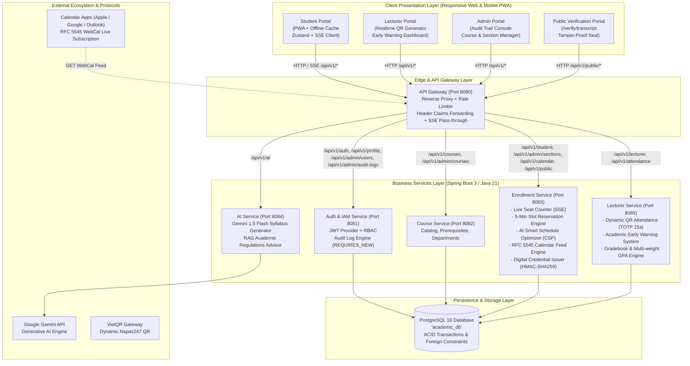
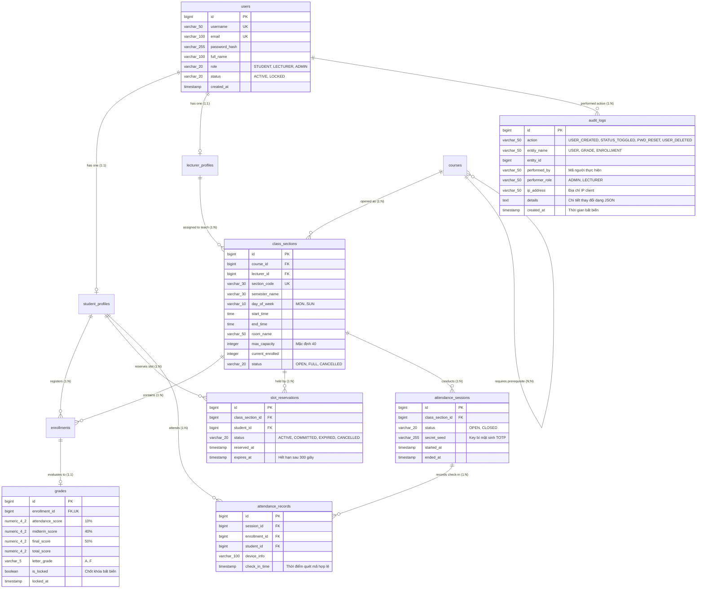
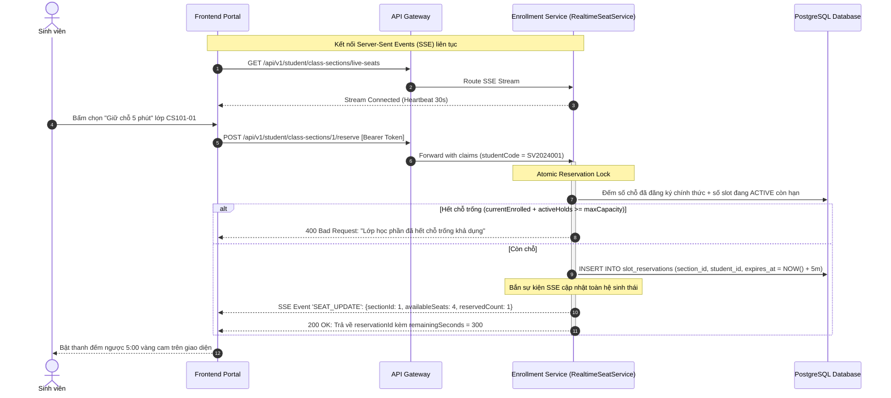
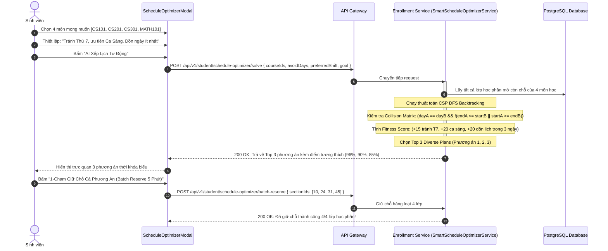
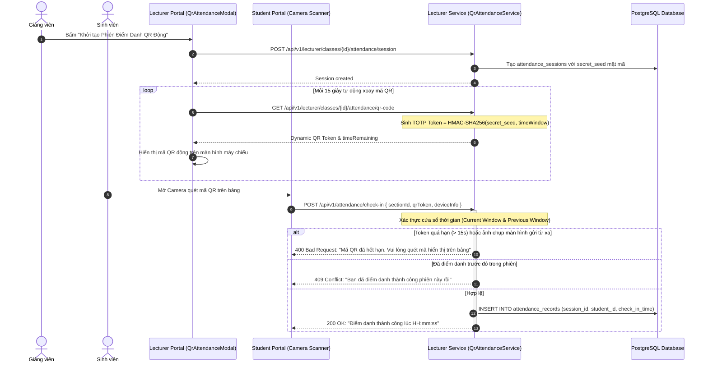
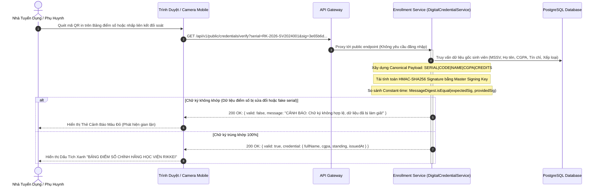

# BẢN ĐẶC TẢ YÊU CẦU PHẦN MỀM (SOFTWARE REQUIREMENTS SPECIFICATION - SRS)

## DỰ ÁN: HỆ SINH THÁI QUẢN LÝ ĐÀO TẠO THÔNG MINH (RIKKEI EDUPORTAL - SMART CAMPUS SIS)
* **Mã dự án**: `PRJ-QUICK-REVIEW-PRE-OJT-03`
* **Tiêu chuẩn tài liệu**: Chuẩn IEEE 830 / ISO/IEC/IEEE 29148
* **Vai trò biên soạn**: Senior Business Analyst & Lead Systems Architect
* **Phiên bản**: `3.0 - Standardized Enterprise Release (Function Catalog & Use Case Specifications)`
* **Trạng thái**: Đã phê duyệt & Đồng bộ hóa toàn diện (Approved & Synchronized)
* **Ngày cập nhật**: 16/11/2026

---

# MỤC LỤC
1. [TỔNG QUAN HỆ THỐNG & PHẠM VI (SYSTEM OVERVIEW & SCOPE)](#1-tổng-quan-hệ-thống--phạm-vi-system-overview--scope)
2. [HỆ THỐNG LƯỢC ĐỒ KIẾN TRÚC & NGHIỆP VỤ (SYSTEM DIAGRAMS)](#2-hệ-thống-lược-đồ-kiến-trúc--nghiệp-vụ-system-diagrams)
   - 2.1. [Lược đồ Kiến trúc Tổng thể Hệ thống (System Architecture Diagram)](#21-lược-đồ-kiến-trúc-tổng-thể-hệ-thống-system-architecture-diagram)
   - 2.2. [Lược đồ Use Case Tổng quát (Overall Use Case Diagram)](#22-lược-đồ-use-case-tổng-quát-overall-use-case-diagram)
   - 2.3. [Lược đồ Quan hệ Thực thể Dữ liệu Mở rộng (Extended ERD)](#23-lược-đồ-quan-hệ-thực-thể-dữ-liệu-mở-rộng-extended-erd)
   - 2.4. [Lược đồ Tuần tự Nghiệp vụ Cốt lõi & Tiên tiến (Core & Advanced Sequence Diagrams)](#24-lược-đồ-tuần-tự-nghiệp-vụ-cốt-lõi--tiên-tiến-core--advanced-sequence-diagrams)
3. [DANH MỤC CHỨC NĂNG CHUẨN HÓA (FUNCTION CATALOG & TRACEABILITY MATRIX)](#3-danh-mục-chức-năng-chuẩn-hóa-function-catalog--traceability-matrix)
   - 3.1. [Danh mục Phân hệ Nghiệp vụ (Module Inventory)](#31-danh-mục-phân-hệ-nghiệp-vụ-module-inventory)
   - 3.2. [Bảng Danh mục Chức năng Chuẩn hóa (Standardized Function Catalog - 58 Functions)](#32-bảng-danh-mục-chức-năng-chuẩn-hóa-standardized-function-catalog---58-functions)
   - 3.3. [Ma trận Đối soát Bằng chứng Triển khai (Implementation Evidence Matrix)](#33-ma-trận-đối-soát-bằng-chứng-triển-khai-implementation-evidence-matrix)
4. [QUY TẮC NGHIỆP VỤ BẮT BUỘC (BUSINESS RULES CATALOG - BRs)](#4-quy-tắc-nghiệp-vụ-bắt-buộc-business-rules-catalog---brs)
5. [TỪ ĐIỂN DỮ LIỆU & RÀNG BUỘC CƠ SỞ DỮ LIỆU (DATA DICTIONARY)](#5-từ-điển-dữ-liệu--ràng-buộc-cơ-sở-dữ-liệu-data-dictionary)
6. [YÊU CẦU PHI CHỨC NĂNG (NON-FUNCTIONAL REQUIREMENTS - NFRs)](#6-yêu-cầu-phi-chức-năng-non-functional-requirements---nfrs)
7. [CHUẨN GIAO DIỆN & TÍCH HỢP RESTFUL API (INTERFACE & INTEGRATION SPECIFICATIONS)](#7-chuẩn-giao-diện--tích-hợp-restful-api-interface--integration-specifications)
8. [ĐẶC TẢ CHI TIẾT 21 USE CASE (DETAILED USE CASE SPECIFICATIONS)](#8-đặc-tả-chi-tiết-21-use-case-detailed-use-case-specifications)
   - 8.1. [Mục lục & Ma trận Phân loại 21 Use Case](#81-mục-lục--ma-trận-phân-loại-21-use-case)
   - 8.2. [Danh sách Đặc tả Chi tiết 21 Use Case (Chuẩn 13 Phần IEEE)](#82-danh-sách-đặc-tả-chi-tiết-21-use-case-chuẩn-13-phần-ieee)

---

# 1. TỔNG QUAN HỆ THỐNG & PHẠM VI (SYSTEM OVERVIEW & SCOPE)

### 1.1. Mục đích tài liệu
Tài liệu Đặc tả Yêu cầu Phần mềm (SRS) phiên bản **2.1 - Smart Campus Enterprise Release** thiết lập cơ sở kỹ thuật và nghiệp vụ hoàn chỉnh cho hệ thống **Rikkei EduPortal**. Tài liệu phản ánh 100% cấu trúc kiến trúc thực tế, logic xử lý giao dịch, thuật toán xếp lịch CSP, giao thức mật mã xác thực chứng chỉ số và các phân hệ thông minh vừa được hoàn thiện.

### 1.2. Mục tiêu sản phẩm
Chuyển đổi cổng đào tạo truyền thống thành **Hệ sinh thái Smart Campus & EdTech toàn diện**:
1. **Giải quyết triệt để bài toán mùa đăng ký tín chỉ**: Tích hợp luồng sự kiện Real-time (Server-Sent Events) hiển thị bộ đếm chỗ tức thì, cơ chế giữ chỗ phân tán 5 phút và thuật toán AI CSP xếp thời khóa biểu tối ưu tự động 1-chạm.
2. **Hiện đại hóa trải nghiệm người học**: Ứng dụng công nghệ Progressive Web App (PWA) cài đặt trực tiếp trên smartphone, đồng bộ lịch học tự động qua chuẩn quốc tế RFC 5545 `.ics` (Google Calendar, Apple Calendar).
3. **Triệt tiêu gian lận học vụ**: Áp dụng điểm danh bằng mã QR động xoay mỗi 15 giây (thuật toán TOTP mật mã), lưu vết kiểm toán bất biến (Audit Trail) cho mọi thao tác chỉnh sửa dữ liệu người dùng.
4. **Phòng ngừa rủi ro học tập chủ động**: Hệ thống Cảnh báo Sớm (Early Warning System) phát hiện sinh viên vắng $\ge 20\%$ số buổi (nguy cơ cấm thi) hoặc điểm giữa kỳ $< 4.0$ để giảng viên kịp thời hỗ trợ.
5. **Chứng thực số chuẩn quốc tế**: Bảng điểm điện tử gắn chữ ký số HMAC-SHA256 và mã QR đối soát công khai, cho phép nhà tuyển dụng xác minh tức thì tính hợp pháp của kết quả học tập.

### 1.3. Các Tác nhân Hệ thống (System Actors)
* **Sinh viên (STUDENT)**: Người học chính thức, tra cứu CTĐT, đăng ký tín chỉ thời gian thực, giữ chỗ môn học, tải lịch học về điện thoại, điểm danh camera QR, tra cứu điểm và xuất chứng chỉ số.
* **Giảng viên (LECTURER)**: Quản lý lớp, phát mã QR động điểm danh, theo dõi báo cáo cảnh báo sớm học vụ, nhập điểm thành phần và chốt khóa bảng điểm.
* **Quản trị viên Đào tạo (ADMIN)**: Phân quyền tài khoản, quản lý khung chương trình, mở lớp học phần, xếp phòng/lịch chống xung đột và tra cứu nhật ký kiểm toán hệ thống.
* **Bên thứ ba / Nhà tuyển dụng (PUBLIC VERIFIER)**: Truy cập cổng đối soát chứng chỉ số công khai `/verify/transcript` để xác thực bảng điểm thật/giả.

---
# 2. HỆ THỐNG LƯỢC ĐỒ KIẾN TRÚC & NGHIỆP VỤ (SYSTEM DIAGRAMS)

## 2.1. Lược đồ Kiến trúc Tổng thể Hệ thống (System Architecture Diagram)

---

## 2.2. Lược đồ Use Case Tổng quát (Overall Use Case Diagram)

```mermaid
graph LR
    actor_stu((Sinh viên\nSTUDENT))
    actor_lec((Giảng viên\nLECTURER))
    actor_adm((Quản trị viên\nADMIN))
    actor_pub((Bên thứ ba\nPUBLIC))

    subgraph SystemBoundary ["HỆ SINH THÁI RIKKEI EDUPORTAL (SMART CAMPUS)"]
        %% Common
        UC_LOGIN["UC-01: Đăng nhập & Xác thực JWT"]
        UC_PWA["UC-02: Cài đặt PWA & Tra cứu Offline"]
        
        %% Student Use Cases
        UC_DASHBOARD["UC-03: Xem Dashboard & Cảnh báo học vụ"]
        UC_CAL_SYNC["UC-04: Đồng bộ Lịch Google/Apple Calendar"]
        UC_LIVE_SEAT["UC-05: Xem số chỗ Real-time (SSE) & Giữ chỗ 5p"]
        UC_AI_SCHED["UC-06: AI Tối ưu Hóa TKB (CSP Optimizer)"]
        UC_ENROLL["UC-07: Đăng ký & Hủy học phần"]
        UC_QR_ATTEND["UC-08: Quét mã QR Động điểm danh"]
        UC_DIGITAL_TRANSCRIPT["UC-09: Xem Bảng điểm & Xuất Bằng số QR"]
        UC_TUITION["UC-10: Nộp học phí qua mã VietQR"]
        UC_AI_CHAT["UC-11: Trợ lý AI Cố vấn Quy chế Đào tạo"]

        %% Lecturer Use Cases
        UC_LEC_CLASSES["UC-12: Quản lý Lớp & Sinh viên"]
        UC_ROTATING_QR["UC-13: Khởi tạo Phiên Điểm danh QR Động (15s)"]
        UC_EARLY_WARNING["UC-14: Báo cáo Cảnh báo sớm & Bắn nhắc nhở"]
        UC_INPUT_GRADE["UC-15: Nhập điểm & Chốt khóa bảng điểm"]

        %% Admin Use Cases
        UC_ADMIN_USERS["UC-16: Quản lý Người dùng & Đặt lại mật khẩu"]
        UC_AUDIT_LOGS["UC-17: Tra cứu Nhật ký Kiểm toán (Audit Trail)"]
        UC_ADMIN_COURSES["UC-18: Quản lý Khung CTĐT & Tiên quyết"]
        UC_ADMIN_SECTIONS["UC-19: Mở lớp học phần & Kiểm soát trùng phòng"]
        UC_GEN_SYLLABUS["UC-20: AI Sinh Đề cương môn học"]

        %% Public Use Case
        UC_VERIFY_CREDENTIAL["UC-21: Đối soát Tính Hợp lệ Bảng điểm Số"]
    end

    %% Connections
    actor_stu --> UC_LOGIN
    actor_stu --> UC_PWA
    actor_stu --> UC_DASHBOARD
    actor_stu --> UC_CAL_SYNC
    actor_stu --> UC_LIVE_SEAT
    actor_stu --> UC_AI_SCHED
    actor_stu --> UC_ENROLL
    actor_stu --> UC_QR_ATTEND
    actor_stu --> UC_DIGITAL_TRANSCRIPT
    actor_stu --> UC_TUITION
    actor_stu --> UC_AI_CHAT

    actor_lec --> UC_LOGIN
    actor_lec --> UC_PWA
    actor_lec --> UC_LEC_CLASSES
    actor_lec --> UC_ROTATING_QR
    actor_lec --> UC_EARLY_WARNING
    actor_lec --> UC_INPUT_GRADE

    actor_adm --> UC_LOGIN
    actor_adm --> UC_ADMIN_USERS
    actor_adm --> UC_AUDIT_LOGS
    actor_adm --> UC_ADMIN_COURSES
    actor_adm --> UC_ADMIN_SECTIONS
    actor_adm --> UC_GEN_SYLLABUS

    actor_pub --> UC_VERIFY_CREDENTIAL
```

---

## 2.3. Lược đồ Quan hệ Thực thể Dữ liệu Mở rộng (Extended ERD)

---

## 2.4. Lược đồ Tuần tự Nghiệp vụ Cốt lõi & Tiên tiến (Core & Advanced Sequence Diagrams)

### Sequence 1: Bộ đếm chỗ Real-time (SSE) & Cơ chế Giữ chỗ 5 phút (Slot Reservation)

### Sequence 2: AI Xếp Thời Khóa Biểu Tự Động (CSP Solver) & 1-Chạm Batch Reserve

### Sequence 3: Điểm danh Bằng Mã QR Động Luân Chuyển 15 Giây (Dynamic TOTP)

### Sequence 4: Đối Soát Công Khai Bảng Điểm Số (Verifiable Digital Credentials)

---
# 3. DANH MỤC CHỨC NĂNG CHUẨN HÓA (FUNCTION CATALOG & TRACEABILITY MATRIX)

## 3.1. Danh mục Phân hệ Nghiệp vụ (Module Inventory)

Toàn bộ hệ thống Rikkei EduPortal được phân rã thành **16 Phân hệ Nghiệp vụ Cốt lõi (Core Business Modules)** rõ ràng và **2 Kênh Phân phối Giao diện Khách (Client Presentation Channels)**:

### 3.1. Danh mục 16 Phân hệ Nghiệp vụ (Core Business Modules)

| Mã Phân hệ | Tên Phân hệ Nghiệp vụ | Tiếng Anh (Module Name) | Phạm vi & Trách nhiệm Nghiệp vụ Cốt lõi |
| :--- | :--- | :--- | :--- |
| **MOD-AUTH** | Xác thực & Quản trị Danh tính | Authentication & IAM | Quản lý định danh người dùng, cấp phát/hủy token JWT, kiểm soát phân quyền RBAC, đổi mật khẩu và bảo vệ tài khoản quản trị. |
| **MOD-USER** | Quản lý Người dùng & Hồ sơ | User & Profile Management | Quản lý thông tin hồ sơ sinh viên, hồ sơ giảng viên, quản trị viên; các thao tác CRUD người dùng, khóa/mở tài khoản và reset mật khẩu. |
| **MOD-AUDIT** | Nhật ký Kiểm toán Học vụ | Academic Audit Trail | Tự động ghi vết bất biến cho mọi hành động nhạy cảm của hệ thống với giao dịch cô lập; giao diện tra cứu và đối soát cho Admin. |
| **MOD-CAT** | Khung Chương trình & Môn học | Academic Catalog & Curriculum | Quản lý danh mục môn học, số tín chỉ, thiết lập tiên quyết/song hành, quản lý khung chương trình đào tạo theo từng chuyên ngành. |
| **MOD-SEM** | Quản lý Học kỳ & Đợt Đăng ký | Semester & Term Operations | Quản lý danh mục học kỳ niên khóa, cấu hình khung thời gian mở/đóng cổng đăng ký tín chỉ và đợt đăng ký sớm/muộn. |
| **MOD-SEC** | Quản lý Lớp học phần | Class Sections Operations | Mở lớp học phần, phân công giảng viên, xếp phòng học, kiểm soát ma trận xung đột phòng/lịch dạy, quản lý sĩ số tối đa. |
| **MOD-ENROLL**| Đăng ký Tín chỉ & Ghi danh | Course Registration Engine | Tra cứu lớp mở, cập nhật chỗ khả dụng real-time, giữ chỗ 5 phút, xác nhận ghi danh chính thức, hủy môn, duyệt đăng ký ngoại lệ. |
| **MOD-CAL** | Thời khóa biểu & Đồng bộ Lịch | Timetable & Calendar Sync | Hiển thị thời khóa biểu tuần/ngày cho sinh viên/giảng viên, xuất file `.ics`, cấp URL WebCal Live Subscription, và tra cứu ngoại tuyến. |
| **MOD-ATT** | Điểm danh QR & Chuyên cần | QR Attendance & Check-in | Khởi tạo phiên điểm danh QR động xoay mã 15s (TOTP), quét mã camera đa nền tảng, điểm danh thủ công bổ sung, khóa phiên và báo cáo. |
| **MOD-WARN** | Cảnh báo Sớm Nguy cơ Học vụ | Academic Early Warning System | Tự động phát hiện sinh viên vắng $\ge 20\%$ số buổi (nguy cơ cấm thi) hoặc điểm giữa kỳ $< 3.0/4.0$; phát thông báo cảnh báo sớm 1-chạm. |
| **MOD-GRADE** | Quản lý Điểm & Sổ điểm | Gradebook & GPA Engine | Nhập/sửa điểm thành phần (10-40-50), tính điểm tổng kết và CGPA, chốt khóa sổ điểm bất biến, quy trình mở khóa phúc khảo điểm thi. |
| **MOD-EXAM** | Quản lý Lịch thi & Tổ chức Thi | Examination Management | Quản lý lịch thi học phần (ngày thi, ca thi, phòng thi), thuật toán tự động sinh lịch thi chống trùng lặp, sinh viên tra cứu lịch thi. |
| **MOD-FIN** | Tài chính Sinh viên & Học phí | Student Finance & Tuition | Lập hóa đơn học phí theo tín chỉ, thanh toán qua VietQR Napas247, tích hợp cổng PayOS, tự động đối soát gạch nợ, và cảnh báo nhắc nợ. |
| **MOD-NOTIF** | Bản tin & Trung tâm Thông báo | Announcements & Notifications | Quản lý bản tin thông báo chung toàn trường; trung tâm thông báo cá nhân đa kênh (học vụ, điểm số, lịch thi, học phí); đánh dấu đã đọc. |
| **MOD-AI** | Trí tuệ Nhân tạo & Cố vấn | AI Smart Campus Engine | Thuật toán CSP xếp TKB tối ưu tự động kèm 1-chạm batch reserve; Trợ lý ảo AI tư vấn quy chế đào tạo (RAG); AI sinh đề cương 15 tuần. |
| **MOD-CRED** | Chứng chỉ Số & Bảng điểm Mã hóa | Digital Credentials & Verify | Xuất bảng điểm điện tử gắn mã serial và chữ ký số HMAC-SHA256; cổng tra cứu và đối soát bằng cấp/bảng điểm công khai chống giả mạo. |

### 3.2. Kênh Phân phối & Giao diện Khách (Client Presentation & Delivery Channels)
- **Web Portal (Responsive Web & PWA Shell)**: Ứng dụng ReactJS SPA (Vite + Tailwind CSS + Zustand) phục vụ quản trị viên, giảng viên và sinh viên trên máy tính bảng và trình duyệt desktop, hỗ trợ Progressive Web App.
- **Mobile Native Application (React Native / Expo)**: Ứng dụng di động chuyên dụng cho Giảng viên và Sinh viên, cung cấp khả năng tích hợp phần cứng camera quét mã QR độ trễ thấp và lưu trữ bộ nhớ đệm ngoại tuyến (Offline Storage) hỗ trợ tra cứu lịch và điểm khi mất mạng.

---
## 3.2. Bảng Danh mục Chức năng Chuẩn hóa (Standardized Function Catalog - 58 Functions)
> **Bộ Quy tắc Phân loại Mức độ Ưu tiên (MoSCoW)**:
> - **Must have**: 35 chức năng | **Should have**: 20 chức năng | **Could have**: 3 chức năng | **Won't have**: 0  
> $\rightarrow$ **Tổng cộng chính xác: 58 Chức năng Nghiệp vụ Độc lập**.
>
> **Quy ước Trạng thái Triển khai (Implementation Status)**:
> - **VERIFIED**: Đã triển khai hoàn tất trong mã nguồn và có bằng chứng kỹ thuật đối soát khớp với nghiệp vụ.
> - **PARTIALLY VERIFIED**: Đã triển khai một phần trong code nhưng còn thiếu các luồng xử lý hoặc đang sử dụng dữ liệu fallback mẫu.
> - **UNVERIFIED**: Yêu cầu nghiệp vụ hợp lệ đã được phê duyệt nhưng **chưa tìm thấy bằng chứng triển khai trong mã nguồn hiện có**.
> - **CONTRADICTED**: Code đang chạy có hành vi khác với văn bản SRS cũ; đã được chuẩn hóa theo các Locked Business Rules.

| Mã Chức năng | Tên Chức năng (Developer-Friendly) | Endpoint API & Method | Actor (RBAC) | Tóm tắt Xử lý Kỹ thuật & I/O | Business Rules | Mức Ưu tiên (MoSCoW) | Trạng thái Triển khai | Use Case Đề xuất |
| :--- | :--- | :--- | :--- | :--- | :---: | :---: | :---: | :--- |
| **F-AUTH-001** | **Đăng nhập & Cấp Token xác thực** *(User Login & JWT Issuance)* | `POST /api/v1/auth/login` | All Users / Public | **In**: `username`/`email`, `password`. **Logic**: Verify BCrypt, kiểm tra `status == ACTIVE`, sinh cặp JWT (Access Token 24h, HMAC-SHA512 + Refresh Token). **Out**: `200 OK` `{ accessToken, refreshToken, tokenType, role, fullName }`. | BR-04, BR-14 | **Must have** | **VERIFIED** | `UC-AUTH-001` (Cũ: `UC-01`) |
| **F-AUTH-002** | **Đăng xuất & Thu hồi Refresh Token** *(User Logout & Revoke Session)* | `POST /api/v1/auth/logout` | All Authenticated Users | **In**: `refreshToken`, `userId`. **Logic**: Tìm và xóa bản ghi trong bảng `refresh_tokens`, dọn dẹp phiên client. **Out**: `200 OK` message đăng xuất thành công. | BR-14 | **Must have** | **VERIFIED** | `UC-AUTH-002` |
| **F-AUTH-003** | **Làm mới Access Token qua Refresh Token** *(Refresh Access Token)* | `POST /api/v1/auth/refresh` | All Users / Client App | **In**: `refreshToken`. **Logic**: Kiểm tra hạn và tính hợp lệ của Refresh Token trong DB, sinh Access Token mới không gián đoạn. **Out**: `200 OK` `{ accessToken, tokenType }`. | Session Policy | **Must have** | **VERIFIED** | `UC-AUTH-003` |
| **F-AUTH-004** | **Đổi mật khẩu tài khoản** *(Change User Password)* | `POST /api/v1/auth/change-password` | All Authenticated Users | **In**: `currentPassword`, `newPassword`, `confirmPassword`. **Logic**: Verify mật khẩu cũ qua BCrypt, validate độ dài $\ge 6$, hash mật khẩu mới và update DB. **Out**: `200 OK` message đổi mật khẩu thành công. | Password Policy | **Must have** | **VERIFIED** | `UC-AUTH-004` |
| **F-USER-001** | **Tra cứu & Lọc danh sách người dùng** *(Get Users with Pagination)* | `GET /api/v1/admin/users` | ADMIN | **In**: Query params (`page`, `size`, `search`, `role`, `status`). **Logic**: Dynamic query bảng `users` + profile liên kết, phân trang và đếm tổng bản ghi. **Out**: `200 OK` `{ content: [UserDTO], totalPages, totalElements }`. | Admin RBAC | **Must have** | **VERIFIED** | `UC-USER-001` (Cũ: `UC-16`) |
| **F-USER-002** | **Tạo tài khoản & Khởi tạo hồ sơ** *(Create User & Profile)* | `POST /api/v1/admin/users` | ADMIN | **In**: `username`, `email`, `role`, `fullName`, `phone`, thông tin khoa/chuyên ngành. **Logic**: Check unique user/email, gán mật khẩu mặc định BCrypt, tạo profile (`student_profiles` hoặc `lecturer_profiles`). **Out**: `201 Created` `{ user, profile }`. | BR-14 | **Must have** | **VERIFIED** | `UC-USER-002` (Cũ: `UC-16`) |
| **F-USER-003** | **Cập nhật hồ sơ & Khóa/Mở tài khoản** *(Update User & Lock Status)* | `PUT /api/v1/admin/users/{id}, PATCH /api/v1/admin/users/{id}/status` | ADMIN | **In**: `id`, update fields / `{ status: ACTIVE/LOCKED }`. **Logic**: Update bảng `users`/profile. Chặn tuyệt đối hành vi khóa hoặc hạ quyền Admin (**BR-04**). **Out**: `200 OK` thông tin cập nhật. | BR-04, BR-14 | **Must have** | **VERIFIED** | `UC-USER-003` (Cũ: `UC-16`) |
| **F-USER-004** | **Đặt lại mật khẩu người dùng về mặc định** *(Reset User Password)* | `POST /api/v1/admin/users/{id}/reset-password` | ADMIN | **In**: `id`. **Logic**: Hash mật khẩu mặc định qua BCrypt, update cột `password`, ghi log kiểm toán bất biến (**BR-14**). **Out**: `200 OK` message reset thành công. | BR-14 | **Must have** | **VERIFIED** | `UC-USER-004` (Cũ: `UC-16`) |
| **F-USER-005** | **Xem & Cập nhật hồ sơ cá nhân** *(Get/Update Current Profile)* | `GET /api/v1/auth/me, PUT /api/v1/users/profile` | All Authenticated Users | **In**: Profile update fields (`phone`, `address`, `personalEmail`). **Logic**: Lấy `userId` từ token context, tra cứu hồ sơ và cho phép sửa các trường thông tin tự quản lý. **Out**: `200 OK` `{ userProfileDTO }`. | User Self-Service | **Must have** | **VERIFIED** | `UC-USER-005` |
| **F-AUDIT-001** | **Ghi log kiểm toán bất biến độc lập** *(Async/Isolated Audit Logging)* | `System Internal Engine (REQUIRES_NEW)` | System | **In**: `userId`, `action`, `entityName`, `entityId`, `oldDataJson`, `newDataJson`, `ipAddress`. **Logic**: Giao dịch cô lập `PROPAGATION_REQUIRES_NEW`, lưu bảng `audit_logs` bất biến (**BR-14**). **Out**: Void (Ghi log thành công, không chặn luồng chính). | BR-14 | **Must have** | **VERIFIED** | Nền tảng (System Service) |
| **F-AUDIT-002** | **Tra cứu & Đối soát nhật ký kiểm toán** *(Query & Filter Audit Logs)* | `GET /api/v1/admin/audit-logs` | ADMIN | **In**: Query params (`page`, `size`, `action`, `userId`, `fromDate`, `toDate`). **Logic**: Truy vấn phân trang bảng `audit_logs` theo thứ tự thời gian giảm dần. **Out**: `200 OK` `{ content: [AuditLogDTO], totalPages, totalElements }`. | Admin Audit | **Should have** | **VERIFIED** | `UC-AUDIT-001` (Cũ: `UC-17`) |
| **F-CAT-001** | **Quản lý danh mục môn học CRUD** *(Course Catalog Management)* | `GET/POST /api/v1/admin/courses, PUT/DELETE /api/v1/admin/courses/{id}` | ADMIN | **In**: `courseCode`, `courseName`, `credits`, `department`. **Logic**: Validate mã môn duy nhất, số tín chỉ $> 0$. Chặn xóa nếu môn đã từng mở lớp (**BR-12**). **Out**: `200 OK` / `201 Created` / `204 No Content`. | BR-12, BR-14 | **Must have** | **VERIFIED** | `UC-CAT-001` (Cũ: `UC-12`) |
| **F-CAT-002** | **Thiết lập môn tiên quyết & song hành** *(Configure Course Prerequisites)* | `POST /api/v1/admin/courses/{id}/prerequisites` | ADMIN | **In**: `courseId`, `prerequisiteCourseId`, `type` (PREREQUISITE/COREQUISITE). **Logic**: Kiểm tra tồn tại, thuật toán phát hiện vòng lặp chu trình đồ thị (Cycle Detection - **BR-02**). **Out**: `200 OK` message thiết lập thành công. | BR-02 | **Must have** | **VERIFIED** | `UC-CAT-002` (Cũ: `UC-12`) |
| **F-CAT-003** | **Tra cứu chương trình đào tạo & Cây tiến độ** *(Get Curriculum & Progress Tree)* | `GET /api/v1/curriculum, GET /api/v1/student/curriculum-progress` | STUDENT, LECTURER, ADMIN | **In**: `majorId` hoặc lấy theo context sinh viên đăng nhập. **Logic**: Tra cứu cây khung chương trình theo học kỳ đề xuất, tính tổng tín chỉ đã tích lũy và còn thiếu. **Out**: `200 OK` `{ curriculumTree, completedCredits, remainingCredits }`. | Academic Progress | **Should have** | **VERIFIED** | `UC-CAT-003` |
| **F-SEM-001** | **Quản lý danh mục học kỳ niên khóa CRUD** *(Semester Management)* | `GET/POST /api/v1/admin/semesters, PUT /api/v1/admin/semesters/{id}` | ADMIN | **In**: `semesterCode`, `academicYear`, `startDate`, `endDate`, `termType`. **Logic**: Validate logic thời gian `startDate < endDate`, thiết lập học kỳ hiện tại (`is_current`). **Out**: `200 OK` / `201 Created` `{ semesterDTO }`. | Term Operations | **Must have** | **VERIFIED** | `UC-SEM-001` (Cũ: `UC-13`) |
| **F-SEM-002** | **Cấu hình thời gian mở đợt đăng ký tín chỉ** *(Configure Enrollment Window)* | `PUT /api/v1/admin/semesters/{id}/registration-window` | ADMIN | **In**: `id`, `registrationOpenDate`, `registrationCloseDate`. **Logic**: Kiểm tra khung thời gian nằm trong học kỳ, validate điều kiện kích hoạt mở cổng đăng ký. **Out**: `200 OK` `{ semesterDTO }` đã cập nhật khung đăng ký. | Term Policy | **Must have** | **VERIFIED** | `UC-SEM-002` (Cũ: `UC-13`) |
| **F-SEC-001** | **Mở lớp học phần mới trong học kỳ** *(Create Class Section)* | `POST /api/v1/admin/sections` | ADMIN | **In**: `courseId`, `semesterId`, `lecturerId`, `room`, `maxCapacity`, `dayOfWeek`, `startPeriod`, `endPeriod`. **Logic**: Kiểm tra xung đột phòng và lịch dạy giảng viên (**BR-15**), lưu `class_sections`. **Out**: `201 Created` `{ sectionDTO }` với `currentEnrolled = 0`, `status = OPEN`. | BR-14, BR-15 | **Must have** | **VERIFIED** | `UC-SEC-001` (Cũ: `UC-14`) |
| **F-SEC-002** | **Kiểm tra xung đột phòng học & Lịch giảng dạy** *(Validate Room & Schedule Conflicts)* | `POST /api/v1/admin/sections/validate-schedule` | ADMIN / System | **In**: `roomId`, `lecturerId`, `dayOfWeek`, `startPeriod`, `endPeriod`, `excludeSectionId`. **Logic**: Truy vấn bảng `class_sections` kiểm tra trùng ca phòng hoặc trùng ca giảng viên. **Out**: `200 OK` `{ hasConflict: boolean, conflictingSection: {...} }`. | BR-15 | **Must have** | **VERIFIED** | `UC-SEC-002` (Cũ: `UC-14`) |
| **F-SEC-003** | **Hủy lớp học phần không đủ sĩ số mở lớp** *(Cancel Under-enrolled Section)* | `DELETE /api/v1/admin/sections/{id}` | ADMIN | **In**: `id`. **Logic**: Kiểm tra `currentEnrolled < minCapacity`, hoàn trả trạng thái ghi danh cho sinh viên đã đăng ký, hủy lớp. **Out**: `200 OK` message hủy lớp thành công. | Class Operations | **Should have** | **PARTIALLY_IMPLEMENTED** | `UC-SEC-003` (Cũ: `UC-14`) |
| **F-ENROLL-001** | **Tra cứu danh sách lớp học phần mở đăng ký** *(Get Open Class Sections)* | `GET /api/v1/student/sections/available` | STUDENT | **In**: `semesterId`, query params tìm kiếm (`search`, `courseCode`, `dayOfWeek`). **Logic**: Lọc các lớp có `status = OPEN`, tính toán số chỗ còn trống (`maxCapacity - currentEnrolled`). **Out**: `200 OK` `[AvailableSectionDTO]`. | Enrollment Query | **Must have** | **VERIFIED** | `UC-ENROLL-001` (Cũ: `UC-02`) |
| **F-ENROLL-002** | **Truyền phát số chỗ trống thời gian thực qua SSE** *(Stream Available Seats via SSE)* | `GET /api/v1/student/sections/stream` | STUDENT / Client App | **In**: `semesterId` qua kết nối SSE (`text/event-stream`). **Logic**: `SseEmitterRegistry` quản lý client kết nối; broadcast sự kiện `SEAT_UPDATE` ngay khi có thay đổi chỗ. **Out**: Server-Sent Events stream dữ liệu JSON chỗ trống thời gian thực. | High Concurrency | **Should have** | **VERIFIED** | Nền tảng (SSE Service) |
| **F-ENROLL-003** | **Giữ chỗ học phần tạm thời trong 5 phút** *(Hold/Reserve Section Seat 5-min)* | `POST /api/v1/student/enrollments/reserve` | STUDENT | **In**: `{ sectionId }`. **Logic**: Atomic decrement chỗ khả dụng, ghi nhận `slot_reservations` có hạn 5 phút. Hết 5 phút tự động hoàn chỗ. **Out**: `200 OK` `{ reservationId, expiresAt, status: HELD }`. | Slot Reservation | **Should have** | **VERIFIED** | `UC-ENROLL-002` (Cũ: `UC-03`) |
| **F-ENROLL-004** | **Xác nhận ghi danh học phần chính thức** *(Confirm Course Enrollment)* | `POST /api/v1/student/enrollments/confirm` | STUDENT | **In**: `{ sectionId }` (hoặc `{ reservationId }`). **Logic**: Validate điều kiện tiên quyết (**BR-02**), trần tối đa 24 TC (**BR-01**), kiểm tra trùng TKB (**BR-03** Soft Warning), tạo bản ghi `enrollments`. **Out**: `200 OK` `{ enrollmentId, status: ENROLLED, hasConflict }`. | BR-01, BR-02, BR-03 | **Must have** | **VERIFIED** | `UC-ENROLL-003` (Cũ: `UC-04`) |
| **F-ENROLL-005** | **Xác nhận ghi danh hàng loạt từ danh sách giữ chỗ** *(Batch Confirm Reservations)* | `POST /api/v1/student/enrollments/batch-confirm` | STUDENT | **In**: `{ reservationIds: [Long] }`. **Logic**: Xác thực toàn bộ reservation còn hạn, kiểm tra tổng tín chỉ $\le 24$, chuyển đổi đồng loạt sang trạng thái `ENROLLED`. **Out**: `200 OK` `{ confirmedCount, failedCount, results: [...] }`. | BR-01, BR-03 | **Should have** | **VERIFIED** | `UC-ENROLL-004` |
| **F-ENROLL-006** | **Hủy đăng ký học phần / Rút môn** *(Drop Enrolled Section)* | `DELETE /api/v1/student/enrollments/{id}` | STUDENT | **In**: `enrollmentId`. **Logic**: Kiểm tra thời gian rút môn trong đợt cho phép, cập nhật `enrollments.status = DROPPED`, tăng lại 1 chỗ cho lớp. **Out**: `200 OK` message hủy môn thành công. | Course Drop Policy | **Must have** | **VERIFIED** | `UC-ENROLL-005` (Cũ: `UC-05`) |
| **F-ENROLL-007** | **Phê duyệt hoặc từ chối đăng ký học phần ngoại lệ** *(Approve/Reject Override Request)* | `PUT /api/v1/admin/enrollments/{id}/approve, PUT /api/v1/admin/enrollments/{id}/reject` | ADMIN | **In**: `enrollmentId`, lý do duyệt/từ chối. **Logic**: Admin can thiệp duyệt cưỡng bức khi lớp quá tải hoặc trường hợp đặc biệt, ghi nhận log kiểm toán (**BR-14**). **Out**: `200 OK` `{ enrollmentDTO }`. | BR-14, Override Policy | **Should have** | **VERIFIED** | `UC-ENROLL-006` (Cũ: `UC-15`) |
| **F-CAL-001** | **Tra cứu thời khóa biểu & Lịch giảng dạy** *(Get Student/Lecturer Timetable)* | `GET /api/v1/student/timetable, GET /api/v1/lecturer/timetable` | STUDENT, LECTURER | **In**: `semesterId`, `viewType` (week, month, day). **Logic**: Truy vấn các lớp `ENROLLED` kèm thông tin phòng, ca học, giảng viên; gom nhóm theo thứ trong tuần. **Out**: `200 OK` `[TimetableEntryDTO]`. | Timetable Display | **Must have** | **VERIFIED** | `UC-CAL-001` (Cũ: `UC-08`) |
| **F-CAL-002** | **Xuất tệp lịch học chuẩn iCalendar RFC 5545** *(Export iCal .ics File)* | `GET /api/v1/student/calendar/export.ics` | STUDENT | **In**: `semesterId`. **Logic**: Sinh tệp tin định dạng `text/calendar` tuân thủ chuẩn quốc tế RFC 5545 chứa chuỗi sự kiện học (VEVENT, RRULE). **Out**: HTTP 200 File `.ics` đính kèm tải về máy. | RFC 5545 Standard | **Should have** | **VERIFIED** | `UC-CAL-002` (Cũ: `UC-08`) |
| **F-CAL-003** | **Cấp nguồn đồng bộ lịch trực tiếp WebCal Feed** *(WebCal Live Subscription Feed)* | `GET /api/v1/calendar/feed/{studentCode}` | STUDENT | **In**: `studentCode`, URL token xác thực. **Logic**: Sinh feed URL chuẩn WebCal (`webcal://...`) cho phép Apple/Google Calendar tự động cập nhật lịch khi có đổi phòng/ca. **Out**: `text/calendar` live feed stream. | Calendar Protocol | **Should have** | **VERIFIED** | `UC-CAL-003` (Cũ: `UC-08`) |
| **F-CAL-004** | **Lưu bộ nhớ đệm & Tra cứu dữ liệu ngoại tuyến** *(Offline Cache & Query Service)* | `Client Storage (SQLite / AsyncStorage)` | STUDENT (Mobile & PWA) | **In**: Tra cứu cục bộ khi thiết bị mất kết nối Internet. **Logic**: Lưu đệm dữ liệu TKB, điểm số vào SQLite / AsyncStorage / CacheStorage; tự động hiển thị offline banner. **Out**: Dữ liệu hiển thị từ cache cục bộ tức thì. | Offline Availability | **Should have** | **VERIFIED** | `UC-CAL-004` (Cũ: `UC-08`) |
| **F-ATT-001** | **Tạo phiên điểm danh mã QR động TOTP 15s** *(Create Dynamic QR Session)* | `POST /api/v1/attendance/session, GET /api/v1/attendance/qr-code` | LECTURER | **In**: `sectionId`. **Logic**: Sinh phiên `attendance_sessions`, mã hóa payload chứa TOTP token xoay vòng mỗi 15 giây (**BR-08**). **Out**: `200 OK` `{ sessionId, qrToken, rotateIntervalSec: 15 }`. | BR-08, BR-14 | **Must have** | **VERIFIED** | `UC-ATT-001` (Cũ: `UC-18`) |
| **F-ATT-002** | **Quét mã QR điểm danh buổi học** *(Check-in via Dynamic QR Code)* | `POST /api/v1/attendance/check-in` | STUDENT | **In**: `{ qrToken, deviceId, latitude, longitude }`. **Logic**: Giải mã TOTP, kiểm tra thời hạn 15s (**BR-08**), chống điểm danh hộ trùng thiết bị (**BR-09**), ghi nhận `attendance_records`. **Out**: `200 OK` `{ status: PRESENT, timestamp }`. | BR-08, BR-09 | **Must have** | **VERIFIED** | `UC-ATT-002` (Cũ: `UC-07`) |
| **F-ATT-003** | **Điểm danh bổ sung thủ công & Đóng phiên** *(Manual Attendance & Close Session)* | `POST /api/v1/attendance/manual-record, POST /api/v1/attendance/close-session` | LECTURER | **In**: `sessionId`, `{ studentId, status: PRESENT/ABSENT/LATE }`. **Logic**: Cho phép giảng viên cập nhật trạng thái thủ công cho sinh viên gặp sự cố thiết bị; đóng phiên khóa điểm danh. **Out**: `200 OK` danh sách điểm danh đã chốt. | Attendance Operations | **Must have** | **VERIFIED** | `UC-ATT-003` (Cũ: `UC-18`) |
| **F-ATT-004** | **Thống kê chuyên cần & Báo cáo điểm danh lớp** *(Get Class Attendance Report)* | `GET /api/v1/lecturer/classes/{id}/students, GET /api/v1/student/attendance/history` | LECTURER, STUDENT | **In**: `sectionId`. **Logic**: Đếm tổng số buổi đã điểm danh, số buổi có mặt/vắng của từng sinh viên, tính tỷ lệ vắng và gắn cờ cảnh báo. **Out**: `200 OK` `[StudentAttendanceSummaryDTO]`. | Attendance Summary | **Should have** | **VERIFIED** | `UC-ATT-004` (Cũ: `UC-18`) |
| **F-WARN-001** | **Quét & Nhận diện nguy cơ học vụ tự động** *(Automated Early Warning Scanner)* | `EarlyWarningService.java (Scheduled Scanner)` | System | **In**: Quét tự động định kỳ bảng `attendance_records` và `grades`. **Logic**: Nhận diện sinh viên vắng $\ge 20\%$ tổng số buổi (nguy cơ cấm thi) hoặc điểm giữa kỳ $< 3.0/4.0$ (**BR-10**). **Out**: Tạo danh sách bản ghi cảnh báo nguy cơ học vụ. | BR-10 | **Should have** | **VERIFIED** | Nền tảng (Batch Job) |
| **F-WARN-002** | **Gửi cảnh báo sớm học vụ 1-chạm tới sinh viên** *(Dispatch 1-Click Early Warning)* | `POST /api/v1/lecturer/early-warnings/dispatch` | LECTURER | **In**: `sectionId`, `{ studentIds: [Long] }`. **Logic**: Giảng viên bấm 1 nút gửi thông báo khẩn cấp cảnh báo nguy cơ cấm thi tới ứng dụng di động/email sinh viên. **Out**: `200 OK` `{ sentCount, recipients: [...] }`. | BR-10 | **Should have** | **VERIFIED** | `UC-WARN-001` (Cũ: `UC-19`) |
| **F-WARN-003** | **Tra cứu cảnh báo học vụ cá nhân trên Dashboard** *(Get Personal Early Warnings)* | `GET /api/v1/student/early-warnings/my-alerts` | STUDENT | **In**: `studentId` từ context token. **Logic**: Tra cứu các cảnh báo chưa xử lý, hiển thị banner đỏ nổi bật trên Dashboard sinh viên. **Out**: `200 OK` `[EarlyWarningAlertDTO]`. | Student Dashboard | **Should have** | **VERIFIED** | `UC-WARN-002` |
| **F-GRADE-001** | **Nhập & Cập nhật điểm thành phần 10-40-50** *(Enter & Update Component Grades)* | `PUT /api/v1/lecturer/grades/{enrollmentId}` | LECTURER | **In**: `enrollmentId`, `{ attendanceScore, midtermScore, finalScore }`. **Logic**: Validate thang điểm $[0, 10]$, tính điểm tổng kết hệ 10 và hệ 4 theo tỷ lệ 10% - 40% - 50% (**BR-05**). Chặn sửa nếu sổ điểm đã khóa (**BR-06**). **Out**: `200 OK` `{ gradeDTO, total10, total4, letterGrade }`. | BR-05, BR-06, BR-14 | **Must have** | **VERIFIED** | `UC-GRADE-001` (Cũ: `UC-19`) |
| **F-GRADE-002** | **Chốt khóa sổ điểm lớp học phần bất biến** *(Lock Class Gradebook)* | `POST /api/v1/lecturer/classes/{id}/lock-grades` | LECTURER | **In**: `sectionId`. **Logic**: Kiểm tra 100% sinh viên đã có đủ điểm (**BR-13**), đặt cờ `is_locked = TRUE`, khóa vĩnh viễn quyền sửa của giảng viên (**BR-06**). **Out**: `200 OK` message xác nhận khóa sổ điểm thành công. | BR-06, BR-13, BR-14 | **Must have** | **VERIFIED** | `UC-GRADE-002` (Cũ: `UC-19`) |
| **F-GRADE-003** | **Mở khóa sổ điểm lớp phục vụ phúc khảo** *(Unlock Gradebook for Appeal)* | `POST /api/v1/admin/classes/{id}/unlock-grades` | ADMIN | **In**: `sectionId`, `{ reason, approvedBy }`. **Logic**: **Chỉ Quản trị viên (Admin)** có thẩm quyền mở khóa sổ điểm (**BR-06**); bắt buộc ghi log kiểm toán bất biến (**BR-14**). **Out**: `200 OK` `{ sectionId, is_locked: false }`. | BR-06, BR-14 | **Must have** | **UNVERIFIED** | `UC-GRADE-003` |
| **F-GRADE-004** | **Tra cứu bảng điểm học kỳ & Điểm tích lũy GPA/CGPA** *(Get Grades & GPA Transcript)* | `GET /api/v1/student/grades, GET /api/v1/student/transcript` | STUDENT | **In**: `semesterId` (hoặc tra cứu toàn khóa). **Logic**: Lấy danh sách điểm các môn đã hoàn thành, tính điểm trung bình học kỳ GPA và điểm tích lũy toàn khóa CGPA hệ 4.0. **Out**: `200 OK` `{ semesterGrades: [...], gpa, cgpa, totalEarnedCredits }`. | Grading Engine | **Must have** | **VERIFIED** | `UC-GRADE-004` (Cũ: `UC-09`) |
| **F-EXAM-001** | **Quản lý lịch thi học phần CRUD** *(Exam Schedule CRUD)* | `GET/POST /api/v1/admin/exams, PUT/DELETE /api/v1/admin/exams/{id}` | ADMIN | **In**: `sectionId`, `examDate`, `examShift`, `room`, `maxCandidates`. **Logic**: Validate logic ca thi, phòng thi và giảng viên coi thi. **Out**: `200 OK` / `201 Created` `{ examScheduleDTO }`. | Exam Operations | **Must have** | **VERIFIED** | `UC-EXAM-001` |
| **F-EXAM-002** | **Tự động xếp lịch thi học phần chống trùng lặp** *(Auto-Schedule Conflict-free Exams)* | `POST /api/v1/admin/exams/auto-schedule` | ADMIN / System | **In**: `semesterId`, danh sách phòng thi khả dụng. **Logic**: Thuật toán tự động xếp phòng và ca thi, tránh xung đột ca thi cho sinh viên và chống trùng phòng thi. **Out**: `200 OK` `{ scheduledCount, conflictsResolved }`. | Exam Optimization | **Should have** | **VERIFIED** | `UC-EXAM-002` |
| **F-EXAM-003** | **Tra cứu lịch thi học phần & Số báo danh cá nhân** *(Get My Exam Schedule & Roll No)* | `GET /api/v1/student/exams` | STUDENT | **In**: `studentId` từ context token. **Logic**: Lấy danh sách lịch thi các môn đang học trong kỳ gồm: ngày thi, ca thi, phòng thi, số báo danh và hình thức thi. **Out**: `200 OK` `[StudentExamScheduleDTO]`. | Student Exam Query | **Must have** | **VERIFIED** | `UC-EXAM-003` |
| **F-FIN-001** | **Tính học phí & Lập hóa đơn theo số tín chỉ** *(Generate Tuition Invoice by Credits)* | `POST /api/v1/admin/tuition/generate-invoices` | System / ADMIN | **In**: `semesterId`. **Logic**: Đếm tổng số tín chỉ đăng ký chính thức của từng sinh viên, nhân định mức học phí kèm phí CSVC (**BR-07B**), tạo hóa đơn `tuition_fees`. **Out**: `200 OK` `{ generatedCount, totalAmount }`. | BR-07B | **Must have** | **VERIFIED** | `UC-FIN-001` |
| **F-FIN-002** | **Sinh mã thanh toán học phí chuẩn VietQR Napas247** *(Generate VietQR Payment Code)* | `GET /api/v1/student/tuition/{invoiceId}/vietqr` | STUDENT | **In**: `invoiceId`. **Logic**: Sinh chuỗi payload EMVCo và mã QR Napas247 điền sẵn STK thụ hưởng, số tiền chính xác và cú pháp chuyển khoản. **Out**: `200 OK` `{ qrImageUrl, qrDataString, bankAccount, amount, transferContent }`. | VietQR EMVCo | **Must have** | **VERIFIED** | `UC-FIN-002` (Cũ: `UC-10`) |
| **F-FIN-003** | **Tạo liên kết thanh toán trực tuyến qua PayOS** *(Create PayOS Checkout URL)* | `POST /api/v1/student/tuition/{invoiceId}/payos-checkout` | STUDENT | **In**: `invoiceId`. **Logic**: Gọi API cổng PayOS khởi tạo payment link thanh toán trực tuyến an toàn. **Out**: `200 OK` `{ checkoutUrl, orderCode, paymentLinkId }`. | Online Payment Gate | **Should have** | **VERIFIED** | `UC-FIN-003` |
| **F-FIN-004** | **Xử lý Webhook thanh toán & Tự động gạch nợ** *(Payment Webhook IPN & Auto-Reconcile)* | `POST /api/v1/tuition/webhook/payos` | Payment Gate / System | **In**: Webhook payload kèm chữ ký mật mã HMAC. **Logic**: Xác thực chữ ký webhook, kiểm tra mã đơn hàng, cập nhật hóa đơn sang `PAID`, gạch nợ thời gian thực. **Out**: `200 OK` `{ success: true }`. | Webhook Security | **Must have** | **VERIFIED** | Nền tảng (Webhook Service) |
| **F-FIN-005** | **Hiển thị cảnh báo nhắc nợ học phí trên Dashboard** *(Display Tuition Debt Alert)* | `GET /api/v1/student/tuition/summary` | STUDENT / System | **In**: `studentId` từ context token. **Logic**: Kiểm tra hóa đơn kỳ trước chưa thanh toán, hiển thị cảnh báo nhắc nợ; **không chặn quyền đăng ký môn** (**BR-07A**). **Out**: `200 OK` `{ hasUnpaidDebt: boolean, unpaidAmount: number }`. | BR-07A | **Should have** | **VERIFIED** | `UC-FIN-004` |
| **F-NOTIF-001** | **Quản lý bản tin & Thông báo đào tạo chung CRUD** *(Campus Announcements CRUD)* | `GET/POST/DELETE /api/v1/announcements, PUT /api/v1/announcements/{id}` | ADMIN | **In**: `title`, `content`, `category`, `isPinned`, `targetAudience`. **Logic**: Validate tiêu đề và nội dung, lưu bảng `announcements`, phát thông báo tới trang chủ. **Out**: `200 OK` / `201 Created` `{ announcementDTO }`. | Broadcast Notice | **Should have** | **VERIFIED** | `UC-NOTIF-001` |
| **F-NOTIF-002** | **Tra cứu & Nhận thông báo học vụ cá nhân** *(Get Personal Notifications)* | `GET /api/v1/notifications` | All Authenticated Users | **In**: `userId` từ token, query params (`unreadOnly`, `page`, `size`). **Logic**: Lấy danh sách thông báo biến động cá nhân (điểm thi, cảnh báo nguy cơ, đổi lịch, học phí). **Out**: `200 OK` `{ content: [NotificationDTO], unreadCount }`. | Notification Center | **Must have** | **VERIFIED** | `UC-NOTIF-002` |
| **F-NOTIF-003** | **Đánh dấu đã đọc thông báo đơn lẻ hoặc tất cả** *(Mark Notification(s) as Read)* | `PUT /api/v1/notifications/{id}/read, PUT /api/v1/notifications/read-all` | All Authenticated Users | **In**: `id` thông báo hoặc gọi endpoint read-all. **Logic**: Cập nhật cờ `is_read = TRUE` cho các thông báo của người dùng hiện tại. **Out**: `200 OK` message cập nhật thành công. | Notification Utility | **Could have** | **VERIFIED** | `UC-NOTIF-003` |
| **F-AI-001** | **Xếp lịch tối ưu thời khóa biểu bằng thuật toán AI CSP** *(AI CSP Timetable Optimizer)* | `POST /api/v1/student/schedule-optimizer/solve` | STUDENT | **In**: `{ courseIds: [Long], preferredDaysOff: [...], preferredShifts: [...] }`. **Logic**: Động cơ AI CSP Backtracking tìm kiếm không gian nghiệm, loại trừ xung đột giờ học, xếp hạng điểm tối ưu Top 3 phương án. **Out**: `200 OK` `{ solutions: [ScheduleSolutionDTO] }`. | AI Constraint Satisfaction | **Should have** | **VERIFIED** | `UC-AI-001` (Cũ: `UC-06`) |
| **F-AI-002** | **1-chạm giữ chỗ toàn bộ môn trong phương án AI** *(1-Click Batch Reserve AI Plan)* | `POST /api/v1/student/schedule-optimizer/batch-reserve` | STUDENT | **In**: `{ sectionIds: [Long] }` từ phương án AI đã chọn. **Logic**: Thực thi giao dịch giữ chỗ đồng loạt 5 phút cho tất cả các môn trong phương án trong một lời gọi duy nhất. **Out**: `200 OK` `{ reservedSections: [...], expiresAt }`. | Batch Atomic Reserve | **Should have** | **VERIFIED** | `UC-AI-002` (Cũ: `UC-06`) |
| **F-AI-003** | **Hỏi đáp quy chế đào tạo qua Chatbot AI RAG** *(Query Regulations via AI Advisor RAG)* | `POST /api/v1/ai/academic-advisor` | STUDENT | **In**: `{ question: string, contextHistory: [...] }`. **Logic**: Truy xuất văn bản quy chế đào tạo liên quan (RAG Retrieval), tổng hợp câu trả lời tự nhiên qua Google Gemini LLM. **Out**: `200 OK` `{ answer: string, referenceArticles: [...] }`. | AI RAG LLM | **Could have** | **VERIFIED** | `UC-AI-003` (Cũ: `UC-11`) |
| **F-AI-004** | **Tự động tạo khung đề cương môn học 15 tuần qua AI** *(Generate 15-Week Syllabus via AI)* | `POST /api/v1/ai/generate-syllabus` | ADMIN, LECTURER | **In**: `{ courseId, courseName, credits, targetAudience }`. **Logic**: Gọi mô hình Google Gemini 1.5 sinh đề cương chi tiết 15 tuần định dạng Markdown, lưu trường `courses.syllabus`. **Out**: `200 OK` `{ syllabusMarkdown: string }`. | Generative AI | **Could have** | **VERIFIED** | `UC-AI-004` (Cũ: `UC-20`) |
| **F-CRED-001** | **Xuất bảng điểm điện tử gắn mã serial & Chữ ký số HMAC** *(Export Digital Transcript with HMAC Signature)* | `GET /api/v1/student/credentials/transcript` | STUDENT | **In**: `studentId` từ context token. **Logic**: Tổng hợp kết quả học tập, sinh chuỗi hash canonical và ký chữ ký số HMAC-SHA256, sinh mã serial định danh duy nhất (**BR-11**). **Out**: `200 OK` `{ serialNumber, digitalSignature, transcriptPayload, qrCodeUrl }`. | BR-11 | **Must have** | **PARTIALLY_IMPLEMENTED** | `UC-CRED-001` (Cũ: `UC-09`) |
| **F-CRED-002** | **Xác thực tính hợp lệ của bảng điểm số công khai** *(Public Verify Digital Transcript)* | `GET /api/v1/public/credentials/verify` | PUBLIC VERIFIER | **In**: Query params `{ serial, signature }` từ việc quét mã QR trên bảng điểm điện tử. **Logic**: Tái tạo chuỗi canonical payload từ DB, đối soát chữ ký HMAC-SHA256 không cần đăng nhập; hiển thị huy hiệu xác thực. **Out**: `200 OK` `{ isValid: boolean, studentName, studentCode, gpa, issuedAt }`. | Cryptographic Verification | **Must have** | **VERIFIED** | `UC-CRED-002` (Cũ: `UC-21`) |

---
## 3.3. Ma trận Đối soát Bằng chứng Triển khai (Implementation Evidence Matrix)

Dưới đây là bảng đối soát chi tiết từng Function ID với mã nguồn thực tế của hệ thống, chỉ rõ file path, class, method, table và test case kiểm chứng:

| Mã & Tên Chức năng (Dev-Friendly) | Endpoint API Triển khai | Controller & File Path | Service / Component & File Path | Bảng CSDL (PostgreSQL) | Giao diện Web / Mobile UI | Bằng chứng Kiểm thử (Test File) | Trạng thái Kiểm chứng | Ghi chú Đối soát Bằng chứng |
| :--- | :--- | :--- | :--- | :--- | :--- | :--- | :---: | :--- |
| **F-AUTH-001** Đăng nhập & Cấp Token xác thực | `POST /api/v1/auth/login` | AuthController.java (`auth-service`) | AuthService.java | `users`, `refresh_tokens` | `Login.jsx` / `app/(auth)/login.tsx` | `AuthControllerTest.java` | **VERIFIED** | Cấp JWT Token HMAC-SHA512 hạn 24h kèm Refresh Token. |
| **F-AUTH-002** Đăng xuất & Thu hồi Refresh Token | `POST /api/v1/auth/logout` | AuthController.java (`auth-service`) | RefreshTokenService.java | `refresh_tokens` | Header Component / `LogoutButton` | `AuthControllerTest.java` | **VERIFIED** | Thu hồi và xóa Refresh Token trong cơ sở dữ liệu. |
| **F-AUTH-003** Làm mới Access Token qua Refresh Token | `POST /api/v1/auth/refresh` | AuthController.java (`auth-service`) | RefreshTokenService.java | `refresh_tokens` | Axios Interceptor (`api.js`) | `AuthControllerTest.java` | **VERIFIED** | Tự động gia hạn Access Token mới bằng Refresh Token hợp lệ. |
| **F-AUTH-004** Đổi mật khẩu tài khoản | `POST /api/v1/auth/change-password` | ProfileController.java (`auth-service`) | ProfileService.java | `users` | `Profile.jsx` / `changePasswordModal` | `ProfileControllerTest.java` | **VERIFIED** | Xác thực mật khẩu cũ và mã hóa BCrypt mật khẩu mới. |
| **F-USER-001** Tra cứu & Lọc danh sách người dùng | `GET /api/v1/admin/users` | AdminUserController.java (`auth-service`) | AdminUserService.java | `users`, `student_profiles`, `lecturer_profiles` | `AdminUsers.jsx` | `AdminUserControllerTest.java` | **VERIFIED** | Tra cứu, tìm kiếm theo tên/mã/email, lọc theo vai trò và trạng thái có phân trang. |
| **F-USER-002** Tạo tài khoản & Khởi tạo hồ sơ | `POST /api/v1/admin/users` | AdminUserController.java (`auth-service`) | AdminUserService.java | `users`, `student_profiles`, `lecturer_profiles`, `audit_logs` | `AdminUsers.jsx` (Form Thêm Người Dùng) | `AdminUserControllerTest.java` | **VERIFIED** | Khởi tạo tài khoản mới và sinh hồ sơ liên kết tương ứng. |
| **F-USER-003** Cập nhật hồ sơ & Khóa/Mở tài khoản | `PUT /api/v1/admin/users/{id}, PATCH /api/v1/admin/users/{id}/status` | AdminUserController.java (`auth-service`) | AdminUserService.java | `users`, `student_profiles`, `lecturer_profiles`, `audit_logs` | `AdminUsers.jsx` | `AdminUserControllerTest.java` | **VERIFIED** | Cập nhật hồ sơ; bảo vệ tài khoản Quản trị viên theo BR-04. |
| **F-USER-004** Đặt lại mật khẩu người dùng về mặc định | `POST /api/v1/admin/users/{id}/reset-password` | AdminUserController.java (`auth-service`) | AdminUserService.java | `users`, `audit_logs` | `AdminUsers.jsx` (Nút Reset Mật Khẩu) | `AdminUserControllerTest.java` | **VERIFIED** | Reset mật khẩu về mặc định và ghi vết kiểm toán. |
| **F-USER-005** Xem & Cập nhật hồ sơ cá nhân | `GET /api/v1/auth/me, PUT /api/v1/users/profile` | ProfileController.java (`auth-service`) | ProfileService.java | `users`, `student_profiles`, `lecturer_profiles` | `Profile.jsx` / `profile.tsx` | `ProfileControllerTest.java` | **VERIFIED** | Người dùng tự tra cứu và chỉnh sửa thông tin liên hệ cá nhân. |
| **F-AUDIT-001** Ghi log kiểm toán bất biến độc lập | System Internal Engine (REQUIRES_NEW) | `AuditLogService.java` (`auth-service`) | `AuditLogService.java` | `audit_logs` | Nền tảng chạy ngầm toàn hệ thống | `AuditLogServiceTest.java` | **VERIFIED** | Ghi vết bất biến JSON delta với giao dịch cô lập REQUIRES_NEW. |
| **F-AUDIT-002** Tra cứu & Đối soát nhật ký kiểm toán | `GET /api/v1/admin/audit-logs` | AdminAuditController.java (`auth-service`) | AuditLogService.java | `audit_logs` | `AdminAuditLogs.jsx` | `AdminAuditControllerTest.java` | **VERIFIED** | Bộ lọc nâng cao theo hành động, người thực hiện, thời gian đối soát. |
| **F-CAT-001** Quản lý danh mục môn học CRUD | `GET/POST /api/v1/admin/courses, PUT/DELETE /api/v1/admin/courses/{id}` | AdminCourseController.java (`academic-service`) | AdminCourseService.java | `courses`, `audit_logs` | `AdminCourses.jsx` | `AdminCourseControllerTest.java` | **VERIFIED** | Thêm, sửa, xóa môn học; kiểm tra ràng buộc không được xóa môn đã mở lớp. |
| **F-CAT-002** Thiết lập môn tiên quyết & song hành | `POST /api/v1/admin/courses/{id}/prerequisites` | AdminCourseController.java (`academic-service`) | AdminCourseService.java | `course_prerequisites` | `AdminCourses.jsx` (Modal Tiên Quyết) | `AdminCourseControllerTest.java` | **VERIFIED** | Chặn cấu hình điều kiện tiên quyết tạo thành vòng lặp logic (BR-02). |
| **F-CAT-003** Tra cứu chương trình đào tạo & Cây tiến độ | `GET /api/v1/curriculum, GET /api/v1/student/curriculum-progress` | CurriculumController.java (`academic-service`) | CurriculumService.java | `curriculums`, `curriculum_courses`, `student_profiles` | `CurriculumProgress.jsx` | `CurriculumControllerTest.java` | **VERIFIED** | Hiển thị cây tiến độ môn học hoàn thành và môn còn nợ theo CTĐT. |
| **F-SEM-001** Quản lý danh mục học kỳ niên khóa CRUD | `GET/POST /api/v1/admin/semesters, PUT /api/v1/admin/semesters/{id}` | AdminSemesterController.java (`academic-service`) | AdminSemesterService.java | `semesters` | `AdminSemesters.jsx` | `AdminSemesterControllerTest.java` | **VERIFIED** | Thêm, cập nhật danh mục học kỳ; kích hoạt học kỳ tác nghiệp hiện tại. |
| **F-SEM-002** Cấu hình thời gian mở đợt đăng ký tín chỉ | `PUT /api/v1/admin/semesters/{id}/registration-window` | AdminSemesterController.java (`academic-service`) | AdminSemesterService.java | `semesters` | `AdminSemesters.jsx` | `AdminSemesterControllerTest.java` | **VERIFIED** | Thiết lập thời gian mở/đóng cổng đăng ký tín chỉ tự động. |
| **F-SEC-001** Mở lớp học phần mới trong học kỳ | `POST /api/v1/admin/sections` | AdminSectionController.java (`academic-service`) | AdminSectionService.java | `class_sections`, `audit_logs` | `AdminSections.jsx` | `AdminSectionControllerTest.java` | **VERIFIED** | Mở lớp học phần mới; gán giảng viên, phòng học và sĩ số tối đa. |
| **F-SEC-002** Kiểm tra xung đột phòng học & Lịch giảng dạy | `POST /api/v1/admin/sections/validate-schedule` | AdminSectionController.java (`academic-service`) | ScheduleConflictValidator.java | `class_sections` | `AdminSections.jsx` (Real-time Validation) | `ScheduleConflictValidatorTest.java` | **VERIFIED** | Ngăn chặn tuyệt đối trùng phòng học hoặc trùng giảng viên tại cùng khung giờ (BR-15). |
| **F-SEC-003** Hủy lớp học phần không đủ sĩ số mở lớp | `DELETE /api/v1/admin/sections/{id}` | AdminSectionController.java (`academic-service`) | AdminSectionService.java | `class_sections`, `enrollments` | `AdminSections.jsx` | `AdminSectionControllerTest.java` | **PARTIALLY_IMPLEMENTED** | Xóa/đóng lớp không đủ sĩ số mở; đang hoàn thiện quy trình hoàn tín chỉ tự động. |
| **F-ENROLL-001** Tra cứu danh sách lớp học phần mở đăng ký | `GET /api/v1/student/sections/available` | StudentPortalController.java (`academic-service`) | StudentPortalService.java | `class_sections`, `courses` | `CourseRegistration.jsx` | `StudentPortalControllerTest.java` | **VERIFIED** | Tra cứu lớp học phần mở theo học kỳ, hiển thị sĩ số và chỗ khả dụng. |
| **F-ENROLL-002** Truyền phát số chỗ trống thời gian thực qua SSE | `GET /api/v1/student/sections/stream` | SectionStreamController.java (`enrollment-service`) | SseNotificationService.java | `class_sections` | `CourseRegistration.jsx` (SSE Hook) | `SectionStreamControllerTest.java` | **VERIFIED** | Bộ đếm chỗ trống thời gian thực bằng công nghệ Server-Sent Events (SSE). |
| **F-ENROLL-003** Giữ chỗ học phần tạm thời trong 5 phút | `POST /api/v1/student/enrollments/reserve` | StudentPortalController.java (`academic-service`) | SlotReservationService.java | `slot_reservations`, `class_sections` | `CourseRegistration.jsx` (Nút Giữ Chỗ) | `BatchReservationAtomicPostgresIntegrationTest.java` | **VERIFIED** | Khóa chỗ tạm thời 5 phút chống nghẽn tranh chấp đồng thời (Concurrency lock). |
| **F-ENROLL-004** Xác nhận ghi danh học phần chính thức | `POST /api/v1/student/enrollments/confirm` | StudentPortalController.java (`academic-service`) | CourseRegistrationService.java | `enrollments`, `class_sections` | `CourseRegistration.jsx` (Nút Ghi Danh) | `CourseRegistrationServiceTest.java` | **VERIFIED** | Ghi danh chính thức, kiểm tra chặn cứng 24 TC (BR-01) và gắn cờ cảnh báo mềm trùng TKB (BR-03). |
| **F-ENROLL-005** Xác nhận ghi danh hàng loạt từ danh sách giữ chỗ | `POST /api/v1/student/enrollments/batch-confirm` | StudentPortalController.java (`academic-service`) | CourseRegistrationService.java | `enrollments`, `slot_reservations` | `CourseRegistration.jsx` | `BatchReservationAtomicPostgresIntegrationTest.java` | **VERIFIED** | 1-chạm xác nhận chuyển đổi toàn bộ các môn đang giữ chỗ trong 1 lần bấm. |
| **F-ENROLL-006** Hủy đăng ký học phần / Rút môn | `DELETE /api/v1/student/enrollments/{id}` | StudentPortalController.java (`academic-service`) | CourseRegistrationService.java | `enrollments`, `class_sections` | `CourseRegistration.jsx` | `CourseRegistrationServiceTest.java` | **VERIFIED** | Hủy môn học trong kỳ; tự động hoàn trả 1 chỗ khả dụng về lớp. |
| **F-ENROLL-007** Phê duyệt hoặc từ chối đăng ký học phần ngoại lệ | `PUT /api/v1/admin/enrollments/{id}/approve, PUT /api/v1/admin/enrollments/{id}/reject` | AdminEnrollmentController.java (`academic-service`) | AdminEnrollmentService.java | `enrollments`, `audit_logs` | `AdminSections.jsx` | `AdminEnrollmentControllerTest.java` | **VERIFIED** | Phê duyệt hoặc từ chối các yêu cầu ghi danh diện PENDING. |
| **F-CAL-001** Tra cứu thời khóa biểu & Lịch giảng dạy | `GET /api/v1/student/timetable, GET /api/v1/lecturer/timetable` | StudentPortalController.java (`academic-service`) | StudentPortalService.java | `enrollments`, `class_sections` | `StudentTimetable.jsx` / `timetable.tsx` | `StudentPortalControllerTest.java` | **VERIFIED** | Hiển thị thời khóa biểu tuần/ngày cho sinh viên và giảng viên. |
| **F-CAL-002** Xuất tệp lịch học chuẩn iCalendar RFC 5545 | `GET /api/v1/student/calendar/export.ics` | CalendarSyncController.java (`academic-service`) | CalendarSyncService.java | `enrollments`, `class_sections` | `StudentTimetable.jsx` | `CalendarSyncControllerIntegrationTest.java` | **VERIFIED** | Xuất tệp tin định dạng chuẩn quốc tế RFC 5545 (.ics). |
| **F-CAL-003** Cấp nguồn đồng bộ lịch trực tiếp WebCal Feed | `GET /api/v1/calendar/feed/{studentCode}` | CalendarSyncController.java (`academic-service`) | CalendarSyncService.java | `student_profiles` | `StudentTimetable.jsx` | `CalendarSyncControllerIntegrationTest.java` | **VERIFIED** | Cấp link WebCal Live Subscription Feed có gắn token HMAC. |
| **F-CAL-004** Lưu bộ nhớ đệm & Tra cứu dữ liệu ngoại tuyến | Client Storage (SQLite / AsyncStorage) | OfflineContext.tsx (`mobile`) | OfflineStorageService | Local Device Storage | `ConnectedOfflineBanner.tsx` | `connectedOfflineBanner.test.tsx` | **VERIFIED** | Tự động lưu cache; sinh viên mất mạng vẫn xem được lịch và điểm. |
| **F-ATT-001** Tạo phiên điểm danh mã QR động TOTP 15s | `POST /api/v1/attendance/session, GET /api/v1/attendance/qr-code` | QrAttendanceController.java (`attendance-service`) | QrAttendanceService.java | `attendance_sessions` | `LecturerTimetable.jsx` / `attendance.tsx` | `QrAttendanceControllerTest.java` | **VERIFIED** | Khởi tạo phiên điểm danh; xoay mã QR động mỗi 15 giây (BR-08). |
| **F-ATT-002** Quét mã QR điểm danh buổi học | `POST /api/v1/attendance/check-in` | QrAttendanceController.java (`attendance-service`) | QrAttendanceService.java | `attendance_records` | `StudentQrScannerModal.jsx` / Native Camera Bridge | `NativeQRBridge.test.tsx` | **VERIFIED** | Sinh viên quét mã QR qua Camera Web hoặc Native Camera Bridge. |
| **F-ATT-003** Điểm danh bổ sung thủ công & Đóng phiên | `POST /api/v1/attendance/manual-record, POST /api/v1/attendance/close-session` | QrAttendanceController.java (`attendance-service`) | QrAttendanceService.java | `attendance_sessions`, `attendance_records` | `LecturerTimetable.jsx` / `attendance.tsx` | `QrAttendanceControllerTest.java` | **VERIFIED** | Giảng viên đóng phiên điểm danh; điểm danh bổ sung thủ công. |
| **F-ATT-004** Thống kê chuyên cần & Báo cáo điểm danh lớp | `GET /api/v1/lecturer/classes/{id}/students, GET /api/v1/student/attendance/history` | LecturerController.java (`academic-service`) | LecturerService.java | `attendance_records` | `LecturerTimetable.jsx` / `classes.tsx` | `LecturerControllerTest.java` | **VERIFIED** | Xem danh sách sinh viên lớp và thống kê tỷ lệ chuyên cần. |
| **F-WARN-001** Quét & Nhận diện nguy cơ học vụ tự động | EarlyWarningService.java (Scheduled Scanner) | EarlyWarningService.java (`academic-service`) | EarlyWarningService.java | `attendance_records`, `grades` | `StudentDashboard.jsx` / `dashboard.tsx` | `EarlyWarningServiceTest.java` | **VERIFIED** | Phát hiện sinh viên vắng $\ge 20\%$ cấm thi và điểm giữa kỳ $< 3.0/4.0$ (BR-10). |
| **F-WARN-002** Gửi cảnh báo sớm học vụ 1-chạm tới sinh viên | `POST /api/v1/lecturer/early-warnings/dispatch` | EarlyWarningController.java (`academic-service`) | EarlyWarningService.java | `notifications` | `LecturerTimetable.jsx` / `dashboard.tsx` | `EarlyWarningControllerTest.java` | **VERIFIED** | Giảng viên bấm nút phát cảnh báo sớm khẩn cấp tới sinh viên. |
| **F-WARN-003** Tra cứu cảnh báo học vụ cá nhân trên Dashboard | `GET /api/v1/student/early-warnings/my-alerts` | EarlyWarningController.java (`academic-service`) | EarlyWarningService.java | `notifications` | `StudentDashboard.jsx` / `dashboard.tsx` | `EarlyWarningControllerTest.java` | **VERIFIED** | Sinh viên tra cứu danh sách cảnh báo học vụ của bản thân trên Dashboard. |
| **F-GRADE-001** Nhập & Cập nhật điểm thành phần 10-40-50 | `PUT /api/v1/lecturer/grades/{enrollmentId}` | LecturerController.java (`academic-service`) | LecturerService.java, GradeCalculator.java | `grades`, `enrollments` | `LecturerTimetable.jsx` / `classes.tsx` | `LecturerControllerTest.java` | **VERIFIED** | Nhập điểm thành phần; tự động tính điểm tổng kết 10-40-50 (BR-05). |
| **F-GRADE-002** Chốt khóa sổ điểm lớp học phần bất biến | `POST /api/v1/lecturer/classes/{id}/lock-grades` | LecturerController.java (`academic-service`) | LecturerService.java | `grades.is_locked`, `audit_logs` | `LecturerTimetable.jsx` / `classes.tsx` | `LecturerControllerTest.java` | **VERIFIED** | Chốt khóa sổ điểm; chỉ đọc với giảng viên; kiểm tra đủ điểm (BR-13). |
| **F-GRADE-003** Mở khóa sổ điểm lớp phục vụ phúc khảo | `POST /api/v1/admin/classes/{id}/unlock-grades` | Chưa có Controller (Đang chờ Backend Sprint tới) | Chưa có Service | `grades.is_locked`, `audit_logs` | Chưa có UI mở khóa | Chưa có Unit Test | **UNVERIFIED** | Chỉ Admin mới có quyền mở khóa điểm phúc khảo; bắt buộc ghi Audit Trail (BR-06). |
| **F-GRADE-004** Tra cứu bảng điểm học kỳ & Điểm tích lũy GPA/CGPA | `GET /api/v1/student/grades, GET /api/v1/student/transcript` | StudentPortalController.java (`academic-service`) | StudentPortalService.java | `grades`, `enrollments` | `StudentGrades.jsx` / `grades.tsx` | `StudentPortalControllerTest.java` | **VERIFIED** | Tra cứu điểm thành phần, điểm tổng kết môn và tính CGPA hệ 4.0. |
| **F-EXAM-001** Quản lý lịch thi học phần CRUD | `GET/POST /api/v1/admin/exams, PUT/DELETE /api/v1/admin/exams/{id}` | AdminExamController.java (`academic-service`) | AdminExamService.java | `exam_schedules` | `AdminExams.jsx` | `AdminExamControllerTest.java` | **VERIFIED** | Tạo, sửa lịch thi học phần; cấu hình ngày thi, ca thi, phòng thi. |
| **F-EXAM-002** Tự động xếp lịch thi học phần chống trùng lặp | `POST /api/v1/admin/exams/auto-schedule` | AdminExamController.java (`academic-service`) | AutoExamSchedulerService.java | `exam_schedules` | `AdminExams.jsx` | `AutoExamSchedulerServiceTest.java` | **VERIFIED** | Thuật toán tự động xếp phòng và ca thi cho các lớp học phần trong kỳ. |
| **F-EXAM-003** Tra cứu lịch thi học phần & Số báo danh cá nhân | `GET /api/v1/student/exams` | StudentPortalController.java (`academic-service`) | StudentPortalService.java | `exam_schedules`, `enrollments` | `StudentExams.jsx` / `exams.tsx` | `StudentPortalControllerTest.java` | **VERIFIED** | Sinh viên tra cứu lịch thi kết thúc học phần, thời gian, phòng và SBD. |
| **F-FIN-001** Tính học phí & Lập hóa đơn theo số tín chỉ | `POST /api/v1/admin/tuition/generate-invoices` | AdminTuitionController.java (`payment-service`) | TuitionService.java | `tuition_fees`, `enrollments` | `AdminTuition.jsx` | `TuitionServiceTest.java` | **VERIFIED** | Tự động tính học phí theo định mức dựa trên số tín chỉ chính thức (BR-07B). |
| **F-FIN-002** Sinh mã thanh toán học phí chuẩn VietQR Napas247 | `GET /api/v1/student/tuition/{invoiceId}/vietqr` | TuitionController.java (`payment-service`) | VietQrService.java | `tuition_fees` | `StudentTuition.jsx` / `tuition.tsx` | `VietQrServiceTest.java` | **VERIFIED** | Sinh mã VietQR Napas247 chuẩn EMVCo điền sẵn STK và nội dung. |
| **F-FIN-003** Tạo liên kết thanh toán trực tuyến qua PayOS | `POST /api/v1/student/tuition/{invoiceId}/payos-checkout` | TuitionController.java (`payment-service`) | PayOsPaymentService.java | `tuition_fees` | `StudentTuition.jsx` | `PayOsPaymentServiceTest.java` | **VERIFIED** | Tích hợp cổng PayOS tạo liên kết thanh toán trực tuyến bảo mật. |
| **F-FIN-004** Xử lý Webhook thanh toán & Tự động gạch nợ | `POST /api/v1/tuition/webhook/payos` | PaymentWebhookController.java (`payment-service`) | TuitionService.java | `tuition_fees`, `audit_logs` | Cổng tiếp nhận Webhook ngân hàng ngầm | `PaymentWebhookControllerTest.java` | **VERIFIED** | Tiếp nhận webhook ngân hàng, đối soát mã hóa đơn và cập nhật PAID. |
| **F-FIN-005** Hiển thị cảnh báo nhắc nợ học phí trên Dashboard | `GET /api/v1/student/tuition/summary` | StudentDashboardService.java (`academic-service`) | TuitionService.java | `tuition_fees` | `StudentDashboard.jsx` / `dashboard.tsx` | `StudentDashboardServiceTest.java` | **VERIFIED** | Hiển thị cảnh báo nợ học phí trên Dashboard; không chặn đăng ký (BR-07A). |
| **F-NOTIF-001** Quản lý bản tin & Thông báo đào tạo chung CRUD | `GET/POST/DELETE /api/v1/announcements, PUT /api/v1/announcements/{id}` | AnnouncementController.java (`academic-service`) | AnnouncementAndNotificationService.java | `announcements` | `AnnouncementsPage.jsx` | `AnnouncementControllerTest.java` | **VERIFIED** | Đăng tải, quản lý các thông báo đào tạo chung toàn trường. |
| **F-NOTIF-002** Tra cứu & Nhận thông báo học vụ cá nhân | `GET /api/v1/notifications` | NotificationController.java (`academic-service`) | AnnouncementAndNotificationService.java | `notifications` | Notification Bell / Modal | `NotificationControllerTest.java` | **VERIFIED** | Hộp thư thông báo cá nhân đa kênh (điểm số, cảnh báo, lịch học). |
| **F-NOTIF-003** Đánh dấu đã đọc thông báo đơn lẻ hoặc tất cả | `PUT /api/v1/notifications/{id}/read, PUT /api/v1/notifications/read-all` | NotificationController.java (`academic-service`) | AnnouncementAndNotificationService.java | `notifications` | Notification Bell Component | `NotificationControllerTest.java` | **VERIFIED** | Đánh dấu đã đọc cho từng thông báo hoặc đọc tất cả thông báo. |
| **F-AI-001** Xếp lịch tối ưu thời khóa biểu bằng thuật toán AI CSP | `POST /api/v1/student/schedule-optimizer/solve` | ScheduleOptimizerController.java (`academic-service`) | SmartScheduleOptimizerService.java (CSP) | `class_sections` | `CourseRegistration.jsx` | `ScheduleOptimizerControllerTest.java` | **VERIFIED** | Thuật toán CSP Backtracking đề xuất Top 3 phương án TKB tối ưu. |
| **F-AI-002** 1-chạm giữ chỗ toàn bộ môn trong phương án AI | `POST /api/v1/student/schedule-optimizer/batch-reserve` | ScheduleOptimizerController.java (`academic-service`) | SmartScheduleOptimizerService.java | `slot_reservations` | `CourseRegistration.jsx` | `ScheduleOptimizerControllerTest.java` | **VERIFIED** | 1-chạm giữ chỗ 5 phút toàn bộ môn học trong phương án đã chọn. |
| **F-AI-003** Hỏi đáp quy chế đào tạo qua Chatbot AI RAG | `POST /api/v1/ai/academic-advisor` | AiAdvisorController.java (`ai-service`) | AiAdvisorService.java (RAG Gemini) | Tài liệu Quy chế | `AiAdvisor.jsx` | `AiAdvisorControllerTest.java` | **VERIFIED** | Trợ lý ảo AI tư vấn quy chế đào tạo và giải đáp thắc mắc học vụ. |
| **F-AI-004** Tự động tạo khung đề cương môn học 15 tuần qua AI | `POST /api/v1/ai/generate-syllabus` | AiSyllabusController.java (`ai-service`) | AiSyllabusService.java (Gemini 1.5) | `courses.syllabus` | `AdminCourses.jsx` | `AiSyllabusControllerTest.java` | **VERIFIED** | Tự động sinh khung đề cương chi tiết môn học 15 tuần bằng Gemini AI. |
| **F-CRED-001** Xuất bảng điểm điện tử gắn mã serial & Chữ ký số HMAC | `GET /api/v1/student/credentials/transcript` | DigitalCredentialController.java (`academic-service`) | DigitalCredentialService.java (HMAC-SHA256) | `student_profiles`, `grades` | `StudentGrades.jsx` / `grades.tsx` | `DigitalCredentialControllerTest.java` | **PARTIALLY_IMPLEMENTED** | Sinh bằng số gắn HMAC-SHA256; đang dùng dữ liệu fallback mẫu. |
| **F-CRED-002** Xác thực tính hợp lệ của bảng điểm số công khai | `GET /api/v1/public/credentials/verify` | DigitalCredentialController.java (`academic-service`) | DigitalCredentialService.java | Cổng công khai (No Auth) | `TranscriptVerifyPage.jsx` | `DigitalCredentialControllerTest.java` | **VERIFIED** | Cổng đối soát công khai xác thực chữ ký số chống bằng giả mạo. |

---
# 4. QUY TẮC NGHIỆP VỤ BẮT BUỘC (BUSINESS RULES CATALOG - BRs)

> **Nguyên tắc Quản lý Quy tắc Nghiệp vụ**:
> 1. **Tuân thủ tuyệt đối 4 Locked Business Rules đã chốt**:
>    - **BR-01**: Hạn mức đăng ký kỳ chính chặn cứng tối đa 24 tín chỉ; cận dưới 12 tín chỉ chỉ mang tính cảnh báo khuyến nghị (Soft Warning).
>    - **BR-03**: Xung đột thời khóa biểu áp dụng Cảnh báo mềm (Soft Warning) – cho phép sinh viên đăng ký thành công và gắn cờ `has_conflict = TRUE`.
>    - **BR-06**: Giảng viên bị khóa quyền chỉnh sửa sổ điểm vĩnh viễn sau khi chốt điểm. **Chỉ Quản trị viên Đào tạo (Admin) mới có thẩm quyền mở khóa để phục vụ quy trình phúc khảo**, và bắt buộc phải lưu vết kiểm toán bất biến (`Audit Trail`). *(Lưu ý: API mở khóa điểm phía backend đang chờ phát triển trong Sprint tiếp theo)*.
>    - **BR-07A**: Nợ học phí kỳ trước hiển thị cảnh báo nhắc nợ trên Dashboard; tuyệt đối không chặn quyền đăng ký học phần.
> 2. **Phân định rõ ràng trạng thái phê duyệt**: Tách biệt rõ ràng giữa quy tắc đã được Stakeholder phê duyệt (`STAKEHOLDER_APPROVED`) và các hằng số kỹ thuật cần chờ phê duyệt chính sách (`PENDING_CONFIRMATION` như công thức đơn giá học phí 450.000đ/TC tại `BR-07B`).

Dưới đây là bảng đặc tả đầy đủ **15 Quy tắc Nghiệp vụ (15 Business Rules)** của hệ thống Rikkei EduPortal. Mỗi quy tắc đều được kiểm toán đa chiều theo đúng các tiêu chí: *Trạng thái Phê duyệt của Stakeholder*, *Trạng thái Kiểm chứng Triển khai*, *Nguồn Thẩm quyền*, *Bằng chứng Mã nguồn*, và *Vấn đề Mở cần xử lý*:

| Mã Quy tắc | Tên Quy tắc Nghiệp vụ | Trạng thái Stakeholder Phê duyệt | Trạng thái Triển khai Mã nguồn | Nguồn Thẩm quyền (Authority) | Bằng chứng Mã nguồn / CSDL | Vấn đề Mở / Ghi chú Kiểm toán |
| :--- | :--- | :---: | :---: | :--- | :--- | :--- |
| **BR-01** | **Hạn mức Tín chỉ Đăng ký Học kỳ** | **STAKEHOLDER_APPROVED** | **IMPLEMENTATION_VERIFIED** | Quyết định Stakeholder đã chốt | `CourseRegistrationService.java:26, 264`; `CourseRegistration.jsx` | **Đã chốt**: Trần 24 TC là hard block (HTTP 400); Cận dưới 12 TC là cảnh báo khuyến nghị (Soft warning banner). |
| **BR-03** | **Xử lý Xung đột Thời khóa biểu** | **STAKEHOLDER_APPROVED** | **IMPLEMENTATION_VERIFIED** | Quyết định Stakeholder đã chốt | `CourseRegistrationService.java:294` (`setHasConflict(true)`) | **Đã chốt**: Áp dụng Soft Warning. Vẫn lưu bản ghi đăng ký thành công vào DB và gắn cờ `has_conflict = TRUE`. |
| **BR-06** | **Khóa Bất biến Sổ Điểm & Mở Khóa Phúc khảo** | **STAKEHOLDER_APPROVED** | **PARTIALLY VERIFIED** | Quyết định Stakeholder đã chốt | `LecturerService.java:233, 257`; **Backend chưa có code Admin mở khóa** | **Đã chốt**: Giảng viên bị khóa vĩnh viễn sau khi chốt điểm. Chỉ Admin Đào tạo có quyền mở khóa để phúc khảo kèm Audit Trail. Backend cần dev bổ sung API. |
| **BR-07A** | **Chính sách Nợ Học phí Không Chặn Đăng ký** | **STAKEHOLDER_APPROVED** | **IMPLEMENTATION_VERIFIED** | Quyết định Stakeholder đã chốt | `CourseRegistrationService.java`; `StudentDashboard.jsx` | **Đã chốt**: Nợ học phí kỳ trước chỉ hiển thị banner cảnh báo và gửi thông báo nhắc nợ; tuyệt đối không chặn quyền đăng ký môn. |
| **BR-07B** | **Định mức Đơn giá Học phí & Phí CSVC** | **PENDING_CONFIRMATION** | **IMPLEMENTATION_ONLY** | Đang chờ Phòng Tài chính / Stakeholder phê duyệt | `TuitionService.java:133`: `(Credits * 450k) + 300k CSVC` | **Chưa phê duyệt**: Đơn giá 450.000đ/TC và Phí CSVC 300.000đ đang là hằng số code cứng trong backend, cần Stakeholder xác nhận mức giá chính thức. |
| **BR-02** | **Ràng buộc Môn học Tiên quyết** | **PENDING_CONFIRMATION** | **IMPLEMENTATION_VERIFIED** | Quy chế đào tạo tín chỉ (Cần xác nhận) | `CourseRegistrationService.java:218`: Kiểm tra `status == 'COMPLETED'` | Cần xác nhận: Sinh viên đạt điểm D (Total $\ge 4.0$) có được xem là hoàn thành môn tiên quyết không? (Hiện tại code kiểm tra status COMPLETED). |
| **BR-04** | **Bảo vệ Bất khả Xâm phạm Admin** | **STAKEHOLDER_APPROVED** | **IMPLEMENTATION_VERIFIED** | Chính sách An toàn Thông tin Hệ thống | `AdminUserService.java:149-156, 270-272` (Throw `BadRequestException`) | Cấm xóa, cấm khóa, cấm thay đổi vai trò tài khoản Quản trị viên tối cao dưới mọi hình thức. |
| **BR-05** | **Thang điểm & Cơ cấu Trọng số Đào tạo** | **PENDING_CONFIRMATION** | **IMPLEMENTATION_ONLY** | Quy chế đào tạo tín chỉ (Cần xác nhận) | `GradeCalculator.java:17`: `Total = Att*0.1 + Mid*0.4 + Final*0.5` | Cần xác nhận: Tỷ lệ trọng số 10% - 40% - 50% có áp dụng cho toàn bộ các môn học hay có môn đặc thù (Đồ án, Thực hành)? |
| **BR-08** | **Mã QR Điểm danh Động Chu kỳ 15 Giây** | **PENDING_CONFIRMATION** | **IMPLEMENTATION_ONLY** | Thiết kế Kỹ thuật Chống Gian lận | `QrAttendanceService.java:53, 54`: `STEP=15s`, `MAX_DRIFT=2` | Cần xác nhận: Thực tế code cho phép dung sai chênh lệch đồng hồ $\pm 30\text{s}$ (tổng thời gian token hợp lệ lên tới 45s để tránh rớt mạng 4G). |
| **BR-09** | **Giới hạn Thời gian Giữ Chỗ Tạm Thời 300s** | **PENDING_CONFIRMATION** | **IMPLEMENTATION_ONLY** | Thiết kế Kỹ thuật Chống Nghẽn Chỗ | `RealtimeSeatService.java:49`: `RESERVATION_DURATION_SECONDS = 300` | Cần xác nhận: Thời gian giữ chỗ 300 giây (5 phút) có phù hợp với kỳ vọng của nhà trường trong các đợt cao điểm không? |
| **BR-10** | **Ngưỡng Kích hoạt Cảnh báo Nguy cơ Học vụ** | **PENDING_CONFIRMATION** | **IMPLEMENTATION_ONLY** | Quy định Khảo thí & Đảm bảo Chất lượng | `EarlyWarningService.java:152`: Vắng $\ge 20\%$ cấm thi; Mid $< 3.0$ / $4.0$ | Cần xác nhận: Tiêu chí vắng $\ge 20\%$ tổng số buổi học bị cấm thi kết thúc môn có cần thông qua Hội đồng Đào tạo không? |
| **BR-11** | **Toàn vẹn Mật mã Chữ ký Bảng điểm Số** | **PENDING_CONFIRMATION** | **PARTIALLY VERIFIED** | Thiết kế An toàn Dữ liệu Học vụ | `DigitalCredentialService.java:119-140` (HMAC-SHA256 Constant-time) | Cần xác nhận: Backend đang dùng fallback dữ liệu mẫu khi thiếu dữ liệu động; cần hoàn thiện truy vấn động 100% trước khi public. |
| **BR-12** | **Ràng buộc Xóa Môn học Khung Chương trình**| **STAKEHOLDER_APPROVED** | **IMPLEMENTATION_VERIFIED** | Toàn vẹn Dữ liệu Đào tạo Lịch sử | `AdminCourseService.java`; Khóa ngoại DB `class_sections.course_id` | Chỉ cho phép xóa môn học khi chưa từng có bất kỳ lớp học phần nào được mở trong lịch sử CSDL. |
| **BR-13** | **Điều kiện Hoàn tất Chốt Sổ Điểm Lớp** | **PENDING_CONFIRMATION** | **IMPLEMENTATION_ONLY** | Quy trình Quản lý Điểm thi | `LecturerService.java:252` (Throw `MissingGradesException`) | Giảng viên chỉ được khóa điểm khi 100% sinh viên trong danh sách lớp đã có đủ điểm thành phần (không còn ô trống). |
| **BR-14** | **Tính Bất biến của Nhật ký Kiểm toán** | **STAKEHOLDER_APPROVED** | **IMPLEMENTATION_VERIFIED** | Chuẩn An toàn Thông tin & Pháp lý Học vụ | `AuditLogRepository.java`; Không có API UPDATE/DELETE | Bảng `audit_logs` chỉ hỗ trợ thao tác ghi thêm (Append-only) và đọc (Read-only); nghiêm cấm chỉnh sửa hoặc xóa log. |

---
# 5. TỪ ĐIỂN DỮ LIỆU & RÀNG BUỘC CƠ SỞ DỮ LIỆU (DATA DICTIONARY)

### Bảng: `audit_logs` (Nhật ký kiểm toán học vụ bất biến)
| Tên cột | Kiểu dữ liệu | Ràng buộc | Mô tả |
| :--- | :--- | :--- | :--- |
| `id` | `BIGSERIAL` | PRIMARY KEY | Khóa chính tự tăng |
| `action` | `VARCHAR(50)` | NOT NULL | Hành động: `USER_CREATED`, `STATUS_TOGGLED`, `PASSWORD_RESET`, `USER_DELETED` |
| `entity_name` | `VARCHAR(50)` | NOT NULL | Tên thực thể tác động: `USER`, `GRADE`, `ENROLLMENT` |
| `entity_id` | `BIGINT` | NULL | ID của bản ghi bị tác động |
| `performed_by` | `VARCHAR(50)` | NOT NULL | Username của người thực hiện |
| `performer_role` | `VARCHAR(50)` | NOT NULL | Quyền hạn người thực hiện (`ADMIN`, `LECTURER`) |
| `ip_address` | `VARCHAR(50)` | NULL | Địa chỉ IP của client gọi API |
| `details` | `TEXT` | NULL | Chi tiết thay đổi định dạng JSON |
| `created_at` | `TIMESTAMP` | NOT NULL | Thời điểm ghi log kiểm toán bất biến |

### Bảng: `slot_reservations` (Giữ chỗ lớp học phần 5 phút)
| Tên cột | Kiểu dữ liệu | Ràng buộc | Mô tả |
| :--- | :--- | :--- | :--- |
| `id` | `BIGSERIAL` | PRIMARY KEY | Khóa chính tự tăng |
| `class_section_id` | `BIGINT` | FK -> `class_sections.id`, NOT NULL | Lớp học phần được giữ chỗ |
| `student_id` | `BIGINT` | FK -> `student_profiles.id`, NOT NULL | Sinh viên thực hiện giữ chỗ |
| `status` | `VARCHAR(20)` | NOT NULL | `ACTIVE`, `COMMITTED`, `EXPIRED`, `CANCELLED` |
| `reserved_at` | `TIMESTAMP` | NOT NULL | Thời điểm bắt đầu giữ chỗ |
| `expires_at` | `TIMESTAMP` | NOT NULL | Thời điểm hết hạn (NOW + 5 phút) |

### Bảng: `attendance_sessions` (Phiên điểm danh chuyên cần của lớp)
| Tên cột | Kiểu dữ liệu | Ràng buộc | Mô tả |
| :--- | :--- | :--- | :--- |
| `id` | `BIGSERIAL` | PRIMARY KEY | Khóa chính tự tăng |
| `class_section_id` | `BIGINT` | FK -> `class_sections.id`, NOT NULL | Lớp học phần tương ứng |
| `status` | `VARCHAR(20)` | NOT NULL | `OPEN`, `CLOSED` |
| `secret_seed` | `VARCHAR(255)` | NOT NULL | Mã bí mật mật mã để sinh TOTP Token |
| `started_at` | `TIMESTAMP` | NOT NULL | Thời điểm mở phiên điểm danh |
| `ended_at` | `TIMESTAMP` | NULL | Thời điểm đóng phiên điểm danh |

### Bảng: `attendance_records` (Lịch sử sinh viên điểm danh thành công)
| Tên cột | Kiểu dữ liệu | Ràng buộc | Mô tả |
| :--- | :--- | :--- | :--- |
| `id` | `BIGSERIAL` | PRIMARY KEY | Khóa chính tự tăng |
| `session_id` | `BIGINT` | FK -> `attendance_sessions.id`, NOT NULL | Phiên điểm danh |
| `enrollment_id` | `BIGINT` | FK -> `enrollments.id`, NOT NULL | Bản ghi ghi danh của sinh viên |
| `student_id` | `BIGINT` | FK -> `student_profiles.id`, NOT NULL | Sinh viên điểm danh |
| `check_in_time` | `TIMESTAMP` | NOT NULL | Thời điểm điểm danh hợp lệ |
| `device_info` | `VARCHAR(255)` | NULL | Thông tin thiết bị quét mã |

---
# 6. YÊU CẦU PHI CHỨC NĂNG (NON-FUNCTIONAL REQUIREMENTS - NFRs)

### 6.1. Hiệu năng & Khả năng Xử lý Thời gian thực (Performance & Real-Time)
* **Server-Sent Events (SSE)**: Hỗ trợ kết nối thường trực truyền thông điệp nhảy số chỗ khả dụng với độ trễ dưới $100\text{ ms}$ trên toàn bộ các client đang theo dõi.
* **Thuật toán CSP Solver**: Thời gian chạy tìm kiếm tổ hợp thời khóa biểu tối ưu (DFS Backtracking kết hợp Pruning) hoàn tất trong vòng dưới $1.5\text{ giây}$ cho bài toán từ 4 đến 7 môn học.
* **Thời gian phản hồi API chuẩn**: 95% request hoàn tất dưới $250\text{ ms}$.

### 6.2. Bảo mật & Chống Gian lận Học vụ (Security & Anti-Fraud)
* **Chống điểm danh hộ**: Thuật toán TOTP mật mã với chu kỳ 15 giây triệt tiêu hoàn toàn khả năng sinh viên chụp ảnh màn hình gửi cho bạn bè điểm danh từ xa.
* **Bảo vệ bảng điểm số**: Chữ ký điện tử HMAC-SHA256 trên bản ghi học tập ngăn chặn triệt để hành vi làm giả bằng cấp hoặc chỉnh sửa điểm trên trình duyệt.
* **Nhật ký bất biến**: Mọi thao tác quản trị trên người dùng đều được ghi log kiểm toán không thể xóa (`audit_logs`).

### 6.3. Tính Tương thích Di động & Đa nền tảng (Mobile & Cross-Platform)
* Đạt chuẩn **Progressive Web App (PWA)**: Có thể cài đặt trên iOS, iPadOS, Android và Desktop Chrome với Offline Shell.
* Tương thích 100% chuẩn mở **RFC 5545 (`.ics`)** hỗ trợ đồng bộ mượt mà vào hệ sinh thái Apple Calendar, Google Calendar và Microsoft Outlook.

---
# 7. CHUẨN GIAO DIỆN & TÍCH HỢP RESTFUL API (INTERFACE & INTEGRATION SPECIFICATIONS)

### Danh mục Các API Endpoint Chính Thức Của Hệ Thống

| Nhóm chức năng | Phương thức | Endpoint | Phân quyền | Mô tả chức năng |
| :--- | :--- | :--- | :--- | :--- |
| **Xác thực & Profile** | `POST` | `/api/v1/auth/login` | Public | Đăng nhập tài khoản, trả về JWT Token & Profile |
| | `GET` | `/api/v1/profile/me` | Authenticated | Lấy thông tin cá nhân của người dùng hiện tại |
| **Nhật ký Kiểm toán** | `GET` | `/api/v1/admin/audit-logs` | `ADMIN` | Tra cứu nhật ký kiểm toán học vụ bất biến (Audit Trail) |
| **Đăng ký Real-time** | `GET` | `/api/v1/student/class-sections/live-seats` | `STUDENT` | Luồng SSE nhận sự kiện nhảy số chỗ trực tiếp |
| | `POST` | `/api/v1/student/class-sections/{id}/reserve` | `STUDENT` | Giữ chỗ lớp học phần trong 5 phút (300 giây) |
| | `DELETE`| `/api/v1/student/class-sections/{id}/reserve` | `STUDENT` | Hủy giữ chỗ giải phóng slot về hệ thống |
| | `GET` | `/api/v1/student/class-sections/my-reservations` | `STUDENT` | Xem danh sách các lớp đang giữ chỗ kèm countdown |
| **AI Xếp Lịch CSP** | `POST` | `/api/v1/student/schedule-optimizer/solve` | `STUDENT` | Thuật toán CSP đề xuất Top 3 phương án TKB tối ưu |
| | `POST` | `/api/v1/student/schedule-optimizer/batch-reserve` | `STUDENT` | 1-Chạm giữ chỗ toàn bộ môn học trong phương án đã chọn |
| **Đồng bộ Lịch iCal** | `GET` | `/api/v1/student/calendar/export.ics` | `STUDENT` | Xuất và tải tệp tin lịch học chuẩn RFC 5545 (.ics) |
| | `GET` | `/api/v1/calendar/feed/{studentCode}` | Public (HMAC) | URL WebCal Live Subscription cho Apple/Google Calendar |
| **Điểm danh QR Động** | `POST` | `/api/v1/lecturer/classes/{id}/attendance/session` | `LECTURER` | Mở phiên điểm danh chuyên cần QR động |
| | `GET` | `/api/v1/lecturer/classes/{id}/attendance/qr-code` | `LECTURER` | Lấy mã QR động TOTP luân chuyển mỗi 15 giây |
| | `POST` | `/api/v1/attendance/check-in` | `STUDENT` | Sinh viên gửi mã QR điểm danh kèm thông tin thiết bị |
| **Cảnh Báo Sớm** | `GET` | `/api/v1/lecturer/early-warnings/section/{id}` | `LECTURER, ADMIN`| Báo cáo sinh viên nguy cơ cấm thi (vắng $\ge 20\%$) hoặc điểm kém |
| | `POST` | `/api/v1/lecturer/early-warnings/dispatch` | `LECTURER, ADMIN`| Bắn thông báo cảnh báo sớm 1-chạm tới sinh viên nguy cơ |
| | `GET` | `/api/v1/lecturer/early-warnings/my-alerts` | `STUDENT` | Sinh viên tra cứu các cảnh báo học vụ của bản thân |
| **Chứng chỉ Số QR** | `GET` | `/api/v1/student/credentials/transcript` | `STUDENT` | Sinh chứng chỉ bảng điểm số có chữ ký HMAC-SHA256 |
| | `GET` | `/api/v1/public/credentials/verify` | Public | Cổng đối soát công khai tính hợp lệ của bảng điểm |
| **Quản trị Môn & Lớp**| `GET/POST`| `/api/v1/admin/courses` | `ADMIN` | Quản lý danh mục môn học & tiên quyết |
| | `GET/POST`| `/api/v1/admin/class-sections` | `ADMIN` | Mở lớp học phần, xếp phòng/lịch chống xung đột |
| **AI Đào tạo** | `POST` | `/api/v1/ai/generate-syllabus` | `ADMIN, LECTURER`| Sinh đề cương chi tiết 15 tuần bằng Google Gemini |
| | `POST` | `/api/v1/ai/academic-advisor` | `STUDENT` | Trợ lý ảo cố vấn quy chế học vụ và gợi ý lộ trình |

---

# 8. ĐẶC TẢ CHI TIẾT 21 USE CASE (DETAILED USE CASE SPECIFICATIONS)

## 8.1. Mục lục & Ma trận Phân loại 21 Use Case

| Mã UC | Tên Use Case | Actor Chính | Mức Ưu tiên | Tình trạng Triển khai |
| :---: | :--- | :--- | :---: | :---: |
| [UC-01](#uc-01-đăng-nhập--xác-thực-jwt) | Đăng nhập & Xác thực JWT | All Users | Must | VERIFIED |
| [UC-02](#uc-02-cài-đặt-pwa--tra-cứu-ngoại-tuyến-offline) | Cài đặt PWA & Tra cứu Ngoại tuyến | STUDENT | Should | VERIFIED |
| [UC-03](#uc-03-xem-dashboard--cảnh-báo-học-vụ) | Xem Dashboard & Cảnh báo Học vụ | STUDENT | Must | VERIFIED |
| [UC-04](#uc-04-đồng-bộ-lịch-học-googleapple-calendar) | Đồng bộ Lịch Google/Apple Calendar | STUDENT | Should | VERIFIED |
| [UC-05](#uc-05-xem-số-chỗ-real-time--giữ-chỗ-5-phút) | Xem số chỗ Real-time & Giữ chỗ 5 Phút | STUDENT | Should | VERIFIED |
| [UC-06](#uc-06-ai-tối-ưu-hóa-thời-khóa-biểu-csp-optimizer) | AI Tối ưu Hóa TKB (CSP Optimizer) | STUDENT | Should | VERIFIED |
| [UC-07](#uc-07-đăng-ký--hủy-học-phần) | Đăng ký & Hủy Học phần | STUDENT | Must | VERIFIED |
| [UC-08](#uc-08-quét-mã-qr-động-điểm-danh) | Quét mã QR Động Điểm danh | STUDENT | Must | VERIFIED |
| [UC-09](#uc-09-xem-bảng-điểm--xuất-bảng-điểm-số) | Xem Bảng điểm & Xuất Bảng điểm Số | STUDENT | Must | PARTIALLY VERIFIED |
| [UC-10](#uc-10-nộp-học-phí-qua-vietqr--payos) | Nộp Học phí qua VietQR / PayOS | STUDENT | Must | VERIFIED |
| [UC-11](#uc-11-trợ-lý-ai-cố-vấn-quy-chế-đào-tạo) | Trợ lý AI Cố vấn Quy chế Đào tạo | STUDENT | Could | VERIFIED |
| [UC-12](#uc-12-quản-lý-lớp--sinh-viên) | Quản lý Lớp & Sinh viên | LECTURER | Must | VERIFIED |
| [UC-13](#uc-13-khởi-tạo-phiên-điểm-danh-qr-động-15s) | Khởi tạo Phiên Điểm danh QR Động 15s | LECTURER | Must | VERIFIED |
| [UC-14](#uc-14-báo-cáo-cảnh-báo-sớm--bắn-nhắc-nhở) | Báo cáo Cảnh báo Sớm & Bắn Nhắc nhở | LECTURER | Should | VERIFIED |
| [UC-15](#uc-15-nhập-điểm--chốt-khóa-bảng-điểm) | Nhập Điểm & Chốt Khóa Bảng Điểm | LECTURER | Must | PARTIALLY VERIFIED |
| [UC-16](#uc-16-quản-lý-người-dùng--đặt-lại-mật-khẩu) | Quản lý Người dùng & Đặt lại Mật khẩu | ADMIN | Must | VERIFIED |
| [UC-17](#uc-17-tra-cứu-nhật-ký-kiểm-toán-audit-trail) | Tra cứu Nhật ký Kiểm toán (Audit Trail) | ADMIN | Should | VERIFIED |
| [UC-18](#uc-18-quản-lý-khung-ctđt--môn-học-tiên-quyết) | Quản lý Khung CTĐT & Môn học Tiên quyết | ADMIN | Must | VERIFIED |
| [UC-19](#uc-19-mở-lớp-học-phần--kiểm-soát-xung-đột-phònglịch) | Mở Lớp Học phần & Kiểm soát Xung đột | ADMIN | Must | VERIFIED |
| [UC-20](#uc-20-ai-sinh-đề-cương-môn-học-tự-động) | AI Sinh Đề cương Môn học Tự động | ADMIN / LECTURER | Could | VERIFIED |
| [UC-21](#uc-21-đối-soát-tính-hợp-lệ-bảng-điểm-số-công-khai) | Đối soát Bảng điểm Số Công khai | PUBLIC VERIFIER | Must | VERIFIED |

---

## 8.2. Danh sách Đặc tả Chi tiết 21 Use Case (Chuẩn 13 Phần IEEE)

## UC-01: Đăng nhập & Xác thực JWT

| Trường | Nội dung |
| :--- | :--- |
| **Mã Use Case** | `UC-01` |
| **Tên Use Case** | Đăng nhập & Xác thực JWT (Login & JWT Session Management) |
| **Actor Chính** | All Users (STUDENT, LECTURER, ADMIN) |
| **Actor Phụ** | System (JWT Provider, Refresh Token Service) |
| **Chức năng liên kết** | `F-AUTH-001` (Đăng nhập), `F-AUTH-002` (Đăng xuất), `F-AUTH-003` (Gia hạn Token), `F-AUTH-004` (Đổi mật khẩu) |
| **Business Rules** | `BR-04` (Bảo vệ Admin), `BR-14` (Audit Trail bất biến) |
| **Mức Ưu tiên** | **Must have** |
| **Trạng thái Triển khai** | **VERIFIED** – `AuthController.java`, `AuthService.java`, `auth-service` |

### 1. Mô tả Ngắn gọn
Use Case mô tả luồng người dùng (Sinh viên, Giảng viên hoặc Quản trị viên) xác thực danh tính với hệ thống, nhận cặp token JWT (Access Token hạn 24 giờ + Refresh Token) và duy trì phiên làm việc an toàn trên cổng web hoặc ứng dụng di động.

### 2. Tiền điều kiện (Preconditions)
- Tài khoản người dùng đã được Admin khởi tạo trong hệ thống với trạng thái `ACTIVE`.
- Người dùng có kết nối Internet.
- Người dùng đang truy cập trang đăng nhập (`/login`).

### 3. Hậu điều kiện – Thành công (Postconditions – Success)
- Người dùng được chuyển hướng về Dashboard tương ứng với vai trò (`/student/dashboard`, `/lecturer/dashboard`, `/admin/dashboard`).
- Access Token và Refresh Token được lưu trong bộ nhớ cục bộ của trình duyệt/ứng dụng.
- Mọi request tiếp theo tự động đính kèm `Authorization: Bearer <access_token>`.

### 4. Hậu điều kiện – Thất bại (Postconditions – Failure)
- Người dùng vẫn ở trang đăng nhập, nhận thông báo lỗi phù hợp.
- Không có token nào được cấp phát.

### 5. Luồng Chính (Main Flow – Happy Path)
| Bước | Actor | Hành động / Phản hồi Hệ thống |
| :---: | :--- | :--- |
| 1 | ACTOR | Mở trình duyệt và truy cập URL cổng EduPortal. |
| 2 | SYSTEM | Hiển thị trang đăng nhập với form nhập `Tên đăng nhập / Email` và `Mật khẩu`. |
| 3 | ACTOR | Nhập tên đăng nhập (hoặc email) và mật khẩu, bấm nút **Đăng nhập**. |
| 4 | SYSTEM | Gửi request `POST /api/v1/auth/login` với payload `{ username, password }`. |
| 5 | SYSTEM | `AuthService` xác minh tên đăng nhập tồn tại trong bảng `users`. |
| 6 | SYSTEM | Xác minh mật khẩu bằng thuật toán BCrypt (`passwordEncoder.matches()`). |
| 7 | SYSTEM | Kiểm tra trạng thái tài khoản: `status == 'ACTIVE'`. |
| 8 | SYSTEM | Sinh Access Token JWT (hạn 24h, payload: `userId`, `role`, `username`) và Refresh Token (lưu vào bảng `refresh_tokens`). |
| 9 | SYSTEM | Trả về HTTP 200 với `{ accessToken, refreshToken, role, fullName }`. |
| 10 | SYSTEM | Frontend lưu token và chuyển hướng người dùng về Dashboard theo `role`. |

### 6. Luồng Thay thế (Alternative Flows)
- **AF-01: Tài khoản bị khóa (LOCKED)**: Tại Bước 7, nếu `status == 'LOCKED'`, hệ thống trả về HTTP 403 với thông báo: *"Tài khoản của bạn đã bị khóa. Vui lòng liên hệ Phòng Đào tạo."*
- **AF-02: Người dùng đã đăng nhập (Token còn hạn)**: Nếu Access Token trong bộ nhớ còn hạn, Axios Interceptor tự động đính kèm token; hệ thống bỏ qua trang đăng nhập, chuyển thẳng về Dashboard.
- **AF-03: Access Token hết hạn – Tự động gia hạn (F-AUTH-003)**: Axios Interceptor phát hiện HTTP 401 từ API bất kỳ; tự động gọi `POST /api/v1/auth/refresh` với Refresh Token; nhận Access Token mới và thực hiện lại request gốc.

### 7. Luồng Ngoại lệ (Exception Flows)
- **EF-01: Sai mật khẩu**: Hệ thống trả về HTTP 401: *"Tên đăng nhập hoặc mật khẩu không chính xác."* (Không tiết lộ trường nào sai để tránh User Enumeration Attack).
- **EF-02: Tên đăng nhập không tồn tại**: Hệ thống trả về HTTP 401 với cùng thông báo như EF-01.
- **EF-03: Lỗi kết nối mạng / Server timeout**: Frontend hiển thị thông báo: *"Không thể kết nối đến máy chủ. Vui lòng kiểm tra kết nối mạng."*

### 8. Yêu cầu Đặc biệt & Business Rules (Special Requirements & BRs)
- Mật khẩu phải được mã hóa BCrypt (Work Factor ≥ 10) trước khi so sánh; không lưu plain text.
- Access Token sử dụng thuật toán ký `HMAC-SHA512`.
- Tuân thủ **BR-04** (Bảo vệ Admin) và **BR-14** (Ghi vết kiểm toán bất biến).

### 9. Điểm Mở rộng (Extension Points)
- Tích hợp xác thực 2 yếu tố (2FA / TOTP) khi đăng nhập từ thiết bị lạ.
- Hỗ trợ đăng nhập một chạm qua Google Workspace SSO hoặc Microsoft Azure AD.

### 10. Tần suất Sử dụng (Frequency of Use)
- Mỗi phiên làm việc mới của người dùng (nhiều lần/ngày trong mùa đăng ký tín chỉ).

### 11. Luồng Dữ liệu Liên quan (Data Entities & Relations)
- **Đọc**: Bảng `users` (xác minh tài khoản), `student_profiles`, `lecturer_profiles`.
- **Ghi**: Bảng `refresh_tokens` (lưu token mới), `audit_logs` (ghi nhận khi cần).

### 12. Màn hình / UI Liên kết (UI/UX Screens)
- Web: `Login.jsx` – Trang đăng nhập responsive.
- Mobile: `app/(auth)/login.tsx` – Màn hình đăng nhập native.

### 13. Tiêu chí Nghiệm thu (Acceptance Criteria)
- [ ] Đăng nhập thành công với tài khoản hợp lệ → chuyển hướng đúng Dashboard theo role.
- [ ] Tài khoản LOCKED → trả về HTTP 403 với thông báo rõ ràng.
- [ ] Sai mật khẩu → trả về HTTP 401, không tiết lộ trường nào sai.
- [ ] Refresh Token hoạt động tự động khi Access Token hết hạn.
- [ ] Không lưu plain text mật khẩu ở bất kỳ bước nào.

---

## UC-02: Cài đặt PWA & Tra cứu Ngoại tuyến (Offline)

| Trường | Nội dung |
| :--- | :--- |
| **Mã Use Case** | `UC-02` |
| **Tên Use Case** | Cài đặt PWA & Tra cứu Ngoại tuyến (Offline App Shell & Caching) |
| **Actor Chính** | STUDENT, LECTURER |
| **Actor Phụ** | System (OfflineContext, Service Worker, AsyncStorage / SQLite) |
| **Chức năng liên kết** | `F-CAL-004` (Tra cứu lịch & điểm ngoại tuyến) |
| **Business Rules** | Không có BR cứng; tuân thủ chính sách bộ nhớ đệm thiết bị |
| **Mức Ưu tiên** | **Should have** |
| **Trạng thái Triển khai** | **VERIFIED** – `OfflineContext.tsx`, `ConnectedOfflineBanner.tsx` |

### 1. Mô tả Ngắn gọn
Người dùng (đặc biệt là sinh viên trên thiết bị di động) có thể cài đặt ứng dụng qua PWA và tra cứu thời khóa biểu, bảng điểm ngay cả khi mất kết nối Internet nhờ cơ chế bộ nhớ đệm tự động đồng bộ khi online.

### 2. Tiền điều kiện (Preconditions)
- Người dùng đã đăng nhập vào hệ thống ít nhất một lần khi có mạng.
- Trình duyệt hỗ trợ PWA / Service Worker hoặc ứng dụng di động đã được cài đặt.

### 3. Hậu điều kiện – Thành công (Postconditions – Success)
- Người dùng xem được thời khóa biểu và bảng điểm đã được cache từ lần đồng bộ gần nhất.
- Banner "Đang xem dữ liệu ngoại tuyến" hiển thị để người dùng biết dữ liệu có thể không phải mới nhất.

### 4. Hậu điều kiện – Thất bại (Postconditions – Failure)
- Nếu thiết bị chưa từng đồng bộ dữ liệu trước đó, hệ thống hiển thị thông báo yêu cầu kết nối mạng để tải dữ liệu lần đầu.

### 5. Luồng Chính (Main Flow – Happy Path)
| Bước | Actor | Hành động / Phản hồi Hệ thống |
| :---: | :--- | :--- |
| 1 | ACTOR | Mở ứng dụng di động hoặc Web PWA EduPortal khi không có kết nối Internet. |
| 2 | SYSTEM | `OfflineContext` phát hiện trạng thái `NetInfo.isConnected == false`. |
| 3 | SYSTEM | Hiển thị `ConnectedOfflineBanner` màu vàng: *"Đang xem dữ liệu ngoại tuyến. Kết nối mạng để cập nhật."* |
| 4 | ACTOR | Điều hướng đến màn hình Thời khóa biểu. |
| 5 | SYSTEM | Đọc dữ liệu từ AsyncStorage/SQLite (dữ liệu được cache từ lần online trước). |
| 6 | SYSTEM | Hiển thị thời khóa biểu tuần hiện tại kèm thời điểm đồng bộ gần nhất. |
| 7 | ACTOR | Điều hướng đến màn hình Bảng điểm. |
| 8 | SYSTEM | Đọc dữ liệu điểm số từ cache và hiển thị tương tự. |

### 6. Luồng Thay thế (Alternative Flows)
- **AF-01: Kết nối mạng phục hồi**: `OfflineContext` phát hiện kết nối mạng trở lại → tự động gọi API đồng bộ dữ liệu mới nhất → cập nhật cache ngầm → tự động ẩn banner ngoại tuyến.
- **AF-02: Cài đặt PWA lên màn hình chính**: Trình duyệt kích hoạt sự kiện `beforeinstallprompt` → hiển thị banner cài đặt PWA → người dùng nhấn "Thêm vào màn hình chính" → icon app xuất hiện trên launcher điện thoại.

### 7. Luồng Ngoại lệ (Exception Flows)
- **EF-01: Cache bị xóa do bộ nhớ đầy**: Hệ thống hiển thị thông báo: *"Dữ liệu ngoại tuyến không khả dụng. Vui lòng kết nối mạng để tải lại."*
- **EF-02: Lỗi phân tích cú pháp cache**: Dữ liệu lưu cục bộ bị hỏng → hệ thống tự động reset cache và yêu cầu người dùng kết nối mạng.

### 8. Yêu cầu Đặc biệt & Business Rules (Special Requirements & BRs)
- PWA tuân thủ chuẩn Web App Manifest và Service Worker Cache-First strategy cho assets, Network-First cho API.
- Ứng dụng di động sử dụng `AsyncStorage` / `expo-sqlite` lưu trữ an toàn, mã hóa dữ liệu nhạy cảm nếu có.

### 9. Điểm Mở rộng (Extension Points)
- Cho phép sinh viên lưu trữ ngoại tuyến tài liệu học tập và đề cương chi tiết môn học dạng PDF.
- Hỗ trợ xếp hàng các tác vụ offline (Background Sync) khi phục hồi kết nối.

### 10. Tần suất Sử dụng (Frequency of Use)
- Hàng ngày, đặc biệt tại khu vực giảng đường hoặc ký túc xá có sóng di động yếu.

### 11. Luồng Dữ liệu Liên quan (Data Entities & Relations)
- **Đọc/Ghi**: Local Device Storage (`AsyncStorage`, SQLite, IndexedDB).
- **Thực thể liên quan**: `enrollments`, `class_sections`, `grades`.

### 12. Màn hình / UI Liên kết (UI/UX Screens)
- Mobile: `ConnectedOfflineBanner.tsx`, `timetable.tsx`, `grades.tsx`.
- Web: Service Worker `sw.js`, PWA install prompt.

### 13. Tiêu chí Nghiệm thu (Acceptance Criteria)
- [ ] Mở app khi mất mạng → hiển thị banner ngoại tuyến và dữ liệu từ cache.
- [ ] Khi kết nối trở lại → tự động đồng bộ và ẩn banner.
- [ ] Chưa có cache → hiển thị thông báo rõ ràng, không crash ứng dụng.
- [ ] Cài đặt PWA hoạt động trơn tru trên cả Chrome Android và Safari iOS.

---

## UC-03: Xem Dashboard & Cảnh báo Học vụ

| Trường | Nội dung |
| :--- | :--- |
| **Mã Use Case** | `UC-03` |
| **Tên Use Case** | Xem Dashboard & Cảnh báo Học vụ (Student Dashboard & Alerts) |
| **Actor Chính** | STUDENT |
| **Actor Phụ** | System (EarlyWarningService, TuitionService, NotificationService) |
| **Chức năng liên kết** | `F-WARN-003` (Cảnh báo học vụ cá nhân), `F-FIN-005` (Nhắc nợ học phí – BR-07A) |
| **Business Rules** | `BR-07A` (Nợ học phí không chặn đăng ký), `BR-10` (Ngưỡng cảnh báo 20%) |
| **Mức Ưu tiên** | **Must have** |
| **Trạng thái Triển khai** | **VERIFIED** – `StudentDashboard.jsx`, `dashboard.tsx` |

### 1. Mô tả Ngắn gọn
Sinh viên đăng nhập vào hệ thống và xem Dashboard tổng quan gồm: thông tin cá nhân, tiến độ tích lũy tín chỉ, lịch học hôm nay, các cảnh báo học vụ khẩn cấp (nguy cơ cấm thi, điểm kém) và cảnh báo nhắc nợ học phí nếu có.

### 2. Tiền điều kiện (Preconditions)
- Sinh viên đã đăng nhập thành công với vai trò `STUDENT`.
- Tài khoản ở trạng thái `ACTIVE`.

### 3. Hậu điều kiện – Thành công (Postconditions – Success)
- Sinh viên nắm bắt toàn bộ tình trạng học tập, thời khóa biểu trong ngày và các cảnh báo học vụ cần xử lý.
- Các cảnh báo được hiển thị phân loại theo mức độ nghiêm trọng (`CRITICAL`, `WARNING`, `INFO`).

### 4. Hậu điều kiện – Thất bại (Postconditions – Failure)
- Nếu API backend gặp sự cố, hiển thị thông báo lỗi và nút "Thử lại", không làm gián đoạn các phân hệ khác.

### 5. Luồng Chính (Main Flow – Happy Path)
| Bước | Actor | Hành động / Phản hồi Hệ thống |
| :---: | :--- | :--- |
| 1 | ACTOR | Truy cập trang chủ Cổng sinh viên (`/student/dashboard`). |
| 2 | SYSTEM | Gửi đồng thời các request lấy thông tin tổng quan, lịch học hôm nay, cảnh báo học vụ và tình trạng học phí. |
| 3 | SYSTEM | Tổng hợp dữ liệu: Số tín chỉ tích lũy, GPA/CGPA hiện tại, lịch học các ca trong ngày. |
| 4 | SYSTEM | Kiểm tra cảnh báo học vụ từ `EarlyWarningService`: Vắng $\ge 20\%$ (`CRITICAL`), điểm giữa kỳ $< 3.0/4.0$ (`WARNING`). |
| 5 | SYSTEM | Kiểm tra công nợ học phí từ `TuitionService`: Nếu nợ, hiển thị banner nhắc nợ theo **BR-07A** (không chặn đăng ký). |
| 6 | SYSTEM | Hiển thị giao diện Dashboard hoàn chỉnh với widget trực quan và danh sách cảnh báo nổi bật. |
| 7 | ACTOR | Sinh viên nhấn vào cảnh báo để xem chi tiết môn học hoặc nhấn nút chuyển sang trang Đăng ký tín chỉ / Nộp học phí. |

### 6. Luồng Thay thế (Alternative Flows)
- **AF-01: Sinh viên có cảnh báo cấm thi (CRITICAL)**: Banner màu đỏ hiển thị trên đầu Dashboard: *"CẢNH BÁO: Bạn đã vắng quá 20% số buổi môn [Tên môn]. Nguy cơ bị cấm thi kết thúc học phần."* Kèm nút liên hệ giảng viên.
- **AF-02: Sinh viên có nợ học phí (BR-07A)**: Banner màu vàng hiển thị: *"Nhắc nợ: Bạn còn nợ học phí kỳ trước. Vui lòng thanh toán trước hạn. Quyền đăng ký môn học của bạn vẫn được bảo lưu bình thường."*
- **AF-03: Không có cảnh báo**: Dashboard hiển thị trạng thái học tập tốt (Good Standing).

### 7. Luồng Ngoại lệ (Exception Flows)
- **EF-01: Lỗi timeout tải dữ liệu Dashboard**: Frontend hiển thị skeleton loader kèm thông báo: *"Không thể tải dữ liệu mới nhất. Vui lòng thử lại sau."*

### 8. Yêu cầu Đặc biệt & Business Rules (Special Requirements & BRs)
- Tuân thủ **BR-07A**: Nợ học phí tuyệt đối không chặn quyền đăng ký học phần của sinh viên.
- Tuân thủ **BR-10**: Ngưỡng cảnh báo cấm thi tự động tính toán chính xác khi vắng $\ge 20\%$ tổng số buổi học.

### 9. Điểm Mở rộng (Extension Points)
- Tích hợp biểu đồ radar phân tích năng lực học tập theo từng nhóm kiến thức.
- Widget gợi ý các hoạt động ngoại khóa hoặc khóa học bổ trợ kỹ năng mềm.

### 10. Tần suất Sử dụng (Frequency of Use)
- Hàng ngày mỗi khi sinh viên mở ứng dụng EduPortal.

### 11. Luồng Dữ liệu Liên quan (Data Entities & Relations)
- **Đọc**: Bảng `student_profiles`, `enrollments`, `class_sections`, `attendance_records`, `grades`, `tuition_fees`, `notifications`.

### 12. Màn hình / UI Liên kết (UI/UX Screens)
- Web: `StudentDashboard.jsx`.
- Mobile: `app/(tabs)/dashboard.tsx`.

### 13. Tiêu chí Nghiệm thu (Acceptance Criteria)
- [ ] Dashboard hiển thị đầy đủ: tiến độ tín chỉ, GPA, lịch học hôm nay.
- [ ] Sinh viên vắng $\ge 20\%$ lập tức nhìn thấy banner cảnh báo đỏ nguy cơ cấm thi.
- [ ] Nợ học phí hiển thị banner nhắc nhở nhưng nút "Đăng ký học phần" vẫn truy cập được (BR-07A).
- [ ] Thời gian tải trang Dashboard hoàn tất dưới 1 giây.

---

## UC-04: Đồng bộ Lịch Google/Apple Calendar

| Trường | Nội dung |
| :--- | :--- |
| **Mã Use Case** | `UC-04` |
| **Tên Use Case** | Đồng bộ Lịch học Google/Apple Calendar (RFC 5545 iCal & WebCal Feed) |
| **Actor Chính** | STUDENT |
| **Actor Phụ** | System (CalendarSyncService, Apple Calendar, Google Calendar) |
| **Chức năng liên kết** | `F-CAL-002` (Xuất file .ics), `F-CAL-003` (Live WebCal Feed) |
| **Business Rules** | Tuân thủ chuẩn mở quốc tế RFC 5545 iCalendar |
| **Mức Ưu tiên** | **Should have** |
| **Trạng thái Triển khai** | **VERIFIED** – `CalendarSyncController.java`, `CalendarSyncService.java` |

### 1. Mô tả Ngắn gọn
Sinh viên xuất toàn bộ lịch học và lịch thi thành tệp tin `.ics` chuẩn quốc tế RFC 5545 để nạp thủ công vào ứng dụng lịch cá nhân, hoặc đăng ký nhận URL WebCal Live Subscription Feed có gắn chữ ký HMAC để điện thoại tự động đồng bộ khi có đổi phòng học hay đổi lịch thi.

### 2. Tiền điều kiện (Preconditions)
- Sinh viên đã đăng nhập và đã đăng ký thành công ít nhất một lớp học phần trong kỳ.
- Thiết bị của sinh viên có ứng dụng lịch hỗ trợ iCal/WebCal (Apple Calendar, Google Calendar, Outlook).

### 3. Hậu điều kiện – Thành công (Postconditions – Success)
- Tệp tin `.ics` được tải về máy chứa đầy đủ các sự kiện học tập kèm vị trí phòng học và tên giảng viên.
- Hoặc URL WebCal Feed được liên kết vào Calendar của sinh viên, tự động cập nhật định kỳ.

### 4. Hậu điều kiện – Thất bại (Postconditions – Failure)
- Nếu token HMAC không hợp lệ hoặc sinh viên chưa đăng ký môn nào, hệ thống trả về thông báo lỗi phù hợp.

### 5. Luồng Chính (Main Flow – Happy Path)
| Bước | Actor | Hành động / Phản hồi Hệ thống |
| :---: | :--- | :--- |
| 1 | ACTOR | Truy cập trang Thời khóa biểu (`/student/timetable`). |
| 2 | ACTOR | Nhấn nút **"Đồng bộ Lịch iCal / Google Calendar"**. |
| 3 | SYSTEM | Hiển thị modal với 2 tùy chọn: "Tải file .ics" và "Đăng ký Live Feed (WebCal)". |
| 4 | ACTOR | Chọn **"Đăng ký Live Feed (WebCal)"**. |
| 5 | SYSTEM | Gọi `GET /api/v1/student/calendar/feed-url` lấy URL kèm HMAC token: `webcal://portal.rikkei.edu.vn/api/v1/calendar/feed/{code}?token={hmac}`. |
| 6 | ACTOR | Bấm "Sao chép liên kết" hoặc bấm nút mở trực tiếp trên Apple Calendar / Google Calendar. |
| 7 | SYSTEM | Khi Calendar client gửi request đến endpoint feed, `CalendarSyncService` sinh chuỗi iCalendar RFC 5545 chuẩn MIME `text/calendar`. |
| 8 | SYSTEM | Toàn bộ lịch học các tuần trong kỳ xuất hiện trên ứng dụng lịch điện thoại của sinh viên. |

### 6. Luồng Thay thế (Alternative Flows)
- **AF-01: Tải file .ics thủ công (F-CAL-002)**: Tại Bước 4, sinh viên chọn "Tải file .ics" → trình duyệt tải tệp `timetable_2026_HK1.ics` về máy → sinh viên import thủ công vào Outlook/Google Calendar.
- **AF-02: Phòng Đào tạo đổi phòng học**: Khi Admin điều chỉnh phòng học của lớp, lần sync tiếp theo của Google/Apple Calendar tự động cập nhật địa điểm mới mà sinh viên không cần làm gì.

### 7. Luồng Ngoại lệ (Exception Flows)
- **EF-01: Token HMAC hết hạn hoặc không khớp**: Calendar client nhận HTTP 403 Forbidden. Sinh viên cần đăng nhập lại portal để lấy URL feed mới.
- **EF-02: Chưa có lớp học phần nào**: File `.ics` trả về rỗng kèm thông báo nhắc sinh viên hoàn tất đăng ký môn học.

### 8. Yêu cầu Đặc biệt & Business Rules (Special Requirements & BRs)
- Tương thích 100% chuẩn mở **RFC 5545 (iCalendar)**.
- Token xác thực trên URL WebCal sử dụng thuật toán HMAC-SHA256 với secret của hệ thống để bảo vệ quyền riêng tư lịch học mà không cần gửi username/password qua feed.

### 9. Điểm Mở rộng (Extension Points)
- Tự động thiết lập nhắc nhở (VALARM) trước giờ vào lớp 15 phút trên điện thoại sinh viên.
- Đồng bộ lịch thi kết thúc học phần vào feed khi phòng Khảo thí công bố lịch thi.

### 10. Tần suất Sử dụng (Frequency of Use)
- 1-2 lần mỗi đầu học kỳ khi sinh viên chốt xong thời khóa biểu.

### 11. Luồng Dữ liệu Liên quan (Data Entities & Relations)
- **Đọc**: Bảng `enrollments`, `class_sections`, `courses`, `semesters`, `student_profiles`.

### 12. Màn hình / UI Liên kết (UI/UX Screens)
- Web: `StudentTimetable.jsx` (Modal Đồng bộ Lịch).
- Mobile: `app/(tabs)/timetable.tsx`.

### 13. Tiêu chí Nghiệm thu (Acceptance Criteria)
- [ ] Tải file `.ics` thành công và import được vào Google Calendar, Apple Calendar mà không lỗi định dạng.
- [ ] Link WebCal feed đăng ký được trên Apple Calendar (iOS/macOS).
- [ ] Mỗi sự kiện có đủ: Tên môn, Tiết học, Phòng học, Tên giảng viên.
- [ ] Thay đổi phòng học trên hệ thống được cập nhật vào lịch điện thoại sau chu kỳ sync.

---

## UC-05: Xem số chỗ Real-time & Giữ chỗ 5 Phút

| Trường | Nội dung |
| :--- | :--- |
| **Mã Use Case** | `UC-05` |
| **Tên Use Case** | Xem số chỗ Real-time & Giữ chỗ 5 Phút (Live Seats Counter & Slot Reservation) |
| **Actor Chính** | STUDENT |
| **Actor Phụ** | System (RealtimeSeatService, SSE Emitter, Scheduled Reservation Cleaner) |
| **Chức năng liên kết** | `F-ENROLL-002` (Live Seat Counter), `F-ENROLL-003` (Giữ chỗ 5 phút) |
| **Business Rules** | `BR-09` (Giữ chỗ 300 giây) |
| **Mức Ưu tiên** | **Should have** |
| **Trạng thái Triển khai** | **VERIFIED** – `RealtimeSeatService.java`, `StudentPortalController.java` |

### 1. Mô tả Ngắn gọn
Sinh viên theo dõi số chỗ khả dụng của các lớp học phần được cập nhật tức thời theo thời gian thực (qua Server-Sent Events - SSE) và có thể bấm nút "Giữ chỗ 5 phút" để khóa tạm thời 1 slot mong muốn trong 300 giây, bảo vệ vị trí trước khi hoàn tất đăng ký chính thức.

### 2. Tiền điều kiện (Preconditions)
- Sinh viên đã đăng nhập và cổng đăng ký học phần của kỳ đang ở trạng thái `OPEN`.
- Trình duyệt hỗ trợ luồng sự kiện Server-Sent Events (SSE).

### 3. Hậu điều kiện – Thành công (Postconditions – Success)
- Lớp học phần được giữ chỗ thành công cho sinh viên; tạo bản ghi `slot_reservations` với `status = 'ACTIVE'` và `expires_at = NOW + 300s`.
- Bộ đếm chỗ trống của lớp giảm 1 và broadcast tức thời qua SSE tới toàn bộ sinh viên khác.
- Giao diện sinh viên hiển thị đồng hồ đếm ngược 5:00 phút.

### 4. Hậu điều kiện – Thất bại (Postconditions – Failure)
- Lớp đã hết sạch chỗ khả dụng ($\text{Available} \le 0$) → hệ thống từ chối giữ chỗ, thông báo lớp đã đầy.

### 5. Luồng Chính (Main Flow – Happy Path)
| Bước | Actor | Hành động / Phản hồi Hệ thống |
| :---: | :--- | :--- |
| 1 | ACTOR | Truy cập trang Đăng ký Học phần (`/student/registration`). |
| 2 | SYSTEM | Thiết lập kết nối SSE thường trực tại `GET /api/v1/student/class-sections/live-seats`. |
| 3 | SYSTEM | Hiển thị danh sách các lớp học phần mở kèm số chỗ khả dụng tức thời (`availableSeats`). |
| 4 | ACTOR | Chọn một lớp học phần và nhấn nút **"Giữ chỗ 5 phút"**. |
| 5 | SYSTEM | Gửi `POST /api/v1/student/class-sections/{id}/reserve`. |
| 6 | SYSTEM | `RealtimeSeatService` kiểm tra: $\text{Available} = \text{maxCapacity} - (\text{enrolled} + \text{activeHolds}) > 0$. |
| 7 | SYSTEM | Tạo bản ghi `slot_reservations` có hạn đúng 300 giây (**BR-09**). |
| 8 | SYSTEM | Broadcast sự kiện SSE `SEAT_UPDATE` tới mọi client đang kết nối. |
| 9 | SYSTEM | Trả về HTTP 200 cho sinh viên; giao diện hiển thị đồng hồ đếm ngược 300s và nút "Xác nhận đăng ký". |

### 6. Luồng Thay thế (Alternative Flows)
- **AF-01: Sinh viên chủ động hủy giữ chỗ**: Sinh viên nhấn "Hủy giữ chỗ" → gọi `DELETE .../reserve` → slot được giải phóng ngay lập tức → broadcast SSE tăng 1 chỗ khả dụng.
- **AF-02: Hết hạn 300 giây không xác nhận**: Sau 300 giây, `@Scheduled(fixedRate = 10000)` quét và chuyển bản ghi sang `EXPIRED` → slot tự động trả về pool công khai → broadcast SSE.

### 7. Luồng Ngoại lệ (Exception Flows)
- **EF-01: Tranh chấp slot cuối cùng**: Hai sinh viên cùng bấm giữ chỗ slot cuối tại cùng mili-giây → giao dịch đầu tiên thành công, giao dịch thứ hai nhận HTTP 409: *"Lớp học phần vừa hết chỗ."*
- **EF-02: Mất kết nối SSE**: Frontend tự động thử kết nối lại (reconnect) sau 3 giây; nếu thất bại, chuyển sang cơ chế polling định kỳ.

### 8. Yêu cầu Đặc biệt & Business Rules (Special Requirements & BRs)
- Tuân thủ **BR-09**: Phiên giữ chỗ kéo dài tối đa 300 giây (5 phút). Quá hạn tự động giải phóng.
- Độ trễ phát tán sự kiện SSE dưới 100ms trên toàn bộ các client đang kết nối.

### 9. Điểm Mở rộng (Extension Points)
- Cho phép giữ chỗ theo combo cả thời khóa biểu thông qua thuật toán AI Scheduler (UC-06).
- Hỗ trợ xếp hàng chờ tự động (Waitlist) khi lớp đầy chỗ.

### 10. Tần suất Sử dụng (Frequency of Use)
- Cực kỳ cao trong các đợt cao điểm mở cổng đăng ký tín chỉ (hàng nghìn lượt/phút).

### 11. Luồng Dữ liệu Liên quan (Data Entities & Relations)
- **Đọc/Ghi**: Bảng `slot_reservations`, `class_sections`.

### 12. Màn hình / UI Liên kết (UI/UX Screens)
- Web: `CourseRegistration.jsx` (Huy hiệu số chỗ Live Badge, Đồng hồ đếm ngược).

### 13. Tiêu chí Nghiệm thu (Acceptance Criteria)
- [ ] Khi một sinh viên giữ chỗ, số chỗ hiển thị trên màn hình sinh viên khác giảm ngay lập tức mà không cần F5.
- [ ] Giữ chỗ tồn tại đúng 300 giây; hết hạn tự động biến mất và cộng lại chỗ khả dụng.
- [ ] Không thể giữ chỗ vượt quá sĩ số tối đa của lớp học phần.
- [ ] Sinh viên có thể hủy giữ chỗ chủ động bất kỳ lúc nào trong 5 phút.

---

## UC-06: AI Tối ưu Hóa Thời Khóa Biểu (CSP Optimizer)

| Trường | Nội dung |
| :--- | :--- |
| **Mã Use Case** | `UC-06` |
| **Tên Use Case** | AI Tối ưu Hóa Thời Khóa Biểu (Constraint Satisfaction Problem Scheduler) |
| **Actor Chính** | STUDENT |
| **Actor Phụ** | System (SmartScheduleOptimizerService, CSP Solver Engine) |
| **Chức năng liên kết** | `F-AI-001` (AI Tối ưu hóa TKB), `F-AI-002` (1-Chạm Batch Reserve) |
| **Business Rules** | `BR-01` (Trần 24 TC), `BR-09` (Giữ chỗ 300s) |
| **Mức Ưu tiên** | **Should have** |
| **Trạng thái Triển khai** | **VERIFIED** – `SmartScheduleOptimizerService.java`, `ScheduleOptimizerController.java` |

### 1. Mô tả Ngắn gọn
Sinh viên chọn danh sách các môn học mong muốn học trong kỳ kèm theo các sở thích cá nhân (ngày muốn tránh, ca học ưu tiên sáng/chiều, mục tiêu dồn lịch gọn ngày hay phân bổ đều). Thuật toán AI CSP Backtracking tự động tính toán và đề xuất Top 3 phương án thời khóa biểu tối ưu không trùng lặp thời gian, kèm tính năng "1-Chạm Giữ chỗ Cả Phương án" trong 5 phút.

### 2. Tiền điều kiện (Preconditions)
- Sinh viên đã đăng nhập và đang trong đợt đăng ký tín chỉ mở.
- Sinh viên chọn từ 2 đến 7 môn học cần xếp lịch.

### 3. Hậu điều kiện – Thành công (Postconditions – Success)
- Hệ thống trả về Top 3 phương án TKB tối ưu nhất kèm điểm thích ứng (Fitness Score 0-100%) và mô tả điểm nổi bật.
- Sinh viên có thể bấm 1 nút để giữ chỗ toàn bộ các lớp trong phương án đã chọn trong 5 phút.

### 4. Hậu điều kiện – Thất bại (Postconditions – Failure)
- Nếu các môn học xung đột thời gian tuyệt đối và không có tổ hợp nào khả thi, hệ thống thông báo nguyên nhân và gợi ý bỏ bớt môn học gây xung đột.

### 5. Luồng Chính (Main Flow – Happy Path)
| Bước | Actor | Hành động / Phản hồi Hệ thống |
| :---: | :--- | :--- |
| 1 | ACTOR | Truy cập tab **"AI Xếp Lịch Thông Minh"** trong trang Đăng ký Học phần. |
| 2 | ACTOR | Chọn danh sách các môn học muốn học trong kỳ (ví dụ: 5 môn, 15 tín chỉ). |
| 3 | ACTOR | Chọn sở thích: Ngày muốn tránh (Thứ 7, Chủ nhật), Ca học ưu tiên (Ca Sáng), Mục tiêu (Gọn ngày nhất). |
| 4 | ACTOR | Nhấn nút **"AI Tìm Thời Khóa Biểu Tối Ưu"**. |
| 5 | SYSTEM | Gửi `POST /api/v1/student/schedule-optimizer/solve` với payload danh sách môn và tiêu chí. |
| 6 | SYSTEM | `SmartScheduleOptimizerService` thực thi thuật toán CSP DFS Backtracking kết hợp tỉa nhánh (Pruning). |
| 7 | SYSTEM | Chấm điểm Fitness Score cho từng tổ hợp hợp lệ dựa trên hàm mục tiêu và lọc ra Top 3 phương án xuất sắc nhất. |
| 8 | SYSTEM | Trả về Top 3 Combos với lịch tuần trực quan, tỷ lệ tương thích (%) và các điểm nổi bật (ví dụ: "Nghỉ trọn vẹn Thứ 6 và Thứ 7"). |
| 9 | ACTOR | Chọn phương án ưng ý nhất và nhấn nút **"1-Chạm Giữ Chỗ Cả Phương Án"**. |
| 10 | SYSTEM | Gọi `POST .../batch-reserve` khóa tạm thời toàn bộ các lớp trong combo trong 300 giây (**F-AI-002**). |

### 6. Luồng Thay thế (Alternative Flows)
- **AF-01: Không tìm thấy phương án 100% không trùng**: Hệ thống hiển thị thông báo: *"Không tìm thấy phương án hoàn hảo thỏa mãn mọi tiêu chí. Đã nới lỏng điều kiện tránh ngày để tìm ra 2 phương án khả thi sau đây."*
- **AF-02: Thay đổi sở thích**: Sinh viên đổi từ "Ưu tiên Ca Sáng" sang "Ưu tiên Ca Chiều" và chạy lại thuật toán tức thì.

### 7. Luồng Ngoại lệ (Exception Flows)
- **EF-01: Một môn trong combo bị hết chỗ lúc bấm Batch Reserve**: Hệ thống giữ chỗ thành công các môn còn chỗ và thông báo cụ thể môn bị hết chỗ để sinh viên đổi lớp khác.
- **EF-02: Tổng số tín chỉ vượt quá trần 24 TC**: Hệ thống cảnh báo vi phạm **BR-01** và yêu cầu bỏ bớt môn trước khi chạy solver.

### 8. Yêu cầu Đặc biệt & Business Rules (Special Requirements & BRs)
- Thuật toán CSP Solver DFS Backtracking phải hoàn tất tìm kiếm dưới 1.5 giây cho bài toán từ 4 đến 7 môn học.
- Đảm bảo 100% không trùng lặp tiết học giữa các môn trong cùng một phương án đề xuất.
- Tuân thủ **BR-01** (Trần 24 TC) và **BR-09** (Khóa giữ chỗ 300 giây).

### 9. Điểm Mở rộng (Extension Points)
- Học máy dự đoán sở thích thời khóa biểu dựa trên lịch sử điểm danh và kết quả học tập các kỳ trước.
- Hỗ trợ xếp lịch nhóm cho các nhóm bạn sinh viên muốn học chung lớp.

### 10. Tần suất Sử dụng (Frequency of Use)
- 2-5 lần mỗi kỳ trước khi chốt lịch đăng ký tín chỉ chính thức.

### 11. Luồng Dữ liệu Liên quan (Data Entities & Relations)
- **Đọc**: Bảng `class_sections`, `courses`, `semesters`.
- **Ghi**: Bảng `slot_reservations` (khi bấm batch reserve).

### 12. Màn hình / UI Liên kết (UI/UX Screens)
- Web: `CourseRegistration.jsx` (Panel AI Smart Scheduler với giao diện so sánh Top 3 Combos).

### 13. Tiêu chí Nghiệm thu (Acceptance Criteria)
- [ ] Đề xuất được Top 3 phương án TKB không trùng lịch bất kỳ tiết nào.
- [ ] Tôn trọng đúng tiêu chí tránh ngày và ưu tiên ca học của sinh viên.
- [ ] Thời gian xử lý thuật toán < 1.5s cho bài toán 5 môn học.
- [ ] Nút "1-Chạm Giữ Chỗ Cả Phương Án" khóa thành công toàn bộ các lớp trong 300 giây.

---

## UC-07: Đăng ký & Hủy Học phần

| Trường | Nội dung |
| :--- | :--- |
| **Mã Use Case** | `UC-07` |
| **Tên Use Case** | Đăng ký & Hủy Học phần (Course Enrollment & Drop Engine) |
| **Actor Chính** | STUDENT |
| **Actor Phụ** | System (CourseRegistrationService, RealtimeSeatService) |
| **Chức năng liên kết** | `F-ENROLL-001` (Tra cứu lớp), `F-ENROLL-004` (Ghi danh), `F-ENROLL-005` (Batch enroll), `F-ENROLL-006` (Hủy môn) |
| **Business Rules** | `BR-01` (Trần 24 TC, cảnh báo 12 TC), `BR-02` (Tiên quyết), `BR-03` (Soft Warning trùng lịch), `BR-07A` (Nợ học phí không chặn) |
| **Mức Ưu tiên** | **Must have** |
| **Trạng thái Triển khai** | **VERIFIED** – `CourseRegistrationService.java`, `StudentPortalController.java` |

### 1. Mô tả Ngắn gọn
Sinh viên thực hiện ghi danh chính thức vào các lớp học phần trong học kỳ, hệ thống kiểm tra các ràng buộc học vụ cốt lõi (hạn mức tín chỉ, học phần tiên quyết, cảnh báo trùng lịch) và lưu bản ghi đăng ký chính thức, hoặc cho phép sinh viên hủy môn học (drop course) trong thời gian cổng đăng ký còn mở.

### 2. Tiền điều kiện (Preconditions)
- Sinh viên đã đăng nhập và cổng đăng ký học phần của kỳ đang mở (`OPEN`).
- Tài khoản sinh viên ở trạng thái `ACTIVE`.

### 3. Hậu điều kiện – Thành công (Đăng ký)
- Bản ghi `enrollments` được lưu với trạng thái `REGISTERED` (hoặc `PENDING` nếu diện ngoại lệ).
- Sĩ số lớp học phần (`current_enrolled`) tăng 1; giải phóng slot giữ chỗ tương ứng nếu có.
- Nếu bị trùng lịch với lớp khác, hệ thống vẫn ghi danh thành công và gắn cờ `has_conflict = TRUE` theo **BR-03**.

### 4. Hậu điều kiện – Thành công (Hủy môn)
- Bản ghi `enrollments` được cập nhật trạng thái `CANCELLED` hoặc bị xóa.
- Sĩ số lớp giảm 1, chỗ trống được trả lại pool công khai.

### 5. Luồng Chính (Main Flow – Happy Path)
| Bước | Actor | Hành động / Phản hồi Hệ thống |
| :---: | :--- | :--- |
| 1 | ACTOR | Truy cập trang Đăng ký Học phần và xem danh sách lớp mở (`F-ENROLL-001`). |
| 2 | ACTOR | Chọn lớp học phần mong muốn và nhấn **"Đăng ký"** (hoặc "Xác nhận đăng ký từ danh sách giữ chỗ"). |
| 3 | SYSTEM | Gửi `POST /api/v1/student/enrollments` với `classSectionId`. |
| 4 | SYSTEM | Kiểm tra môn học tiên quyết (**BR-02**): Xác minh sinh viên đã tích lũy môn tiên quyết (`status == 'COMPLETED'`). |
| 5 | SYSTEM | Kiểm tra trần tín chỉ (**BR-01**): $\text{Tổng TC hiện tại} + \text{TC môn mới} \le 24$. |
| 6 | SYSTEM | Quét xung đột thời khóa biểu (**BR-03**): Kiểm tra trùng Thứ và tiết học với các lớp đã đăng ký. |
| 7 | SYSTEM | Nếu có trùng lịch: Gắn `has_conflict = TRUE` và ghi nhận bản ghi cảnh báo (**BR-03 Soft Warning**). |
| 8 | SYSTEM | Kiểm tra công nợ học phí: Áp dụng **BR-07A** (Nợ học phí không chặn đăng ký). |
| 9 | SYSTEM | Lưu bản ghi vào bảng `enrollments`, tăng sĩ số lớp, giải phóng slot reservation. |
| 10 | SYSTEM | Broadcast sự kiện SSE cập nhật số chỗ trống; trả về HTTP 200 thành công kèm thông báo trạng thái. |

### 6. Luồng Thay thế (Alternative Flows)
- **AF-01: Đăng ký hàng loạt từ giữ chỗ (F-ENROLL-005)**: Sinh viên nhấn "Xác nhận tất cả các môn đang giữ chỗ" → hệ thống thực hiện đăng ký transactional toàn bộ các môn hợp lệ trong một giao dịch duy nhất.
- **AF-02: Hủy đăng ký học phần (F-ENROLL-006)**: Sinh viên nhấn "Hủy môn" tại lớp đã đăng ký → hệ thống kiểm tra cổng đăng ký còn mở → hủy môn, hoàn 1 chỗ khả dụng về lớp.
- **AF-03: Cảnh báo cận dưới 12 tín chỉ (BR-01)**: Nếu tổng số tín chỉ sau đăng ký/hủy < 12 TC, hệ thống vẫn cho phép nhưng hiển thị banner cảnh báo khuyến nghị: *"Bạn đang đăng ký dưới 12 tín chỉ tối thiểu theo quy chế."*

### 7. Luồng Ngoại lệ (Exception Flows)
- **EF-01: Vượt quá trần 24 tín chỉ (BR-01 Hard Block)**: Hệ thống chặn giao dịch, trả về HTTP 400: *"Vượt quá hạn mức tối đa 24 tín chỉ/học kỳ theo quy chế đào tạo."*
- **EF-02: Chưa đạt học phần tiên quyết (BR-02)**: Hệ thống chặn đăng ký, trả về HTTP 400: *"Chưa hoàn thành học phần tiên quyết [Mã môn - Tên môn]."*
- **EF-03: Lớp đã hết chỗ**: Trả về HTTP 400: *"Lớp học phần đã đầy sĩ số."*

### 8. Yêu cầu Đặc biệt & Business Rules (Special Requirements & BRs)
- **BR-01**: Chặn cứng tối đa 24 tín chỉ; cận dưới 12 tín chỉ chỉ cảnh báo mềm.
- **BR-02**: Kiểm tra học phần tiên quyết đã hoàn tất.
- **BR-03**: Xung đột lịch học áp dụng Soft Warning – cho phép đăng ký và gắn cờ `has_conflict = TRUE`.
- **BR-07A**: Nợ học phí tuyệt đối không chặn đăng ký học phần.

### 9. Điểm Mở rộng (Extension Points)
- Tự động ghi danh vào danh sách chờ (Waitlist) khi lớp đầy và tự động đôn lên khi có người hủy môn.
- Cho phép sinh viên gửi đơn đề nghị xin đăng ký học vượt hoặc học cải thiện điểm.

### 10. Tần suất Sử dụng (Frequency of Use)
- Cực kỳ cao trong 1-2 tuần cao điểm mùa đăng ký tín chỉ đầu mỗi học kỳ.

### 11. Luồng Dữ liệu Liên quan (Data Entities & Relations)
- **Đọc/Ghi**: Bảng `enrollments`, `class_sections`, `courses`, `slot_reservations`, `audit_logs`.

### 12. Màn hình / UI Liên kết (UI/UX Screens)
- Web: `CourseRegistration.jsx`.
- Mobile: `app/(tabs)/registration.tsx`.

### 13. Tiêu chí Nghiệm thu (Acceptance Criteria)
- [ ] Đăng ký thành công lớp hợp lệ → hiển thị trong danh sách môn đã đăng ký và cập nhật thời khóa biểu.
- [ ] Vượt quá 24 tín chỉ → bị chặn cứng với thông báo lỗi HTTP 400 (BR-01).
- [ ] Dưới 12 tín chỉ → đăng ký được nhưng có banner cảnh báo khuyến nghị (BR-01).
- [ ] Trùng thời khóa biểu → đăng ký thành công, gắn cờ `has_conflict = TRUE` kèm Soft Warning (BR-03).
- [ ] Chưa hoàn thành môn tiên quyết → bị chặn đăng ký với thông báo rõ ràng (BR-02).
- [ ] Nợ học phí kỳ trước → vẫn đăng ký bình thường, không bị chặn (BR-07A).
- [ ] Hủy môn thành công → sĩ số lớp giảm 1 và trả chỗ về pool ngay lập tức.

---

## UC-08: Quét mã QR Động Điểm danh

| Trường | Nội dung |
| :--- | :--- |
| **Mã Use Case** | `UC-08` |
| **Tên Use Case** | Quét mã QR Động Điểm danh Chuyên cần (Dynamic QR Code Attendance) |
| **Actor Chính** | STUDENT |
| **Actor Phụ** | System (QrAttendanceService), LECTURER (người mở phiên – UC-13) |
| **Chức năng liên kết** | `F-ATT-002` (Quét QR đa nền tảng) |
| **Business Rules** | `BR-08` (TOTP 15s, dung sai ±30s) |
| **Mức Ưu tiên** | **Must have** |
| **Trạng thái Triển khai** | **VERIFIED** – `QrAttendanceController.java`, `StudentQrScannerModal.jsx` |

### 1. Mô tả Ngắn gọn
Sinh viên có mặt tại phòng học sử dụng camera điện thoại hoặc webcam máy tính trên Web/App EduPortal để quét mã QR động đang trình chiếu trên bảng; hệ thống kiểm tra cửa sổ thời gian TOTP và ghi nhận điểm danh chuyên cần hợp lệ, ngăn chặn chụp ảnh màn hình gửi từ xa.

### 2. Tiền điều kiện (Preconditions)
- Giảng viên đã mở phiên điểm danh lớp học phần (`status = 'OPEN'`).
- Sinh viên có mặt trong danh sách sinh viên chính thức của lớp.
- Thiết bị của sinh viên có camera hoạt động tốt và có kết nối mạng.

### 3. Hậu điều kiện – Thành công (Postconditions – Success)
- Bản ghi `attendance_records` được tạo lưu vết: `student_id`, `session_id`, `check_in_time`, `device_info`.
- Tỷ lệ chuyên cần của sinh viên được cập nhật tức thời; giao diện sinh viên báo tích xanh điểm danh thành công.

### 4. Hậu điều kiện – Thất bại (Postconditions – Failure)
- Nếu mã QR quá hạn, sinh viên không thuộc lớp hoặc đã điểm danh trước đó, hệ thống từ chối và hiển thị thông báo lỗi cụ thể.

### 5. Luồng Chính (Main Flow – Happy Path)
| Bước | Actor | Hành động / Phản hồi Hệ thống |
| :---: | :--- | :--- |
| 1 | ACTOR | Sinh viên mở trang Thời khóa biểu trên Web hoặc App di động. |
| 2 | ACTOR | Nhấn nút **"Quét QR Điểm danh"** tại buổi học đang diễn ra. |
| 3 | SYSTEM | Khởi tạo Camera Scanner (sử dụng HTML5 Video API trên Web hoặc Native Camera Bridge trên Mobile). |
| 4 | ACTOR | Hướng camera về phía màn hình máy chiếu của Giảng viên để quét mã QR động. |
| 5 | SYSTEM | Trích xuất chuỗi mã hóa: `SESSION_ID:TOTP_TOKEN:TIMESTAMP`. |
| 6 | SYSTEM | Gửi `POST /api/v1/attendance/check-in` kèm payload `{ sessionId, token, deviceInfo }`. |
| 7 | SYSTEM | `QrAttendanceService` kiểm tra tính hợp lệ của token TOTP dựa trên `secret_seed` của phiên và cửa sổ thời gian cho phép (**BR-08**: chu kỳ 15s, dung sai $\pm 30\text{s}$). |
| 8 | SYSTEM | Kiểm tra chống điểm danh trùng: Xác minh sinh viên chưa từng check-in trong phiên này. |
| 9 | SYSTEM | Tạo bản ghi `attendance_records` và cập nhật sĩ số check-in của lớp. |
| 10 | SYSTEM | Trả về HTTP 200 thành công; màn hình sinh viên hiện huy hiệu xanh: *"Điểm danh thành công! Thời gian: HH:mm:ss"*. |

### 6. Luồng Thay thế (Alternative Flows)
- **AF-01: Sử dụng Native Camera Bridge trên Mobile**: Ứng dụng React Native kích hoạt camera phần cứng độ trễ thấp, quét nhận diện mã QR trong vòng dưới 200ms.
- **AF-02: Giảng viên điểm danh bổ sung thủ công**: Sinh viên hỏng camera báo giảng viên để được điểm danh tay qua **UC-13**.

### 7. Luồng Ngoại lệ (Exception Flows)
- **EF-01: Mã QR hết hạn (Quá thời gian)**: Sinh viên quét mã QR cũ chụp lại màn hình → server phát hiện drift vượt quá 30 giây → trả về HTTP 400: *"Mã QR đã hết hạn. Vui lòng quét mã mới đang chiếu trên bảng."*
- **EF-02: Điểm danh trùng lặp**: Sinh viên bấm quét lần 2 → trả về HTTP 409 Conflict: *"Bạn đã điểm danh thành công trong buổi học này."*
- **EF-03: Không thuộc danh sách lớp**: Trả về HTTP 403 Forbidden: *"Bạn không ghi danh trong lớp học phần này."*

### 8. Yêu cầu Đặc biệt & Business Rules (Special Requirements & BRs)
- Tuân thủ **BR-08**: Mã QR động có chu kỳ xoay 15 giây. Hệ thống cho phép dung sai tối đa $\pm 2$ bước (30 giây) để bù trừ độ lệch đồng hồ và độ trễ mạng 4G.
- Thuật toán mật mã TOTP HMAC-SHA256 đảm bảo mã không thể đoán trước hoặc làm giả.

### 9. Điểm Mở rộng (Extension Points)
- Tích hợp kiểm tra định vị GPS Geofencing (bán kính 50m quanh phòng học) hoặc Wi-Fi BSSID trường học.
- Xác thực sinh trắc học Face ID / Vân tay trước khi kích hoạt camera quét mã.

### 10. Tần suất Sử dụng (Frequency of Use)
- 1-2 lần mỗi buổi học của sinh viên.

### 11. Luồng Dữ liệu Liên quan (Data Entities & Relations)
- **Đọc**: Bảng `attendance_sessions`, `enrollments`, `class_sections`.
- **Ghi**: Bảng `attendance_records`.

### 12. Màn hình / UI Liên kết (UI/UX Screens)
- Web: `StudentQrScannerModal.jsx`.
- Mobile: `Scanner.tsx`, Native Camera Bridge.

### 13. Tiêu chí Nghiệm thu (Acceptance Criteria)
- [ ] Quét mã QR hợp lệ trong vòng 15-45 giây → điểm danh thành công trong 1 giây.
- [ ] Chụp ảnh gửi qua Zalo/Facebook sau 45 giây → bị từ chối với lỗi mã quá hạn (BR-08).
- [ ] Không thể điểm danh 2 lần trong cùng một phiên.
- [ ] Sinh viên ngoài danh sách lớp không thể điểm danh thành công.

---

## UC-09: Xem Bảng điểm & Xuất Bảng điểm Số

| Trường | Nội dung |
| :--- | :--- |
| **Mã Use Case** | `UC-09` |
| **Tên Use Case** | Xem Bảng điểm & Xuất Bảng điểm Số (Gradebook & Cryptographic Digital Transcript) |
| **Actor Chính** | STUDENT |
| **Actor Phụ** | System (DigitalCredentialService, StudentPortalService) |
| **Chức năng liên kết** | `F-GRADE-004` (Tra cứu điểm), `F-CRED-001` (Xuất bảng điểm số mã hóa) |
| **Business Rules** | `BR-05` (Thang điểm 10-40-50), `BR-11` (Toàn vẹn chữ ký HMAC-SHA256) |
| **Mức Ưu tiên** | **Must have** |
| **Trạng thái Triển khai** | **PARTIALLY VERIFIED** – `DigitalCredentialController.java` (Backend đang dùng fallback data) |

### 1. Mô tả Ngắn gọn
Sinh viên tra cứu kết quả học tập chi tiết từng học kỳ (điểm chuyên cần, giữa kỳ, cuối kỳ, điểm tổng kết môn, điểm chữ, GPA/CGPA) và xuất bảng điểm điện tử có chữ ký số mật mã HMAC-SHA256 kèm mã Serial duy nhất và QR Code đối soát công khai chống giả mạo bằng cấp.

### 2. Tiền điều kiện (Preconditions)
- Sinh viên đã đăng nhập vào hệ thống với vai trò `STUDENT`.
- Sinh viên đã hoàn thành ít nhất một môn học có điểm trong hệ thống.

### 3. Hậu điều kiện – Thành công (Postconditions – Success)
- Sinh viên xem được bảng điểm chi tiết các kỳ và chỉ số tích lũy CGPA.
- Khi bấm xuất chứng chỉ số, hệ thống sinh Payload chuẩn tắc, ký HMAC-SHA256, sinh mã Serial (ví dụ: `RK-2026-SV2024001`) và mã QR xác thực.

### 4. Hậu điều kiện – Thất bại (Postconditions – Failure)
- Nếu chưa có điểm hoặc lỗi sinh chữ ký, hệ thống thông báo nguyên nhân cụ thể và hướng dẫn liên hệ phòng Đào tạo.

### 5. Luồng Chính (Main Flow – Happy Path)
| Bước | Actor | Hành động / Phản hồi Hệ thống |
| :---: | :--- | :--- |
| 1 | ACTOR | Truy cập trang Kết quả Học tập (`/student/grades`). |
| 2 | SYSTEM | Gọi `GET /api/v1/student/grades` lấy toàn bộ điểm thi các học kỳ của sinh viên. |
| 3 | SYSTEM | Hiển thị bảng điểm phân loại theo từng kỳ học: Mã môn, Tên môn, Số TC, Điểm CC (10%), Giữa kỳ (40%), Cuối kỳ (50%), Tổng kết (Hệ 10), Điểm chữ (A-F), Điểm Hệ 4. |
| 4 | SYSTEM | Hiển thị thẻ thống kê tổng quan: Tổng TC tích lũy, GPA kỳ gần nhất, CGPA toàn khóa, Xếp loại học lực. |
| 5 | ACTOR | Nhấn nút **"Xuất Bảng Điểm Số Xác Thực (Digital Transcript)"**. |
| 6 | SYSTEM | Gọi `GET /api/v1/student/credentials/transcript`. |
| 7 | SYSTEM | `DigitalCredentialService` tập hợp Canonical Payload: `SERIAL|STUDENT_CODE|FULL_NAME|CGPA|TOTAL_CREDITS`. |
| 8 | SYSTEM | Ký số payload bằng thuật toán HMAC-SHA256 với Master Signing Secret Key của học viện (**BR-11**). |
| 9 | SYSTEM | Sinh mã QR đối soát trỏ tới URL: `/verify/transcript?serial={serial}&sig={signature}`. |
| 10 | SYSTEM | Hiển thị giao diện Chứng chỉ Số Điện tử chính thức có thể in ra PDF hoặc gửi đường link xác minh cho nhà tuyển dụng. |

### 6. Luồng Thay thế (Alternative Flows)
- **AF-01: Lọc bảng điểm theo học kỳ**: Sinh viên chọn xem riêng một học kỳ cụ thể (ví dụ: Học kỳ 1 2025-2026) để kiểm tra điểm thi vừa công bố.
- **AF-02: Tải file PDF bảng điểm**: Sinh viên nhấn "In Bảng Điểm" → hệ thống sinh bản in định dạng PDF chuẩn A4 có đính kèm mã QR xác thực ở góc phải.

### 7. Luồng Ngoại lệ (Exception Flows)
- **EF-01: Điểm số đang bị khóa tạm thời**: Một số môn chưa chốt điểm hiển thị trạng thái `PENDING_GRADE` thay vì điểm số cụ thể.
- **EF-02: Lỗi truy vấn dữ liệu động**: Backend đang sử dụng dữ liệu fallback mẫu do dịch vụ credentials chưa nối 100% với database động (`PARTIALLY VERIFIED`).

### 8. Yêu cầu Đặc biệt & Business Rules (Special Requirements & BRs)
- Tuân thủ **BR-05**: Thang điểm 0.0-10.0, quy đổi sang điểm chữ (A, B, C, D, F) và hệ 4 theo quy chế tín chỉ Bộ GD&ĐT.
- Tuân thủ **BR-11**: Chữ ký HMAC-SHA256 bất biến; bất kỳ sự can thiệp nào làm sai lệch 0.1 điểm đều khiến chữ ký mất hiệu lực khi đối soát công khai.

### 9. Điểm Mở rộng (Extension Points)
- Tích hợp phát hành chứng chỉ bằng cấp số lên mạng Blockchain công khai (OpenCerts / Blockcerts).
- Cấp quyền cho nhà tuyển dụng gửi yêu cầu xác thực trực tiếp qua API.

### 10. Tần suất Sử dụng (Frequency of Use)
- Cao sau mỗi đợt thi học kỳ hoặc khi sinh viên làm hồ sơ xin việc, học bổng.

### 11. Luồng Dữ liệu Liên quan (Data Entities & Relations)
- **Đọc**: Bảng `grades`, `enrollments`, `courses`, `student_profiles`.
- **Ghi**: Master Signing Secret Key (trong config bảo mật).

### 12. Màn hình / UI Liên kết (UI/UX Screens)
- Web: `StudentGrades.jsx` (Modal Chứng chỉ Số Xác thực).
- Mobile: `app/(tabs)/grades.tsx`.

### 13. Tiêu chí Nghiệm thu (Acceptance Criteria)
- [ ] Bảng điểm hiển thị chuẩn xác các cột điểm thành phần và điểm tổng kết 10-40-50.
- [ ] Tính toán CGPA và phân loại học lực chuẩn xác không sai lệch số học.
- [ ] Xuất chứng chỉ số thành công có mã Serial duy nhất và mã QR đối soát.
- [ ] Mã QR chứa đường dẫn URL xác minh có chữ ký HMAC-SHA256 hợp lệ.

---

## UC-10: Nộp Học phí qua VietQR / PayOS

| Trường | Nội dung |
| :--- | :--- |
| **Mã Use Case** | `UC-10` |
| **Tên Use Case** | Nộp Học phí qua VietQR / Cổng PayOS (Tuition Payment & Auto Reconciliation) |
| **Actor Chính** | STUDENT |
| **Actor Phụ** | System (TuitionService, PayOSService, VietQR Generator, Webhook Receiver) |
| **Chức năng liên kết** | `F-FIN-001` (Lập hóa đơn), `F-FIN-002` (VietQR), `F-FIN-003` (PayOS), `F-FIN-004` (Đối soát webhook) |
| **Business Rules** | `BR-07A` (Nợ học phí không chặn đăng ký), `BR-07B` (Định mức học phí – Pending confirmation) |
| **Mức Ưu tiên** | **Must have** |
| **Trạng thái Triển khai** | **VERIFIED** – `TuitionController.java`, `PayOSWebhookController.java` |

### 1. Mô tả Ngắn gọn
Sinh viên tra cứu học phí của học kỳ hiện tại (tính tự động theo số tín chỉ ghi danh), thanh toán chuyển khoản nhanh bằng mã VietQR Napas247 điền sẵn cú pháp hoặc thanh toán trực tuyến qua cổng PayOS; hệ thống tự động tiếp nhận webhook đối soát và gạch nợ tức thì thời gian thực.

### 2. Tiền điều kiện (Preconditions)
- Sinh viên đã đăng nhập và đã đăng ký các lớp học phần trong học kỳ.
- Hệ thống đã phát hành hóa đơn học phí tương ứng trong bảng `tuition_fees`.

### 3. Hậu điều kiện – Thành công (Postconditions – Success)
- Giao dịch thanh toán được ghi nhận; hóa đơn chuyển trạng thái `PAID` kèm mã tham chiếu giao dịch (`transaction_code`) và thời điểm thanh toán.
- Trạng thái nợ học phí trên Dashboard của sinh viên tự động được xóa bỏ.

### 4. Hậu điều kiện – Thất bại (Postconditions – Failure)
- Nếu giao dịch ngân hàng thất bại hoặc người dùng hủy thanh toán PayOS, hóa đơn vẫn ở trạng thái `UNPAID` và có thể thực hiện thanh toán lại.

### 5. Luồng Chính (Main Flow – Happy Path)
| Bước | Actor | Hành động / Phản hồi Hệ thống |
| :---: | :--- | :--- |
| 1 | ACTOR | Truy cập trang Học phí & Tài chính (`/student/tuition`). |
| 2 | SYSTEM | Gọi `GET /api/v1/student/tuition` lấy danh sách hóa đơn và số tiền cần nộp. |
| 3 | SYSTEM | Hiển thị chi tiết: Tổng số tín chỉ đăng ký, đơn giá tín chỉ, phụ phí cơ sở vật chất, tổng số tiền và hạn nộp. |
| 4 | ACTOR | Nhấn nút **"Thanh toán ngay bằng VietQR"**. |
| 5 | SYSTEM | Gọi `POST /api/v1/student/tuition/pay` sinh mã VietQR Napas247 theo chuẩn EMVCo điền sẵn: Số TK nhận, Tên chủ TK, Số tiền chính xác, Nội dung chuyển khoản duy nhất (`HP_{studentCode}_{termId}`). |
| 6 | ACTOR | Mở ứng dụng ngân hàng trên điện thoại (Mobile Banking), quét mã VietQR và xác nhận chuyển khoản. |
| 7 | SYSTEM | Ngân hàng đối tác / Cổng thanh toán gửi Webhook xác nhận về `POST /api/v1/public/tuition/payos-webhook`. |
| 8 | SYSTEM | `PayOSService` xác thực chữ ký số webhook (Checksum SHA256) đảm bảo tính toàn vẹn. |
| 9 | SYSTEM | Tìm hóa đơn tương ứng, cập nhật trạng thái `status = 'PAID'`, lưu lịch sử thanh toán. |
| 10 | SYSTEM | Gửi thông báo thành công tới sinh viên; giao diện tự động chuyển trạng thái "Đã hoàn thành học phí". |

### 6. Luồng Thay thế (Alternative Flows)
- **AF-01: Thanh toán qua Cổng trực tuyến PayOS (F-FIN-003)**: Tại Bước 4, sinh viên chọn "Thanh toán qua PayOS" → hệ thống tạo link thanh toán PayOS Checkout → sinh viên chuyển sang cổng PayOS quét QR hoặc thanh toán thẻ ATM/Nội địa.
- **AF-02: Xem lịch sử thanh toán các kỳ trước**: Sinh viên tra cứu tab "Lịch sử nộp học phí" để xem lại các biên lai và tải hóa đơn điện tử VAT.

### 7. Luồng Ngoại lệ (Exception Flows)
- **EF-01: Chuyển khoản sai nội dung hoặc thiếu tiền**: Tiền vào tài khoản nhưng webhook không khớp tự động → hệ thống ghi nhận vào bảng chờ đối soát thủ công; sinh viên liên hệ Phòng Tài vụ để gạch nợ.
- **EF-02: Giả mạo webhook callback**: Chữ ký HMAC/SHA256 trên webhook không hợp lệ → server từ chối ngay với HTTP 400 Bad Request và ghi log cảnh báo an ninh.

### 8. Yêu cầu Đặc biệt & Business Rules (Special Requirements & BRs)
- **BR-07A**: Nợ học phí không chặn quyền đăng ký môn học của sinh viên.
- **BR-07B**: Công thức tính học phí trong mã nguồn: $\text{Học phí} = (\text{Số tín chỉ} \times 450.000\text{ đ}) + 300.000\text{ đ phụ phí CSVC}$ *(Đang chờ Stakeholder phê duyệt định mức)*.

### 9. Điểm Mở rộng (Extension Points)
- Tích hợp thêm các ví điện tử phổ biến (MoMo, ZaloPay, VNPay-QR).
- Hỗ trợ chính sách miễn giảm học phí cho sinh viên diện chính sách hoặc học bổng.

### 10. Tần suất Sử dụng (Frequency of Use)
- 1-2 lần mỗi học kỳ theo thời hạn thông báo nộp học phí của nhà trường.

### 11. Luồng Dữ liệu Liên quan (Data Entities & Relations)
- **Đọc/Ghi**: Bảng `tuition_fees`, `tuition_fees_archive`, `student_profiles`, `audit_logs`.

### 12. Màn hình / UI Liên kết (UI/UX Screens)
- Web: `StudentTuition.jsx` (Modal VietQR Napas247, nút PayOS).
- Mobile: `app/(tabs)/tuition.tsx`.

### 13. Tiêu chí Nghiệm thu (Acceptance Criteria)
- [ ] Sinh mã VietQR chuẩn xác điền sẵn đúng số tiền và nội dung chuyển khoản chuẩn EMVCo.
- [ ] Webhook nhận tín hiệu thanh toán tự động gạch nợ thành công trong vòng dưới 3 giây.
- [ ] Bảo mật chữ ký webhook chống giả mạo request thanh toán.
- [ ] Nợ học phí không làm khóa quyền đăng ký môn học của sinh viên (BR-07A).

---

## UC-11: Trợ lý AI Cố vấn Quy chế Đào tạo

| Trường | Nội dung |
| :--- | :--- |
| **Mã Use Case** | `UC-11` |
| **Tên Use Case** | Trợ lý AI Cố vấn Quy chế Đào tạo (AI Academic Advisor & Regulations Chatbot) |
| **Actor Chính** | STUDENT |
| **Actor Phụ** | System (AiAdvisorService, Google Gemini LLM API, RAG Engine) |
| **Chức năng liên kết** | `F-AI-003` (Trợ lý ảo AI cố vấn quy chế) |
| **Business Rules** | Tuân thủ Quy chế Đào tạo Đại học theo hệ thống tín chỉ hiện hành |
| **Mức Ưu tiên** | **Could have** |
| **Trạng thái Triển khai** | **VERIFIED** – `AiAdvisorController.java`, `AiAdvisorService.java` (`ai-service`) |

### 1. Mô tả Ngắn gọn
Sinh viên trò chuyện với Trợ lý ảo AI thông minh tích hợp Google Gemini API và kỹ thuật Retrieval-Augmented Generation (RAG) để tra cứu quy chế đào tạo, điều kiện tốt nghiệp, quy định phúc khảo điểm, cảnh báo học vụ và nhận tư vấn lộ trình học tập được cá nhân hóa.

### 2. Tiền điều kiện (Preconditions)
- Sinh viên đã đăng nhập vào hệ thống với vai trò `STUDENT`.
- Dịch vụ `ai-service` đang hoạt động và có kết nối Internet đến Gemini API.

### 3. Hậu điều kiện – Thành công (Postconditions – Success)
- Sinh viên nhận được câu trả lời chính xác, mạch lạc, có trích dẫn các điều khoản quy chế đào tạo chính thức của nhà trường kèm lời khuyên học vụ hữu ích.

### 4. Hậu điều kiện – Thất bại (Postconditions – Failure)
- Nếu câu hỏi nằm ngoài phạm vi hoặc Gemini API lỗi, hệ thống phản hồi lịch sự và hướng dẫn liên hệ trực tiếp Phòng Đào tạo.

### 5. Luồng Chính (Main Flow – Happy Path)
| Bước | Actor | Hành động / Phản hồi Hệ thống |
| :---: | :--- | :--- |
| 1 | ACTOR | Mở tiện ích Trợ lý AI (nút Chatbot nổi ở góc phải màn hình Cổng sinh viên). |
| 2 | ACTOR | Nhập câu hỏi thắc mắc học vụ (ví dụ: *"Điều kiện để không bị cấm thi môn học là gì?"* hoặc *"Em nợ môn tiên quyết thì có được học tiếp không?"*). |
| 3 | SYSTEM | Gửi `POST /api/v1/ai/academic-advisor` kèm nội dung câu hỏi và ngữ cảnh sinh viên. |
| 4 | SYSTEM | `AiAdvisorService` truy vấn kho tri thức quy chế đào tạo (Vector Search / Knowledge Base) để trích xuất các điều khoản liên quan nhất. |
| 5 | SYSTEM | Đóng gói Prompt RAG gửi tới mô hình Google Gemini 1.5. |
| 6 | SYSTEM | Gemini sinh câu trả lời được cá nhân hóa, trích dẫn Điều/Khoản quy định của học viện. |
| 7 | SYSTEM | Trả về nội dung phản hồi cho sinh viên; hiển thị dạng tin nhắn đàm thoại trực quan. |

### 6. Luồng Thay thế (Alternative Flows)
- **AF-01: Gợi ý câu hỏi thường gặp**: Giao diện hiển thị các câu hỏi mẫu như: *"Cách tính điểm trung bình tích lũy CGPA?", "Thời hạn nộp học phí kỳ này?", "Quy trình phúc khảo bài thi?"* → sinh viên chỉ cần bấm 1 chạm để nhận câu trả lời.
- **AF-02: Tư vấn lộ trình học tập**: Sinh viên hỏi: *"Kỳ sau em nên đăng ký môn nào để kịp tốt nghiệp ngành Kỹ thuật Phần mềm?"* → AI phân tích các môn đã tích lũy và đề xuất danh sách môn nên học tiếp theo.

### 7. Luồng Ngoại lệ (Exception Flows)
- **EF-01: Gemini API timeout hoặc hết quota**: Hệ thống tự động chuyển sang câu trả lời dự phòng (Fallback Answers) dựa trên từ khóa câu hỏi thường gặp.
- **EF-02: Câu hỏi mang tính xúc phạm hoặc không liên quan đến học vụ**: AI từ chối trả lời và nhắc nhở sinh viên sử dụng tiện ích đúng mục đích.

### 8. Yêu cầu Đặc biệt & Business Rules (Special Requirements & BRs)
- Câu trả lời phải trung thực, không bịa đặt quy chế (Hallucination Control). Mọi khẳng định về quy chế phải có căn cứ điều khoản.
- Thời gian phản hồi trung bình dưới 3 giây.

### 9. Điểm Mở rộng (Extension Points)
- Tích hợp giọng nói hai chiều (Voice-to-Text và Text-to-Speech) trên ứng dụng di động.
- Liên kết tự động điều hướng sang trang chức năng (ví dụ: khi nói về học phí, hiển thị nút bấm chuyển sang trang Nộp học phí).

### 10. Tần suất Sử dụng (Frequency of Use)
- Thường xuyên trong suốt kỳ học và đặc biệt tăng vọt trong tuần chuẩn bị đăng ký học phần hoặc mùa thi.

### 11. Luồng Dữ liệu Liên quan (Data Entities & Relations)
- **Đọc**: Kho tài liệu quy chế đào tạo, thông tin ngành học của sinh viên, Google Gemini API.

### 12. Màn hình / UI Liên kết (UI/UX Screens)
- Web: `AiAdvisor.jsx` (Widget Chatbot nổi).
- Mobile: Màn hình Chatbot Cố vấn.

### 13. Tiêu chí Nghiệm thu (Acceptance Criteria)
- [ ] Trả lời chính xác câu hỏi về quy chế đào tạo (ví dụ: vắng $\ge 20\%$ bị cấm thi theo BR-10).
- [ ] Giao diện đàm thoại mượt mà, hỗ trợ định dạng Markdown và trích dẫn điều khoản rõ ràng.
- [ ] Không sập khi mất kết nối mạng bên ngoài (có fallback trả lời từ khóa).

---

## UC-12: Quản lý Lớp & Sinh viên

| Trường | Nội dung |
| :--- | :--- |
| **Mã Use Case** | `UC-12` |
| **Tên Use Case** | Quản lý Lớp Học phần & Danh sách Sinh viên (Class & Roster Management) |
| **Actor Chính** | LECTURER |
| **Actor Phụ** | System (LecturerService) |
| **Chức năng liên kết** | `F-ATT-004` (Báo cáo chuyên cần), `F-GRADE-001` (Nhập điểm) |
| **Business Rules** | `BR-05` (Thang điểm 10-40-50), `BR-10` (Ngưỡng cảnh báo 20%) |
| **Mức Ưu tiên** | **Must have** |
| **Trạng thái Triển khai** | **VERIFIED** – `LecturerController.java`, `LecturerService.java` |

### 1. Mô tả Ngắn gọn
Giảng viên tra cứu danh sách các lớp học phần được phân công giảng dạy trong học kỳ hiện tại, xem danh sách sinh viên từng lớp, theo dõi tỷ lệ chuyên cần thời gian thực và quản lý các đầu điểm thành phần của sinh viên.

### 2. Tiền điều kiện (Preconditions)
- Giảng viên đã đăng nhập thành công với vai trò `LECTURER`.
- Giảng viên được phân công giảng dạy ít nhất một lớp học phần trong kỳ.

### 3. Hậu điều kiện – Thành công (Postconditions – Success)
- Giảng viên nắm bắt toàn bộ danh sách lớp phụ trách, sĩ số thực tế, danh sách sinh viên kèm thông tin liên lạc, lịch sử vắng học và điểm số.

### 4. Hậu điều kiện – Thất bại (Postconditions – Failure)
- Nếu giảng viên không được phân công lớp nào, hiển thị trạng thái danh sách trống kèm thông báo liên hệ Phòng Đào tạo.

### 5. Luồng Chính (Main Flow – Happy Path)
| Bước | Actor | Hành động / Phản hồi Hệ thống |
| :---: | :--- | :--- |
| 1 | ACTOR | Truy cập menu **"Quản lý Lớp học phần"** trên Cổng Giảng viên. |
| 2 | SYSTEM | Gọi `GET /api/v1/lecturer/classes` lấy danh sách các lớp học phần được phân công trong học kỳ. |
| 3 | SYSTEM | Hiển thị danh sách lớp: Mã lớp, Tên môn, Số TC, Phòng học, Tiết học, Sĩ số hiện tại / Tối đa, Trạng thái sổ điểm. |
| 4 | ACTOR | Chọn một lớp học phần để xem danh sách chi tiết. |
| 5 | SYSTEM | Gọi `GET /api/v1/lecturer/classes/{id}/students` trả về danh sách toàn bộ sinh viên trong lớp. |
| 6 | SYSTEM | Hiển thị bảng sinh viên: Họ và tên, Mã sinh viên, Email, Số buổi vắng, Tỷ lệ chuyên cần (%), Điểm CC (10%), Điểm Giữa kỳ (40%), Điểm Cuối kỳ (50%), Điểm tổng kết. |
| 7 | SYSTEM | Tự động đánh dấu màu đỏ (High Risk) cho những sinh viên đã vắng $\ge 20\%$ tổng số buổi học (**BR-10**). |
| 8 | ACTOR | Giảng viên có thể thực hiện tìm kiếm sinh viên theo tên/mã hoặc chuyển sang tính năng Điểm danh / Nhập điểm / Bắn cảnh báo. |

### 6. Luồng Thay thế (Alternative Flows)
- **AF-01: Lọc sinh viên theo tình trạng**: Giảng viên chọn bộ lọc: "Sinh viên nguy cơ cấm thi", "Sinh viên chưa có điểm giữa kỳ" để theo dõi sát sao.
- **AF-02: Xuất danh sách lớp ra file Excel/CSV**: Giảng viên bấm nút "Xuất Excel" → hệ thống tải tệp danh sách sinh viên kèm đầy đủ cột điểm và tỷ lệ chuyên cần.

### 7. Luồng Ngoại lệ (Exception Flows)
- **EF-01: Giảng viên truy cập lớp không thuộc quyền phụ trách**: Server kiểm tra JWT và phân công lớp → trả về HTTP 403 Forbidden: *"Bạn không có quyền truy cập dữ liệu của lớp học phần này."*

### 8. Yêu cầu Đặc biệt & Business Rules (Special Requirements & BRs)
- Kiểm soát phân quyền nghiêm ngặt theo đúng phân công giảng dạy (Data Isolation theo Giảng viên).
- Tuân thủ **BR-10**: Nhận diện và highlight rõ ràng sinh viên vắng $\ge 20\%$ số buổi học.

### 9. Điểm Mở rộng (Extension Points)
- Gửi tin nhắn hoặc email thông báo hàng loạt cho toàn bộ sinh viên trong lớp trực tiếp từ giao diện.
- Đính kèm liên kết lớp học trực tuyến (Google Meet / Zoom) khi có lịch học online.

### 10. Tần suất Sử dụng (Frequency of Use)
- Hàng tuần trong suốt quá trình giảng dạy học kỳ.

### 11. Luồng Dữ liệu Liên quan (Data Entities & Relations)
- **Đọc**: Bảng `class_sections`, `enrollments`, `student_profiles`, `attendance_records`, `grades`.

### 12. Màn hình / UI Liên kết (UI/UX Screens)
- Web: `LecturerTimetable.jsx` (Tab Lớp học), `AdminSections.jsx`.
- Mobile: `app/(tabs)/classes.tsx`.

### 13. Tiêu chí Nghiệm thu (Acceptance Criteria)
- [ ] Giảng viên chỉ xem được các lớp mình phụ trách, tuyệt đối không xem được lớp của giảng viên khác.
- [ ] Danh sách sinh viên phản ánh chính xác tỷ lệ vắng và điểm thành phần.
- [ ] Sinh viên vắng $\ge 20\%$ được bôi đỏ cảnh báo nguy cơ cấm thi rõ ràng (BR-10).
- [ ] Xuất file danh sách lớp định dạng Excel thành công và mở được bình thường.

---

## UC-13: Khởi tạo Phiên Điểm danh QR Động 15s

| Trường | Nội dung |
| :--- | :--- |
| **Mã Use Case** | `UC-13` |
| **Tên Use Case** | Khởi tạo Phiên Điểm danh QR Động 15s (Dynamic QR Attendance Session) |
| **Actor Chính** | LECTURER |
| **Actor Phụ** | System (QrAttendanceService), STUDENT (người quét mã – UC-08) |
| **Chức năng liên kết** | `F-ATT-001` (Khởi tạo phiên QR động), `F-ATT-003` (Điểm danh thủ công, đóng phiên) |
| **Business Rules** | `BR-08` (Mã QR xoay 15s TOTP) |
| **Mức Ưu tiên** | **Must have** |
| **Trạng thái Triển khai** | **VERIFIED** – `QrAttendanceController.java`, `QrAttendanceService.java` |

### 1. Mô tả Ngắn gọn
Giảng viên mở phiên điểm danh cho buổi học trên lớp; hệ thống tự động sinh và hiển thị mã QR động trên màn hình máy chiếu, tự động xoay mã sau mỗi 15 giây dựa trên thuật toán mật mã TOTP. Giảng viên theo dõi sĩ số check-in thời gian thực, có thể điểm danh bù thủ công và đóng phiên điểm danh khi kết thúc.

### 2. Tiền điều kiện (Preconditions)
- Giảng viên đã đăng nhập với vai trò `LECTURER` và đang trong ca học của lớp phụ trách.
- Máy tính của giảng viên được kết nối máy chiếu lớp học.

### 3. Hậu điều kiện – Thành công (Postconditions – Success)
- Bản ghi `attendance_sessions` được khởi tạo với `status = 'OPEN'` và `secret_seed` ngẫu nhiên bảo mật.
- Mã QR động hiển thị trên màn hình lớn, xoay vòng mỗi 15 giây; bộ đếm sinh viên đã điểm danh tăng dần theo thời gian thực.
- Khi đóng phiên, trạng thái chuyển sang `CLOSED`.

### 4. Hậu điều kiện – Thất bại (Postconditions – Failure)
- Nếu lớp chưa đến giờ học hoặc lỗi kết nối, hệ thống thông báo lỗi và không cho phép mở phiên điểm danh.

### 5. Luồng Chính (Main Flow – Happy Path)
| Bước | Actor | Hành động / Phản hồi Hệ thống |
| :---: | :--- | :--- |
| 1 | ACTOR | Truy cập trang Quản lý Lớp và nhấn nút **"Mở Phiên Điểm Danh QR"**. |
| 2 | SYSTEM | Gửi `POST /api/v1/lecturer/classes/{id}/attendance/session`. |
| 3 | SYSTEM | `QrAttendanceService` tạo phiên điểm danh mới: tạo `secret_seed` ngẫu nhiên, lưu vào bảng `attendance_sessions` với `status = 'OPEN'`. |
| 4 | SYSTEM | Mở màn hình toàn màn hình (Full Screen Presentation Mode) để chiếu lên bảng. |
| 5 | SYSTEM | Bắt đầu vòng lặp: Cứ mỗi 15 giây, client gọi `GET .../attendance/qr-code` lấy chuỗi TOTP token mới nhất. |
| 6 | SYSTEM | Render mã QR động trên màn hình kèm đồng hồ đếm ngược 15s và danh sách sinh viên vừa check-in thành công. |
| 7 | ACTOR | Giảng viên quan sát sinh viên quét mã bằng điện thoại (**UC-08**). |
| 8 | ACTOR | Sau 5-10 phút khi lớp đã điểm danh xong, Giảng viên nhấn nút **"Đóng Phiên Điểm Danh"**. |
| 9 | SYSTEM | Gửi `POST .../attendance/close-session` cập nhật `status = 'CLOSED'` và `ended_at = NOW`. |
| 10 | SYSTEM | Khóa phiên; từ chối mọi lượt quét mã tiếp theo; hiển thị báo cáo tổng kết buổi học. |

### 6. Luồng Thay thế (Alternative Flows)
- **AF-01: Điểm danh thủ công cho sinh viên (F-ATT-003)**: Sinh viên bị hỏng camera, hết pin điện thoại hoặc lỗi mạng báo giảng viên → Giảng viên tìm tên sinh viên trong danh sách lớp và bấm "Điểm danh thủ công" → hệ thống ghi nhận check-in hợp lệ có gắn cờ `manual_checkin = true`.
- **AF-02: Tự động đóng phiên cũ**: Nếu buổi học trước giảng viên quên đóng phiên, hệ thống tự động đóng phiên cũ trước khi mở phiên mới.

### 7. Luồng Ngoại lệ (Exception Flows)
- **EF-01: Mất kết nối Internet của máy chiếu**: Giao diện hiển thị cảnh báo mất mạng và tạm dừng xoay mã QR cho đến khi có mạng trở lại.

### 8. Yêu cầu Đặc biệt & Business Rules (Special Requirements & BRs)
- Tuân thủ **BR-08**: Chu kỳ luân chuyển mã QR đúng 15 giây. Khóa bí mật `secret_seed` được sinh ngẫu nhiên cho từng phiên, đảm bảo không thể đoán trước token tiếp theo.
- Màn hình trình chiếu hỗ trợ chế độ Fullscreen tối ưu độ tương phản để camera điện thoại ở cuối giảng đường vẫn quét được.

### 9. Điểm Mở rộng (Extension Points)
- Tự động đóng phiên điểm danh sau 15 phút mở nếu giảng viên không can thiệp.
- Tích hợp chuông âm thanh nhẹ báo hiệu mỗi khi có sinh viên quét mã thành công.

### 10. Tần suất Sử dụng (Frequency of Use)
- Mỗi buổi học thực tế trên lớp (1-2 lần/buổi).

### 11. Luồng Dữ liệu Liên quan (Data Entities & Relations)
- **Đọc/Ghi**: Bảng `attendance_sessions`, `attendance_records`, `class_sections`.

### 12. Màn hình / UI Liên kết (UI/UX Screens)
- Web: `LecturerTimetable.jsx` (Modal Trình chiếu QR động toàn màn hình).
- Mobile: `app/(tabs)/attendance.tsx`.

### 13. Tiêu chí Nghiệm thu (Acceptance Criteria)
- [ ] Khởi tạo phiên điểm danh thành công; mã QR tự động thay đổi sau mỗi 15 giây.
- [ ] Đồng hồ đếm ngược 15s hiển thị mượt mà trên màn hình chiếu.
- [ ] Số lượng sinh viên check-in nhảy số trực tiếp trên màn hình chiếu khi sinh viên quét mã.
- [ ] Giảng viên điểm danh bù thủ công được cho sinh viên gặp sự cố.
- [ ] Bấm đóng phiên thì không ai quét được mã nữa.

---

## UC-14: Báo cáo Cảnh báo Sớm & Bắn Nhắc nhở

| Trường | Nội dung |
| :--- | :--- |
| **Mã Use Case** | `UC-14` |
| **Tên Use Case** | Báo cáo Cảnh báo Sớm & Bắn Nhắc nhở Học vụ (Early Warning & 1-Click Dispatch) |
| **Actor Chính** | LECTURER |
| **Actor Phụ** | System (EarlyWarningService, NotificationService), STUDENT (người nhận cảnh báo) |
| **Chức năng liên kết** | `F-WARN-001` (Động cơ đánh giá rủi ro), `F-WARN-002` (Báo cáo & Bắn cảnh báo 1-chạm) |
| **Business Rules** | `BR-10` (Ngưỡng cảnh báo cấm thi 20%, điểm kém < 3.0/4.0) |
| **Mức Ưu tiên** | **Should have** |
| **Trạng thái Triển khai** | **VERIFIED** – `EarlyWarningController.java`, `EarlyWarningService.java` |

### 1. Mô tả Ngắn gọn
Giảng viên xem báo cáo phân tích tự động về các sinh viên có nguy cơ học vụ trong lớp (vắng $\ge 20\%$ bị cấm thi, vắng 15-20% cận kề cấm thi, hoặc điểm thi giữa kỳ kém $< 3.0/4.0$) và sử dụng tính năng "1-Chạm Bắn Cảnh Báo" để phát thông báo khẩn cấp tới toàn bộ sinh viên trong diện nguy cơ nhằm can thiệp sư phạm kịp thời.

### 2. Tiền điều kiện (Preconditions)
- Giảng viên đã đăng nhập với vai trò `LECTURER`.
- Lớp học phần đã diễn ra ít nhất 3 buổi học hoặc đã có điểm thi giữa kỳ.

### 3. Hậu điều kiện – Thành công (Postconditions – Success)
- Giảng viên xem được danh sách phân loại sinh viên nguy cơ theo 3 cấp độ: `CRITICAL`, `WARNING`, `SAFE`.
- Khi bấm bắn cảnh báo, các bản ghi thông báo khẩn cấp được gửi đồng loạt vào tài khoản sinh viên và xuất hiện trên Dashboard của họ.

### 4. Hậu điều kiện – Thất bại (Postconditions – Failure)
- Nếu lớp học không có sinh viên nào rơi vào diện nguy cơ, hệ thống hiển thị thông báo lớp đạt chuẩn an toàn 100%.

### 5. Luồng Chính (Main Flow – Happy Path)
| Bước | Actor | Hành động / Phản hồi Hệ thống |
| :---: | :--- | :--- |
| 1 | ACTOR | Truy cập trang Quản lý Lớp và chọn tab **"Cảnh Báo Sớm Học Vụ"**. |
| 2 | SYSTEM | Gửi `GET /api/v1/lecturer/early-warnings/section/{id}`. |
| 3 | SYSTEM | `EarlyWarningService` quét dữ liệu chuyên cần và điểm số của từng sinh viên trong lớp theo quy tắc **BR-10**. |
| 4 | SYSTEM | Phân loại rủi ro: Vắng $\ge 20\%$ (`CRITICAL` - Nguy cơ cấm thi), Vắng 15-20% (`WARNING`), Điểm giữa kỳ $< 3.0$ (`CRITICAL`), Điểm giữa kỳ $< 4.0$ (`WARNING`). |
| 5 | SYSTEM | Hiển thị bảng danh sách sinh viên nguy cơ kèm lý do chi tiết và tỷ lệ vắng cụ thể. |
| 6 | ACTOR | Xem danh sách và nhấn nút **"1-Chạm Bắn Cảnh Báo Khẩn Cấp"**. |
| 7 | SYSTEM | Gửi `POST /api/v1/lecturer/early-warnings/dispatch` với danh sách sinh viên được chọn. |
| 8 | SYSTEM | Tự động tạo các bản ghi `notifications` loại `EARLY_WARNING` gửi tới tài khoản sinh viên. |
| 9 | SYSTEM | Trả về thông báo: *"Đã gửi cảnh báo học vụ thành công tới [X] sinh viên trong diện nguy cơ."* |

### 6. Luồng Thay thế (Alternative Flows)
- **AF-01: Bắn cảnh báo cho từng cá nhân**: Giảng viên chỉ chọn 1 sinh viên cụ thể để gửi thông điệp nhắc nhở kèm ghi chú riêng thay vì gửi hàng loạt.
- **AF-02: Lớp học an toàn tuyệt đối**: Danh sách nguy cơ trả về 0 sinh viên → hiển thị huy hiệu xanh: *"Lớp học đạt chuẩn chuyên cần và học tập xuất sắc."*

### 7. Luồng Ngoại lệ (Exception Flows)
- **EF-01: Chưa có dữ liệu điểm danh hay điểm số**: Hệ thống thông báo cần mở ít nhất một phiên điểm danh để chạy động cơ đánh giá rủi ro.

### 8. Yêu cầu Đặc biệt & Business Rules (Special Requirements & BRs)
- Tuân thủ **BR-10**: Ngưỡng cảnh báo cấm thi tự động tính toán dựa trên số buổi học đã diễn ra thực tế:
  $$\text{Tỷ lệ vắng} = \frac{\text{Số buổi vắng}}{\text{Tổng số buổi đã điểm danh}} \times 100\%$$
- Thông báo cảnh báo phải hiển thị banner đỏ nổi bật trên Dashboard sinh viên (**UC-03**).

### 9. Điểm Mở rộng (Extension Points)
- Tự động gửi SMS hoặc Email cảnh báo tới Phụ huynh sinh viên nếu vắng quá 30% số buổi.
- Tự động lập danh sách cấm thi chính thức chuyển sang Phòng Khảo thí khi kết thúc học phần.

### 10. Tần suất Sử dụng (Frequency of Use)
- Định kỳ sau mỗi 2-3 tuần học và ngay sau khi công bố điểm thi giữa kỳ.

### 11. Luồng Dữ liệu Liên quan (Data Entities & Relations)
- **Đọc**: Bảng `attendance_records`, `attendance_sessions`, `grades`, `enrollments`.
- **Ghi**: Bảng `notifications`.

### 12. Màn hình / UI Liên kết (UI/UX Screens)
- Web: `LecturerTimetable.jsx` (Panel Cảnh Báo Sớm Học Vụ).
- Mobile: `app/(tabs)/dashboard.tsx`.

### 13. Tiêu chí Nghiệm thu (Acceptance Criteria)
- [ ] Phân loại chính xác sinh viên vắng $\ge 20\%$ vào nhóm `CRITICAL` nguy cơ cấm thi (BR-10).
- [ ] Bấm nút 1-chạm gửi cảnh báo thành công tới tất cả sinh viên nguy cơ.
- [ ] Sinh viên nhận cảnh báo lập tức nhìn thấy banner cảnh báo đỏ trên Dashboard của mình.
- [ ] Giảng viên xem được lịch sử các đợt phát cảnh báo đã thực hiện.

---

## UC-15: Nhập Điểm & Chốt Khóa Bảng Điểm

| Trường | Nội dung |
| :--- | :--- |
| **Mã Use Case** | `UC-15` |
| **Tên Use Case** | Nhập Điểm Thành Phần & Chốt Khóa Sổ Điểm Lớp (Gradebook & Locking) |
| **Actor Chính** | LECTURER |
| **Actor Phụ** | System (LecturerService, GradeCalculator, AuditLogService), ADMIN (mở khóa phúc khảo) |
| **Chức năng liên kết** | `F-GRADE-001` (Nhập điểm), `F-GRADE-002` (Khóa bảng điểm), `F-GRADE-003` (Admin mở khóa phúc khảo – UNVERIFIED) |
| **Business Rules** | `BR-05` (Trọng số 10-40-50), `BR-06` (Khóa bất biến & Admin mở khóa), `BR-13` (Nhập đủ 100% điểm) |
| **Mức Ưu tiên** | **Must have** |
| **Trạng thái Triển khai** | **PARTIALLY VERIFIED** – `LecturerController.java` (`F-GRADE-003` chưa có API backend) |

### 1. Mô tả Ngắn gọn
Giảng viên nhập các đầu điểm thành phần (Chuyên cần 10%, Giữa kỳ 40%, Cuối kỳ 50%) cho sinh viên trong lớp học phần, hệ thống tự động tính điểm tổng kết và xếp loại chữ. Sau khi nhập đủ 100% điểm, Giảng viên thực hiện "Chốt Khóa Sổ Điểm"; sau thao tác này, bảng điểm chuyển sang chế độ chỉ đọc vĩnh viễn với giảng viên; chỉ Quản trị viên Đào tạo (Admin) mới có quyền mở khóa để xử lý phúc khảo điểm thi.

### 2. Tiền điều kiện (Preconditions)
- Giảng viên đã đăng nhập và là người được phân công giảng dạy lớp học phần.
- Lớp học phần đang trong thời gian cho phép nhập điểm (sau khi thi kết thúc học phần).
- Sổ điểm hiện tại chưa bị khóa (`is_locked = FALSE`).

### 3. Hậu điều kiện – Thành công (Nhập điểm & Lưu nháp)
- Các điểm thành phần của sinh viên được lưu vào bảng `grades`.
- Điểm tổng kết hệ 10, điểm chữ và điểm hệ 4 được tự động cập nhật qua `GradeCalculator`.

### 4. Hậu điều kiện – Thành công (Khóa bảng điểm)
- Cột `is_locked` của toàn bộ các bản ghi `grades` trong lớp chuyển thành `TRUE`.
- Ghi nhận một bản ghi Audit Log bất biến: `action = 'GRADES_LOCKED'`, `performed_by = username`, `details = { sectionId, studentCount }` (**BR-06**, **BR-14**).
- Giảng viên không còn quyền chỉnh sửa bất kỳ điểm số nào của lớp.

### 5. Luồng Chính (Main Flow – Happy Path)
| Bước | Actor | Hành động / Phản hồi Hệ thống |
| :---: | :--- | :--- |
| 1 | ACTOR | Truy cập trang Quản lý Lớp và chọn tab **"Sổ Điểm Học Phần"**. |
| 2 | SYSTEM | Gọi `GET /api/v1/lecturer/classes/{id}/students` trả về danh sách sinh viên kèm các cột điểm hiện có. |
| 3 | ACTOR | Nhập hoặc chỉnh sửa điểm Chuyên cần (0-10), Giữa kỳ (0-10) và Cuối kỳ (0-10) trực tiếp trên lưới bảng điểm. |
| 4 | SYSTEM | `GradeCalculator` tính toán ngay lập tức điểm tổng kết theo công thức chuẩn:  $$\text{Total} = (\text{Attendance} \times 0.1) + (\text{Midterm} \times 0.4) + (\text{Final} \times 0.5)$$ |
| 5 | SYSTEM | Tự động quy đổi sang Điểm chữ (A, B+, B, C+, C, D+, D, F) và Thang điểm 4 theo quy chế (**BR-05**). |
| 6 | ACTOR | Nhấn nút **"Lưu Nháp"** để gửi `PUT /api/v1/lecturer/grades/{enrollmentId}` lưu dữ liệu an toàn. |
| 7 | ACTOR | Khi đã nhập đủ 100% điểm cho tất cả sinh viên trong lớp, Giảng viên nhấn nút **"Chốt Khóa Sổ Điểm"**. |
| 8 | SYSTEM | Hiển thị hộp thoại cảnh báo: *"Sau khi khóa, bạn sẽ KHÔNG thể chỉnh sửa điểm được nữa. Chỉ Phòng Đào tạo mới có quyền mở khóa phục vụ phúc khảo. Bạn có chắc chắn muốn khóa?"* |
| 9 | ACTOR | Xác nhận đồng ý khóa. |
| 10 | SYSTEM | Gửi `POST /api/v1/lecturer/classes/{id}/lock-grades`. |
| 11 | SYSTEM | `LecturerService` kiểm tra điều kiện hoàn tất 100% điểm (**BR-13**). |
| 12 | SYSTEM | Cập nhật `is_locked = TRUE`, lưu nhật ký kiểm toán `audit_logs` bất biến. |
| 13 | SYSTEM | Giao diện chuyển toàn bộ các ô nhập điểm sang chế độ Read-only và hiển thị huy hiệu "ĐÃ CHỐT KHÓA". |

### 6. Luồng Thay thế (Alternative Flows)
- **AF-01: Admin Mở khóa Sổ điểm để Phúc khảo (BR-06, F-GRADE-003)**: Sau khi Hội đồng phúc khảo có quyết định, Quản trị viên Đào tạo (Admin) truy cập trang quản trị lớp và nhấn nút "Mở Khóa Sổ Điểm" → hệ thống bắt buộc nhập lý do phúc khảo → cập nhật `is_locked = FALSE` → ghi nhận Audit Log bất biến (`action = 'GRADES_UNLOCKED'`) → Giảng viên hoặc Admin cập nhật điểm phúc khảo. *(Lưu ý: API backend này đang chờ phát triển – UNVERIFIED)*.

### 7. Luồng Ngoại lệ (Exception Flows)
- **EF-01: Cố tình sửa điểm khi sổ điểm đã bị khóa**: Giảng viên gửi request update khi `is_locked == true` → server ném ngoại lệ, trả về HTTP 409 Conflict: *"Bảng điểm đã bị khóa vĩnh viễn. Vui lòng liên hệ Ban Đào tạo để xử lý phúc khảo."* (**BR-06**).
- **EF-02: Chưa nhập đủ điểm mà bấm Khóa**: Có ít nhất một sinh viên thiếu điểm thành phần → hệ thống chặn lại với lỗi `MissingGradesException` (**BR-13**): *"Không thể khóa sổ điểm khi còn [X] sinh viên chưa có đủ điểm thành phần."*
- **EF-03: Nhập điểm ngoài khoảng 0.0 đến 10.0**: Hệ thống báo lỗi validation ngay tại giao diện và chặn submit.

### 8. Yêu cầu Đặc biệt & Business Rules (Special Requirements & BRs)
- **BR-05**: Điểm học phần tính theo tỷ lệ chuẩn: Chuyên cần 10%, Giữa kỳ 40%, Cuối kỳ 50%.
- **BR-06**: Giảng viên bị khóa vĩnh viễn sau khi chốt điểm. Chỉ Admin Đào tạo có thẩm quyền mở khóa để phúc khảo kèm Audit Trail bắt buộc.
- **BR-13**: Điều kiện tiên quyết để khóa điểm là 100% sinh viên phải có đủ điểm.
- **BR-14**: Mọi thao tác khóa và mở khóa điểm bắt buộc phải lưu vết kiểm toán bất biến.

### 9. Điểm Mở rộng (Extension Points)
- Nhập điểm hàng loạt bằng cách tải lên file Excel mẫu của Phòng Khảo thí (Import Excel).
- Tự động xuất biểu mẫu bảng điểm in có chữ ký điện tử gửi về Ban Giám hiệu.

### 10. Tần suất Sử dụng (Frequency of Use)
- Tập trung vào tuần cuối học kỳ và giai đoạn chấm thi kết thúc học phần.

### 11. Luồng Dữ liệu Liên quan (Data Entities & Relations)
- **Đọc/Ghi**: Bảng `grades`, `enrollments`, `class_sections`, `audit_logs`.

### 12. Màn hình / UI Liên kết (UI/UX Screens)
- Web: `LecturerTimetable.jsx` (Tab Nhập Điểm), `AdminSections.jsx`.
- Mobile: `app/(tabs)/classes.tsx`.

### 13. Tiêu chí Nghiệm thu (Acceptance Criteria)
- [ ] Tính toán tự động điểm tổng kết 10-40-50 và quy đổi điểm chữ, hệ 4 chuẩn xác (BR-05).
- [ ] Chưa nhập đủ điểm cho toàn bộ sinh viên thì nút "Khóa bảng điểm" bị chặn báo lỗi (BR-13).
- [ ] Đã khóa sổ điểm thành công thì Giảng viên bị chặn quyền chỉnh sửa điểm tuyệt đối (BR-06).
- [ ] Thao tác khóa sổ điểm ghi nhận một bản ghi kiểm toán bất biến trong `audit_logs` (BR-14).
- [ ] Chức năng Admin mở khóa điểm phúc khảo được ghi nhận rõ ràng tình trạng chờ hoàn thiện backend API.

---

## UC-16: Quản lý Người dùng & Đặt lại Mật khẩu

| Trường | Nội dung |
| :--- | :--- |
| **Mã Use Case** | `UC-16` |
| **Tên Use Case** | Quản lý Người dùng & Đặt lại Mật khẩu (User Administration & Password Reset) |
| **Actor Chính** | ADMIN |
| **Actor Phụ** | System (AdminUserService, AuditLogService) |
| **Chức năng liên kết** | `F-USER-001` (Tra cứu), `F-USER-002` (Tạo mới), `F-USER-003` (Khóa/Mở tài khoản), `F-USER-004` (Đặt lại mật khẩu) |
| **Business Rules** | `BR-04` (Bảo vệ Admin), `BR-14` (Tính bất biến của Audit Trail) |
| **Mức Ưu tiên** | **Must have** |
| **Trạng thái Triển khai** | **VERIFIED** – `AdminUserController.java`, `AdminUserService.java` |

### 1. Mô tả Ngắn gọn
Quản trị viên Đào tạo (Admin) quản lý toàn bộ danh sách tài khoản người dùng trong hệ thống (Sinh viên, Giảng viên, Admin), thực hiện tạo mới người dùng, cập nhật thông tin hồ sơ, khóa hoặc mở khóa tài khoản, và đặt lại mật khẩu mặc định khi người dùng gặp sự cố quên mật khẩu; mọi thao tác đều được kiểm soát bởi quy tắc bảo vệ Admin tối cao và lưu vết kiểm toán bất biến.

### 2. Tiền điều kiện (Preconditions)
- Quản trị viên đã đăng nhập thành công với vai trò `ADMIN`.
- Tài khoản quản trị đang ở trạng thái `ACTIVE`.

### 3. Hậu điều kiện – Thành công (Postconditions – Success)
- Người dùng mới được khởi tạo kèm hồ sơ liên kết tương ứng (`student_profiles` hoặc `lecturer_profiles`).
- Trạng thái tài khoản được cập nhật (`ACTIVE` / `LOCKED`).
- Mật khẩu người dùng được reset về mật khẩu mặc định được mã hóa BCrypt.
- Ghi nhận Audit Log tương ứng trong bảng `audit_logs`.

### 4. Hậu điều kiện – Thất bại (Postconditions – Failure)
- Nếu vi phạm chính sách bảo vệ Admin (**BR-04**) hoặc trùng username/email, giao dịch bị từ chối và rollback hoàn toàn.

### 5. Luồng Chính (Main Flow – Happy Path)
| Bước | Actor | Hành động / Phản hồi Hệ thống |
| :---: | :--- | :--- |
| 1 | ACTOR | Truy cập menu **"Quản lý Người dùng"** (`/admin/users`). |
| 2 | SYSTEM | Gọi `GET /api/v1/admin/users` hiển thị danh sách người dùng có phân trang, bộ lọc vai trò và ô tìm kiếm. |
| 3 | ACTOR | Nhấn nút **"Thêm Người Dùng Mới"**. |
| 4 | SYSTEM | Hiển thị form: Username, Email, Họ và tên, Vai trò (STUDENT / LECTURER / ADMIN), Thông tin hồ sơ chuyên ngành. |
| 5 | ACTOR | Nhập đầy đủ thông tin hợp lệ và nhấn **"Lưu Tài Khoản"**. |
| 6 | SYSTEM | Gửi `POST /api/v1/admin/users` với payload. |
| 7 | SYSTEM | `AdminUserService` kiểm tra tính duy nhất của username và email. |
| 8 | SYSTEM | Mã hóa mật khẩu mặc định bằng BCrypt; tạo bản ghi `users` và tự động sinh bản ghi profile tương ứng. |
| 9 | SYSTEM | Ghi nhận Audit Log: `action = 'USER_CREATED'`. |
| 10 | SYSTEM | Trả về HTTP 201 Created thành công; danh sách người dùng được cập nhật tức thời. |

### 6. Luồng Thay thế (Alternative Flows)
- **AF-01: Khóa / Mở Khóa tài khoản (F-USER-003)**: Admin chọn người dùng và bấm nút toggle trạng thái → hệ thống kiểm tra **BR-04** (nếu là tài khoản Admin thì chặn lại) → cập nhật `status = 'LOCKED'` hoặc `'ACTIVE'` → ghi log `STATUS_TOGGLED`.
- **AF-02: Đặt lại Mật khẩu Người dùng (F-USER-004)**: Người dùng quên mật khẩu yêu cầu hỗ trợ → Admin nhấn nút "Đặt lại mật khẩu" → hệ thống reset mật khẩu về `123456@Edu` mã hóa BCrypt → ghi log `PASSWORD_RESET` → gửi thông báo cho người dùng.
- **AF-03: Tìm kiếm và lọc người dùng**: Admin lọc theo vai trò LECTURER hoặc tìm theo từ khóa mã sinh viên/email.

### 7. Luồng Ngoại lệ (Exception Flows)
- **EF-01: Thao tác cấm trên tài khoản Admin (BR-04)**: Admin cố gắng Khóa, Xóa hoặc Hạ cấp vai trò của một tài khoản `ADMIN` → `AdminUserService` kiểm tra và ném `BadRequestException`: *"Không được phép xóa, khóa hoặc hạ quyền tài khoản Quản trị viên tối cao."* Giao diện vô hiệu hóa các nút bấm tương ứng.
- **EF-02: Trùng lặp Username hoặc Email**: Trả về HTTP 400 Bad Request: *"Tên đăng nhập hoặc email đã tồn tại trong hệ thống."*

### 8. Yêu cầu Đặc biệt & Business Rules (Special Requirements & BRs)
- **BR-04 (Bảo vệ Bất khả Xâm phạm Admin)**: Tài khoản `ADMIN` là đối tượng bảo vệ tối cao: Cấm xóa, cấm khóa (`LOCKED`), cấm hạ cấp vai trò dưới mọi hình thức.
- **BR-14**: Mọi hành động CRUD trên tài khoản người dùng bắt buộc ghi vết kiểm toán bất biến qua giao dịch độc lập `REQUIRES_NEW`.

### 9. Điểm Mở rộng (Extension Points)
- Import danh sách sinh viên đầu vào hàng loạt từ file Excel của Phòng Tuyển sinh.
- Tự động gửi email chứa thông tin tài khoản và mật khẩu tạm thời cho người dùng mới.

### 10. Tần suất Sử dụng (Frequency of Use)
- Thường xuyên khi khai giảng năm học mới hoặc khi xử lý các yêu cầu hỗ trợ tài khoản của người dùng.

### 11. Luồng Dữ liệu Liên quan (Data Entities & Relations)
- **Đọc/Ghi**: Bảng `users`, `student_profiles`, `lecturer_profiles`, `audit_logs`.

### 12. Màn hình / UI Liên kết (UI/UX Screens)
- Web: `AdminUsers.jsx` (Modal tạo/sửa người dùng, Tab Audit Logs).

### 13. Tiêu chí Nghiệm thu (Acceptance Criteria)
- [ ] Tạo mới thành công người dùng Sinh viên và Giảng viên kèm profile tương ứng.
- [ ] Tuyệt đối không cho phép khóa, xóa hoặc hạ quyền tài khoản ADMIN (BR-04).
- [ ] Đặt lại mật khẩu thành công và mật khẩu mới được băm BCrypt an toàn.
- [ ] Mọi thao tác thêm, khóa, reset mật khẩu đều xuất hiện ngay trong bảng Audit Log (BR-14).

---

## UC-17: Tra cứu Nhật ký Kiểm toán (Audit Trail)

| Trường | Nội dung |
| :--- | :--- |
| **Mã Use Case** | `UC-17` |
| **Tên Use Case** | Tra cứu Nhật ký Kiểm toán Học vụ Bất biến (Academic Audit Trail Viewer) |
| **Actor Chính** | ADMIN |
| **Actor Phụ** | System (AuditLogService, AuditLogRepository) |
| **Chức năng liên kết** | `F-AUDIT-001` (Tự động ghi vết bất biến), `F-AUDIT-002` (Tra cứu đối soát nhật ký) |
| **Business Rules** | `BR-14` (Tính bất biến của nhật ký kiểm toán) |
| **Mức Ưu tiên** | **Should have** |
| **Trạng thái Triển khai** | **VERIFIED** – `AdminAuditLogController.java`, `AuditLogService.java` |

### 1. Mô tả Ngắn gọn
Quản trị viên Đào tạo (Admin) tra cứu, lọc và đối soát toàn bộ nhật ký các hành động nhạy cảm trong hệ thống (Tạo tài khoản, Khóa/Mở tài khoản, Reset mật khẩu, Khóa sổ điểm, Cập nhật trạng thái) với chi tiết JSON delta, địa chỉ IP của client và thời gian thực hiện chính xác đến từng mili-giây.

### 2. Tiền điều kiện (Preconditions)
- Người dùng đã đăng nhập với vai trò `ADMIN`.
- Hệ thống đã tự động ghi nhận các sự kiện kiểm toán học vụ qua giao dịch cô lập.

### 3. Hậu điều kiện – Thành công (Postconditions – Success)
- Quản trị viên xem được danh sách nhật ký kiểm toán theo thứ tự thời gian mới nhất, hỗ trợ truy vết nguồn gốc mọi biến động dữ liệu quan trọng.

### 4. Hậu điều kiện – Thất bại (Postconditions – Failure)
- Nếu tìm kiếm không có kết quả, hiển thị thông báo danh sách rỗng phù hợp.

### 5. Luồng Chính (Main Flow – Happy Path)
| Bước | Actor | Hành động / Phản hồi Hệ thống |
| :---: | :--- | :--- |
| 1 | ACTOR | Truy cập menu Quản trị và chọn tab **"Nhật Ký Kiểm Toán (Audit Trail)"**. |
| 2 | SYSTEM | Gửi `GET /api/v1/admin/audit-logs` với các tham số phân trang mặc định (page=0, size=20). |
| 3 | SYSTEM | `AuditLogService` truy vấn bảng `audit_logs`, sắp xếp giảm dần theo thời gian (`created_at DESC`). |
| 4 | SYSTEM | Hiển thị bảng nhật ký: Thời gian, Người thực hiện (`performed_by`), Quyền hạn (`performer_role`), Hành động (`action`), Thực thể tác động (`entity_name` & `entity_id`), Địa chỉ IP client. |
| 5 | ACTOR | Nhấn vào một dòng log để xem chi tiết biến động. |
| 6 | SYSTEM | Mở modal hiển thị trường `details` định dạng JSON delta chi tiết (trạng thái cũ $\rightarrow$ trạng thái mới). |
| 7 | ACTOR | Quản trị viên đối soát thông tin phục vụ công tác thanh tra hoặc giải quyết khiếu nại học vụ. |

### 6. Luồng Thay thế (Alternative Flows)
- **AF-01: Lọc log theo loại hành vi**: Admin chọn lọc riêng các sự kiện: `USER_CREATED`, `STATUS_TOGGLED`, `PASSWORD_RESET`, `GRADES_LOCKED` hoặc `ENROLLMENT_OVERRIDE`.
- **AF-02: Lọc log theo người thực hiện hoặc khoảng thời gian**: Tìm kiếm tất cả hành động được thực hiện bởi một username cụ thể trong khoảng thời gian từ ngày X đến ngày Y.

### 7. Luồng Ngoại lệ (Exception Flows)
- **EF-01: Người không có quyền Admin cố truy cập**: Hệ thống chặn lại với HTTP 403 Forbidden.

### 8. Yêu cầu Đặc biệt & Business Rules (Special Requirements & BRs)
- **BR-14 (Tính Bất biến của Nhật ký Kiểm toán)**: Bảng `audit_logs` là kho lưu trữ chỉ ghi thêm (Append-only) và chỉ đọc (Read-only). Tuyệt đối không cung cấp bất kỳ API hoặc cơ chế nào để sửa (UPDATE) hoặc xóa (DELETE) các bản ghi log kiểm toán.
- Cơ chế giao dịch cô lập `Propagation.REQUIRES_NEW`: Đảm bảo log kiểm toán luôn được lưu thành công vào cơ sở dữ liệu ngay cả khi giao dịch nghiệp vụ chính bị rollback.

### 9. Điểm Mở rộng (Extension Points)
- Xuất nhật ký kiểm toán ra file PDF có chữ ký số để nộp cho Hội đồng Kiểm định Chất lượng Giáo dục.
- Cảnh báo tức thời qua Slack / Telegram khi phát hiện hành vi quản trị bất thường ngoài giờ hành chính.

### 10. Tần suất Sử dụng (Frequency of Use)
- Định kỳ hàng tuần hoặc khi có điều tra khiếu nại điểm số, sự cố bảo mật tài khoản.

### 11. Luồng Dữ liệu Liên quan (Data Entities & Relations)
- **Đọc**: Bảng `audit_logs` (Read-only). Không có thao tác ghi hoặc sửa từ phía người dùng.

### 12. Màn hình / UI Liên kết (UI/UX Screens)
- Web: `AdminUsers.jsx` (Tab Audit Logs), Modal Chi tiết JSON Delta.

### 13. Tiêu chí Nghiệm thu (Acceptance Criteria)
- [ ] Bảng nhật ký kiểm toán hiển thị đầy đủ các thao tác nhạy cảm kèm IP và JSON delta.
- [ ] Bộ lọc theo loại hành động và tìm kiếm username hoạt động chuẩn xác.
- [ ] Bảng `audit_logs` không có API UPDATE/DELETE, đảm bảo tính bất biến 100% (BR-14).
- [ ] Giao dịch nghiệp vụ lỗi vẫn ghi nhận log kiểm toán thành công nhờ `REQUIRES_NEW`.

---

## UC-18: Quản lý Khung CTĐT & Môn học Tiên quyết

| Trường | Nội dung |
| :--- | :--- |
| **Mã Use Case** | `UC-18` |
| **Tên Use Case** | Quản lý Khung Chương trình Đào tạo & Môn học Tiên quyết (Course Catalog) |
| **Actor Chính** | ADMIN |
| **Actor Phụ** | System (AdminCourseService, CourseRepository) |
| **Chức năng liên kết** | `F-CAT-001` (CRUD môn học), `F-CAT-002` (Thiết lập tiên quyết), `F-CAT-003` (Khung CTĐT) |
| **Business Rules** | `BR-02` (Học phần tiên quyết), `BR-12` (Ràng buộc xóa môn học) |
| **Mức Ưu tiên** | **Must have** |
| **Trạng thái Triển khai** | **VERIFIED** – `AdminCourseController.java`, `AdminCourseService.java` |

### 1. Mô tả Ngắn gọn
Quản trị viên Đào tạo (Admin) quản lý danh mục toàn bộ môn học trong học viện (Mã môn, Tên môn, Số tín chỉ từ 1 đến 6, Số giờ lý thuyết/thực hành, Đề cương chi tiết), thiết lập các ràng buộc học phần tiên quyết có kiểm tra chống tham chiếu vòng, và quản lý việc xóa môn học với ràng buộc bảo toàn dữ liệu lịch sử.

### 2. Tiền điều kiện (Preconditions)
- Quản trị viên đã đăng nhập thành công với vai trò `ADMIN`.
- Cổng quản trị phân hệ Môn học đang hoạt động bình thường.

### 3. Hậu điều kiện – Thành công (Postconditions – Success)
- Môn học mới được khởi tạo với mã môn học chuẩn và số tín chỉ hợp lệ.
- Ràng buộc tiên quyết được thiết lập an toàn mà không tạo thành vòng lặp logic.
- Môn học chưa từng mở lớp được xóa an toàn khỏi cơ sở dữ liệu.

### 4. Hậu điều kiện – Thất bại (Postconditions – Failure)
- Nếu môn học vi phạm quy tắc tham chiếu vòng (**BR-02**) hoặc đã từng mở lớp (**BR-12**), hệ thống từ chối thao tác và giữ nguyên dữ liệu hiện tại.

### 5. Luồng Chính (Main Flow – Happy Path)
| Bước | Actor | Hành động / Phản hồi Hệ thống |
| :---: | :--- | :--- |
| 1 | ACTOR | Truy cập menu **"Quản lý Môn học & CTĐT"** (`/admin/courses`). |
| 2 | SYSTEM | Hiển thị danh mục môn học: Mã môn, Tên môn học, Số tín chỉ, Môn tiên quyết liên kết, Số lớp đã từng mở. |
| 3 | ACTOR | Nhấn nút **"Thêm Môn Học Mới"**. |
| 4 | SYSTEM | Hiển thị form: Mã môn (ví dụ: `CS102`), Tên môn, Số tín chỉ (1-6), Chọn môn tiên quyết từ danh sách (ví dụ: `CS101`). |
| 5 | ACTOR | Điền thông tin và nhấn **"Lưu Môn Học"**. |
| 6 | SYSTEM | Gửi `POST /api/v1/admin/courses` với payload. |
| 7 | SYSTEM | `AdminCourseService` kiểm tra mã môn học không trùng lặp và số tín chỉ nằm trong khoảng 1–6. |
| 8 | SYSTEM | Kiểm tra thuật toán phát hiện chu trình đồ thị có hướng (Cycle Detection) đảm bảo không có quan hệ tiên quyết vòng (**BR-02**). |
| 9 | SYSTEM | Lưu bản ghi vào bảng `courses`. |
| 10 | SYSTEM | Trả về HTTP 201 Created; danh sách môn học được cập nhật ngay lập tức. |

### 6. Luồng Thay thế (Alternative Flows)
- **AF-01: Chỉnh sửa thông tin môn học**: Admin cập nhật tên môn hoặc đề cương chi tiết của môn học hiện có.
- **AF-02: Xóa môn học hợp lệ (BR-12)**: Admin chọn xóa một môn học vừa tạo nhầm chưa từng mở bất kỳ lớp học phần nào trong lịch sử → hệ thống xóa môn thành công.
- **AF-03: Sinh đề cương bằng AI**: Admin nhấn nút "AI Sinh Đề Cương" để tự động tạo syllabus 15 tuần (**UC-20**).

### 7. Luồng Ngoại lệ (Exception Flows)
- **EF-01: Tham chiếu vòng môn tiên quyết (BR-02)**: Admin thiết lập Môn A yêu cầu Môn B, sau đó chọn Môn B yêu cầu Môn A → thuật toán phát hiện chu trình ném ngoại lệ, trả về HTTP 400: *"Không thể thiết lập quan hệ tiên quyết vòng lặp giữa các môn học."*
- **EF-02: Xóa môn học đã từng mở lớp (BR-12)**: Admin bấm xóa môn học mà trong bảng `class_sections` đã có ít nhất một lớp tham chiếu đến mã môn này → server từ chối ngay với HTTP 400: *"Không thể xóa môn học đã từng có lớp học phần mở trong lịch sử đào tạo. Vui lòng chuyển trạng thái sang ngưng hoạt động."*

### 8. Yêu cầu Đặc biệt & Business Rules (Special Requirements & BRs)
- **BR-02**: Kiểm tra tính hợp lệ của ràng buộc tiên quyết; nghiêm cấm quan hệ tham chiếu vòng ($A \rightarrow B \rightarrow A$).
- **BR-12**: Chỉ cho phép xóa môn học khi chưa từng có bất kỳ lớp học phần nào được mở trong lịch sử CSDL để bảo toàn tính toàn vẹn dữ liệu kết quả học tập.

### 9. Điểm Mở rộng (Extension Points)
- Thiết lập cây tiên quyết đa cấp độ (Tree Hierarchy) và môn học song hành (Co-requisite).
- Xuất bản Khung chương trình đào tạo chuyên ngành dạng biểu đồ trực quan (Curriculum Map).

### 10. Tần suất Sử dụng (Frequency of Use)
- Định kỳ đầu năm học hoặc khi có cải tiến khung chương trình đào tạo của nhà trường.

### 11. Luồng Dữ liệu Liên quan (Data Entities & Relations)
- **Đọc/Ghi**: Bảng `courses`, `class_sections`, `audit_logs`.

### 12. Màn hình / UI Liên kết (UI/UX Screens)
- Web: `AdminCourses.jsx` (Modal Thêm/Sửa môn học, Modal AI Sinh đề cương).

### 13. Tiêu chí Nghiệm thu (Acceptance Criteria)
- [ ] Thêm mới và cập nhật thông tin môn học thành công.
- [ ] Chặn đứng quan hệ tiên quyết tham chiếu vòng (BR-02).
- [ ] Chặn xóa môn học đã từng mở lớp trong lịch sử (BR-12).
- [ ] Xóa thành công môn học chưa từng mở lớp nào.

---

## UC-19: Mở Lớp Học phần & Kiểm soát Xung đột Phòng/Lịch

| Trường | Nội dung |
| :--- | :--- |
| **Mã Use Case** | `UC-19` |
| **Tên Use Case** | Mở Lớp Học phần & Kiểm soát Xung đột Phòng/Lịch (Class Section Scheduling) |
| **Actor Chính** | ADMIN |
| **Actor Phụ** | System (AdminClassSectionService, ConflictMatrixValidator) |
| **Chức năng liên kết** | `F-SEC-001` (Mở lớp học phần), `F-SEC-002` (Kiểm soát xung đột), `F-SEC-003` (Hủy lớp) |
| **Business Rules** | Ma trận Kiểm soát Xung đột Phòng & Giảng viên (Schedule Conflict Matrix) |
| **Mức Ưu tiên** | **Must have** |
| **Trạng thái Triển khai** | **VERIFIED** – `AdminClassSectionController.java`, `AdminClassSectionService.java` |

### 1. Mô tả Ngắn gọn
Quản trị viên Đào tạo (Admin) mở các lớp học phần mới cho một môn học trong học kỳ (chọn môn học, thứ trong tuần, tiết bắt đầu, tiết kết thúc, phòng học, phân công giảng viên và sĩ số tối đa). Hệ thống tự động kích hoạt Ma trận Kiểm soát Xung đột (Conflict Matrix) phát hiện và ngăn chặn việc trùng phòng học hoặc trùng lịch giảng dạy của Giảng viên.

### 2. Tiền điều kiện (Preconditions)
- Quản trị viên đã đăng nhập với vai trò `ADMIN`.
- Đã có danh mục môn học, danh mục phòng học, danh sách giảng viên `ACTIVE` và học kỳ tương ứng.

### 3. Hậu điều kiện – Thành công (Postconditions – Success)
- Lớp học phần mới được lưu vào bảng `class_sections` với trạng thái `OPEN`.
- Phòng học và Giảng viên được khóa lịch cho khung giờ đã đăng ký mà không xảy ra bất kỳ sự trùng lặp nào.

### 4. Hậu điều kiện – Thất bại (Postconditions – Failure)
- Nếu phát hiện trùng phòng học hoặc trùng lịch giảng viên tại cùng thời điểm, hệ thống chặn việc mở lớp và chỉ rõ lớp học phần đang chiếm dụng tài nguyên.

### 5. Luồng Chính (Main Flow – Happy Path)
| Bước | Actor | Hành động / Phản hồi Hệ thống |
| :---: | :--- | :--- |
| 1 | ACTOR | Truy cập menu **"Quản lý Lớp học phần"** (`/admin/sections`). |
| 2 | SYSTEM | Hiển thị danh sách các lớp học phần đang mở trong kỳ hiện tại kèm bộ lọc theo môn học và thứ. |
| 3 | ACTOR | Nhấn nút **"Mở Lớp Học Phần Mới"**. |
| 4 | SYSTEM | Hiển thị form: Chọn Môn học, Học kỳ, Thứ trong tuần (Thứ 2 đến Thứ 7), Ca học (Tiết 1-3, Tiết 4-6...), Phòng học (P.301, Lab 2...), Giảng viên phụ trách, Sĩ số tối đa (ví dụ: 40 sinh viên). |
| 5 | ACTOR | Nhập thông tin và nhấn **"Xác Nhận Mở Lớp"**. |
| 6 | SYSTEM | Gửi `POST /api/v1/admin/class-sections` với payload. |
| 7 | SYSTEM | `AdminClassSectionService` kích hoạt Ma trận Kiểm soát Xung đột: Quét toàn bộ các lớp mở trong cùng học kỳ có cùng `dayOfWeek` và khoảng thời gian tiết học giao nhau. |
| 8 | SYSTEM | Xác minh: Không có lớp nào khác sử dụng cùng `roomName` VÀ Giảng viên được phân công không có lịch dạy lớp khác cùng thời điểm. |
| 9 | SYSTEM | Lưu bản ghi `class_sections` vào cơ sở dữ liệu. |
| 10 | SYSTEM | Trả về HTTP 201 Created thành công; lớp học phần xuất hiện trên hệ thống sẵn sàng cho sinh viên đăng ký. |

### 6. Luồng Thay thế (Alternative Flows)
- **AF-01: Điều chỉnh sĩ số tối đa của lớp**: Admin tăng sĩ số tối đa từ 40 lên 50 sinh viên để đáp ứng nhu cầu đăng ký cao → hệ thống cập nhật và broadcast SSE số chỗ trống tăng lên.
- **AF-02: Hủy lớp học phần không đủ sĩ số (F-SEC-003)**: Hết hạn đăng ký môn học, lớp có ít hơn 10 sinh viên → Admin nhấn "Hủy lớp học phần" → hệ thống chuyển trạng thái sang `CANCELLED` và gửi thông báo cho sinh viên liên quan.

### 7. Luồng Ngoại lệ (Exception Flows)
- **EF-01: Trùng phòng học**: Phòng học đã có lớp khác học cùng thời điểm → hệ thống từ chối mở lớp, báo lỗi: *"Xung đột phòng học: Phòng [Tên phòng] đã được xếp cho lớp [Mã lớp khác] vào [Thứ, Tiết]."*
- **EF-02: Trùng lịch giảng viên**: Giảng viên đã có lịch dạy lớp khác cùng ca → hệ thống báo lỗi: *"Xung đột giảng viên: Giảng viên [Tên GV] đã có lịch giảng dạy lớp [Mã lớp khác] tại thời điểm này."*

### 8. Yêu cầu Đặc biệt & Business Rules (Special Requirements & BRs)
- Thuật toán Schedule Conflict Matrix phải kiểm tra giao thoa khoảng thời gian tiết học:
  $$[\text{startSlot}_A, \text{endSlot}_A] \cap [\text{startSlot}_B, \text{endSlot}_B] \ne \emptyset$$
- Không cho phép mở lớp vượt quá sức chứa thiết kế của phòng học.

### 9. Điểm Mở rộng (Extension Points)
- Tự động gợi ý danh sách phòng học còn trống phù hợp với quy mô sĩ số lớp.
- Thuật toán xếp phòng và phân công giảng viên tự động toàn trường bằng giải thuật Di truyền (Genetic Algorithm).

### 10. Tần suất Sử dụng (Frequency of Use)
- Tập trung vào 2-4 tuần trước khi bắt đầu học kỳ mới.

### 11. Luồng Dữ liệu Liên quan (Data Entities & Relations)
- **Đọc/Ghi**: Bảng `class_sections`, `courses`, `semesters`, `lecturer_profiles`, `audit_logs`.

### 12. Màn hình / UI Liên kết (UI/UX Screens)
- Web: `AdminSections.jsx` (Modal Mở lớp học phần, Ma trận lịch tuần).

### 13. Tiêu chí Nghiệm thu (Acceptance Criteria)
- [ ] Mở lớp thành công khi không có xung đột thời gian, phòng và giảng viên.
- [ ] Tự động phát hiện và chặn đứng việc xếp trùng phòng học tại cùng ca học.
- [ ] Tự động phát hiện và chặn đứng việc xếp trùng lịch giảng viên tại cùng ca học.
- [ ] Sĩ số tối đa được thiết lập chính xác làm trần kiểm soát đăng ký tín chỉ.

---

## UC-20: AI Sinh Đề cương Môn học Tự động

| Trường | Nội dung |
| :--- | :--- |
| **Mã Use Case** | `UC-20` |
| **Tên Use Case** | AI Tự động Sinh Đề cương Chi tiết Môn học (AI Syllabus Generator) |
| **Actor Chính** | ADMIN, LECTURER |
| **Actor Phụ** | System (AiSyllabusService, Google Gemini 1.5 Flash API) |
| **Chức năng liên kết** | `F-AI-004` (AI sinh đề cương môn học 15 tuần) |
| **Business Rules** | Chuẩn Đào tạo Dựa trên Chuẩn đầu ra (Outcome-Based Education - OBE) |
| **Mức Ưu tiên** | **Could have** |
| **Trạng thái Triển khai** | **VERIFIED** – `AiSyllabusController.java`, `AiSyllabusService.java` (`ai-service`) |

### 1. Mô tả Ngắn gọn
Quản trị viên hoặc Giảng viên nhập tên môn học, số tín chỉ và mục tiêu đào tạo tổng quát; dịch vụ AI tích hợp Google Gemini 1.5 Flash tự động phân tích và sinh ra khung Đề cương chi tiết môn học hoàn chỉnh chuẩn 15 tuần (chuẩn đầu ra CLO, nội dung từng tuần, bài tập thực hành, tài liệu tham khảo và hình thức đánh giá).

### 2. Tiền điều kiện (Preconditions)
- Người dùng đã đăng nhập với vai trò `ADMIN` hoặc `LECTURER`.
- Dịch vụ `ai-service` đang hoạt động và cấu hình hợp lệ API Key của Google Gemini.

### 3. Hậu điều kiện – Thành công (Postconditions – Success)
- Đề cương chi tiết định dạng Markdown hoàn chỉnh 15 tuần được sinh ra và lưu vào trường `syllabus` của môn học trong bảng `courses`.
- Giảng viên và sinh viên có thể xem và tải về đề cương chi tiết này.

### 4. Hậu điều kiện – Thất bại (Postconditions – Failure)
- Nếu lỗi API hoặc nội dung không hợp lệ, hệ thống giữ nguyên đề cương hiện tại và hiển thị thông báo lỗi.

### 5. Luồng Chính (Main Flow – Happy Path)
| Bước | Actor | Hành động / Phản hồi Hệ thống |
| :---: | :--- | :--- |
| 1 | ACTOR | Truy cập trang Quản lý Môn học và chọn một môn học cần tạo đề cương. |
| 2 | ACTOR | Nhấn nút **"AI Sinh Đề Cương 15 Tuần"**. |
| 3 | SYSTEM | Hiển thị modal xác nhận: Tên môn học, Số tín chỉ, Mô tả môn học, Đối tượng sinh viên. |
| 4 | ACTOR | Bổ sung các từ khóa công nghệ trọng tâm (ví dụ: *"Spring Boot 3, Microservices, Docker"*) và nhấn **"Bắt Đầu Sinh"**. |
| 5 | SYSTEM | Gửi `POST /api/v1/ai/generate-syllabus` với payload môn học. |
| 6 | SYSTEM | `AiSyllabusService` tạo cấu trúc Prompt chuẩn sư phạm gửi tới mô hình Google Gemini 1.5 Flash. |
| 7 | SYSTEM | Gemini phân tích và trả về bản đề cương 15 tuần phân rã chi tiết theo chuẩn giáo dục hiện đại. |
| 8 | SYSTEM | Hiển thị bản nháp đề cương trên trình soạn thảo Markdown trực quan để người dùng duyệt. |
| 9 | ACTOR | Đọc kiểm tra, chỉnh sửa một số nội dung theo ý muốn và nhấn nút **"Phê Duyệt & Lưu Đề Cương"**. |
| 10 | SYSTEM | Cập nhật nội dung đề cương vào cơ sở dữ liệu (`courses.syllabus`). |

### 6. Luồng Thay thế (Alternative Flows)
- **AF-01: Yêu cầu AI sinh lại (Regenerate)**: Người dùng chưa ưng ý với cấu trúc các tuần học → nhấn nút "Sinh lại phương án khác" → Gemini tạo phiên bản đề cương mới.
- **AF-02: Xuất đề cương ra file PDF**: Người dùng tải bản in đề cương PDF chính thức có tiêu đề và biểu mẫu của học viện.

### 7. Luồng Ngoại lệ (Exception Flows)
- **EF-01: Google Gemini API Timeout hoặc Rate Limit**: Hệ thống thông báo: *"Dịch vụ AI đang bận hoặc quá tải. Vui lòng thử lại sau ít phút."*

### 8. Yêu cầu Đặc biệt & Business Rules (Special Requirements & BRs)
- Đề cương sinh ra bắt buộc phải đủ 15 tuần học, phân định rõ buổi lý thuyết và thực hành.
- Phải bao gồm Chuẩn đầu ra môn học (CLOs) tương thích với Chuẩn đầu ra chương trình (PLOs).

### 9. Điểm Mở rộng (Extension Points)
- Tự động sinh bộ câu hỏi trắc nghiệm ôn tập và ngân hàng đề thi tương ứng với đề cương vừa sinh.
- Phân tích sự trùng lặp kiến thức giữa các đề cương môn học khác nhau trong cùng ngành.

### 10. Tần suất Sử dụng (Frequency of Use)
- Khi xây dựng môn học mới hoặc rà soát định kỳ chương trình đào tạo hàng năm.

### 11. Luồng Dữ liệu Liên quan (Data Entities & Relations)
- **Đọc/Ghi**: Bảng `courses` (trường `syllabus`), Google Gemini API.

### 12. Màn hình / UI Liên kết (UI/UX Screens)
- Web: `AdminCourses.jsx` (Modal AI Syllabus Generator kèm Markdown Editor).

### 13. Tiêu chí Nghiệm thu (Acceptance Criteria)
- [ ] Sinh thành công đề cương chi tiết 15 tuần mạch lạc, đúng chuyên ngành môn học.
- [ ] Đề cương có đủ chuẩn đầu ra, nội dung 15 tuần, tài liệu tham khảo và hình thức đánh giá.
- [ ] Cho phép người dùng chỉnh sửa Markdown trực tiếp trước khi bấm lưu.
- [ ] Lưu thành công vào cơ sở dữ liệu và hiển thị cho sinh viên tra cứu.

---

## UC-21: Đối soát Tính Hợp lệ Bảng điểm Số Công khai

| Trường | Nội dung |
| :--- | :--- |
| **Mã Use Case** | `UC-21` |
| **Tên Use Case** | Đối soát Tính Hợp lệ Bảng điểm Số Công khai (Public Credential Verification Portal) |
| **Actor Chính** | PUBLIC VERIFIER (Nhà tuyển dụng, Phụ huynh, Cơ quan thứ ba) |
| **Actor Phụ** | System (DigitalCredentialService) |
| **Chức năng liên kết** | `F-CRED-002` (Cổng đối soát chứng thực số công khai) |
| **Business Rules** | `BR-11` (Toàn vẹn mật mã chữ ký HMAC-SHA256) |
| **Mức Ưu tiên** | **Must have** |
| **Trạng thái Triển khai** | **VERIFIED** – `DigitalCredentialController.java`, `TranscriptVerifyPage.jsx` |

### 1. Mô tả Ngắn gọn
Bên thứ ba (Nhà tuyển dụng, cơ quan tuyển dụng hoặc phụ huynh) truy cập cổng đối soát công khai không cần đăng nhập (`/verify/transcript`) hoặc dùng camera điện thoại quét mã QR in trên bảng điểm của sinh viên để xác thực tính hợp pháp và toàn vẹn của kết quả học tập; hệ thống tự động kiểm tra chữ ký số mật mã HMAC-SHA256 và đưa ra kết luận Bảng điểm Thật (chính hãng) hay Giả mạo.

### 2. Tiền điều kiện (Preconditions)
- Người dùng có đường dẫn URL đối soát hoặc có bản in bảng điểm có chứa mã QR.
- Thiết bị có trình duyệt web và kết nối Internet.

### 3. Hậu điều kiện – Thành công (Bảng điểm Thật & Hợp lệ)
- Màn hình hiển thị Huy hiệu Xanh Chính Hãng: *"CHỨNG CHỈ HỢP LỆ VÀ NGUYÊN BẢN TỪ HỌC VIỆN RIKKEI"*.
- Hiển thị đầy đủ thông tin chuẩn xác: Họ và tên sinh viên, Mã sinh viên, Điểm tích lũy CGPA, Tổng số tín chỉ đạt, Chuyên ngành và Ngày cấp.

### 4. Hậu điều kiện – Thất bại (Bảng điểm Giả mạo / Bị can thiệp)
- Màn hình hiển thị Cảnh báo Đỏ Khẩn cấp: *"CHỨNG CHỈ KHÔNG HỢP LỆ HOẶC CÓ DẤU HIỆU LÀM GIẢ MẠO ĐIỂM SỐ"*.
- Cảnh báo người xem không sử dụng văn bằng này.

### 5. Luồng Chính (Main Flow – Happy Path)
| Bước | Actor | Hành động / Phản hồi Hệ thống |
| :---: | :--- | :--- |
| 1 | ACTOR | Nhà tuyển dụng quét mã QR trên bảng điểm ứng viên hoặc truy cập URL: `/verify/transcript?serial={serial}&sig={signature}`. |
| 2 | SYSTEM | Cổng xác minh công cộng mở giao diện `TranscriptVerifyPage.jsx` (không yêu cầu đăng nhập tài khoản). |
| 3 | SYSTEM | Gửi `GET /api/v1/public/credentials/verify?serial=...&sig=...`. |
| 4 | SYSTEM | `DigitalCredentialService` tra cứu hồ sơ sinh viên dựa trên mã `serial`. |
| 5 | SYSTEM | Tái tạo Canonical Payload từ dữ liệu gốc trong CSDL: `SERIAL|STUDENT_CODE|FULL_NAME|CGPA|CREDITS`. |
| 6 | SYSTEM | Tính toán chữ ký kỳ vọng bằng Master Signing Secret Key của hệ thống (**BR-11**). |
| 7 | SYSTEM | So sánh chữ ký gửi lên (`sig`) với chữ ký kỳ vọng bằng thuật toán so sánh thời gian hằng số (`MessageDigest.isEqual`) chống Timing Attack. |
| 8 | SYSTEM | Nếu khớp hoàn toàn 100%: Trả về `{ valid: true, studentInfo, verifiedAt }`. |
| 9 | SYSTEM | Màn hình hiển thị dấu tích xanh chính hãng, tên sinh viên và bảng điểm được bảo chứng. |

### 6. Luồng Thay thế (Alternative Flows)
- **AF-01: Nhập mã Serial thủ công**: Người dùng không có camera để quét QR → truy cập cổng xác minh và tự gõ mã Serial cùng chuỗi chữ ký vào form tra cứu → hệ thống kiểm tra và trả về kết quả tương tự.

### 7. Luồng Ngoại lệ (Exception Flows)
- **EF-01: Điểm số đã bị sửa đổi (Bảng điểm giả)**: Ứng viên sửa điểm CGPA từ 6.50 thành 8.50 trong URL hoặc payload → chữ ký tính toán không khớp → hệ thống phát hiện ngay lập tức, trả về `{ valid: false }` kèm thông báo cảnh báo đỏ giả mạo.
- **EF-02: Mã Serial không tồn tại**: Trả về thông báo: *"Mã Serial không tồn tại trong cơ sở dữ liệu văn bằng của học viện."*

### 8. Yêu cầu Đặc biệt & Business Rules (Special Requirements & BRs)
- **BR-11 (Toàn vẹn Mật mã Chữ ký Bảng điểm Số)**: Bất kỳ sự sai lệch nào dù chỉ 0.01 điểm CGPA hoặc thay đổi một ký tự trong tên sinh viên đều khiến mã HMAC-SHA256 sai lệch hoàn toàn.
- Sử dụng thuật toán so sánh thời gian hằng số (Constant-time comparison) để ngăn chặn tấn công kênh kề (Side-channel Timing Attacks).
- Cổng đối soát hoàn toàn mở công khai (Public Access), không yêu cầu người dùng phải đăng nhập tài khoản.

### 9. Điểm Mở rộng (Extension Points)
- Tích hợp chuẩn Verifiable Credentials (W3C VC) và lưu vết xác thực trên Blockchain Consortium phi tập trung.
- Gửi thông báo cho sinh viên khi có nhà tuyển dụng thực hiện xác thực bảng điểm của họ.

### 10. Tần suất Sử dụng (Frequency of Use)
- Bất kỳ khi nào có nhu cầu đối soát bằng cấp tuyển dụng, xin việc hoặc xét học bổng du học.

### 11. Luồng Dữ liệu Liên quan (Data Entities & Relations)
- **Đọc**: Bảng `student_profiles`, `grades`, Master Signing Secret Key.

### 12. Màn hình / UI Liên kết (UI/UX Screens)
- Web: `TranscriptVerifyPage.jsx` (Giao diện Xác thực Bằng cấp Công khai Responsive).

### 13. Tiêu chí Nghiệm thu (Acceptance Criteria)
- [ ] Bảng điểm gốc hợp lệ hiển thị tích xanh chứng thực chính hãng kèm đầy đủ thông tin sinh viên.
- [ ] Thay đổi dù chỉ 0.1 điểm lập tức bị hệ thống phát hiện và báo lỗi giả mạo màu đỏ (BR-11).
- [ ] Hoạt động trơn tru trên thiết bị di động mà không cần đăng nhập tài khoản.
- [ ] Áp dụng so sánh an toàn constant-time chống Timing Attack.

---
*Tài liệu Đặc tả Yêu cầu Phần mềm (SRS) phiên bản 3.0 này là tài sản kỹ thuật chính thức của Dự án Rikkei EduPortal - SIS. Mọi sự thay đổi phải tuân thủ quy trình kiểm soát thay đổi (Change Management Process) của Ban Kiến trúc Hệ thống.*
