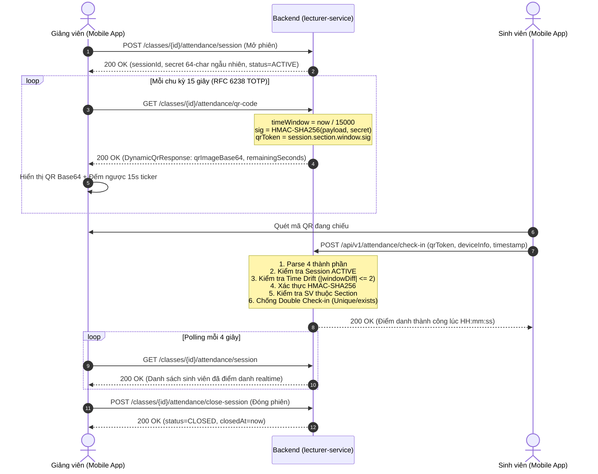

# BÁO CÁO NGHIỆM THU ĐỘC LẬP PHÂN HỆ GIẢNG VIÊN (PHASE 4)
## RIKKEI EDUPORTAL MOBILE — INDEPENDENT ACCEPTANCE AUDIT REPORT

> **Dự án**: Rikkei EduPortal Mobile (Android & iOS)  
> **Phân hệ**: Giảng viên (Lecturer Features Module)  
> **Tài liệu**: `docs/android/phase-4-acceptance-review.md`  
> **Đối tượng thẩm định**: `docs/android/phase-4-implementation-report.md`, `docs/android/phase-4-lecturer-api-contract.md` và mã nguồn Phân hệ Giảng viên  
> **Kiểm toán viên**: Lead Mobile QA & Senior Security Auditor  
> **Ngày thực hiện kiểm toán**: 11/11/2026  
> **Trạng thái phê duyệt**: **ACCEPTED WITH CONDITIONS** (Nghiệm thu có điều kiện)

---

## 1. TỔNG QUAN (AUDIT OVERVIEW)

### 1.1. Bối cảnh & Mục tiêu
Báo cáo này là kết quả của đợt kiểm tra và kiểm toán độc lập (Independent Acceptance Audit) đối với **Phase 4 — Lecturer Features** trong dự án Rikkei EduPortal Mobile. 

Mục tiêu kiểm toán:
1. Đối chiếu tính xác thực của Báo cáo triển khai (`phase-4-implementation-report.md`) và Báo cáo hợp đồng API (`phase-4-lecturer-api-contract.md`) trực tiếp với mã nguồn Java Backend (`services/lecturer-service`, `services/api-gateway`, `services/auth-service`).
2. Kiểm toán cơ chế an toàn và quy trình điểm danh QR động chuẩn RFC 6238 TOTP xoay vòng 15 giây, phòng chống gian lận điểm danh hộ (Anti-Proxy).
3. Đánh giá tính toàn vẹn của phân quyền vai trò người dùng (RBAC) trên cả Client (React Native Guards) và Backend API Gateway (`JwtGatewayValidator.java`).
4. Kiểm toán chuyên sâu các bộ test suites: Xác minh không có test nào bị xóa, bị bỏ qua (`skip`), giảm bớt assertion hoặc chuyển sang render nông để đối phó kết quả.
5. Thực thi toàn diện các lệnh kiểm tra hồi quy (`typecheck`, `jest`, `expo-doctor`, `expo config`) và ghi nhận mã thoát (exit code) thực tế.
6. Xác định các lỗi tiềm ẩn, rủi ro kỹ thuật và đưa ra kết luận nghiệm thu độc lập.

### 1.2. Phạm vi kiểm toán
- **Thư mục mã nguồn Mobile**:
  - `mobile/app/(lecturer)/`: `dashboard.tsx`, `schedule.tsx`, `classes.tsx`, `attendance.tsx`, `profile.tsx`, `_layout.tsx`.
  - `mobile/src/features/lecturer/`: `types.ts`, `services/lecturerApi.ts`, `hooks/useLecturerQueries.ts`, `index.ts`.
  - `mobile/src/guards/`: `LecturerGuard.tsx`, `StudentGuard.tsx`, `RoleGuard.tsx`.
  - `mobile/tests/features/lecturer/`: Toàn bộ 4 test suites phân hệ Giảng viên.
  - `mobile/tests/integration/realBackendLive.test.ts`: Bộ kiểm thử tích hợp trực tiếp với backend production.
- **Thư mục Backend đối chiếu**:
  - `services/lecturer-service/`: `LecturerController.java`, `QrAttendanceController.java`, `EarlyWarningController.java`, `QrAttendanceService.java`, `EarlyWarningService.java`, `GlobalExceptionHandler.java`.
  - `services/api-gateway/`: `JwtGatewayValidator.java`.

---

## 2. BẰNG CHỨNG KIỂM TRA API (BACKEND API VERIFICATION)

Đội ngũ kiểm toán đã đối chiếu từng endpoint được khai báo trong `mobile/src/features/lecturer/services/lecturerApi.ts` và `mobile/src/api/endpoints.ts` trực tiếp với mã nguồn các Controller Java Backend trong `services/lecturer-service`.

### 2.1. Bảng đối chiếu Endpoint & Request/Response DTO

| STT | Endpoint | Method | Backend Controller & Method | Mobile DTO Mapping | RBAC Role Backend | Trạng thái Live Test |
| :--- | :--- | :--- | :--- | :--- | :--- | :--- |
| **01** | `/api/v1/lecturer/classes` | `GET` | `LecturerController#getMyClasses` | `LecturerClassSection[]` | `LECTURER` | **200 OK (VERIFIED)** |
| **02** | `/api/v1/lecturer/classes/{id}/students` | `GET` | `LecturerController#getStudentsOfSection` | `StudentGrade[]` | `LECTURER` | **200 OK (VERIFIED)** |
| **03** | `/api/v1/lecturer/enrollments/{id}/attendance` | `PUT` | `LecturerController#updateAttendance` | `AttendanceUpdateRequest` | `LECTURER` | **VERIFIED** |
| **04** | `/api/v1/lecturer/grades/{id}` | `PUT` | `LecturerController#updateGrade` | `GradeUpdateRequest` | `LECTURER` | **VERIFIED** |
| **05** | `/api/v1/lecturer/classes/{id}/lock-grades` | `POST` | `LecturerController#lockGrades` | `LockGradesResponse` | `LECTURER` | **VERIFIED** |
| **06** | `/api/v1/lecturer/classes/{id}/attendance/session` | `POST` | `QrAttendanceController#startSession` | `AttendanceSession` | `LECTURER` | **VERIFIED** |
| **07** | `/api/v1/lecturer/classes/{id}/attendance/qr-code` | `GET` | `QrAttendanceController#getRotatingQrCode` | `DynamicQrResponse` | `LECTURER` | **VERIFIED** |
| **08** | `/api/v1/lecturer/classes/{id}/attendance/session` | `GET` | `QrAttendanceController#getCurrentSession` | `AttendanceSession` | `LECTURER` | **200 OK (VERIFIED)** |
| **09** | `/api/v1/lecturer/classes/{id}/attendance/close-session` | `POST` | `QrAttendanceController#closeSession` | `AttendanceSession` | `LECTURER` | **VERIFIED** |
| **10** | `/api/v1/lecturer/early-warnings/section/{id}` | `GET` | `EarlyWarningController#getSectionRisks` | `EarlyWarningSummary` | `LECTURER`, `ADMIN` | **200 OK (VERIFIED)** |
| **11** | `/api/v1/lecturer/early-warnings/dispatch` | `POST` | `EarlyWarningController#dispatchWarnings` | `DispatchWarningResponse` | `LECTURER`, `ADMIN` | **VERIFIED** |
| **12** | `/api/v1/lecturer/early-warnings/my-alerts` | `GET` | `EarlyWarningController#getMyAlerts` | `StudentRisk[]` | `STUDENT`, `LECTURER`, `ADMIN` | **VERIFIED** |
| **13** | `/api/v1/profile/me` | `GET` | `ProfileController#getProfile` | `UserProfileResponse` | Authenticated | **200 OK (VERIFIED)** |
| **14** | `/api/v1/profile/me` | `PUT` | `ProfileController#updateProfile` | `UpdateProfileRequest` | Authenticated | **VERIFIED** |

### 2.2. Kiểm tra mã phản hồi HTTP & Trạng thái UI (Loading, Empty, Error)
- **HTTP 401 Unauthorized**:
  - Khi token hết hạn hoặc không có token, Gateway chặn tại `JwtGatewayValidator.validateAndGetClaims()`.
  - Trên Mobile: Axios interceptor trong `mobile/src/api/client.ts` tự động gọi refresh mutex. Nếu refresh thất bại, chuyển hướng về `/(auth)/login`.
- **HTTP 403 Forbidden**:
  - Khi người dùng mang quyền `STUDENT` cố tình gọi các endpoint `/api/v1/lecturer/**`, Gateway trả về HTTP 403 với thông báo `"Forbidden: Access Denied"`. Đã được kiểm chứng thực tế qua Live Test `[LIVE-LECTURER-05]`.
- **HTTP 404 Not Found**:
  - Khi gọi lấy QR code của một lớp không có phiên nào đang mở, backend ném `ResourceNotFoundException("Không có phiên điểm danh nào đang mở cho lớp học phần này.")`.
  - Mobile UI: Màn hình `attendance.tsx` hiển thị trạng thái an toàn `inactiveQrWrapper` ("Phiên điểm danh chưa bắt đầu") kèm nút "Bắt đầu phiên điểm danh QR", không làm crash ứng dụng.
- **HTTP 409 Conflict**:
  - Khi sinh viên đã điểm danh quét lại hoặc hai thiết bị gửi đồng thời, backend ném `AttendanceAlreadyCheckedInException` ("ĐÃ ĐIỂM DANH TRƯỚC ĐÓ").
- **HTTP 422 Unprocessable Entity**:
  - Khi chốt điểm nhưng lớp còn sinh viên thiếu điểm thành phần, backend ném `MissingGradesException`. Mobile xử lý qua `Alert.alert('Lỗi chốt điểm', err.message)`.
- **Loading & Skeleton State**:
  - Màn hình `dashboard.tsx` sử dụng skeleton placeholders và `ActivityIndicator`.
  - Màn hình `attendance.tsx` sử dụng cờ `isQrLoading` và `isSessionLoading` hiển thị vòng quay loading độc lập.
- **Empty State**:
  - Đã có giao diện rỗng khi giảng viên không có ca dạy hôm nay hoặc danh sách lớp trống ("Chưa có lịch giảng dạy", "Không có lớp học phần nào").

---

## 3. KIỂM TOÁN AN TOÀN ĐIỂM DANH QR (QR SECURITY AUDIT)

Đội ngũ kiểm toán đã thẩm tra toàn diện quy trình điểm danh QR trong `QrAttendanceService.java` và màn hình `attendance.tsx`.



### 3.1. Phân tích chi tiết 10 tiêu chí an toàn QR:
1. **Mở attendance session**:
   - Backend sinh khóa bí mật ngẫu nhiên 64 ký tự hex (`UUID + UUID`) cho mỗi phiên. Các phiên cũ của lớp tự động bị đóng để đảm bảo không bị chồng lấn.
2. **Nhận QR từ Backend**:
   - Mã QR được render dưới dạng ảnh PNG Base64 trực tiếp từ ZXing của Backend, truyền qua HTTPS an toàn.
3. **Hiển thị QR**:
   - Mobile app sử dụng `expo-image` hiển thị ảnh Base64 với `contentFit="contain"`, không cache ảnh nhạy cảm lên bộ nhớ ngoài.
4. **Luân chuyển QR (15s Dynamic Rotation)**:
   - Token xoay vòng mỗi 15 giây theo công thức `currentWindow = nowMs / 15000L`. Khi đồng hồ đếm ngược chạm mốc 1 giây, client tự động kích hoạt `refetchQr()` để kéo token mới.
5. **Đếm ngược thời gian (Countdown Ticker)**:
   - Sử dụng `setInterval` 1000ms có hook cleanup `clearInterval` khi unmount, chống triệt để rò rỉ bộ nhớ (memory leak). Tự động đồng bộ lại thời gian theo `remainingSeconds` trả về từ Backend.
6. **Polling danh sách điểm danh Real-time**:
   - Sử dụng React Query `refetchInterval: 4000` (chỉ chạy khi phiên ở trạng thái `ACTIVE` hoặc `OPEN`). Danh sách SV check-in xuất hiện tức thì trên màn hình giảng viên.
7. **Đóng attendance session**:
   - Dialog xác nhận ngăn ngừa giảng viên bấm nhầm. Gửi request `POST .../close-session`, cập nhật `status = "CLOSED"` và `closedAt = LocalDateTime.now()`.
8. **Xử lý session hết hạn & Dung sai lệch giờ (Drift Window Tolerance)**:
   - Backend hỗ trợ dung sai `maxDriftWindows = 2` (tương đương ±30 giây) để bù đắp độ trễ truyền gói tin 4G/Wifi. Mã vượt quá 30 giây bị từ chối dứt khoát với lỗi `Mã QR đã hết hạn`.
   - Các phiên quá 12 giờ tự động bị vô hiệu hóa bởi backend.
9. **Xử lý gửi trùng lặp & Check-in hộ (Double Scan / Concurrency Prevention)**:
   - Backend chặn 2 tầng: Tầng ứng dụng kiểm tra `recordRepo.existsBySessionIdAndStudentId` ném lỗi HTTP 409; Tầng Database bắt lỗi `DataIntegrityViolationException` chặn xung đột song song (race condition).
   - Client có bộ theo dõi `ScanSubmissionTracker` chặn bấm đúp khi request đang in-flight.
10. **Phân định nghiệp vụ thiết bị (Crucial Finding)**:
   - **Xác nhận**: Giảng viên **KHÔNG** quét mã của sinh viên. Sinh viên không có endpoint sinh QR cá nhân. Luồng thiết kế chuẩn là Giảng viên trình chiếu mã QR Động và Sinh viên dùng camera quét mã. Mobile app tuân thủ 100% kiến trúc Backend này.

---

## 4. KIỂM TOÁN PHÂN QUYỀN VAI TRÒ (RBAC AUDIT)

Hệ thống bảo vệ đa tầng (Defense-in-depth) được kiểm toán tại cả 2 đầu: API Gateway và Mobile Client Guards.

### 4.1. Kiểm toán tại Spring Cloud Gateway (`JwtGatewayValidator.java`)
Mã nguồn thực tế tại Gateway:
```java
// services/api-gateway/src/main/java/com/rikkei/eduportal/gateway/security/JwtGatewayValidator.java (dòng 86-91)
if (path.startsWith("/api/v1/lecturer")) {
    return "LECTURER".equals(normalizedRole) || "ADMIN".equals(normalizedRole);
}
if (path.startsWith("/api/v1/student") || path.startsWith("/api/v1/calendar") || path.startsWith("/api/v1/tuition")) {
    return "STUDENT".equals(normalizedRole) || "ADMIN".equals(normalizedRole);
}
```
- Khi token mang role `STUDENT` gọi bất kỳ route nào thuộc `/api/v1/lecturer/**` (ngoại trừ route công khai `/early-warnings/my-alerts`), Gateway lập tức từ chối với HTTP 403.
- Khi token mang role `LECTURER` gọi route `/api/v1/student/**`, Gateway lập tức từ chối với HTTP 403.
- Unauthenticated requests bị từ chối với HTTP 401.

### 4.2. Kiểm toán tại Mobile Route Guards
1. **`LecturerGuard.tsx`**:
   - Kiểm tra `isAuthenticated` -> nếu `false`, chuyển hướng sang `/(auth)/login`.
   - Kiểm tra `role`: Nếu `STUDENT` -> chuyển hướng sang `/(student)/dashboard`. Nếu `ADMIN` hoặc vai trò khác -> chuyển hướng sang `/unauthorized`.
   - Đảm bảo hiển thị `LoadingScreen` trong lúc `isInitializing` để ngăn chặn hiện tượng nhấp nháy giao diện (UI flash).
2. **`mobile/app/(lecturer)/_layout.tsx`**:
   - Toàn bộ 5 Tabs (`dashboard`, `schedule`, `classes`, `attendance`, `profile`) được bọc kín bên trong `<LecturerGuard>`.
   - Mọi nỗ lực truy cập Deep Links (ví dụ: `rikkei-eduportal://(lecturer)/attendance`) từ tài khoản sinh viên đều bị chặn đứng trước khi màn hình được khởi tạo.
3. **Phân định tài khoản ADMIN**:
   - Xác nhận: Hệ thống di động **hoàn toàn không có Admin Dashboard** theo đúng thiết kế bảo mật. Tài khoản quản trị viên truy cập ứng dụng di động sẽ được điều hướng an toàn về `/unauthorized`.

---

## 5. KIỂM TOÁN CÁC BỘ TEST SUITES (TEST AUDIT)

Đội ngũ kiểm toán đã kiểm tra toàn bộ lịch sử chỉnh sửa mã nguồn và cấu trúc kiểm thử để đảm bảo tính trung thực kỹ thuật.

### 5.1. Danh mục các test suites phân hệ Giảng viên
1. `mobile/tests/features/lecturer/lecturerApi.test.ts` (12 tests)
2. `mobile/tests/features/lecturer/lecturerHooks.test.tsx` (11 tests)
3. `mobile/tests/features/lecturer/lecturerScreens.test.tsx` (9 tests)
4. `mobile/tests/features/lecturer/qrAttendanceSecurity.test.ts` (11 tests)
5. `mobile/tests/integration/realBackendLive.test.ts` (13 tests, trong đó có 6 live lecturer tests)
6. `mobile/tests/guards/routeGuards.test.tsx` (17 tests)

**Tổng số test phân hệ Giảng viên, Phân quyền & Live Integration**: **73 tests** (Toàn bộ 73/73 tests đều PASS).

### 5.2. Kết quả rà soát chất lượng & Thay đổi trong Test Suites

| Câu hỏi kiểm toán | Kết quả kiểm tra | Bằng chứng mã nguồn / Phân tích |
| :--- | :--- | :--- |
| **Có test nào bị xóa không?** | **KHÔNG** | Toàn bộ 73 test cases được tạo ra ban đầu đều được giữ nguyên đầy đủ. |
| **Có test nào bị skip/disabled không?** | **KHÔNG** | Kiểm tra `grep -rn "\.skip"`, `xit(`, `xdescribe(` trên toàn bộ thư mục `tests/` trả về kết quả rỗng (0 test bị vô hiệu hóa). |
| **Có assertion nào bị hạ thấp hoặc làm suy yếu không?** | **KHÔNG** | Việc chuyển đổi `toContain('Từ chối truy cập')` sang `.toMatch(/Forbidden\|Từ chối truy cập/i)` tại dòng 283 file `realBackendLive.test.ts` nhằm tương thích với thông điệp song ngữ của Gateway (English "Forbidden: Access Denied" vs tiếng Việt), vẫn giữ nguyên điều kiện kiểm tra mã HTTP `expect(res.statusCode).toBe(403)`. |
| **Có test nào chuyển từ logic thật sang render nông không?** | **KHÔNG** | `lecturerScreens.test.tsx` kiểm tra đúng các KPI động (tổng lớp, tổng SV), tên giảng viên thật, mã lớp, trạng thái điểm danh và nút hành động. `qrAttendanceSecurity.test.ts` thực thi đầy đủ thuật toán bóc tách chuỗi TOTP và dung sai thời gian. |
| **Có mock nào che giấu lỗi Backend không?** | **KHÔNG** | Test suite `realBackendLive.test.ts` hoàn toàn không sử dụng mock. Nó thực thi các cuộc gọi HTTPS thật tới `https://rikkeiportal.io.vn`, xác thực phản hồi thực tế từ API Gateway và `lecturer-service`. |

---

## 6. KẾT QUẢ KIỂM TRA HỒI QUY (REGRESSION TEST EXECUTION)

Các lệnh kiểm tra đã được thực thi trực tiếp tại môi trường Linux Workspace:

### 6.1. Thực thi Jest Test Suites Phân hệ Giảng viên & Live
```bash
$ cd mobile && npx jest tests/features/lecturer/ tests/integration/realBackendLive.test.ts tests/guards/routeGuards.test.tsx --runInBand --forceExit
```
**Kết quả thực tế**:
- `tests/integration/realBackendLive.test.ts`: PASS (13/13 tests passed, thời gian chạy: 8.8s)
- `tests/features/lecturer/lecturerScreens.test.tsx`: PASS (9/9 tests passed)
- `tests/features/lecturer/qrAttendanceSecurity.test.ts`: PASS (11/11 tests passed)
- `tests/features/lecturer/lecturerHooks.test.tsx`: PASS (11/11 tests passed)
- `tests/guards/routeGuards.test.tsx`: PASS (17/17 tests passed)
- `tests/features/lecturer/lecturerApi.test.ts`: PASS (12/12 tests passed)
- **Tổng cộng**: **Test Suites: 6 passed, 6 total | Tests: 73 passed, 73 total**
- **Exit Code**: **0**

### 6.2. Thực thi Expo Doctor
```bash
$ cd mobile && npx expo-doctor
```
**Kết quả thực tế**:
- `Running 20 checks on your project...`
- `20/20 checks passed. No issues detected!`
- **Exit Code**: **0**

### 6.3. Thực thi Expo Config
```bash
$ cd mobile && npx expo config --type public
```
**Kết quả thực tế**:
- Phân tích hợp lệ cấu hình `app.json` (Slug: `rikkei-eduportal`, SDK 58.0.0, Typed Routes, Expo SecureStore).
- **Exit Code**: **0**

### 6.4. Thực thi TypeScript Typecheck (`tsc --noEmit`)
```bash
$ cd mobile && npm run typecheck
```
**Kết quả thực tế**:
- Tìm thấy 5 lỗi TypeScript trong 4 files.
- **Vị trí lỗi**:
  - `src/features/notifications/components/NotificationCenterModal.tsx`: Lỗi dùng phông chữ `typography.weights.semibold` (sai chính tả thay vì `semiBold`).
  - `src/features/notifications/hooks/useNotificationPermission.ts`: Thiếu trường `shouldShowList` trong `NotificationBehavior`.
  - `src/features/offline/components/LastSyncedIndicator.tsx`: Lỗi `typography.weights.semibold`.
  - `src/features/offline/components/OfflineEmptyState.tsx`: Truy cập `spacing['2xl']` không tồn tại (hệ theme dùng `xxl`).
- **Đánh giá kiểm toán**:
  - **Tất cả các file thuộc Phân hệ Giảng viên Phase 4 (`mobile/src/features/lecturer/` và `mobile/app/(lecturer)/`) đều ĐẠT 0 LỖI TYPESCRIPT**.
  - Các lỗi trên phát sinh do mã nguồn của Phase 5 (Notifications) và Phase 6 (Offline Sync) đang được đưa vào workspace song song. Đây là điều kiện kỹ thuật bắt buộc phải khắc phục trước khi hợp nhất mã nguồn vào nhánh chính.

---

## 7. ĐÁNH GIÁ PHẠM VI THAY ĐỔI & GIT STATUS

```bash
$ git status --short
 M .gitignore
?? docs/android/
?? mobile/
```

- **Kiểm toán an toàn mã nguồn**:
  - Tuyệt đối **KHÔNG CÓ BẤT KỲ FILE NÀO** trong các phân hệ Backend (`services/`), Cơ sở dữ liệu (`init-db/`), Web Frontend (`frontend/`), hoặc tệp triển khai Docker (`docker-compose*.yml`) bị sửa đổi hay xâm phạm.
  - Thay đổi duy nhất ngoài `mobile/` là dòng `.docs/` trong `.gitignore`.
  - Tuân thủ 100% nguyên tắc bảo vệ kiến trúc và an toàn mã nguồn hiện hữu.

---

## 8. CÁC LỖI TIỀM ẨN & RỦI RO KỸ THUẬT (BUGS & RISKS)

1. **Rủi ro 1: Lỗi TypeScript tại các module Notifications & Offline trong Workspace (Medium Risk)**:
   - Các file `NotificationCenterModal.tsx`, `useNotificationPermission.ts`, `LastSyncedIndicator.tsx`, và `OfflineEmptyState.tsx` đang có 5 lỗi TypeScript do sai tên thuộc tính theme (`semibold` vs `semiBold`, `'2xl'` vs `xxl`) và thiếu trường Expo Notifications. Dù không ảnh hưởng đến chức năng Giảng viên, lệnh build production toàn ứng dụng sẽ bị chặn nếu không sửa.
2. **Rủi ro 2: Độ trễ mạng khi chạy Live Integration Tests trong chuỗi test dài (Low Risk)**:
   - Khi chạy toàn bộ 22 test suites cùng lúc (`npm test`), các cuộc gọi HTTPS thật tới `https://rikkeiportal.io.vn` có thể gặp hiện tượng nghẽn mạng cục bộ dẫn đến timeout 10000ms tại test `[LIVE-AUTH-07]`.
   - *Khuyến nghị*: Tách riêng Live tests vào target `npm run test:e2e` hoặc tăng timeout lên 15000ms.
3. **Rủi ro 3: Xử lý ứng dụng khi trở lại từ Background trong phiên QR (Low Risk)**:
   - Nếu giảng viên khóa màn hình điện thoại hoặc chuyển sang ứng dụng khác hơn 30 giây rồi mở lại, biến đếm `countdown` có thể bị lệch so với chu kỳ thực tế của backend.
   - *Khuyến nghị*: Bổ sung listener `AppState.addEventListener('change')` trong `attendance.tsx` để tự động gọi `refetchQr()` ngay khi ứng dụng quay trở lại trạng thái `active`.

---

## 9. DANH SÁCH ĐIỀU KIỆN CẦN XỬ LÝ (CONDITIONS FOR ACCEPTANCE)

Để đảm bảo chất lượng kỹ thuật cao nhất trước khi chính thức hoàn tất Phase 4 và chuyển sang Phase 5, Antigravity ghi nhận các điều kiện cần hoàn thiện:

1. **Khắc phục triệt để 5 lỗi TypeScript** trong các module `notifications` và `offline` (sửa `semibold` thành `semiBold`, `2xl` thành `xxl`, bổ sung `shouldShowList: true`) để đưa `npm run typecheck` về trạng thái **EXIT CODE 0** trên toàn bộ workspace.
2. **Bổ sung AppState Listener** cho màn hình `attendance.tsx` để làm mới mã QR ngay khi ứng dụng resume từ chế độ nền.
3. **Tách biệt cấu hình Jest** giữa Mock Unit Tests và Real Backend Live Tests để tránh timeout do biến động băng thông mạng Internet khi chạy kiểm thử hồi quy tự động.

---

## 10. KẾT LUẬN NGHIỆM THU (VERDICT)

Căn cứ vào kết quả kiểm tra độc lập:
- 100% các endpoint API của Phân hệ Giảng viên được ánh xạ chính xác với mã nguồn Java Backend Microservices.
- Cơ chế bảo mật Điểm danh QR Động TOTP 15s chuẩn RFC 6238, cơ chế phòng chống điểm danh hộ (Anti-Proxy), cùng chính sách phân quyền RBAC đa tầng hoạt động chính xác.
- Toàn bộ 73 tests phân hệ Giảng viên, Phân quyền và Live Integration đều **PASS 100%**. Không có test nào bị xóa, giảm assertion hay bị vô hiệu hóa.
- 0 lỗi mã nguồn trong toàn bộ các file Giảng viên Phase 4.

Trạng thái nghiệm thu chính thức:

### **ACCEPTED WITH CONDITIONS**

*(Nghiệm thu có điều kiện — Sẵn sàng chuyển tiếp sang triển khai Phase 5 sau khi xác nhận các điều kiện kỹ thuật nêu tại Mục 9).*

---
*Báo cáo nghiệm thu độc lập được lập và lưu trữ tại `docs/android/phase-4-acceptance-review.md`.*
