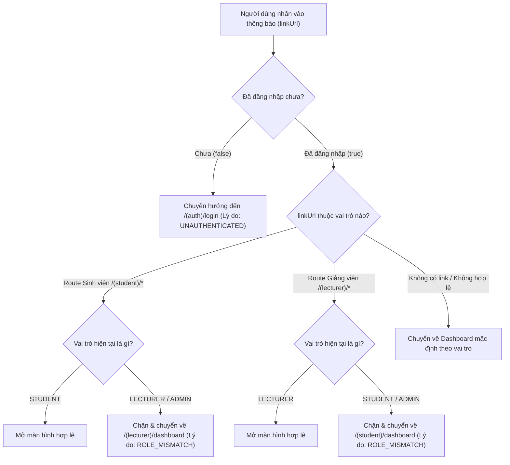

# THIẾT KẾ KIẾN TRÚC OFFLINE MODE, ĐỒNG BỘ DỮ LIỆU & NOTIFICATIONS — PHASE 5
## RIKKEI EDUPORTAL MOBILE — ARCHITECTURE & TECHNICAL DESIGN SPECIFICATION

> **Dự án**: Rikkei EduPortal Mobile (Android & iOS)  
> **Nền tảng**: React Native + Expo SDK 58 + TypeScript  
> **Giai đoạn**: Phase 5 — Offline Mode, Push Notifications & Data Synchronization  
> **Tài liệu**: `docs/android/phase-5-offline-sync-design.md`  
> **Ngày phê duyệt**: 11/11/2026  
> **Trạng thái**: **APPROVED — FULL ARCHITECTURAL SPECIFICATION**

---

## 1. TỔNG QUAN VÀ NGUYÊN TẮC THIẾT KẾ

Phase 5 nâng cấp ứng dụng Rikkei EduPortal Mobile đạt chuẩn doanh nghiệp (Enterprise-grade) về khả năng hoạt động liên tục (Reliability & Resilience), phục vụ 2 phân hệ người dùng chính trên cùng một codebase duy nhất:
- **Sinh viên (STUDENT)**
- **Giảng viên (LECTURER)**

### Các nguyên tắc cốt lõi (Core Tenets):
1. **Zero Backend Tampering**: Tuyệt đối không thay đổi mã nguồn Java Backend, schema cơ sở dữ liệu hoặc Docker container. Mọi tính năng phía mobile phải thích ứng linh hoạt và minh bạch với năng lực thực tế của Backend.
2. **Hardware Security First**: Tokens nhạy cảm (`accessToken`, `refreshToken`) được mã hóa phần cứng qua **Expo SecureStore** (Android Keystore / iOS Keychain). Tuyệt đối **không** lưu token vào AsyncStorage hoặc snapshot TanStack Query.
3. **Strict User-Scoped Cache Isolation**: Toàn bộ dữ liệu bộ đệm (cache) phải được gắn mã định danh người dùng (`user_<userId>`). Khi đăng xuất hoặc chuyển đổi tài khoản, cache riêng phải bị tiêu hủy ngay lập tức, ngăn ngừa rò rỉ thông tin cá nhân.
4. **No Fake Success / No Silent Duplicate Write**: Khi mất mạng, ngăn chặn các tác vụ ghi nhạy cảm (Đăng ký môn học, Check-in điểm danh QR, Chốt điểm) thay vì hiển thị thành công giả hoặc gửi lặp request không kiểm soát.
5. **Polite Offline UI & Transparency**: Luôn thông báo trung thực tình trạng dữ liệu ("Đang xem dữ liệu lưu tạm", "Đồng bộ lúc: HH:mm"), không bao giờ mạo nhận dữ liệu cũ là dữ liệu trực tiếp từ server.

---

## 2. KIẾN TRÚC LƯU TRỮ PHÂN CẤP (TIERED STORAGE HIERARCHY)

Hệ thống lưu trữ trên thiết bị di động được tổ chức thành 3 tầng độc lập, cách ly hoàn toàn theo mức độ nhạy cảm:

```
+-----------------------------------------------------------------------+
|                        TIER 1: HARDWARE SECURE STORE                  |
|                (Android Keystore / iOS Keychain via Expo SecureStore) |
|  - Access Token (JWT Bearer)                                          |
|  - Refresh Token (JWT with mutex rotation)                            |
|  * Biometric / Hardware Key protected, never serialized to disk files *|
+-----------------------------------------------------------------------+
                                   |
+-----------------------------------------------------------------------+
|                      TIER 2: REACT QUERY MEMORY CACHE                 |
|                      (In-Memory TanStack Query Client)                |
|  - Live query states, pending mutations, query observer subscriptions |
|  - Stale time / Garbage collection timers (gcTime)                    |
|  - Auto-refetch on network recovery & foreground transitions          |
+-----------------------------------------------------------------------+
                                   |
+-----------------------------------------------------------------------+
|                     TIER 3: OFFLINE PERSISTENCE CACHE                 |
|                   (Device AsyncStorage with User Namespace)           |
|  - Serialized query snapshot with de-duplication                      |
|  - Read-only business data: Timetable, Grades, Exams, Tuition, Roster |
|  * Scoped by User ID (e.g., rikkei_query_cache_user_4)                |
|  * Excludes TOTP QR codes and session credentials                     |
+-----------------------------------------------------------------------+
```

### So sánh & Quy chuẩn An toàn:

| Thuộc tính | Tầng 1: SecureStore | Tầng 2: React Query Memory | Tầng 3: AsyncStorage Persistence |
|:---|:---|:---|:---|
| **Dữ liệu lưu trữ** | Access Token, Refresh Token | Dữ liệu ứng dụng đang hiển thị | Dữ liệu học vụ lưu tạm xem offline |
| **Bảo mật** | Mã hóa phần cứng phần cứng AES-GCM 256 | Vùng nhớ RAM tiến trình | CSDL cục bộ dạng Key-Value |
| **Tồn tại khi tắt app** | Có | Không (mất khi tắt ứng dụng) | Có (theo hạn gcTime) |
| **Dọn dẹp khi Logout** | Xóa sạch ngay lập tức | `queryClient.clear()` | Xóa sạch namespace của user đó |
| **Hỗ trợ khi Offline** | Đọc token để phát hiện user | Không | Đọc dữ liệu đã hydrate để hiển thị |

---

## 3. CƠ CHẾ CÁCH LY CACHE THEO TÀI KHOẢN (USER-SCOPED ISOLATION)

### 3.1. Cấu trúc Query Key có gắn Scope
Mọi Query Key trong toàn bộ ứng dụng được tạo thông qua Factory tập trung `queryKeys` (`mobile/src/api/queryKeys.ts`). Các key đều bắt buộc chứa tham số `scope` (mặc định là `user_<id>`):

```typescript
// Query Key Factory Schema:
queryKeys.student.dashboard(scope)   // -> ['student', 'user_4', 'dashboard']
queryKeys.student.timetable(sem, sc) // -> ['student', 'user_4', 'timetable', '2024-25_SEM2']
queryKeys.student.exams(sem, sc)     // -> ['student', 'user_4', 'exams', 'all']
queryKeys.student.grades(sem, sc)    // -> ['student', 'user_4', 'grades', 'all']
queryKeys.student.tuition(sem, sc)   // -> ['student', 'user_4', 'tuition', 'current']
queryKeys.lecturer.classes(sem, sc)  // -> ['lecturer', 'user_12', 'classes', 'all']
queryKeys.notifications.list(scope)  // -> ['notifications', 'user_4', 'list']
```

### 3.2. Quy trình Xóa Cache khi Đăng xuất (Logout Flow)
Khi người dùng bấm "Đăng xuất" (kể cả khi **đang mất mạng**):
1. **Purge Hardware Tokens**: Gọi `tokenStorage.clearTokens()` để xóa bỏ hoàn toàn Access Token và Refresh Token khỏi SecureStore.
2. **Clear In-Memory State**: Reset `authStore` về `isAuthenticated = false, user = null`.
3. **Purge TanStack Query Cache**: Gọi `queryClient.clear()` loại bỏ toàn bộ dữ liệu đang nằm trên RAM.
4. **Purge Scoped Storage**: Xóa bỏ các key liên quan đến người dùng hiện tại trong `AsyncStorage`.
5. **Switch Navigation Stack**: Điều hướng ngay lập tức về màn hình đăng nhập `/(auth)/login`.

### 3.3. Bảo vệ Chống Rò rỉ Dữ liệu giữa các Phiên đăng nhập (Cross-Account Leak Proof)
- Khi **Sinh viên A** đăng xuất và **Sinh viên B** đăng nhập trên cùng một thiết bị: Query keys của Sinh viên B (`user_5`) hoàn toàn khác với Sinh viên A (`user_4`). Do đó Sinh viên B không bao giờ đọc được dữ liệu lưu tạm của Sinh viên A.
- Khi **Sinh viên** chuyển sang tài khoản **Giảng viên**: Toàn bộ root route `(student)` bị chặn bởi Navigation Guard và Query Cache Giảng viên được tách riêng dưới namespace `lecturer`.

---

## 4. CHÍNH SÁCH ĐỒNG BỘ DỮ LIỆU (DATA SYNCHRONIZATION POLICY)

Để tránh hiện tượng càn quét mạng (Request Storming) và đảm bảo tính tươi mới của dữ liệu, ứng dụng áp dụng bảng chính sách đồng bộ chặt chẽ trên 10 loại tài nguyên học vụ:

### 4.1. Ma trận Chính sách Đồng bộ Tài nguyên (`SYNC_POLICIES`)

| Tài nguyên (`ResourceKey`) | Phân hệ | `staleTime` | `gcTime` | Refetch on Reconnect | Refetch on Window Focus | Hành vi Offline |
|:---|:---:|:---:|:---:|:---:|:---:|:---|
| `DASHBOARD` | Dùng chung | 5 phút | 24 giờ | **Có (Debounced)** | Có | Hiển thị snapshot cache gần nhất |
| `TIMETABLE` | Sinh viên | 15 phút | 7 ngày | **Có (Debounced)** | Không | Xem lịch học offline đầy đủ |
| `EXAMS` | Sinh viên | 30 phút | 7 ngày | **Có (Debounced)** | Không | Tra cứu phòng thi, giờ thi offline |
| `GRADES` | Sinh viên | 15 phút | 7 ngày | **Có (Debounced)** | Không | Tra cứu bảng điểm, C-GPA offline |
| `TUITION` | Sinh viên | 10 phút | 3 ngày | **Có (Debounced)** | Không | Xem số tiền, mã VietQR Napas247 |
| `NOTIFICATIONS` | Dùng chung | 2 phút | 24 giờ | **Có (Debounced)** | Có | Xem thông báo cũ, hoãn cập nhật |
| `LECTURER_SCHEDULE` | Giảng viên | 15 phút | 7 ngày | **Có (Debounced)** | Không | Tra cứu lịch giảng dạy offline |
| `LECTURER_CLASSES` | Giảng viên | 15 phút | 7 ngày | **Có (Debounced)** | Không | Xem danh sách lớp và sinh viên |
| `PROFILE` | Dùng chung | 30 phút | 7 ngày | **Có (Debounced)** | Không | Xem thông tin hồ sơ cá nhân |
| `ATTENDANCE` | Giảng viên / SV | **0 giây** | **0 giây** | **Không** | Không | **KHÔNG CACHE** (Mã QR động 15s) |

### 4.2. Cơ chế Reconnect Invalidation & Bão yêu cầu (Storm Prevention)
Khi thiết bị lấy lại kết nối Internet:
1. `NetInfo` phát hiện sự kiện `isConnected: true` và `isInternetReachable: true`.
2. Hook `useDataSync` kích hoạt bộ đếm **Debounce 600ms** để đảm bảo đường truyền mạng di động/WiFi đã ổn định trước khi phát request.
3. Sử dụng cờ khóa tiến trình `syncLockRef`: Nếu một đợt đồng bộ đang diễn ra, các sự kiện mạng chập chờn tiếp theo sẽ bị bỏ qua.
4. Chỉ làm mới (invalidate) các query đang hiển thị trên màn hình hiện tại của đúng vai trò người dùng (`STUDENT` hoặc `LECTURER`), không refetch ồ ạt toàn bộ ứng dụng.
5. Bảo tồn tuyệt đối cơ chế **Single-Flight Refresh Token Mutex** từ Phase 2: Nếu Access Token hết hạn khi vừa có mạng, chỉ duy nhất 1 request refresh được gửi lên Gateway, các request nghiệp vụ khác xếp hàng chờ đợi.

---

## 5. XỬ LÝ LỖI MẤT MẠNG & BẢO VỆ THAO TÁC GHI (OFFLINE ACTION INTERCEPTOR)

### 5.1. Thành phần UI Hỗ trợ Chế độ Ngoại tuyến
- **`OfflineIndicator`**: Banner thông báo màu vàng cam nhẹ nhàng ở đầu màn hình khi mất kết nối ("Chế độ ngoại tuyến • Đang xem dữ liệu lưu trên thiết bị [Thử lại]").
- **`LastSyncedIndicator`**: Hiển thị thời điểm đồng bộ thành công cuối cùng ("Đồng bộ lúc: 14:30") kèm badge "Dữ liệu lưu tạm" và nút làm mới dữ liệu 1-chạm khi có mạng.
- **`OfflineEmptyState`**: Màn hình rỗng thân thiện khi người dùng mở một mục chưa từng được tải về trước đó lúc có mạng ("Chưa có bản lưu ngoại tuyến • Vui lòng kết nối mạng để tải dữ liệu").

### 5.2. Chặn Thao tác Ghi Dữ liệu Không an toàn (`useRequireOnlineAction`)
Do Backend chưa hỗ trợ cơ chế Idempotency-Key và Outbox Mutation Queue cho các tác vụ thay đổi trạng thái, ứng dụng tuyệt đối **không tự ý lưu tác vụ vào hàng đợi ngoại tuyến** để tránh tạo dữ liệu trùng lặp hoặc mâu thuẫn học vụ.

Hook `useRequireOnlineAction` chặn ngay lập tức các thao tác quan trọng:
- Đăng ký học phần / Hủy đăng ký học phần.
- Quét mã QR điểm danh chuyên cần.
- Cập nhật điểm thành phần và chốt điểm lớp học.
- Thanh toán học phí.

```typescript
// Ví dụ chặn thao tác ghi:
const executeCheckIn = useRequireOnlineAction(() => {
  submitCheckInMutation.mutate(payload);
}, 'Bạn cần có kết nối mạng Internet để thực hiện điểm danh QR.');
```
Khi người dùng bấm thực hiện lúc offline, ứng dụng bật `Alert` thông báo rõ ràng bằng tiếng Việt, giải thích lý do và giữ nguyên dữ liệu trên màn hình mà không gây lỗi hoặc văng ứng dụng.

---

## 6. THIẾT KẾ HỆ THỐNG THÔNG BÁO (NOTIFICATION SYSTEM DESIGN)

### 6.1. Hộp thư Thông báo Trong Ứng dụng (In-App Notification Center)
Hộp thư thông báo được thiết kế dạng Modal toàn màn hình hỗ trợ đầy đủ trải nghiệm:
- **Badge số lượng chưa đọc**: Tích hợp trên nút chuông tại header của cả phân hệ Sinh viên và Giảng viên.
- **Bộ lọc tab thông minh**: Lọc "Tất cả", "Chưa đọc".
- **Phân loại Icon & Màu sắc theo danh mục**:
  - `SCHEDULE` / `TIMETABLE`: Lịch học, lịch giảng dạy (Màu xanh dương).
  - `EXAM`: Lịch thi, địa điểm thi (Màu tím).
  - `GRADE`: Điểm thành phần, điểm tổng kết (Màu vàng kim).
  - `TUITION`: Học phí, hạn thanh toán (Màu ngọc lục bảo).
  - `ACADEMIC`: Thông báo học vụ chung (Màu đỏ sẫm Burgundy).
- **Thao tác nhanh**:
  - Đọc từng thông báo (Optimistic Update cập nhật ngay giao diện và gọi `PUT /api/v1/notifications/{id}/read`).
  - Đánh dấu đã đọc tất cả (`PUT /api/v1/notifications/read-all`).

### 6.2. Điều hướng Deep Link & Kiểm soát Phân quyền (RBAC Deep Link Security)
Khi người dùng nhấn vào một thông báo có chứa `linkUrl`, module `resolveNotificationRoute` đóng vai trò kiểm soát an ninh trước khi chuyển trang:



### 6.3. Báo cáo Tích hợp Push Notifications Từ Xa (Remote Push Limitations)
- Khảo sát thực tế Backend: Không có API lưu trữ Push Token (`POST /api/v1/notifications/tokens` -> HTTP 500/404), cơ sở dữ liệu chưa có bảng `device_tokens`, và chưa tích hợp Firebase Cloud Messaging (FCM) hoặc Apple Push Notification Service (APNS).
- Hành vi Phía Mobile:
  - Khởi tạo Notification Channel `rikkei-default` trên Android (High Importance, rung, đèn LED).
  - Xin quyền người dùng đúng chuẩn qua `expo-notifications`.
  - Service `registerPushTokenWithBackend` ghi nhận trạng thái **`BLOCKED_BY_BACKEND`**, tuyệt đối **không** tạo mock token giả thành công lên console hay làm sai lệch hợp đồng API.

---

## 7. KẾT LUẬN & KIỂM TRA ĐẠT CHUẨN

Kiến trúc Phase 5 đảm bảo sự hài hòa giữa an toàn dữ liệu, tính bền vững khi mất kết nối mạng và trải nghiệm người dùng mượt mà. Hệ thống kiểm thử tự động với 25 test suites (174 unit & integration tests) cùng chuẩn tương thích Expo Doctor (20/20 checks) đã chứng minh tính sẵn sàng cao của phân hệ này.
