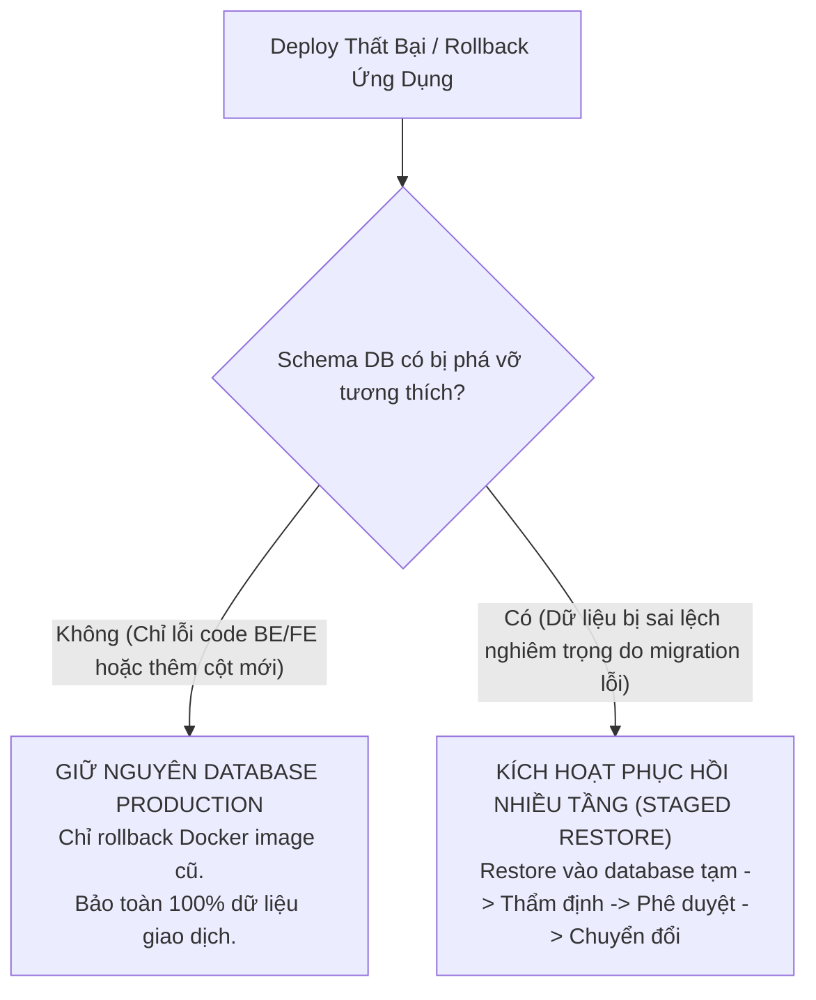

# Hướng dẫn Phục hồi Dữ liệu Thảm họa & Kiểm soát Migration (Disaster Recovery Guide)

Tài liệu này cung cấp quy chuẩn ứng phó sự cố, chiến lược migration tương thích ngược và quy trình khôi phục dữ liệu an toàn nhiều tầng cho môi trường **Production** của dự án **Rikkei EduPortal**.

---

## 1. Chiến lược Database Migration an toàn (Expand-Contract Pattern)

Hệ thống đang cấu hình `spring.jpa.hibernate.ddl-auto: update` kết hợp với các script SQL trong `init-db/`.

### 1.1. Nguyên tắc cốt lõi: Không tự động Restore Database khi Rollback ứng dụng
- **Lý do kỹ thuật:** Khi một phiên bản ứng dụng gặp lỗi và phải rollback về phiên bản Docker trước đó, hệ thống **tuyệt đối không tự động ghi đè bản backup database**. Trong khoảng thời gian từ lúc deploy đến khi phát hiện lỗi, người dùng thật có thể đã phát sinh các bản ghi mới (giao dịch thanh toán PayOS, điểm danh, nộp bài). Nếu tự động restore dump, toàn bộ dữ liệu mới này sẽ bị xóa sạch vĩnh viễn.
- **Giải pháp áp dụng:** Áp dụng mô hình **Expand-Contract (Mở rộng trước - Thu hẹp sau)** cho toàn bộ thay đổi database:
  1. **Phase 1 (Expand - Mở rộng):** Chỉ bổ sung cột mới (`NULLABLE` hoặc có `DEFAULT`), tạo bảng mới. Không đổi tên cột, không xóa cột, không thêm ràng buộc `NOT NULL` tức thì lên bảng đang có dữ liệu.
  2. **Tương thích ngược (Backward Compatibility):** Đảm bảo cả phiên bản code mới lẫn phiên bản code cũ đều đọc/ghi được cấu trúc database này. Nếu code mới bị lỗi và phải rollback container về code cũ, code cũ vẫn hoạt động trơn tru mà không cần can thiệp DB.
  3. **Phase 2 (Contract - Thu hẹp):** Chỉ xóa cột cũ hoặc siết ràng buộc ở bản phát hành tiếp theo sau khi bản mới đã vận hành ổn định tối thiểu 1-2 tuần.

### 1.2. Quyết định thiết kế Backup: Bản sao lưu phi phá hủy (Non-Destructive Dump)
- Bản sao lưu tạo bởi `remote-deploy.sh` sử dụng lệnh `pg_dump -U postgres academic_db` tiêu chuẩn, **cố ý không dùng cờ `--clean --if-exists`**.
- **Mục đích an toàn:** Tránh trường hợp tệp backup chứa sẵn các câu lệnh `DROP TABLE`, nếu người vận hành vô tình chạy nhầm vào database Production đang hoạt động thì toàn bộ dữ liệu sẽ không bị xóa sổ đột ngột. Mọi quy trình phục hồi bắt buộc phải qua bước nạp vào database tạm để thẩm định trước.

---

## 2. Cây quyết định ứng phó sự cố (Incident Decision Tree)



---

## 3. Quy trình Phục hồi Database Staged An toàn (8-Step SOP)

Khi phát hiện dữ liệu hoặc schema bị lỗi nghiêm trọng đòi hỏi phục hồi, thực hiện nghiêm ngặt quy trình 8 bước sau. **Tuyệt đối không restore trực tiếp đè lên database Production đang chạy.**

### Bước 1: Xác định file sao lưu hợp lệ gần nhất
Đăng nhập SSH vào VPS và kiểm tra danh sách file backup:
```bash
cd /opt/eduportal/backups
ls -lht pre_deploy_backup_*.sql.gz
```
Ghi nhận đường dẫn file backup mục tiêu:
```bash
export BACKUP_TARGET="/opt/eduportal/backups/pre_deploy_backup_YYYYMMDD_HHMMSS.sql.gz"
```

### Bước 2: Kiểm tra tính toàn vẹn của tệp sao lưu
```bash
# 1. Kiểm tra bit nén gzip
gzip -t "$BACKUP_TARGET" && echo "✅ Gzip CRC check: PASSED"

# 2. Kiểm tra chữ ký PostgreSQL header
zcat "$BACKUP_TARGET" | head -n 20 | grep -qiE "PostgreSQL database dump|PostgreSQL" && echo "✅ PostgreSQL header: VALID"
```

### Bước 3: Tạo Database tạm thời để thử nghiệm (`academic_db_restore`)
Tạo một database độc lập hoàn toàn để nạp thử, không ảnh hưởng đến database Production `academic_db`:
```bash
docker exec -i eduportal-postgres-prod psql -U postgres -c "DROP DATABASE IF EXISTS academic_db_restore;"
docker exec -i eduportal-postgres-prod psql -U postgres -c "CREATE DATABASE academic_db_restore;"
```

### Bước 4: Nạp dữ liệu vào Database tạm thời (Dừng ngay nếu có lỗi SQL)
Sử dụng cờ `-v ON_ERROR_STOP=1` để lệnh lập tức dừng lại nếu có bất kỳ lỗi SQL cú pháp hoặc vi phạm ràng buộc:
```bash
echo "Đang khôi phục dữ liệu vào database tạm academic_db_restore..."
gunzip -c "$BACKUP_TARGET" | docker exec -i eduportal-postgres-prod psql -U postgres -v ON_ERROR_STOP=1 -d academic_db_restore
echo "✅ Quá trình import vào database tạm hoàn tất thành công không có lỗi SQL."
```

### Bước 5: Thẩm định Schema trong Database tạm
Kiểm tra cấu trúc bảng, khóa ngoại và chỉ mục đã phục hồi đầy đủ:
```bash
docker exec -it eduportal-postgres-prod psql -U postgres -d academic_db_restore -c "\dt"
```

### Bước 6: Thẩm định tính đúng đắn của dữ liệu trọng yếu
Kiểm tra số lượng bản ghi và mẫu dữ liệu giao dịch:
```bash
docker exec -it eduportal-postgres-prod psql -U postgres -d academic_db_restore -c "
SELECT 'users' AS table_name, count(*) AS total_rows FROM users
UNION ALL
SELECT 'class_sections', count(*) FROM class_sections
UNION ALL
SELECT 'student_grades', count(*) FROM student_grades
UNION ALL
SELECT 'enrollments', count(*) FROM enrollments;
"
```

### Bước 7: Thẩm định khả năng tương thích của Ứng dụng
Khởi động một container backend trỏ thử nghiệm vào `academic_db_restore` hoặc kiểm tra logic entity xem có xung đột trường dữ liệu nào hay không.

### Bước 8: Chuyển đổi Database Production (Yêu cầu Phê duyệt & Bảo trì)
> [!CAUTION]
> **Yêu cầu bắt buộc trước khi chuyển đổi:**
> 1. Có sự phê duyệt chính thức bằng văn bản/tin nhắn từ Tech Lead / Product Owner.
> 2. Đặt hệ thống vào khung giờ bảo trì (Maintenance Window) và tạm dừng các container backend.
> 3. Không xóa database cũ mà đổi tên để lưu trữ đối chứng (Preservation).

Thao tác chuyển đổi an toàn:
```bash
# 1. Dừng các microservices để ngắt kết nối ghi dữ liệu
docker compose -f /opt/eduportal/docker-compose.prod.yml stop auth-service course-service enrollment-service lecturer-service ai-service

# 2. Khóa không cho kết nối mới và đóng toàn bộ session đang mở vào database cũ
docker exec -i eduportal-postgres-prod psql -U postgres -c "
REVOKE CONNECT ON DATABASE academic_db FROM PUBLIC;
SELECT pg_terminate_backend(pid)
FROM pg_stat_activity
WHERE datname = 'academic_db' AND pid <> pg_backend_pid();
"

# 3. Đổi tên database cũ thành bản lưu trữ (KHÔNG DROP, giữ lại đối chứng tối thiểu 30 ngày)
TIMESTAMP=$(date +"%Y%m%d_%H%M%S")
docker exec -i eduportal-postgres-prod psql -U postgres -c "
ALTER DATABASE academic_db RENAME TO academic_db_archived_${TIMESTAMP};
ALTER DATABASE academic_db_restore RENAME TO academic_db;
GRANT CONNECT ON DATABASE academic_db TO PUBLIC;
"

# 4. Khởi động lại toàn bộ stack Production
docker compose -f /opt/eduportal/docker-compose.prod.yml up -d

# 5. Kiểm tra Health Check sau chuyển đổi
for port in 8081 8082 8083 8084 8085; do
  curl -s -o /dev/null -w "Service port ${port}: %{http_code}\n" "http://127.0.0.1:${port}/actuator/health"
done
```

*Kế hoạch hoàn tác (Rollback Plan cho Bước 8):* Nếu sau khi chuyển đổi có sự cố phát sinh, chỉ cần dừng service, đổi tên `academic_db` về lại `academic_db_restore` và phục hồi `academic_db_archived_${TIMESTAMP}` thành `academic_db`. Dữ liệu ban đầu vẫn nguyên vẹn 100%.

---

## 4. Ngưỡng đo lường & Tiêu chuẩn Kiểm thử Tải (Load-Testing Thresholds)

Để xác nhận hệ thống đủ điều kiện Production GO mà không cần nâng cấp VPS 1GB RAM / 1 vCPU, tiến hành kiểm thử tải mô phỏng 20-50 người dùng đồng thời và theo dõi các chỉ số theo ngưỡng sau:

| Chỉ số (Metric) | Công cụ / Lệnh đo | Ngưỡng An Toàn (Pass) | Ngưỡng Cảnh Báo (Warning) | Ngưỡng Vi Phạm (Fail - Cần nâng cấp) |
| :--- | :--- | :--- | :--- | :--- |
| **Swap Thrashing (`so`)** | `vmstat 1 30` | `so = 0` liên tục | `so < 100 KB/s` gián đoạn | `so > 500 KB/s` kéo dài trên 10s |
| **Áp lực bộ nhớ (PSI Memory)** | `cat /proc/pressure/memory` | `full avg10 < 5%` | `5% <= full avg10 < 15%` | `full avg10 >= 20%` |
| **Áp lực I/O (PSI I/O)** | `cat /proc/pressure/io` | `full avg10 < 5%` | `5% <= full avg10 < 15%` | `full avg10 >= 20%` |
| **Thời gian phản hồi API (p95)** | Newman / k6 | `p95 < 500ms` | `500ms <= p95 < 1500ms` | `p95 >= 2000ms` hoặc HTTP 504 |
| **Sự cố dừng container (OOM)** | `docker inspect` | 0 sự cố OOM (Exit 137) | Restart 1 lần khi spike | Bị kill liên tục / crash loop |
| **Tỷ lệ lỗi HTTP** | Newman / Access Log | Lỗi 5xx = 0% | 5xx < 0.5% | 5xx >= 1% |
