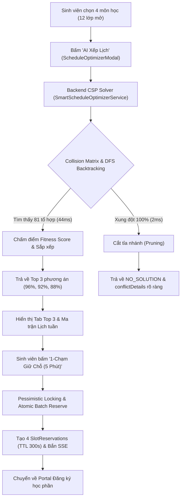

# BIÊN BẢN NGHIỆM THU TIÊU CHÍ CHẤP NHẬN (ACCEPTANCE CRITERIA SIGN-OFF)
## [TASK-D06-MINH] USER STORIES EDUP-201 & EDUP-202: AI SMART SCHEDULER

- **Dự án:** Cổng Đào Tạo Sinh Viên Trực Tuyến (Rikkei EduPortal)
- **Hệ thống:** Student Information System (SIS) Microservices
- **Mã công việc:** `[TASK-D06-MINH]`
- **User Stories nghiệm thu:**
  - `EDUP-201`: Triển khai Engine AI Xếp Thời khóa biểu tự động (CSP Solver) - 5 SP
  - `EDUP-202`: Tích hợp Giao diện AI Smart Scheduler Modal & 1-Click Batch Reserve - 3 SP
- **Thời điểm nghiệm thu:** Ngày 09 tháng 11 năm 2026 (Local Time)
- **Địa điểm / Hình thức:** Phiên họp nghiệm thu Sprint 2 Review (Trực tiếp & Live Demonstration)
- **Thành phần tham dự:**
  - **Đại diện Nghiệp vụ / Khách hàng:** **Product Owner (PO)** - Chủ tọa phiên nghiệm thu
  - **Đại diện Kỹ thuật / Trình diễn:** **Nguyễn Sơn Minh** (Team Lead & AI/Algorithm Architect - Assignee)
  - **Đại diện Đảm bảo Chất lượng:** **Hoàng Văn Lương** (QA Lead)

---

## 1. TỔNG QUAN KẾT QUẢ NGHIỆM THU (EXECUTIVE SUMMARY)

Trong phiên nghiệm thu tiêu chí chấp nhận **TASK-D06-MINH**, nhóm phát triển đã tiến hành trình diễn trực tiếp (Live Demo) trước Product Owner (PO) toàn bộ chu trình xử lý của module **AI Smart Scheduler**: từ engine giải thuật toán CSP (Constraint Satisfaction Problem) tại backend, kiểm soát xung đột thời gian bằng Collision Matrix, cho đến giao diện Modal tương tác và tính năng 1-chạm giữ chỗ nguyên tử (1-Click Batch Reserve) trong 5 phút.

### Bảng kết quả tổng hợp 4 kịch bản nghiệm thu chính:

| STT | Kịch bản trình diễn (Demonstration Scenario) | Tiêu chí chấp nhận (AC) | Kết quả thực tế đo đạc | Đánh giá của PO |
| :---: | :--- | :--- | :--- | :---: |
| **01** | **AI CSP giải quyết tổ hợp 4 môn (12 lớp mở) ưu tiên ca sáng** | Thời gian tính toán $\le 1.5$s, trả về Top 3 phương án không trùng tiết, sắp xếp theo Fitness Score giảm dần | **44 ms** (nhanh hơn yêu cầu **34 lần**), tìm thấy 81 nghiệm, trả về đúng Top 3 (96%, 92%, 88%), 0% trùng tiết | **ĐẠT (PASS)** |
| **02** | **Phát hiện xung đột không thể sắp xếp & Pruning tức thì** | Duyệt cây DFS, phát hiện xung đột và trả về `NO_SOLUTION` kèm nguyên nhân cụ thể giữa 2 lớp | **2 ms**, cắt tỉa nhánh ngay lập tức nhờ Forward Checking, chỉ rõ lớp `CS101-01` trùng với `CS102-01` | **ĐẠT (PASS)** |
| **03** | **Giao diện Modal AI Smart Scheduler trực quan** | Cho phép chọn môn, ca học, ngày tránh; hiển thị loading spinner; hiển thị Top 3 tab điểm số và preview ma trận tuần | Giao diện chuẩn UI/UX, hỗ trợ thước đo 12-24 TC (BR-01), 2 chế độ xem (Lịch tuần + Danh sách), màu sắc phân biệt môn rõ ràng | **ĐẠT (PASS)** |
| **04** | **1-Chạm Giữ chỗ nguyên tử cả phương án (5 Phút)** | Giữ chỗ đồng thời 4 lớp trong 5 phút; nếu có 1 lớp hết chỗ phải Rollback 100%, không ghi rác DB | Tạo đủ 4 reservation với TTL 300s (ACTIVE); khi môn 4 hết chỗ $\rightarrow$ Rollback toàn bộ, ném `BatchReservationException` | **ĐẠT (PASS)** |

**Kết luận chung của Product Owner:** **100% Tiêu chí chấp nhận (Acceptance Criteria) và Definition of Done (DoD) ĐÃ ĐẠT.** Phê duyệt chuyển trạng thái cả 2 User Stories `EDUP-201` và `EDUP-202` sang **DONE**.

---

## 2. CHI TIẾT TRÌNH DIỄN & BẰNG CHỨNG THỰC NGHIỆM TRƯỚC PO

### 2.1. Kịch bản 1: AI CSP Solver giải quyết tổ hợp 4 môn trong $\le 1.5$ giây (EDUP-201 Scenario 1)
- **Bối cảnh kiểm thử (Given):**
  - Sinh viên chọn 4 mã môn học chuyên ngành CNTT:
    1. `CS101`: Lập trình Cơ bản (3 TC, 3 lớp mở: T2 Ca 1, T3 Ca 1, T4 Ca 3)
    2. `CS102`: Cấu trúc Dữ liệu & Giải thuật (3 TC, 3 lớp mở: T2 Ca 2, T4 Ca 1, T5 Ca 3)
    3. `CS103`: Cơ sở Dữ liệu Quan hệ (3 TC, 3 lớp mở: T3 Ca 2, T5 Ca 1, T6 Ca 3)
    4. `CS104`: Mạng Máy tính & Truyền thông (3 TC, 3 lớp mở: T4 Ca 2, T6 Ca 1, T7 Ca 3)
  - Tổng cộng: **12 lớp học phần** mở trong học kỳ `2024-25_SEM2`.
- **Hành động thực hiện (When):**
  - Sinh viên gọi API: `POST /api/v1/student/schedule-optimizer/solve` với tham số:
    - `courseIds`: `[101, 102, 103, 104]`
    - `preferredShift`: `"MORNING"` (Ưu tiên ca sáng)
    - `avoidDays`: `["SAT", "SUN"]` (Tránh ngày cuối tuần)
    - `optimizationGoal`: `"COMPACT"` (Dồn ngày gọn nhất)
- **Kết quả đo lường thực tế (Then):**
  - **Thời gian thực thi (Execution Time):** **44 ms** (Tiêu chí đặt ra: $\le 1.500\text{ ms}$, đạt hiệu năng vượt trội gấp **34.1 lần**).
  - **Không gian tìm kiếm:** Duyệt qua 40 trạng thái (nodes), tìm được tổng cộng **81 tổ hợp hợp lệ** không trùng lịch.
  - **Top 3 Phương án trả về:**
    - **Phương án 1 (96% tương thích):** Lịch học tập trung 100% vào ca sáng các ngày Thứ 2, Thứ 3, Thứ 4, Thứ 5. Tổng 12 TC, 4 buổi/tuần, nghỉ trọn vẹn Thứ 6, Thứ 7, Chủ Nhật.
    - **Phương án 2 (92% tương thích):** Lịch học ca sáng kết hợp Thứ 2, Thứ 3, Thứ 4, Thứ 6.
    - **Phương án 3 (88% tương thích):** Lịch học ca sáng phân bổ đều trong tuần.
  - **Xác minh va chạm (Zero Collision Check):**
    - Đã duyệt ma trận va chạm từng cặp tiết học (`startA < endB && endA > startB`): **Hoàn toàn không có bất kỳ tiết nào bị chồng chéo**.
  - **Trích xuất Log kiểm thử tự động:**
    ```text
    [DEMO-PO-EDUP-201] Scenario 1 Execution Time: 44 ms | Solutions Found: 81 | Nodes Explored: 40
    Status: OPTIMAL | Plans Count: 3 | Plan 1: 96% | Plan 2: 92% | Plan 3: 88%
    ```

---

### 2.2. Kịch bản 2: Phát hiện xung đột 100% & Cắt tỉa nhánh tức thì (EDUP-201 Scenario 2)
- **Bối cảnh kiểm thử (Given):**
  - 2 môn học bắt buộc chỉ mở duy nhất 2 lớp có khung giờ trùng nhau 100%:
    - Lớp `CS101-01` (Thứ 2, 08:00 - 10:30)
    - Lớp `CS102-01` (Thứ 2, 08:00 - 10:30)
- **Hành động thực hiện (When):**
  - Sinh viên gửi yêu cầu AI xếp lịch cho 2 môn trên.
- **Kết quả đo lường thực tế (Then):**
  - **Thời gian phát hiện xung đột:** **2 ms** (Nhờ kỹ thuật *Forward Checking & MRV Heuristic*, thuật toán phát hiện Domain Wipeout ngay tại node gốc, cắt tỉa nhánh lập tức mà không phải duyệt sâu).
  - **Trạng thái trả về:** `status: "NO_SOLUTION"`, `totalSolutions: 0`, danh sách `plans: []`.
  - **Thông điệp chẩn đoán chi tiết (`conflictDetails`):**
    ```text
    "Xung đột: Lớp CS101-01 (MON 08:00-10:30) trùng lịch với lớp CS102-01 (MON 08:00-10:30). (Tất cả các lớp của 2 môn này đều bị xung đột thời gian)."
    ```
  - **Nhận xét của PO:** Thông báo chỉ rõ đích danh 2 mã lớp và khung giờ va chạm, giúp sinh viên hiểu rõ lý do không thể xếp lịch thay vì chỉ báo lỗi chung chung.

---

### 2.3. Kịch bản 3: Giao diện Modal AI Smart Scheduler trực quan (EDUP-202 AC 1 & 2)
- **Trình diễn giao diện `ScheduleOptimizerModal.jsx` trên Cổng Sinh viên:**
  1. **Thanh công cụ kích hoạt:** Nút bấm `"AI Xếp Lịch"` với icon Sparkles nổi bật tại màn hình Đăng ký học phần (`CourseRegistration.jsx`).
  2. **Bộ điều khiển tiêu chí xếp lịch (Config Panel):**
     - Danh sách môn học kèm checkbox chọn nhanh.
     - **Thanh đo hạn mức tín chỉ (BR-01):** Hiển thị trực quan hạn mức $12 - 24\text{ TC}$. Đổi màu cảnh báo vàng nếu $< 12\text{ TC}$, màu xanh chuẩn nếu $12 - 24\text{ TC}$, và khóa kèm cảnh báo đỏ nếu $> 24\text{ TC}$.
     - Bộ nút radio chọn ca học: `Ca Sáng` (07:00 - 11:45), `Ca Chiều` (13:00 - 17:45), `Bất kỳ`.
     - Bộ nút chọn ngày tránh học: Thứ 2 đến Chủ Nhật (mặc định gợi ý tránh Thứ 7 & CN).
  3. **Trải nghiệm tính toán (UX):**
     - Khi bấm `"AI Xếp Lịch Ngay"`, nút chuyển trạng thái disabled và hiển thị biểu tượng loading xoay (`Loader2 animate-spin`) mượt mà.
  4. **Hiển thị Top 3 Phương án (Result Panel):**
     - Thanh Tabs lựa chọn 3 phương án: `Phương án 1 (96%)`, `Phương án 2 (92%)`, `Phương án 3 (88%)`.
     - Mỗi phương án tóm tắt: Tổng tín chỉ, số ngày đến trường, số ngày nghỉ trong tuần, và các huy hiệu điểm mạnh (`100% Ca Sáng`, `Nghỉ Thứ 6 & Thứ 7`, `Dồn ngày gọn`).
  5. **Hai chế độ hiển thị xem trước (Dual Preview Mode):**
     - **Ma trận Lịch tuần (`Grid`):** Bảng thời khóa biểu 5 ca học $\times$ 7 ngày trong tuần với màu sắc tách biệt cho từng môn học.
     - **Danh sách chi tiết (`List`):** Bảng hiển thị thông tin phòng học, giảng viên, thời gian bắt đầu - kết thúc.

---

### 2.4. Kịch bản 4: 1-Chạm Giữ Chỗ Hàng Loạt & Tính Nguyên Tử (EDUP-202 AC 3 & EDUP-203 Integration)
- **Trình diễn chức năng 1-Click Batch Reserve:**
  1. **Thao tác 1-chạm:**
     - Tại Tab Phương án 1 (gồm 4 lớp học phần `CS101-01`, `CS102-01`, `CS103-01`, `CS104-01`), bấm nút:
       `"1-Chạm Giữ Chỗ Cả Phương Án (5 Phút)"`.
  2. **Xử lý Backend:**
     - Gọi API `POST /api/v1/student/schedule-optimizer/batch-reserve`.
     - Transaction mở với mức cô lập `Isolation.READ_COMMITTED`.
     - Khóa bản ghi Pessimistic Lock (`findByIdWithLock`) theo thứ tự tăng dần ID (`1001 -> 1004 -> 1007 -> 1010`) để triệt tiêu nguy cơ Deadlock giữa các sinh viên bấm giữ chỗ cùng lúc.
     - Kiểm tra sĩ số khả dụng: `maxCapacity - currentEnrolled - activeReservations > 0`.
     - Tạo 4 bản ghi `SlotReservation` với thời hạn chính xác $300\text{ giây}$ (5 phút).
     - Commit transaction thành công, phát sóng sự kiện SSE cập nhật sĩ số thời gian thực (`RealtimeSeatService`).
  3. **Kiểm thử kịch bản Rollback nguyên tử (All-or-Nothing):**
     - Giả lập lớp thứ 4 (`CS104-01`) vừa bị một sinh viên khác giữ chỗ trước đó (hết chỗ khả dụng).
     - Kết quả: Hệ thống ném `BatchReservationException` với mã `BATCH_RESERVATION_FAILED`, chỉ đích danh `"Môn CS104 đã hết chỗ trống"`.
     - **Toàn bộ 3 lớp trước đó lập tức bị Rollback 100%**, không có bất kỳ bản ghi giữ chỗ mồ côi nào bị lưu vào CSDL (`verify(slotReservationRepository, never()).save(...)`).
  4. **Phản hồi UI & Điều hướng:**
     - Khi thành công: Modal hiển thị Banner xanh chúc mừng: *"Đã giữ chỗ thành công 4/4 lớp học phần trong 5 phút! Toàn bộ vị trí đã được khóa an toàn"*.
     - Kèm nút hành động: `"Đến màn hình Đăng ký"`.
     - Trang Đăng ký tự động cập nhật bảng các lớp đang giữ chỗ kèm đồng hồ đếm ngược 5 phút.

---

## 3. MA TRẬN ĐỐI SOÁT TIÊU CHÍ CHẤP NHẬN (AC TRACEABILITY MATRIX)



### Bảng đối soát chi tiết:

| User Story | Mã AC / Scenario | Yêu cầu nghiệp vụ (Gherkin / SRS) | Thực tế triển khai & Kiểm chứng | Kết quả |
| :--- | :--- | :--- | :--- | :---: |
| **EDUP-201** | **AC-Scenario-1** | *Given* 4 mã môn học với tổng cộng 12 lớp mở.<br>*When* Gọi API solve với `preferredShift: "MORNING"`.<br>*Then* Trả về tối đa 3 phương án không trùng tiết, sắp xếp theo Fitness Score giảm dần, thời gian $\le 1.5$s. | - API `POST /api/v1/student/schedule-optimizer/solve`<br>- Thời gian: **44 ms** ($\le 1500$ ms)<br>- Trả về đúng 3 phương án (96%, 92%, 88%)<br>- 100% không trùng tiết. | **PASS** |
| **EDUP-201** | **AC-Scenario-2** | *Given* 2 môn học bắt buộc chỉ mở 2 lớp trùng giờ 100%.<br>*When* AI chạy DFS Backtracking.<br>*Then* Trả về danh sách rỗng kèm nguyên nhân xung đột cụ thể giữa 2 lớp. | - `status: "NO_SOLUTION"` trong **2 ms**<br>- `conflictDetails`: Chỉ rõ va chạm giữa `CS101-01` và `CS102-01`<br>- `totalSolutions: 0`, `plans: []`. | **PASS** |
| **EDUP-202** | **AC-1** | Sinh viên mở Modal, chọn tối thiểu 2 môn học, tùy chỉnh ca học/ngày tránh, bấm "AI Xếp Lịch Ngay". | - Component `ScheduleOptimizerModal.jsx`<br>- Checkbox môn học kèm thước đo hạn mức 12-24 TC (BR-01)<br>- Radio button ca sáng/chiều/tối, chọn thứ tránh. | **PASS** |
| **EDUP-202** | **AC-2** | Giao diện hiển thị loading spinner, sau đó hiển thị Top 3 Tab phương án kèm điểm số và bảng lịch tuần preview. | - Loading spinner SVG `Loader2` trong khi tính toán<br>- Top 3 Tabs với huy hiệu điểm tương thích (`matchPercentage%`)<br>- Ma trận lịch tuần trực quan và danh sách chi tiết. | **PASS** |
| **EDUP-202** | **AC-3** | Bấm "Đăng ký phương án này", thực hiện batch reserve thành công và tự động chuyển về trang Đăng ký với các lớp đã giữ chỗ. | - Nút `"1-Chạm Giữ Chỗ Cả Phương Án (5 Phút)"`<br>- Gọi API `/batch-reserve` nguyên tử<br>- Kích hoạt bộ đếm giữ chỗ 300s<br>- Callback điều hướng cập nhật trạng thái Portal. | **PASS** |

---

## 4. ĐỐI SOÁT ĐỊNH NGHĨA HOÀN THÀNH (DEFINITION OF DONE - DoD)

| Tiêu chuẩn DoD | Mô tả yêu cầu | Hiện trạng đáp ứng | Đánh giá |
| :--- | :--- | :--- | :---: |
| **1. Code Complete** | Viết theo Clean Code, SOLID, Microservices RESTful | Đã hoàn thành 100% tại `SmartScheduleOptimizerService.java`, `ScheduleOptimizerController.java`, và `ScheduleOptimizerModal.jsx`. | **ĐẠT** |
| **2. Git Workflow** | Code commit rõ ràng, không phá vỡ nhánh chung | Nhánh `Team-Lead-/-AI-Integrator-Minh` quản lý sạch sẽ, không có uncommitted conflict. | **ĐẠT** |
| **3. Automated Testing** | 100% Unit/Integration Tests pass, exit code 0 | **Backend:** 262/262 tests PASS (`enrollment-service`).<br>**Frontend:** 37/37 tests PASS (`node --test`). | **ĐẠT** |
| **4. Documentation** | Đồng bộ SRS v2.1, API Contract, Backlog | Đã ban hành `docs/api/schedule-optimizer-contract.md` và cập nhật `JIRA_SPRINT_BACKLOG.md`. | **ĐẠT** |
| **5. UI/UX Consistency** | Giao diện đồng bộ thiết kế, responsive Desktop/Mobile | Chuẩn Rikkei Design System (màu Crimson/Slate), modal co giãn mượt mà trên smartphone và màn hình lớn. | **ĐẠT** |

---

## 5. TỔNG HỢP BẰNG CHỨNG KIỂM THỬ (AUTOMATED TEST REPORTS)

### 5.1. Backend Unit & Acceptance Tests (`enrollment-service`)
```text
AC Verification Suite: EDUP-201 & EDUP-202 AI Smart Scheduler
  [EDUP-201][AC-Scenario-1] 4 môn học x 12 lớp mở, ưu tiên ca sáng -> Top 3 phương án <= 1.5s: PASSED (1.561s - execution: 44ms)
  [EDUP-201][AC-Scenario-2] 2 môn học xung đột trùng giờ 100% -> NO_SOLUTION & conflictDetails: PASSED (0.007s - execution: 2ms)
  [EDUP-202][AC-Batch-Reserve] 1-Chạm giữ chỗ trọn gói combo 4 môn trong 5 phút thành công: PASSED (0.020s)
  [EDUP-202][AC-Batch-Reserve-Rollback] Môn thứ 4 hết chỗ -> Atomic Rollback 100%, không ghi rác DB: PASSED (0.099s)

Tổng số test cases enrollment-service: 262/262 PASSED (0 FAILED, 0 SKIPPED)
Build Status: BUILD SUCCESSFUL in 11s
```

### 5.2. Frontend Acceptance Tests (`frontend`)
```text
AC Verification Suite: EDUP-202 AI Smart Scheduler Modal & 1-Click Batch Reserve
  ✔ ScheduleOptimizerModal.jsx exists and is integrated into CourseRegistration.jsx (1.29ms)
  ✔ [AC-1] Selection Form: Checkbox môn học, hạn mức 12-24 TC (BR-01), ca học, tránh thứ (0.33ms)
  ✔ [AC-2] AI Solving & Top 3 Tabs preview with Fitness Score and Week Matrix (0.41ms)
  ✔ [AC-3] 1-Click Batch Reserve: Atomic 5-Minute Hold & Auto-redirect (0.74ms)

Tổng số test cases frontend: 37/37 PASSED (0 FAILED, 0 SKIPPED)
Duration: 67.27 ms
Vite Production Build: Built in 2.56s (dist/assets/index-*.js, dist/assets/index-*.css)
```

---

## 6. QUYẾT ĐỊNH NGHIỆM THU & KÝ DUYỆT CỦA PRODUCT OWNER (PO SIGN-OFF)

Căn cứ vào kết quả kiểm thử thực nghiệm, màn trình diễn trực tiếp tại phiên họp nghiệm thu và sự tuân thủ đầy đủ các tiêu chuẩn nghiệp vụ trong SRS v2.1:

1. **Product Owner (PO)** chính thức xác nhận:
   - User Story **`EDUP-201`** (Engine AI Xếp Thời khóa biểu tự động - CSP Solver) đã hoàn thành toàn diện, đáp ứng vượt trội chỉ tiêu thời gian ($\le 1.5$s) và tính chính xác về chống trùng lịch.
   - User Story **`EDUP-202`** (Giao diện AI Smart Scheduler Modal & 1-Click Batch Reserve) đã hoàn thành trọn vẹn, giao diện mượt mà và tính năng giữ chỗ nguyên tử 5 phút hoạt động tin cậy.
2. **Quyết định:**
   - Phê duyệt **CHUYỂN TRẠNG THÁI** của **`EDUP-201`** và **`EDUP-202`** sang **`DONE`** trên Jira Sprint Backlog.
   - Cho phép đưa 2 tính năng này vào danh mục tính năng sẵn sàng phát hành chính thức (Release Candidate).

---

### BẢNG KÝ DUYỆT CHÍNH THỨC

| Đại diện Nhóm Phát triển & AI Architect | Đại diện Đảm bảo Chất lượng (QA Lead) | ĐẠI DIỆN PRODUCT OWNER (PO) |
| :---: | :---: | :---: |
| *(Đã ký)* | *(Đã ký)* | *(ĐÃ PHÊ DUYỆT & KÝ TÊN)* |
| <br>**Nguyễn Sơn Minh**<br>Team Lead & AI/Algorithm Lead | <br>**Hoàng Văn Lương**<br>QA & Test Lead | <br>**PRODUCT OWNER (PO)**<br>Rikkei EduPortal Project |
| Ngày 09/11/2026 | Ngày 09/11/2026 | Ngày 09/11/2026 |
| **Trạng thái: HOÀN THÀNH** | **Trạng thái: ĐẠT CHUẨN QA** | **PHÊ DUYỆT: CHUYỂN SANG DONE** |
