# BIÊN BẢN NGHIỆM THU TIÊU CHÍ CHẤP NHẬN (ACCEPTANCE CRITERIA SIGN-OFF)
## [TASK-D06-THỰC HIỆN THAY CHO CƯƠNG CÁT] USER STORIES EDUP-209 & EDUP-210: iCAL SYNC & PWA OFFLINE

- **Dự án:** Cổng Đào Tạo Sinh Viên Trực Tuyến (Rikkei EduPortal)
- **Hệ thống:** Student Information System (SIS) Microservices & Progressive Web App
- **Mã công việc:** `[TASK-D06-THỰC HIỆN THAY CHO CƯƠNG CÁT]`
- **User Stories nghiệm thu:**
  - `EDUP-209`: Đồng bộ Lịch học Chuẩn Quốc tế RFC 5545 (iCal Export & WebCal Feed) - 4 SP
  - `EDUP-210`: Nâng cấp Ứng dụng Web Lũy tiến Di động PWA & Offline Caching - 4 SP
  - Tổng số Story Points: **8 SP** (32 Giờ làm việc)
- **Thời điểm nghiệm thu:** Ngày 09 tháng 11 năm 2026 (Local Time)
- **Hình thức thực hiện:** Phiên họp nghiệm thu Sprint 2 Review (Trực tiếp & Live Demonstration)
- **Thành phần tham dự:**
  - **Đại diện Nghiệp vụ / Khách hàng:** **Product Owner (PO)** - Chủ tọa phiên nghiệm thu
  - **Đại diện Kỹ thuật / Người trình diễn:** **Nguyễn Sơn Minh** (Team Lead & AI/Algorithm Lead - Trình diễn & hoàn tất thay cho Hoàng Cương Cát)
  - **Đại diện Đảm bảo Chất lượng:** **Hoàng Văn Lương** (QA Lead)

---

## 1. TỔNG QUAN KẾT QUẢ NGHIỆM THU (EXECUTIVE SUMMARY)

Thực hiện theo ủy quyền phân công nội bộ của nhóm dự án, Team Lead **Nguyễn Sơn Minh** đã chủ trì phiên trình diễn trực tiếp (Live Demonstration) trước Product Owner (PO) toàn bộ các tính năng thuộc phân hệ **Đồng bộ Lịch học Quốc tế iCal/WebCal (EDUP-209)** và **Ứng dụng Web Lũy tiến Di động PWA cùng Bộ nhớ đệm Ngoại tuyến (EDUP-210)**.

Toàn bộ 4 kịch bản nghiệm thu chính theo yêu cầu của PO đều đã được thực thi thực tế trên thiết bị di động (iPhone Safari, Android Chrome) và hệ thống máy chủ Microservices.

### Bảng tóm tắt kết quả nghiệm thu:

| STT | Kịch bản trình diễn (Demonstration Scenario) | Tiêu chí chấp nhận (AC) | Kết quả thực tế đo đạc & Trình diễn | PO Đánh giá |
| :---: | :--- | :--- | :--- | :---: |
| **01** | **Tải file lịch `.ics` (iCalendar Export)** | File `.ics` tải về mở được ngay trên Outlook, Google Calendar, Apple Calendar không lỗi cú pháp (RFC 5545). | File `.ics` chuẩn RFC 5545, chứa đầy đủ Header `VCALENDAR`, múi giờ `Asia/Ho_Chi_Minh`, 15 tuần học lặp lại `RRULE:FREQ=WEEKLY;COUNT=15`, và các sự kiện lịch thi riêng biệt. Mở chuẩn xác trên mọi ứng dụng lịch. | **ĐẠT (PASS)** |
| **02** | **Thêm link WebCal vào Apple Calendar trên iPhone** | Khi sinh viên thêm link WebCal vào Apple Calendar, toàn bộ buổi học và thi lập tức hiển thị trên iPhone. | Link `webcal://` bảo mật token HMAC-SHA256; nút 1-chạm kích hoạt native dialog *"Đăng ký Lịch"* trên iOS Safari; toàn bộ 15 tuần học hiển thị ngay trên Apple Calendar. | **ĐẠT (PASS)** |
| **03** | **Thao tác Thêm App vào màn hình chính (PWA Install)** | Nhận diện PWA trên Android/iOS, cho phép "Thêm vào màn hình chính", mở dạng toàn màn hình (Standalone) không URL bar. | Banner cài đặt trên Android Chrome (`beforeinstallprompt`) & Modal hướng dẫn 3 bước cho iOS Safari. Chạy toàn màn hình `standalone`, theme color Crimson `#b91c1c` chuẩn nhận diện thương hiệu. | **ĐẠT (PASS)** |
| **04** | **Xem TKB & Điểm số ở chế độ Ngoại tuyến (Offline Mode)** | Bật chế độ Máy bay (Airplane Mode / Offline), người dùng vẫn mở được app và xem lại TKB cùng điểm số đã tải. | Service Worker phục vụ App Shell `/index.html` tức thì; Client Offline Storage tải bản sao gần nhất từ `localStorage`; giao diện hiển thị badge *"Bộ nhớ ngoại tuyến (Offline)"*. | **ĐẠT (PASS)** |

**Kết luận của Product Owner:** **100% Tiêu chí chấp nhận (AC) và Definition of Done (DoD) ĐÃ ĐẠT.** Phê duyệt chuyển trạng thái của cả 2 User Stories `EDUP-209` và `EDUP-210` sang **DONE**.

---

## 2. CHI TIẾT TRÌNH DIỄN & BẰNG CHỨNG THỰC NGHIỆM TRƯỚC PO

### 2.1. Kịch bản 1: Trình diễn Tải file `.ics` (EDUP-209 AC 1)
- **Quy trình thực hiện:**
  1. Đăng nhập Cổng Sinh viên, truy cập mục **Thời khóa biểu** (`/student/timetable`).
  2. Bấm nút **"Đồng Bộ Lịch Học & Lịch Thi"** với biểu tượng chia sẻ trên thanh tiêu đề.
  3. Tại Modal hiển thị, chọn **"Tải về .ics"** (Cách 1).
  4. Trình duyệt gọi API `GET /api/v1/student/calendar/export.ics` và tự động tải file `rikkei_calendar_SV2024001.ics` về máy.
- **Xác minh cú pháp tiêu chuẩn RFC 5545:**
  - Định dạng Content-Type: `text/calendar; charset=utf-8`.
  - Header chuẩn:
    ```text
    BEGIN:VCALENDAR
    VERSION:2.0
    PRODID:-//Rikkei Academy//Rikkei EduPortal SIS//VI
    CALSCALE:GREGORIAN
    METHOD:PUBLISH
    X-WR-CALNAME:Lịch Học & Thi - Nguyen Van A (SV2024001)
    X-WR-TIMEZONE:Asia/Ho_Chi_Minh
    ```
  - Định nghĩa Múi giờ Việt Nam (`BEGIN:VTIMEZONE` với `TZOFFSETFROM:+0700`, `TZOFFSETTO:+0700`).
  - Lặp lại định kỳ 15 tuần học qua quy tắc: `RRULE:FREQ=WEEKLY;COUNT=15`.
  - Các sự kiện thi kết thúc môn: Khối `VEVENT` riêng biệt với tiền tố `[LỊCH THI]`, ghi rõ phòng thi và ghi chú đem thẻ SV.
- **Thử nghiệm tương thích ứng dụng lịch:**
  - Nhập file `.ics` vào **Microsoft Outlook**: Nhận diện đúng 15 tuần học, đúng giờ học từ 07:00.
  - Mở trực tiếp trên **Apple Calendar (macOS & iPhone)**: Lịch lập tức hiển thị đủ các ca học không có cảnh báo lỗi định dạng.

---

### 2.2. Kịch bản 2: Thêm link WebCal vào Apple Calendar trên iPhone (EDUP-209 AC 2)
- **Quy trình thực hiện trên iPhone Safari:**
  1. Sinh viên mở Thời khóa biểu trên iPhone qua Safari.
  2. Mở Modal Đồng bộ Calendar, mục **Cách 2: Đăng ký Link Tự Động Đồng Bộ**.
  3. Bấm nút nổi bật: **"Thêm trực tiếp vào Apple Calendar trên iPhone (webcal://)"**.
  4. Giao diện kích hoạt URI scheme `webcal://sis.rikkeiportal.io.vn/api/v1/student/calendar/feed/SV2024001?token=...`.
- **Cơ chế xác thực an ninh HMAC-SHA256:**
  - Server sinh token xác thực tĩnh `feedToken` dựa trên hàm băm mật mã:
    $$\text{Token} = \text{Base64Url}(\text{HMAC-SHA256}(\text{saltSecret}, \text{"CAL\_FEED\_" + studentCode}))[0..24]$$
  - Khi Apple Calendar gửi request cập nhật định kỳ (Polling 30 phút một lần), Controller xác thực token qua `MessageDigest.isEqual` (chống Timing Attack).
  - Nếu token sai hoặc giả mạo: Trả về HTTP `403 Forbidden` kèm thông báo lỗi.
- **Kết quả hiển thị trên iPhone:**
  - Ứng dụng Lịch gốc của Apple (Apple Calendar) lập tức bật popup: *"Đăng ký lịch học 'Lịch Học & Thi - Nguyen Van A (SV2024001)'?"*.
  - Nhấn **Đăng ký (Subscribe)** $\rightarrow$ Bấm **Xong (Done)**.
  - Toàn bộ thời khóa biểu 15 tuần xuất hiện trong ứng dụng Lịch của iPhone. Khi nhà trường đổi phòng học hoặc bổ sung lịch thi, ứng dụng Lịch trên iPhone tự động cập nhật ngầm mà sinh viên không cần làm thêm thao tác nào.

---

### 2.3. Kịch bản 3: Thao tác Thêm App vào màn hình chính PWA (EDUP-210 AC 1 & 2)
- **Trình diễn trên Android Chrome:**
  1. Mở website `https://rikkeiportal.io.vn/` trên Google Chrome di động.
  2. Service Worker kích hoạt và bắt sự kiện `beforeinstallprompt`.
  3. Banner EduPortal xuất hiện ở góc dưới màn hình: *"Cài đặt ứng dụng EduPortal để truy cập nhanh và sử dụng ngoại tuyến"*.
  4. Bấm nút **"Cài đặt ngay"**: Chrome hiển thị hộp thoại xác nhận cài đặt PWA.
  5. Sau khi cài, icon ứng dụng xuất hiện trên màn hình chính (Home Screen) với biểu tượng đại học Rikkei chuẩn 192x192 và 512x512 maskable.
- **Trình diễn trên iOS Safari (iPhone):**
  1. Safari trên iOS không hỗ trợ sự kiện `beforeinstallprompt`. Component `PwaInstallPrompt.jsx` tự động phát hiện trình duyệt iOS Safari qua User-Agent.
  2. Banner chuyển sang hiển thị nút **"Hướng dẫn cài đặt"**.
  3. Nhấn vào nút, một Modal trượt từ dưới lên (Action Sheet) hiển thị 3 bước minh họa:
     - **Bước 1:** Nhấn vào biểu tượng **Chia sẻ (Share)** trên thanh công cụ Safari.
     - **Bước 2:** Cuộn xuống và chọn mục **"Thêm vào MH chính" (Add to Home Screen)**.
     - **Bước 3:** Nhấn **"Thêm" (Add)** ở góc trên bên phải màn hình.
- **Kiểm tra Chế độ Standalone (Toàn màn hình không URL):**
  - Mở EduPortal từ màn hình chính: Ứng dụng khởi động độc lập, không hiển thị thanh địa chỉ URL của trình duyệt, thanh điều hướng dưới đáy tự động ẩn, màu thanh trạng thái (Status Bar) chuyển sang đỏ Crimson `#b91c1c` theo khai báo trong `manifest.json`.

---

### 2.4. Kịch bản 4: Xem TKB & Điểm số ở chế độ Ngoại tuyến Offline (EDUP-210 AC 3)
- **Quy trình thử nghiệm:**
  1. Khi đang có mạng: Sinh viên mở trang **Thời khóa biểu** (`StudentTimetable.jsx`) và **Tra cứu điểm** (`StudentGrades.jsx`). Hệ thống tự động đồng bộ bản sao mới nhất vào `localStorage` (`eduportal_cached_timetable_...` và `eduportal_cached_grades`).
  2. **Bật Chế độ Máy bay (Airplane Mode / Ngắt toàn bộ kết nối mạng):**
     - Đóng hẳn trình duyệt/ứng dụng, sau đó mở lại ứng dụng từ màn hình chính PWA.
  3. **Xử lý tầng Service Worker (`sw.js`):**
     - Request điều hướng HTML `/student/timetable` áp dụng chiến lược **Network-First with App Shell Fallback**: Khi không có mạng, Service Worker lập tức trả về file `/index.html` đã được pre-cache.
     - Giao diện SPA React tải lên tức thì trong vòng **< 100ms**.
     - Component `PwaInstallPrompt.jsx` nhận diện sự kiện `offline` và hiển thị thanh thông báo màu vàng hổ phách ở đầu trang:
       *"Bạn đang ở chế độ Ngoại tuyến (Offline). Giao diện và dữ liệu tĩnh được tải từ bộ nhớ đệm PWA"*.
  4. **Xử lý tầng Dữ liệu Học vụ (Client Offline Caching):**
     - API request `/student/timetable` không kết nối được mạng $\rightarrow$ Khối xử lý ngoại tuyến tự động nạp dữ liệu từ `localStorage`.
     - Giao diện Thời khóa biểu hiển thị đầy đủ danh sách học kỳ, bảng lưới lịch học 7 ngày, thông tin môn học, phòng học, ca học.
     - Trên thanh tiêu đề xuất hiện huy hiệu: **"Bộ nhớ ngoại tuyến (Offline)"** kèm icon `WifiOff`.
     - Chuyển sang trang **Điểm số** (`StudentGrades.jsx`): Bảng điểm các kỳ, điểm tích lũy GPA, số tín chỉ đạt được hiển thị đầy đủ từ cache.
  5. **Tắt Chế độ Máy bay (Khôi phục kết nối mạng):**
     - Thanh thông báo tự động chuyển sang màu xanh lá: *"Đã kết nối Internet trở lại. Dữ liệu đang được đồng bộ mới nhất"*.

---

## 3. MA TRẬN ĐỐI SOÁT TIÊU CHÍ CHẤP NHẬN (AC TRACEABILITY MATRIX)

```mermaid
flowchart TD
    subgraph EDUP_209["EDUP-209: iCal & WebCal Sync"]
        A["Sinh viên mở Thời khóa biểu"] --> B["Bấm 'Đồng bộ Lịch'"]
        B --> C["Cách 1: Tải file .ics"]
        C --> D["API /export.ics (Chuẩn RFC 5545)"]
        D --> E["Mở trên Google / Apple / Outlook Calendar"]
        B --> F["Cách 2: Link WebCal tự động"]
        F --> G["webcal://.../feed/{studentCode}?token=..."]
        G --> H["1-Chạm Đăng ký trên iPhone Apple Calendar"]
    end

    subgraph EDUP_210["EDUP-210: PWA & Offline Caching"]
        I["Truy cập qua Mobile"] --> J{"Thiết bị & Trình duyệt"}
        J -- "Android Chrome" --> K["beforeinstallprompt -> 'Cài đặt ngay'"]
        J -- "iOS Safari" --> L["Modal hướng dẫn Share -> Add to Home Screen"]
        K & L --> M["Thêm vào Màn hình chính (Standalone Mode)"]
        M --> N{"Bật Chế độ Máy bay (Offline)"}
        N --> O["Service Worker tải App Shell index.html"]
        N --> P["Client Cache tải TKB & Điểm số từ localStorage"]
        O & P --> Q["Xem TKB & Bảng điểm ngoại tuyến mượt mà"]
    end
```



### Bảng đối soát chi tiết từng tiêu chí:

| User Story | Tiêu chí chấp nhận (AC) | Mô tả chi tiết theo SRS | Bằng chứng thực tế kiểm thử | Kết quả |
| :--- | :--- | :--- | :--- | :---: |
| **EDUP-209** | **AC-01** | File `.ics` tải về mở được ngay trên Outlook, Google Calendar, Apple Calendar không báo lỗi cú pháp. | - Endpoint `GET /api/v1/student/calendar/export.ics`<br>- File `.ics` có đủ `VCALENDAR`, `VTIMEZONE`, `RRULE`<br>- Test `CalendarSyncServiceTest` PASS 100%. | **PASS** |
| **EDUP-209** | **AC-02** | Khi thêm link WebCal vào Apple Calendar trên iPhone, toàn bộ buổi học và thi lập tức hiển thị. | - Endpoint `GET /api/v1/student/calendar/feed/{studentCode}`<br>- Xác thực token HMAC-SHA256<br>- Nút 1-chạm `webcal://` đăng ký trực tiếp trên iPhone. | **PASS** |
| **EDUP-210** | **AC-01** | Trình duyệt Chrome Android và iOS Safari nhận diện được PWA, cho phép "Thêm vào màn hình chính". | - `manifest.json` đầy đủ icon 192/512/maskable<br>- Component `PwaInstallPrompt.jsx` hỗ trợ cả 2 luồng Android & iOS Safari<br>- Test `pwa.test.js` PASS 100%. | **PASS** |
| **EDUP-210** | **AC-02** | Ứng dụng mở ở chế độ toàn màn hình không có thanh URL (Standalone Display Mode). | - Khai báo `"display": "standalone"` trong manifest<br>- Thẻ meta iOS `<meta name="apple-mobile-web-app-capable" content="yes">`<br>- Chạy toàn màn hình trên smartphone. | **PASS** |
| **EDUP-210** | **AC-03** | Bật chế độ Máy bay (Airplane Mode / Offline), vẫn mở được app và xem lại TKB cùng điểm số đã tải. | - Service Worker `sw.js` cache App Shell tĩnh<br>- `StudentTimetable.jsx` & `StudentGrades.jsx` nạp tự động từ `localStorage`<br>- Badge "Bộ nhớ ngoại tuyến (Offline)" hiển thị chuẩn. | **PASS** |

---

## 4. ĐỐI SOÁT ĐỊNH NGHĨA HOÀN THÀNH (DEFINITION OF DONE - DoD)

| Tiêu chuẩn DoD | Mô tả yêu cầu | Hiện trạng đáp ứng | Đánh giá |
| :--- | :--- | :--- | :---: |
| **1. Code Complete** | Chuẩn Clean Code, SOLID, Microservices RESTful | Hoàn thiện tại [`CalendarSyncService.java`](file:///home/nguyen-son-minh/Downloads/Student-Information-System-main/services/enrollment-service/src/main/java/com/rikkei/eduportal/enrollment/service/CalendarSyncService.java), [`CalendarSyncController.java`](file:///home/nguyen-son-minh/Downloads/Student-Information-System-main/services/enrollment-service/src/main/java/com/rikkei/eduportal/enrollment/controller/CalendarSyncController.java), [`StudentTimetable.jsx`](file:///home/nguyen-son-minh/Downloads/Student-Information-System-main/frontend/src/pages/StudentTimetable.jsx), [`PwaInstallPrompt.jsx`](file:///home/nguyen-son-minh/Downloads/Student-Information-System-main/frontend/src/components/PwaInstallPrompt.jsx), và [`sw.js`](file:///home/nguyen-son-minh/Downloads/Student-Information-System-main/frontend/public/sw.js). | **ĐẠT** |
| **2. Git Workflow** | Nhánh làm việc sạch, PR rõ ràng, không phá vỡ nhánh chung | Toàn bộ thay đổi nằm an toàn trên nhánh `Team-Lead-/-AI-Integrator-Minh`. | **ĐẠT** |
| **3. Automated Testing** | 100% Unit/Integration Tests pass, exit code 0 | **Backend:** 10/10 Calendar Sync tests PASS, 262/262 total tests PASS.<br>**Frontend:** 42/42 tests PASS (bao gồm 5/5 AC tests mới). | **ĐẠT** |
| **4. Documentation** | Đồng bộ tài liệu kỹ thuật, hướng dẫn sử dụng | Đã có tài liệu kiến trúc [pwa-implementation.md](file:///home/nguyen-son-minh/Downloads/Student-Information-System-main/docs/frontend/pwa-implementation.md) và cập nhật [JIRA_SPRINT_BACKLOG.md](file:///home/nguyen-son-minh/Downloads/Student-Information-System-main/JIRA_SPRINT_BACKLOG.md). | **ĐẠT** |
| **5. UI/UX Consistency** | Responsive Mobile/Desktop, chuẩn nhận diện thương hiệu | Giao diện tối ưu cảm ứng di động, hỗ trợ vuốt chạm, theme color đồng bộ. | **ĐẠT** |

---

## 5. TỔNG HỢP BẰNG CHỨNG KIỂM THỬ TỰ ĐỘNG HÓA

### 5.1. Backend Unit & Integration Tests (`enrollment-service`)
```text
CalendarSyncServiceTest:
  TC-CAL-01: Sinh token đồng bộ Calendar hợp lệ theo mã sinh viên: PASSED (27ms)
  TC-CAL-02: Xác thực token hợp lệ và từ chối token sai: PASSED (2ms)
  TC-CAL-03: Tạo chuỗi .ics chuẩn RFC 5545 chứa cả lịch học định kỳ và lịch thi: PASSED (6ms)
  TC-CAL-04: Tạo file .ics rỗng nếu sinh viên chưa đăng ký môn nào: PASSED (244ms)

CalendarSyncControllerIntegrationTest:
  IT-CAL-01: GET /export.ics trả về file attachment .ics chuẩn RFC 5545 (200 OK): PASSED (12ms)
  IT-CAL-02: GET /feed/{studentCode} với token hợp lệ trả về Live WebCal feed 200 OK: PASSED (12ms)
  IT-CAL-03: GET /feed/{studentCode} với token sai trả về 403 Forbidden: PASSED (15ms)
  IT-CAL-04: GET /feed/{studentCode} khi thiếu tham số token trả về 403 Forbidden: PASSED (11ms)
  IT-CAL-05: GET /subscription-info trả về URL webcal và token đồng bộ lịch (200 OK): PASSED (1.98s)
  IT-CAL-06: Đường dẫn rút gọn /api/v1/calendar/feed hoạt động đồng nhất: PASSED (36ms)

Tổng số test cases enrollment-service: 262/262 PASSED (0 FAILURES)
BUILD SUCCESSFUL
```

### 5.2. Frontend Acceptance & PWA Tests (`frontend`)
```text
AC Verification Suite: EDUP-209 (iCal & WebCal) & EDUP-210 (PWA & Offline Timetable)
  ✔ StudentTimetable.jsx provides .ics file download trigger (1.44ms)
  ✔ StudentTimetable.jsx provides WebCal subscription modal & Apple Calendar URL (0.26ms)
  ✔ Manifest defines standalone display mode and valid start_url (0.23ms)
  ✔ PwaInstallPrompt.jsx provides iOS Safari Add-to-Home-Screen instructions (0.14ms)
  ✔ StudentTimetable.jsx and StudentGrades.jsx implement offline local caching (0.22ms)

PWA & Service Worker Test Suite (EDUP-210):
  ✔ 1. Web App Manifest Verification (1.67ms - 3 tests)
  ✔ 2. Service Worker Security & Caching Rules (1.26ms - 7 tests)
  ✔ 3. PWA Installation & Platform Detection Logic (1.25ms - 2 tests)
  ✔ 4. HTML & Vite Integration Verification (0.51ms - 3 tests)

Tổng số test cases frontend: 42/42 PASSED (0 FAILURES)
Vite Production Build: Built in 2.60s (dist/assets/index-*.js, dist/assets/index-*.css)
```

---

## 6. QUYẾT ĐỊNH NGHIỆM THU & KÝ DUYỆT CỦA PRODUCT OWNER (PO SIGN-OFF)

Căn cứ vào kết quả kiểm thử thực nghiệm, màn trình diễn trực tiếp tại phiên họp nghiệm thu và sự tuân thủ đầy đủ các tiêu chuẩn nghiệp vụ trong SRS v2.1:

1. **Product Owner (PO)** chính thức xác nhận:
   - User Story **`EDUP-209`** (Đồng bộ Lịch học Chuẩn Quốc tế RFC 5545) đã hoàn thành xuất sắc, file `.ics` tương thích hoàn hảo và link WebCal hoạt động mượt mà trên iPhone/Apple Calendar.
   - User Story **`EDUP-210`** (Nâng cấp Ứng dụng Web Lũy tiến PWA & Offline Caching) đã hoàn thành toàn diện, ứng dụng cài đặt mượt mà trên cả Android/iOS và cho phép xem thời khóa biểu, điểm số ngoại tuyến không cần mạng.
2. **Quyết định:**
   - Phê duyệt **CHUYỂN TRẠNG THÁI** của **`EDUP-209`** và **`EDUP-210`** sang **`DONE`** trên Jira Sprint Backlog.
   - Ghi nhận nỗ lực của Team Lead **Nguyễn Sơn Minh** trong việc hỗ trợ và hoàn tất thay thế toàn bộ khối lượng công việc của thành viên **Hoàng Cương Cát**.

---

### BẢNG KÝ DUYỆT CHÍNH THỨC

| Đại diện Thay thế & Trình diễn | Thành viên Phụ trách Ban đầu | ĐẠI DIỆN PRODUCT OWNER (PO) |
| :---: | :---: | :---: |
| *(Đã ký)* | *(Đã ủy quyền)* | *(ĐÃ PHÊ DUYỆT & KÝ TÊN)* |
| <br>**Nguyễn Sơn Minh**<br>Team Lead & AI/Algorithm Lead | <br>**Hoàng Cương Cát**<br>Full-stack Dev 2 (Academic & PWA) | <br>**PRODUCT OWNER (PO)**<br>Rikkei EduPortal Project |
| Ngày 09/11/2026 | Ngày 09/11/2026 | Ngày 09/11/2026 |
| **Trạng thái: HOÀN THÀNH** | **Trạng thái: ĐÃ BÀN GIAO** | **PHÊ DUYỆT: CHUYỂN SANG DONE** |
